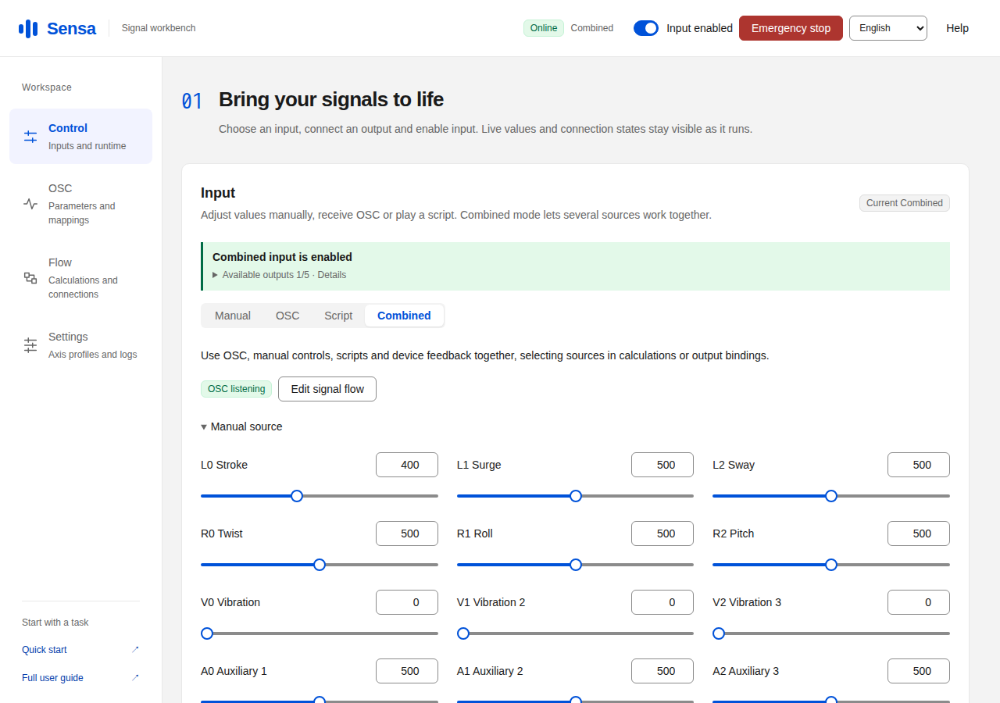

# Sensa

[简体中文](README.zh-CN.md) · [Documentation](https://sealoong.github.io/Sensa/) · [Downloads](https://github.com/SeaLoong/Sensa/releases/latest) · [Parameter explorer](https://sealoong.github.io/Sensa/parameter-geometry.html)

**Connect live data, scripts and manual controls to devices and applications.**

Sensa runs on your computer and uses a browser for configuration. Read OSC parameters from VRChat or other applications, blend signals, add smoothing or triggers, then control devices, write application parameters or record a reusable funscript.

[Narrow layout](docs/screenshots/mobile/combined-input-en-US.png) · [More running examples](docs/screenshots.en.md)

## Inputs → computation → outputs

| Step | Your choice | Examples |
| --- | --- | --- |
| **Input** | Where values come from | OSC, tracking, manual sliders, scripts, external protocol controls, device feedback and recording replay |
| **Computation** | How values are processed | Weighted averages, distances, plane depth, direction angles, smoothing and triggers |
| **Output** | Where results go | Motion devices, OSC parameters, DG-LAB, other applications or recording files |

A simple flow connects an input directly to an output. Add a calculation when you need to combine or process values. One result can feed several outputs, each with its own range and sending mode. [Set up a flow](docs/signal-pipeline.en.md)

## What would you like to do?

| Goal | Start here |
| --- | --- |
| Adjust a value and check a device or application's response | [First run](docs/quick-start.en.md) |
| Route a website/player's device controls to OSR or another output | [Protocol inputs, virtual devices and Bluetooth/serial bridges](docs/protocol-inputs.en.md) |
| Combine touch readings, smooth a signal or add a trigger | [Computed signals and examples](docs/computed-signals.en.md) |
| Control a device while writing an Avatar effect parameter | [One result, several outputs](docs/signal-pipeline.en.md#one-result-several-outputs) |
| Record an interaction for playback or editing | [Recording and replay](docs/signal-pipeline.en.md#record-and-inspect) |
| Use VRChat OGB/SPS parameters or root tracking | [Choose a setup](docs/usage-scenarios.en.md) |

## Download and start

1. Open [Downloads](https://github.com/SeaLoong/Sensa/releases/latest) for the latest stable release. Development previews and older builds are listed separately in [release history](https://github.com/SeaLoong/Sensa/releases). On **Windows**, choose the x64 or ARM64 installer from the release assets, install it and open Sensa from the Start menu. On **Linux/macOS**, fully extract the matching `.tar.gz` archive and run `./Sensa`.
2. Open **http://127.0.0.1:5086** in your browser. All builds include the required .NET runtime. Windows also offers a directly runnable `SingleFile.exe` and a portable `.zip`; see [download formats](docs/quick-start.en.md#1-start).
3. Follow [First run](docs/quick-start.en.md) to add an output, save the setup and enable input. Recording a manual slider as funscript is a useful first flow.

For a motion device, start with small manual targets to check direction, travel and stopping. The header provides input activation and emergency stop. After saving configuration or changing input, enable input again when ready.

## Where can results go?

| Output | Use |
| --- | --- |
| **TCode / Intiface** | Supported position, rotation, vibration and auxiliary features; TCode uses serial, UDP or TCP, while Intiface connects to Central |
| **Handy / Lovense / Autoblow / VacuGlide** | Explicit device API integrations for supported position, intensity/speed or synchronized script capabilities; [setup and limits](docs/protocol-inputs.en.md#vendor-compatible-input-and-physical-device-output) |
| **OSC parameter** | Send to an OSC application or a configured writable VRChat Avatar parameter |
| **DG-LAB** | Pair through the DG-LAB 4 APP and control intensity/waveforms within channel limits |
| **MIDI CC** | Send controller values to a system MIDI output port |
| **HTTP JSON / WebSocket JSON / MQTT** | Connect a dashboard, automation service or custom application |
| **Recording** | Save funscript tracks or JSON Lines/CSV signal data for analysis |

Add an output in Flow and configure its connection inside that output. [Output setup and examples](docs/signal-pipeline.en.md#add-outputs-and-bindings)

Sensa can also act as a device-facing input for another application: Buttplug v3/v4, TCode TCP/UDP/serial, Central's virtual device manager, HTTP/WebSocket JSON and documented vendor API subsets. Optional tools bridge virtual serial ports and LOOB/Thrust Sync BLE. [Build an application → Sensa → device flow](docs/protocol-inputs.en.md); browser/OS and physical-device acceptance are separate from simulated tests.

## Record, play and reuse

Recording outputs default to **Funscript**. Select a source and track name, then record. Completed segments can be downloaded, loaded into the script player or used in calculations through Recording replay. Each track saves its continuous valid segments separately. [Operation](docs/signal-pipeline.en.md#record-and-inspect)

Once your interaction is ready, [save a complete plan](docs/signal-pipeline.en.md#save-and-reuse-a-complete-plan), including calculations, axis mappings, axis profiles and outputs. Same-origin tabs [share their realtime connection](docs/signal-pipeline.en.md#pages-and-shared-connections) when supported by the browser, with independent drafts.

## VRChat and Unity

Existing OGB/SPS parameters connect directly through OSC. When building your own Avatar, install the [Sensa Unity package](unity/top.sealoong.sensa/README.md) and choose **SPS four-anchor tracking**, **Contact direct tracking (SDK Beta)** or **Shader capture**. Add a **Tracking Frame** when a reference plane should follow a bone’s movement and rotation. See the [setup guide](docs/usage-scenarios.en.md) for prerequisites, measurements and calibration.

The [interactive parameter explorer](https://sealoong.github.io/Sensa/parameter-geometry.html) explains parameters and detection regions through adjustable scenes. The app also serves the offline explorer at **http://127.0.0.1:5086/docs/parameter-geometry.html**. Installer and portable packages include a copy at `docs/parameter-geometry.html`. Tracking is experimental; check client, graphics and device behavior with the versions you use.

Stable releases and development previews include desktop downloads and a Unity ZIP. **The VPM repository for VCC/ALCOM offers published stable Unity packages**; download previews separately from Releases.

## Full documentation

[Workbench guide](docs/guide.en.md) · [Feature overview](docs/features.en.md) · [Signal flows](docs/signal-pipeline.en.md) · [OSC parameter reference](docs/osc-parameters.en.md) · [Tracking and calibration](docs/positioning.en.md) · [Language preferences](docs/languages.en.md)

See the [development guide](docs/development.en.md) for builds and publication, and the [verification record](docs/e2e-status.en.md) for browser, native-package and installer checks tied to commits. Successful main checks automatically publish a development preview and the documentation site. Start stable releases with the **Release** workflow in Actions.

[MIT license](LICENSE) · [Terminology](GLOSSARY.md)
