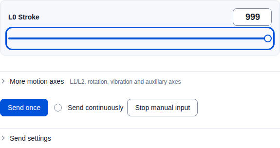

# Sensa

[简体中文](README.zh-CN.md) · [Open WebSensa](https://sealoong.github.io/Sensa/websensa/) · [Download](https://github.com/SeaLoong/Sensa/releases/latest) · [Documentation](https://sealoong.github.io/Sensa/)

**Control OSR and other interactive devices from VRChat/SPS, funscripts or manual sliders.**

Sensa turns VRChat contact parameters into device movement or vibration. You can also play a `.funscript` or move a slider to control a device yourself.

## Build the flow you need

- **VRChat / SPS / OGB:** use your Avatar's existing contact parameters, choose a preset and calibrate the response. [Choose a setup](docs/usage-scenarios.en.md)
- **Play a funscript:** connect a device, load the file and press Play. [WebSensa](docs/websensa.en.md)
- **Manual control:** connect a device and try the main L0 slider. [First run](docs/quick-start.en.md)

## Choose how to run

[Open WebSensa](https://sealoong.github.io/Sensa/websensa/) for manual control and scripts without installing Sensa. Browser connections include Intiface, TCode WebSocket and supported serial/Bluetooth devices.

[Download Sensa](https://github.com/SeaLoong/Sensa/releases/latest) for **VRChat/OSC**, native serial/UDP/TCP connections and routing from other applications. Choose **Desktop** for a desktop window or **CLI** for a service you use through your browser. [Connections and download formats](docs/features.en.md)

[Narrow layout](docs/screenshots/mobile/english-manual.png) · [More running examples](docs/screenshots.en.md)

## Start the desktop workbench

1. Download, extract and run Sensa. The Desktop edition opens a window; the CLI opens your browser.
2. Add your output device, save its settings and click **Enable** on its card.
3. Choose your input, apply its mode, then turn on **Input enabled**.

[Follow the first-run steps](docs/quick-start.en.md) · [Workbench guide](docs/guide.en.md)

## Connect devices and applications

Connect OSR/SR6 through TCode, or discover devices through Intiface Central. Other outputs include Handy, Lovense, Autoblow, VacuGlide, DG-LAB, OSC, MIDI, HTTP/WebSocket and MQTT. [Feature reference](docs/features.en.md)

To send a website or player's controls to OSR, use a route such as **website → Sensa virtual Buttplug device → TCode → OSR**. [Protocol inputs and device bridges](docs/protocol-inputs.en.md)

## Explore, record and reuse

Once the first connection works, you can add [Computed signals](docs/computed-signals.en.md), use [Multiple output bindings](docs/signal-pipeline.en.md#one-result-several-outputs), or save an interaction with [Recording and replay](docs/signal-pipeline.en.md#record-and-inspect). The [Signal-flow guide](docs/signal-pipeline.en.md) covers these setups.

The [parameter explorer](https://sealoong.github.io/Sensa/parameter-geometry.html) explains contact and tracking visually and also ships offline. Custom Avatar tracking is available through the [Unity package](unity/top.sealoong.sensa/README.md).

## Documentation and development

[OSC dictionary](docs/osc-parameters.en.md) · [Languages](docs/languages.en.md) · [Development and releases](docs/development.en.md) · [Verification record](docs/e2e-status.en.md) · [Terminology](GLOSSARY.md)

[Development previews](https://github.com/SeaLoong/Sensa/releases) contain current main builds. Download opens the latest stable release. Unity packages can also be installed through VCC/ALCOM when a stable VPM package is available.

[MIT license](LICENSE)
