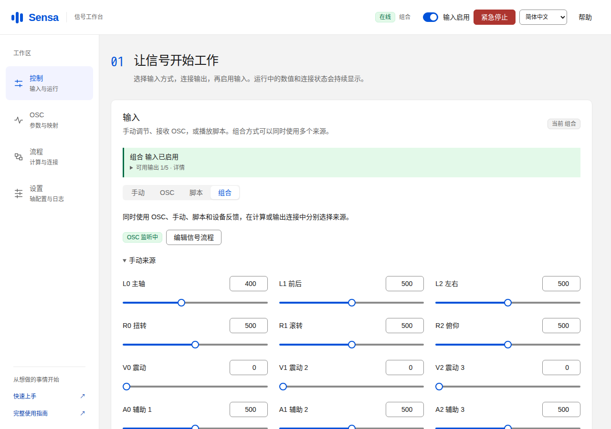

# Sensa

**简体中文** · [English](README.md) · [文档站](https://sealoong.github.io/Sensa/) · [下载](https://github.com/SeaLoong/Sensa/releases/latest) · [参数图解](https://sealoong.github.io/Sensa/parameter-geometry.html)

**把实时数据、脚本和手动控制连接到设备与应用。**

Sensa 在你的电脑上运行，用浏览器完成配置。你可以读取 VRChat 等应用的 OSC 参数，混合多个信号、加入平滑或触发条件，再控制设备、回写应用参数，或录成可重复播放的 funscript。

[窄屏界面](docs/screenshots/mobile/combined-input-zh-CN.png) · [更多运行画面](docs/screenshots.md)

## 输入 → 计算转换 → 输出

| 步骤 | 你来选择 | 例子 |
| --- | --- | --- |
| **输入** | 从哪里取得数值 | OSC 参数、定位测量、手动滑条、脚本、设备反馈、录制回放 |
| **计算转换** | 怎样处理数值 | 加权平均、两点距离、平面深度、方向夹角、平滑与触发 |
| **输出** | 把结果送到哪里 | 动作设备、OSC 参数、DG-LAB、其他应用或录制文件 |

简单流程可以直接把输入连到输出；需要融合或处理时，再添加计算。同一个结果可以连接多个输出，每个输出分别设置范围和发送方式。[建立信号流程](docs/signal-pipeline.md)

## 你想做什么？

| 目标 | 从这里开始 |
| --- | --- |
| 调节一个数值，检查设备或应用的反应 | [首次使用](docs/quick-start.md) |
| 融合触碰读数、加入平滑或触发条件 | [计算信号与示例](docs/computed-signals.md) |
| 一边控制设备，一边回写 Avatar 效果参数 | [一个结果连接多个输出](docs/signal-pipeline.md#同一个结果连接多个输出) |
| 录下交互轨迹，之后播放或继续编辑 | [录制与回放](docs/signal-pipeline.md#录制与观察) |
| 接入 VRChat 的 OGB／SPS 参数或根点定位 | [按目标选择方案](docs/usage-scenarios.md) |

## 下载并启动

1. 打开[下载](https://github.com/SeaLoong/Sensa/releases/latest)查看最新正式版；开发预览与旧版本单独列在[发布历史](https://github.com/SeaLoong/Sensa/releases)。**Windows** 推荐在发布附件中选择 x64 或 ARM64 安装器，安装后从开始菜单打开；**Linux／macOS** 选择对应 `.tar.gz`，完整解压后运行 `./Sensa`。
2. 在浏览器打开 **http://127.0.0.1:5086**。各版本均自带所需 .NET 运行时；Windows 还提供直接运行的 `SingleFile.exe` 和便携 `.zip`。[选择下载格式](docs/quick-start.md#1-启动)
3. 按[首次使用](docs/quick-start.md)添加一个输出、保存设置，再启用输入。可以先把手动滑条录成 funscript，熟悉整个流程。

连接动作设备时，先用小幅手动目标检查方向、行程和停止。顶栏提供输入开关与急停；保存配置或切换输入后，准备好再启用输入。

## 可以连接哪些输出？

| 输出 | 用途 |
| --- | --- |
| **TCode／Intiface** | 控制支持的位置、旋转、振动和辅助功能；TCode 支持串口、UDP、TCP，Intiface 连接 Central |
| **OSC 参数** | 将结果发送给 OSC 应用，或回写 VRChat 中已配置的可写 Avatar 参数 |
| **DG-LAB** | 通过 DG-LAB 4 APP 配对，按通道上限控制强度和波形 |
| **MIDI CC** | 向系统 MIDI 输出端口发送控制值 |
| **HTTP JSON／WebSocket JSON／MQTT** | 连接面板、自动化服务或自制应用 |
| **录制** | 保存 funscript 轨道，或记录用于分析的 JSON Lines／CSV 信号数据 |

在“流程”添加输出，连接设置就在该输出内部。[输出配置与示例](docs/signal-pipeline.md#添加输出与绑定)

## 录制、播放与复用

录制输出默认使用 **Funscript**。选好来源和轨道名称后开始录制，完成的片段可以下载、载入脚本播放器，或作为“录制回放”输入继续参与计算。每条轨道分别保存连续有效的片段。[操作步骤](docs/signal-pipeline.md#录制与观察)

配置好一套交互后，可以[保存整套方案](docs/signal-pipeline.md#保存与复用整套方案)，一起保留计算、轴映射、轴配置和输出。同源多个标签页会在浏览器支持时[共用实时连接](docs/signal-pipeline.md#页面与连接共用)，各页保留自己的草稿。

## VRChat 与 Unity

已有 OGB／SPS 参数时，直接通过 OSC 接入。制作自己的 Avatar 时，可安装 [Sensa Unity 组件包](unity/top.sealoong.sensa/README.zh-CN.md)，选择 **SPS 四点定位**、**Contact 直接定位（SDK Beta）**或 **Shader 捕获**。需要参考平面跟随骨骼移动和转动时，可添加 **Tracking Frame**。各方案的安装条件、测量内容和校准步骤见[方案指南](docs/usage-scenarios.md)。

[交互参数图解](https://sealoong.github.io/Sensa/parameter-geometry.html)用可操作的场景解释参数和检测区域；启动应用后，可通过 **http://127.0.0.1:5086/docs/parameter-geometry.html** 使用离线图解；安装版和便携包也附带 `docs/parameter-geometry.html` 文件。定位功能属于实验能力，实际客户端、图形环境和设备效果按所用版本检查。

正式版与开发预览均在 Releases 提供桌面包和 Unity ZIP。**VCC／ALCOM 的 VPM 源提供已发布的 Unity 正式版**，预览版从 Releases 单独下载。

## 完整帮助

[工作台指南](docs/guide.md) · [功能总览](docs/features.md) · [信号流程](docs/signal-pipeline.md) · [OSC 参数说明](docs/osc-parameters.md) · [定位与校准](docs/positioning.md) · [语言设置](docs/languages.md)

开发、构建和发布方式见[开发指南](docs/development.md)；按提交记录的浏览器、原生包与安装器检查见[验证记录](docs/e2e-status.md)。推送 main 后通过检查会自动发布开发预览和文档站，正式版在 Actions 的 **Release** 工作流发起。

[MIT 许可](LICENSE) · [术语表](GLOSSARY.md)
