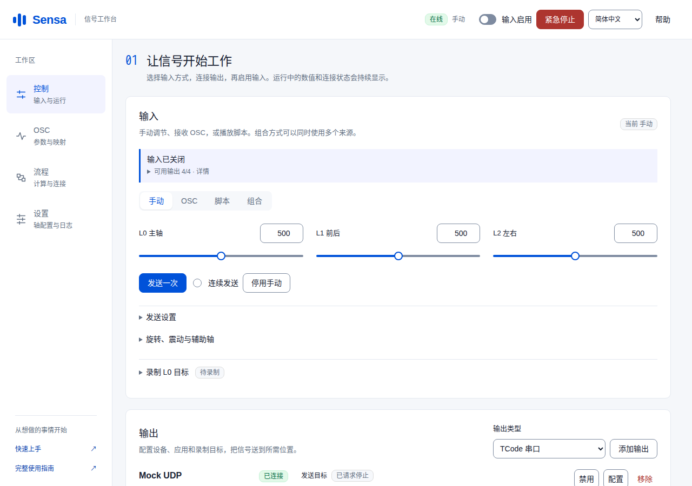

# Sensa

[English](README.md) · [打开 WebSensa](https://sealoong.github.io/Sensa/websensa/) · [下载](https://github.com/SeaLoong/Sensa/releases/latest) · [使用指南](docs/start.md) · [设备](docs/devices.md)

**让 VRChat／SPS、funscript 或手动滑条驱动 OSR 等互动设备。**

Sensa 将 VRChat 的接触参数转为设备动作或振动。你也可以播放 `.funscript`，或直接移动滑条控制设备。首次使用向导会帮助你选择目标、连接设备并准备输入。

## 建立你需要的流程

- **VRChat／SPS／OGB**：使用 Avatar 接触参数与映射预设，再校准响应。[VRChat 设置](docs/usage-scenarios.md#已有-ogb--sps)
- **播放 funscript**：连接设备，载入文件。[播放器指南](docs/websensa.md#手动控制与脚本)
- **手动控制**：连接设备，使用对应的位置或振动滑条。[首次使用](docs/quick-start.md)

## 选择运行方式

[打开 WebSensa](https://sealoong.github.io/Sensa/websensa/)，无需安装 Sensa 即可手动控制或播放脚本。支持 Intiface、TCode WebSocket，以及浏览器支持的串口／蓝牙设备。

使用 **VRChat／OSC**、原生串口／UDP／TCP，或接收其他应用的控制时，[下载 Sensa](https://github.com/SeaLoong/Sensa/releases/latest)。需要桌面窗口选择 **Desktop**，需要浏览器操作或后台服务选择 **CLI**。[比较连接方式](docs/devices.md#选择桌面版或-websensa) · [下载格式](docs/features.md#配置与开发)

[窄屏界面](docs/screenshots/mobile/control-page.png) · [更多运行画面](docs/screenshots.md)

## 启动桌面工作台

1. 下载、解压并运行 Sensa，跟随首次使用向导选择目标。
2. 连接一个输出设备，准备输入，适用时使用预设。
3. 检查连接与量程，准备好后打开**输入启用**。

[跟随首次使用步骤](docs/quick-start.md) · [全部指南](docs/start.md) · [工作台地图](docs/guide.md)

## 连接设备与应用

通过 TCode 连接 OSR／SR6，或通过 Intiface Central 发现兼容设备。位置、振动与旋转使用设备声明的能力。其他输出包括 Handy、Lovense、Autoblow、VacuGlide、DG-LAB、OSC、MIDI、HTTP／WebSocket 与 MQTT。[设备与连接](docs/devices.md) · [功能参考](docs/features.md)

将网站或播放器的控制送到 OSR 时，可以使用 **网站 → Sensa 虚拟 Buttplug 设备 → TCode → OSR**。[协议输入与设备桥](docs/protocol-inputs.md)

## 图解、录制与复用

首次连接成功后，可以添加[计算信号](docs/computed-signals.md)、使用[多条输出绑定](docs/signal-pipeline.md#同一个结果连接多个输出)，或通过[录制与回放](docs/signal-pipeline.md#录制与观察)保存一次交互。[信号流程指南](docs/signal-pipeline.md)介绍这些设置。

[参数图解](https://sealoong.github.io/Sensa/parameter-geometry.html)可以直观看懂接触与定位，也随程序提供离线副本。制作自定义 Avatar 定位时，使用 [Unity 组件包](unity/top.sealoong.sensa/README.zh-CN.md)。

## 文档与开发

[OSC 参数字典](docs/osc-parameters.md) · [语言设置](docs/languages.md) · [开发与发布](docs/development.md) · [验证记录](docs/e2e-status.md) · [术语表](GLOSSARY.md)

[开发预览](https://github.com/SeaLoong/Sensa/releases)提供当前 main 构建，下载入口打开最新正式版。已有正式 VPM 包时，也可通过 VCC／ALCOM 安装 Unity 组件。

[MIT 许可](LICENSE)
