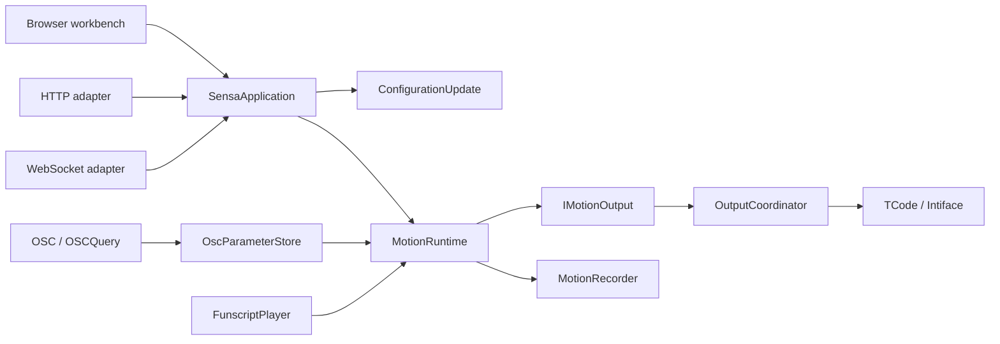

# Architecture and behavior contracts

[简体中文](architecture.md) | **English**

Sensa converts the selected input into twelve-axis motion targets and dispatches them through each output's configuration. The browser provides controls and previews; the backend owns input permission, configuration transactions, gates and stops. See the [Glossary](../GLOSSARY.md) and [Feature reference](features.en.md).

## Data flow

| Boundary | Responsibility |
| --- | --- |
| [SensaApplication](https://github.com/SeaLoong/Sensa/blob/main/src/Application/SensaApplication.cs) | Shared HTTP/WebSocket command dispatch for modes, scripts, recording and connections |
| [ConfigurationUpdate](https://github.com/SeaLoong/Sensa/blob/main/src/Application/ConfigurationUpdate.cs) | Serialized validation, disarming, stopping, application, reconnection and persistence; restores configuration/connections after failure |
| [MotionRuntime](https://github.com/SeaLoong/Sensa/blob/main/src/Runtime/MotionRuntime.cs) | Actual mode, permission, signal processing, freshness, gates, merging, request generations and stopping |
| [IMotionOutput](https://github.com/SeaLoong/Sensa/blob/main/src/Motion/IMotionOutput.cs) | Runtime depends only on send/stop operations; tests substitute isolated outputs |
| [OutputCoordinator](https://github.com/SeaLoong/Sensa/blob/main/src/Outputs/OutputCoordinator.cs) | Dispatches by output type/configuration without exposing transports to the runtime |
| [OscParameterStore](https://github.com/SeaLoong/Sensa/blob/main/src/Input/Osc/OscModels.cs) | Source identity, values, update times, sequences and avatar lifecycle |

UDP and OSCQuery share the avatar-change entry point: clear affected data, reset learned state and stop enabled OSC input. Unconsumed parts of mixed OSC bundles preserve structure, order and timetags for forwarding. Parameter intake does not thereby gain atomic frame semantics or full timetag scheduling. [OSC parser](https://github.com/SeaLoong/Sensa/blob/main/src/Input/Osc/OscPacketParser.cs)

## Input permission is an invariant

| Operation | Backend behavior |
| --- | --- |
| Browse pages or input tabs | Preserve actual mode and input permission |
| Change actual input mode | Disable input, stop outputs and invalidate pending old requests |
| Replace/load a script | Disable input first, including replacement within Script mode |
| Save configuration | Disable input and leave it disabled after success |
| Emergency stop / clear | Latch the stop; clearing does not resume movement |
| Pause/stop/unload script | Stop automatic frames and UDP refresh; invalidate old timer frames |
| Explicit seek/step while paused | May send a target while Script input remains enabled |
| Gate or spatial validity fails | Stop without substituting an old scalar for invalid spatial input |
| Start application | Do not restore input, output enablement, scripts or movement |

Targets are not position feedback. Recording happens before dispatch, so it cannot prove delivery; UDP provides no execution acknowledgment.

## Web workbench

The WebUI uses React and project-owned basic components styled after TDesign. [ui.jsx](https://github.com/SeaLoong/Sensa/blob/main/src/web/ui.jsx), [controls.jsx](https://github.com/SeaLoong/Sensa/blob/main/src/web/controls.jsx) and [styles.css](https://github.com/SeaLoong/Sensa/blob/main/src/web/styles.css) own controls and styling while retaining native input, keyboard and dialog semantics.

Control/OSC/Settings are the main destinations, with expandable details. The top bar preserves actual mode, input permission and emergency stop. A browser draft is distinct from saved configuration.

| Module | Centralized rules |
| --- | --- |
| [configuration.js](https://github.com/SeaLoong/Sensa/blob/main/src/web/configuration.js) | Drafts, default profiles, output references, destination conflicts and saving |
| [input-workflows.js](https://github.com/SeaLoong/Sensa/blob/main/src/web/input-workflows.js) | Manual targets, script timecodes, speed and looping intent |
| [realtime-session.js](https://github.com/SeaLoong/Sensa/blob/main/src/web/realtime-session.js) | Same-origin sessions, correlation, timeout, disconnect rejection, reconnection and page lifecycle; no action replay |
| [osc-workspace.js](https://github.com/SeaLoong/Sensa/blob/main/src/web/osc-workspace.js) | Presets and mapping drafts |
| [osc-preview.js](https://github.com/SeaLoong/Sensa/blob/main/src/web/osc-preview.js) | Path matching, FT prefix filtering, previews and experimental calibration |
| [diagnostics.js](https://github.com/SeaLoong/Sensa/blob/main/src/web/diagnostics.js) | Log and diagnostic filtering |

## Spatial input is isolated

Contact reconstruction remains an experimental `ReferenceLocal` estimate. `allowExperimentalSpatialInput=false` by default also blocks existing spatial configurations; the catalog no longer recommends Point/Pose. Freshness uses the oldest contributing update, with a default one-second spatial age limit overridden by a positive input timeout. Fresh does not prove simultaneous; low residual does not prove one Sender.

Four noncoplanar anchors with true ranges to one point can determine relative XYZ. Ordinary Proximity supplies neither the required identity nor batch guarantees, and cannot reveal common world motion. A trusted producer supplying batched XYZ+frameId+valid is a future design requirement, not an implemented feature. [Positioning analysis](positioning.en.md)

## Verification and tools

TimeProvider injects time dependencies; isolated contract tests use virtual time and mock transports. Network adapters use random loopback ports. Unity tests and metadata checks do not substitute for uploaded-client acceptance.

Installers share [lab_installation.py](https://github.com/SeaLoong/Sensa/blob/main/scripts/lab_installation.py) and preflight before writing. Smoke runners share [process_smoke.py](https://github.com/SeaLoong/Sensa/blob/main/scripts/process_smoke.py) for configuration isolation, deadlines and cleanup.

Locally, plan with `python -X utf8 scripts/verify.py --plan`, then run the verification entry point; valid receipts are reused. Browser E2E, screenshots, full-process smoke and World PlayMode run only in Actions. CI selects affected work and inherits/recovers unfinished product verification; intent artifacts never replace actual required job success. Prereleases require full comparison and the necessary product chain at the candidate SHA. Retain the ten newest published prereleases while preserving stable releases, drafts and tags. [Development](development.en.md), [E2E](e2e.en.md), [decision](adr/0002-impact-based-verification.md)
