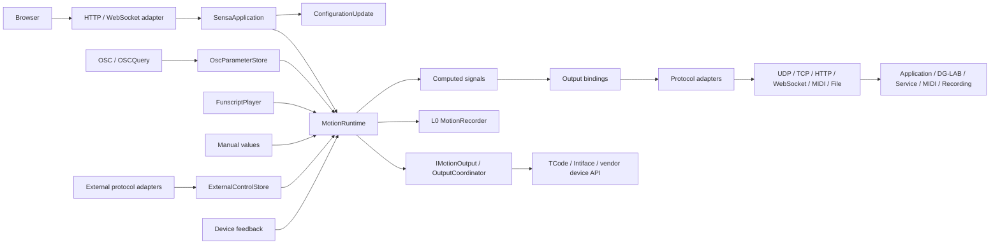

# Architecture and behavior contracts

[简体中文](architecture.md) | **English**

The backend reads input samples and external protocol commands, computes reusable results, and delivers through bindings or a motion path preserving arrival durations. Manual, OSC, Script and Protocol retain quick workflows; Combined lets sources contribute together. Existing motion outputs use twelve-axis targets, while OSC, DG-LAB, network services and recording expose their own destinations. The browser owns intentions and drafts; the backend owns activation, stopping, validity and save transactions. This page describes boundaries; see the [guide](guide.en.md) for operation and [glossary](../GLOSSARY.md) for terms.

## One command boundary

| Module | Rules it owns |
| --- | --- |
| [SensaApplication](https://github.com/SeaLoong/Sensa/blob/main/src/Application/SensaApplication.cs) | Shared command dispatch, mode/script/recording/connection operations |
| [ConfigurationUpdate](https://github.com/SeaLoong/Sensa/blob/main/src/Application/ConfigurationUpdate.cs) | Serialized validation, disarm, stop, reconnect and persistence; configuration/connection rollback |
| [MotionRuntime](https://github.com/SeaLoong/Sensa/blob/main/src/Runtime/MotionRuntime.cs) | Actual mode, permission, gates, fusion, freshness, request generations and stop |
| [ProtocolInputCoordinator](https://github.com/SeaLoong/Sensa/blob/main/src/Input/Protocols/ProtocolInputCoordinator.cs) / [ExternalControlStore](https://github.com/SeaLoong/Sensa/blob/main/src/Input/Protocols/ExternalControl.cs) | Separate listeners, source sessions, atomic multichannel commands, types/durations, leases and current command identity |
| [ComputedSignalEvaluator](https://github.com/SeaLoong/Sensa/blob/main/src/Signals/ComputedSignalEvaluator.cs) | Bounded dependency graph, computation reuse, shared-source/frame checks, oldest sample time and numeric validity |
| [SignalInputSource](https://github.com/SeaLoong/Sensa/blob/main/src/Signals/SignalInputSource.cs) | Resolve a configured source into a timestamped, valid or invalid sample |
| [ISignalProcessor](https://github.com/SeaLoong/Sensa/blob/main/src/Signals/ISignalProcessor.cs) | Shared computation-frame evaluation and temporal reset boundary |
| [SignalOutputCoordinator](https://github.com/SeaLoong/Sensa/blob/main/src/Outputs/SignalOutputCoordinator.cs) | Per-binding validity, current-value delivery, event queue, stopping and protocol adapters |
| [FunscriptTrackRecorder](https://github.com/SeaLoong/Sensa/blob/main/src/Recording/FunscriptTrackRecorder.cs) | Per-binding valid segments, axis filenames, bounded actions and completed-file publication |
| [SignalSession](https://github.com/SeaLoong/Sensa/blob/main/src/Recording/SignalSession.cs) | Recording formats, file lists and funscript/diagnostic-signal replay |
| [IMotionOutput](https://github.com/SeaLoong/Sensa/blob/main/src/Motion/IMotionOutput.cs) | Send/stop seam replaceable by isolated tests |
| [OutputCoordinator](https://github.com/SeaLoong/Sensa/blob/main/src/Outputs/OutputCoordinator.cs) | Output types, profiles and transport lifecycle; encapsulate protocol details in the output layer |
| [OscParameterStore](https://github.com/SeaLoong/Sensa/blob/main/src/Input/Osc/OscModels.cs) | Sources, values, receive/change timestamps, sequences and Avatar lifecycle |

UDP and OSCQuery share Avatar-change cleanup, resetting caches/learning and stopping OSC. Unconsumed bundles preserve structure, order and timetags for forwarding. Input messages are interpreted individually; forwarding retains the bundle timetag, while atomic frame scheduling remains outside the current implementation.

## Permission and stopping invariants

| Event | Required behavior |
| --- | --- |
| Browse navigation/input tabs | Keep actual mode and permission unchanged |
| Change mode, replace script, save configuration | Disarm/stop first; invalidate old pending requests |
| Emergency stop/clear | Latch stop; after clearing, wait for input to be enabled manually |
| Pause/stop/unload script | Stop automatic frames/UDP refresh; explicitly permitted seek/step may still send |
| Gate/spatial invalidity | Stop the affected motion or binding and invalidate its old target |
| Startup | Start with input off, outputs disabled, scripts unloaded and motion stopped |

Connection and input activation are managed separately; an already active input may send its valid current target to a new connection. L0 recording precedes motion distribution. Recording outputs default to funscript tracks from each binding's converted 0–1 values, with independent timing and files per valid segment. Advanced JSON Lines/CSV retain raw readings, converted values and validity on a shared timeline. Command telemetry, recordings and device-reported feedback have separate meanings.

## Signal and spatial validity

Ordinary scalar processing matches paths and source, then calibrates, inverts, curves, fuses roles and applies gates. OgbDepth/OgbTouch interpret their parameters according to the external protocol definitions. Spatial input has a separate default-off experimental permission.

Computed signals produce reusable raw values before calibration, using OSC parameters, validated tracking metrics, manual/script readings, device feedback, constants or other computations. Temporal processing belongs to the current evaluator instance and uses injected time. Configuration validation bounds graph size and reference depth and rejects missing references and cycles. Runtime reuses results in dependency order and shares leaf inputs within each evaluation. Results retain contributing source, coordinate frame and oldest sample time. Required-input invalidity propagates through references to dependent bindings; existing axis mappings retain motion-runtime gates. Disarming, reconfiguration and changed provenance reset relevant temporal state. The browser presents saved state using the same backend evaluator. [Operations and configuration](computed-signals.en.md)

| Family | Coordinate/freshness rules |
| --- | --- |
| Legacy Point/Handle/Pose | ReferenceLocal; oldest participating channel, including Handle grab; default 1000 ms or positive timeout |
| Contact direct tracking (SDK Beta) | AvatarRootMeters; one dedicated Self Sender/Receiver, complete twelve-field report, positive Proximity and supported Radius; Sample change age at most 1000 ms |
| SPS four-anchor tracking | AvatarRootLocal; known P0–P3 geometry, unsaturated inputs and residual checks; stationary P may cache, changing Sample defaults to 1000 ms, capped at 1250 ms |
| Native Shader | AvatarRootLocal; complete measurement packets, provenance, frame progression and validity; fields, encoding and recovery follow the [positioning protocol](positioning.en.md) |

A dedicated marker and unique channel keep each root measurement tied to its intended own target. SPS four-anchor tracking reconstructs one point from distances in authored AvatarRootLocal units; Contact reports midpoint position and contact-point velocity in physical metre-based AvatarRootMeters. Contact position and velocity metrics share SensaPoint calibration, activation and invalidity stops. The native report provides Contact properties, and Sensa Sample adds a producer-activity check; a clock, sequence and stable Sender ID are outside that report's field set. [SDK contract and evidence](contact-sdk.en.md). [Positioning](positioning.en.md) and the [dictionary](osc-parameters.en.md) define protocols, equations and stop conditions.

Output bindings select source, conversion, value type, range, stop value and sending policy. Protocol adapters encode OSC values, JSON messages, DG-LAB tasks or records; transports own connection lifetime, bounded delivery, cancellation and closure. State delivery retains the latest target, while a bounded queue delivers events in order. Feedback enters through source resolution. [Input/computation/output decision](adr/0008-signal-pipeline-and-shared-session.md) · [User configuration](signal-pipeline.en.md)

## External protocol inputs and device APIs

Buttplug v2/v3/v4, TCode, JSON and vendor-compatible adapters interpret controls as external commands with channels, targets, durations and direction. Direct motion routing retains independent timing per channel, with Stop as an ordered barrier; protocol samples also feed computation/bindings. An initial trajectory with an unknown start keeps its current value invalid while exposing the target. Interpolation represents command state, not hardware feedback. Existing device feedback remains a separate source.

Protocol listeners are separate from management APIs and default to loopback. Websites and native clients connect directly to the configured address without per-website approval. Handy, Lovense, Autoblow and VacuGlide outputs connect to actual device APIs; similarly named local compatibility inputs require an upstream-selectable endpoint and do not take over fixed vendor clouds. Optional tools own BLE peripheral/central and virtual serial wiring. See the [protocol input guide](protocol-inputs.en.md) and [ADR 0010](adr/0010-external-protocol-inputs.md) for operation, types and stopping scope.

## Following planes and spatial calculations

Spatial calculations take a measured point `P`, a reference origin `O` and a plane orientation. Signed depth along its normal and in-plane offset describe axial and lateral movement; point distance and direction angles can feed output bindings independently. Both the measured target and reference on your own Avatar can move or rotate. When live tracking supplies the origin and orientation, calculations follow their current readings. Distance results retain the position unit, angles use degrees, and output bindings set the final range and direction. Interaction between Avatars uses the dedicated depth, offset and angle metrics from [paired three-marker pose](positioning.en.md#interaction-between-avatars-paired-three-marker-pose).

`SensaTrackingFrame` represents a target's translation and rotation with three points in one coordinate frame: Origin, Forward and Right. Forward minus Origin gives the virtual plane's positive normal. Shader capture directly measures a root position and two X/Z axes. One axis defines a working plane perpendicular to it; two independent tangent axes define the actual sampled plane through their cross product, including non-uniform-scale effects. The [reference-plane decision](adr/0009-following-reference-planes.md) describes these geometric meanings.

Spatial operations check the coordinate frame, position unit and directional role of each three-component group, retaining one OSC source and the oldest sample time. A zero normal, collinear plane axes or invalid inputs stop dependent bindings. AvatarScale from the same source converts position units between AvatarRootLocal and AvatarRootMeters; coordinates from different local references cannot be mixed directly. [Configuration examples](computed-signals.en.md)

## Unity authoring and tracking generation

Unity authoring components store settings and implement SDK `IEditorOnly`. In NDMF Generating before MA's work in the same phase, `SensaPlugin` reads settings and creates Contacts, constraints and temporary animator/parameter/menu inputs for MA merging. `BuildContext.GetState` records completion per build; source scenes and authoring prefabs remain editable.

SPS four-anchor tracking, Contact direct tracking and Shader capture share this entry point while retaining their protocols. All three root prefabs accept an explicit Avatar Transform, SPS, Sensa Component or native Contact target. Root frames are read before removing any Sensa author component they reference. Native measurement components and reference Transforms remain in the uploaded result.

A read-only SDK checkpoint diagnoses remaining authors after the audited Fury processing and before default SDK cleanup. NDMF Optimizing separately checks author cleanup and Contact count at that point. See the [Unity build guide](unity-build.en.md) for phases, component/object EditorOnly behavior and official version evidence.

## Browser modules

React uses native controls, dialogs and semantic labels, with local styles presenting the TDesign appearance. The header carries actual state/permission while content scrolls separately. Drafts differ from saved configuration.

| File | Responsibility |
| --- | --- |
| [configuration.js](https://github.com/SeaLoong/Sensa/blob/main/src/web/configuration.js) | Normalize drafts, output references, conflicts and saves |
| [input-workflows.js](https://github.com/SeaLoong/Sensa/blob/main/src/web/input-workflows.js) | Manual/script intentions and timecodes |
| [realtime-session.js](https://github.com/SeaLoong/Sensa/blob/main/src/web/realtime-session.js) | Same-origin session, correlation, timeout, disconnect rejection and reconnect; await new control requests after reconnection |
| [shared-realtime.js](https://github.com/SeaLoong/Sensa/blob/main/src/web/shared-realtime.js) | Reference-counted page clients, shared-session message broker and per-tab request isolation |
| [elected-realtime.js](https://github.com/SeaLoong/Sensa/blob/main/src/web/elected-realtime.js) | Web Locks grants exclusive connection ownership; BroadcastChannel carries cross-tab messages |
| [osc-workspace.js](https://github.com/SeaLoong/Sensa/blob/main/src/web/osc-workspace.js) / [osc-preview.js](https://github.com/SeaLoong/Sensa/blob/main/src/web/osc-preview.js) | Preset drafts, matching, filters, preview and calibration |
| [i18n.js](https://github.com/SeaLoong/Sensa/blob/main/src/web/i18n.js) | URL/preference/environment locale, document routing and text |
| [diagnostics.js](https://github.com/SeaLoong/Sensa/blob/main/src/web/diagnostics.js) | Log/state filtering |

One browser page multiplexes state and commands through one session. Same-origin tabs first share one backend WebSocket through SharedWorker. If that is unavailable, Web Locks grants one tab exclusive connection ownership and BroadcastChannel carries messages. When neither sharing method is available, each tab uses a singleton. Requests are correlated separately and drafts stay local. Page-cache suspension detaches a client and restoration attaches it again. HTTP connection pools and the server's WebSocket session budget are separate limits; sharing reduces the number of backend sessions used by compatible tabs.

The standalone explorer displays parameters in the browser through local classic scripts, a pure model and bundled Three.js. It can run independently of an application session or device connection. Pages statically publishes Markdown and the same six explorer assets; the Sensa service hosts the motion runtime.

## Verification seams

TimeProvider injects time. Isolated tests use virtual clocks, loopback ports and mock transports. Installers preflight managed files before writing and retain user changes; shared smoke tooling owns process cleanup.

CI requires units, full E2E and isolated native smoke before publication; browser/process checks use mock transports. EditMode, metadata and browser mocks verify author processing, asset structure and interface behavior respectively. Actual uploads, client behavior and hardware require acceptance checks in their corresponding environments. World PlayMode and real-client checks are arranged separately. See [development and releases](development.en.md).
