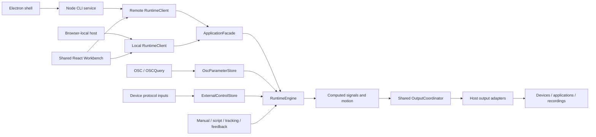

# Architecture and behavior contracts

[简体中文](architecture.md) | **English**

Sensa uses one TypeScript runtime and one React workbench across WebSensa, the Node.js service and Electron. Each host supplies its available transports, device access and storage. The shared application owns command behavior, signal processing and output coordination. [User guide](guide.en.md) · [Terminology](../GLOSSARY.md)

## Hosts and the shared application

| Host | Engine and interface |
| --- | --- |
| WebSensa | Runs the engine in the page, mounts the shared workbench and uses browser device APIs |
| Node.js CLI | Owns one local engine, listeners, files and device connections; serves the workbench to browsers |
| Electron | Launches the same packaged Node CLI executable and opens its workbench in an embedded window |

Electron waits for the CLI's ready message with its actual URL. The renderer uses the same HTTP/WebSocket application boundary as an ordinary browser. Reopening a configuration reuses its existing service; closing Electron stops a service it started. Unity's authoring and build package remains C# and publishes the existing OSC contracts.

| Module | Rules it owns |
| --- | --- |
| [ApplicationFacade](https://github.com/SeaLoong/Sensa/blob/main/src/core/runtime/application.ts) | Shared command dispatch, mode/script/recording/connection operations |
| [Configuration](https://github.com/SeaLoong/Sensa/blob/main/src/core/runtime/configuration.ts) | Canonical schema, defaults, validation and inactive persisted state |
| [RuntimeEngine](https://github.com/SeaLoong/Sensa/blob/main/src/core/runtime/runtime.ts) | Actual mode, input activation, gates, fusion, freshness, request generations and stop |
| [ComputedSignalEvaluator](https://github.com/SeaLoong/Sensa/blob/main/src/core/runtime/computed.ts) / [ComputedSignalResolver](https://github.com/SeaLoong/Sensa/blob/main/src/core/runtime/resolver.ts) | Bounded dependency graph, source resolution, shared-source/frame checks and sample validity |
| [Tracking and geometry](https://github.com/SeaLoong/Sensa/tree/main/src/core/runtime) | SPS, Contact and Shader decoding, coordinate conversion and following-plane calculations |
| [RuntimeScriptPlayer](https://github.com/SeaLoong/Sensa/blob/main/src/core/runtime/script.ts) / [RuntimeMotionRecorder](https://github.com/SeaLoong/Sensa/blob/main/src/core/runtime/recording.ts) | Script timeline and the L0 motion recording workflow |
| [OutputCoordinator](https://github.com/SeaLoong/Sensa/blob/main/src/core/outputs/coordinator.ts) / [OutputLane](https://github.com/SeaLoong/Sensa/blob/main/src/core/outputs/lifecycle.ts) | Per-binding evaluation, output connection ownership, ordered delivery, cancellation and stopping |
| [Recording and replay](https://github.com/SeaLoong/Sensa/blob/main/src/core/outputs/recording.ts) | Valid funscript segments, JSON Lines/CSV encoding and signal-session replay |
| [ExternalControlStore](https://github.com/SeaLoong/Sensa/blob/main/src/core/protocols/external-control.ts) | Source sessions, atomic multichannel commands, types/durations, leases and current command identity |
| [OscParameterStore and OSC codec](https://github.com/SeaLoong/Sensa/blob/main/src/core/protocols/osc.ts) | Sources, values, receive/change timestamps, sequences, bundles and Avatar lifecycle |
| [Node host](https://github.com/SeaLoong/Sensa/tree/main/src/node/host) | Management sessions, serialized configuration updates with rollback, atomic files and process ownership |
| [Node inputs](https://github.com/SeaLoong/Sensa/tree/main/src/node/inputs) / [Node outputs](https://github.com/SeaLoong/Sensa/tree/main/src/node/outputs) | Network/native listeners, device APIs, discovery and filesystem adapters |
| [Browser host](https://github.com/SeaLoong/Sensa/blob/main/src/websensa/browser-runtime.ts) | In-page lifecycle, local configuration and browser adapters for the same application and output coordinator |

Core code has no browser or Node transport dependency. Hosts inject clocks, delivery callbacks, files and device factories. Existing PascalCase configuration files are accepted through case-insensitive decoding; saves use the canonical camelCase schema. New processes start with transient input and output activity reset.

UDP and OSCQuery share Avatar-change cleanup. Forwarding preserves unconsumed OSC bundle structure, order and timetags; input messages are interpreted individually. [Shared-core decision](adr/0011-shared-core-and-capability-adapters.md)

## Permission and stopping invariants

| Event | Required behavior |
| --- | --- |
| Browse navigation/input tabs | Keep actual mode and permission unchanged |
| Change mode, replace script, save configuration | Disarm/stop first; invalidate old pending requests |
| Emergency stop/clear | Latch stop; after clearing, wait for input to be enabled manually |
| Natural script completion | Retain the final value and input activation; other Combined sources continue |
| Pause/stop/unload script | Stop the corresponding script activity; explicitly permitted seek/step may still send |
| Gate/spatial invalidity | Stop the affected motion or binding and invalidate its old target |
| Startup | Start with input off, outputs disabled, scripts unloaded and motion stopped |

Connection and input activation are managed separately; an already active input may send its valid current target to a new connection. L0 recording precedes motion distribution. Recording outputs default to funscript tracks from each binding's converted 0–1 values, with independent timing and files per valid segment. Advanced JSON Lines/CSV retain raw readings, converted values and validity on a shared timeline. Command telemetry, recordings and device-reported feedback have separate meanings.

## Signal and spatial validity

Ordinary scalar processing matches paths and source, then calibrates, inverts, curves, fuses roles and applies gates. OgbDepth/OgbTouch interpret their parameters according to the external protocol definitions. Spatial input has a separate default-off experimental permission.

Computed signals produce reusable raw values before calibration, using OSC parameters, validated tracking metrics, manual/script readings, device feedback, constants or other computations. Temporal processing belongs to the current evaluator instance and uses injected time. Configuration validation bounds graph size and reference depth and rejects missing references and cycles. Runtime reuses results in dependency order and shares leaf inputs within each evaluation. Results retain contributing source, coordinate frame and oldest sample time. Required-input invalidity propagates through references to dependent bindings; existing axis mappings retain motion-runtime gates. Disarming, reconfiguration and changed provenance reset relevant temporal state. The workbench presents saved state from the same evaluator in both remote and browser-local hosts. [Operations and configuration](computed-signals.en.md)

| Family | Coordinate/freshness rules |
| --- | --- |
| Legacy Point/Handle/Pose | ReferenceLocal; oldest participating channel, including Handle grab; default 1000 ms or positive timeout |
| Contact direct tracking (SDK Beta) | AvatarRootMeters; one dedicated Self Sender/Receiver, complete twelve-field report, positive Proximity and supported Radius; Sample change age at most 1000 ms |
| SPS four-anchor tracking | AvatarRootLocal; known P0–P3 geometry, unsaturated inputs and residual checks; stationary P may cache, changing Sample defaults to 1000 ms, capped at 1250 ms |
| Native Shader | AvatarRootLocal; complete measurement packets, provenance, frame progression and validity; fields, encoding and recovery follow the [positioning protocol](positioning.en.md) |

A dedicated marker and unique channel keep each root measurement tied to its intended own target. SPS four-anchor tracking reconstructs one point from distances in authored AvatarRootLocal units; Contact reports midpoint position and contact-point velocity in physical metre-based AvatarRootMeters. Contact position and velocity metrics share SensaPoint calibration, activation and invalidity stops. The native report provides Contact properties, and Sensa Sample adds a producer-activity check; a clock, sequence and stable Sender ID are outside that report's field set. [SDK contract and evidence](contact-sdk.en.md). [Positioning](positioning.en.md) and the [dictionary](osc-parameters.en.md) define protocols, equations and stop conditions.

Output bindings select source, conversion, value type, range, stop value and sending policy. Protocol adapters encode OSC values, JSON messages, DG-LAB tasks or records; transports own connection lifetime, bounded delivery, cancellation and closure. State delivery retains the latest target, while a bounded queue delivers events in order. Feedback enters through source resolution. [Input/computation/output decision](adr/0008-signal-pipeline-and-shared-session.md) · [User configuration](signal-pipeline.en.md)

## External protocol inputs and device APIs

Buttplug v2/v3/v4, TCode, JSON and vendor-compatible adapters interpret controls as external commands with channels, targets, durations and direction. Direct motion routing retains independent timing per channel, with Stop as an ordered barrier; protocol samples also feed computation/bindings. An initial trajectory with an unknown start keeps its current value invalid while exposing the target. Interpolation represents command state, not hardware feedback. Existing device feedback remains a separate source.

Protocol listeners are separate from management APIs. A shared HTTP listener serves Buttplug, JSON, vendor APIs and TCode WebSocket on distinct configured `path` prefixes. Longest complete-path matching selects one source before dispatch; that source owns its session, channels and timing. Raw TCP and UDP keep their transport-specific listeners. Handy, Lovense, Autoblow and VacuGlide have device-output adapters and local compatibility inputs. Optional bridge tools provide BLE peripheral/central and virtual serial wiring. See the [protocol input guide](protocol-inputs.en.md) and [ADR 0010](adr/0010-external-protocol-inputs.md) for operation, types and stopping scope.

## Following planes and spatial calculations

Spatial calculations take a measured point `P`, a reference origin `O` and a plane orientation. Signed depth along its normal and in-plane offset describe axial and lateral movement; point distance and direction angles can feed output bindings independently. Both the measured target and reference on your own Avatar can move or rotate. When live tracking supplies the origin and orientation, calculations follow their current readings. Distance results retain the position unit, angles use degrees, and output bindings set the final range and direction. Interaction between Avatars uses the dedicated depth, offset and angle metrics from [paired three-marker pose](positioning.en.md#interaction-between-avatars-paired-three-marker-pose).

`SensaTrackingFrame` represents a target's translation and rotation with three points in one coordinate frame: Origin, Forward and Right. Forward minus Origin gives the virtual plane's positive normal. Shader capture directly measures a root position and two X/Z axes. One axis defines a working plane perpendicular to it; two independent tangent axes define the actual sampled plane through their cross product, including non-uniform-scale effects. The [reference-plane decision](adr/0009-following-reference-planes.md) describes these geometric meanings.

Spatial operations check the coordinate frame, position unit and directional role of each three-component group, retaining one OSC source and the oldest sample time. A zero normal, collinear plane axes or invalid inputs stop dependent bindings. AvatarScale from the same source converts position units between AvatarRootLocal and AvatarRootMeters; coordinates from different local references cannot be mixed directly. [Configuration examples](computed-signals.en.md)

## Unity authoring and tracking generation

Unity authoring components store settings and implement SDK `IEditorOnly`. In NDMF Generating before MA's work in the same phase, `SensaPlugin` reads settings and creates Contacts, constraints and temporary animator/parameter/menu inputs for MA merging. `BuildContext.GetState` records completion per build; source scenes and authoring prefabs remain editable.

SPS four-anchor tracking, Contact direct tracking and Shader capture share this entry point while retaining their protocols. All three root prefabs accept an explicit Avatar Transform, SPS, Sensa Component or native Contact target. Root frames are read before removing any Sensa author component they reference. Native measurement components and reference Transforms remain in the uploaded result.

A read-only SDK checkpoint diagnoses remaining authors after the audited Fury processing and before default SDK cleanup. NDMF Optimizing separately checks author cleanup and Contact count at that point. See the [Unity build guide](unity-build.en.md) for phases, component/object EditorOnly behavior and official version evidence.

## Browser modules

React uses native controls, dialogs and semantic labels, with local styles presenting the TDesign appearance. The header carries actual state/permission while content scrolls separately. Drafts differ from saved configuration.

| File | Responsibility |
| --- | --- |
| [RuntimeClient](https://github.com/SeaLoong/Sensa/blob/main/src/web/runtime-client.ts) / [bootstrap.tsx](https://github.com/SeaLoong/Sensa/blob/main/src/web/bootstrap.tsx) | Mount one workbench with a remote service client or a browser-local facade |
| [configuration.js](https://github.com/SeaLoong/Sensa/blob/main/src/web/configuration.js) | Normalize drafts, output references, conflicts and saves |
| [input-workflows.js](https://github.com/SeaLoong/Sensa/blob/main/src/web/input-workflows.js) | Manual/script intentions and timecodes |
| [realtime-session.js](https://github.com/SeaLoong/Sensa/blob/main/src/web/realtime-session.js) | Same-origin session, correlation, timeout, disconnect rejection and reconnect; await new control requests after reconnection |
| [shared-realtime.js](https://github.com/SeaLoong/Sensa/blob/main/src/web/shared-realtime.js) | Reference-counted page clients, shared-session message broker and per-tab request isolation |
| [elected-realtime.js](https://github.com/SeaLoong/Sensa/blob/main/src/web/elected-realtime.js) | Web Locks grants exclusive connection ownership; BroadcastChannel carries cross-tab messages |
| [osc-workspace.js](https://github.com/SeaLoong/Sensa/blob/main/src/web/osc-workspace.js) / [osc-preview.js](https://github.com/SeaLoong/Sensa/blob/main/src/web/osc-preview.js) | Preset drafts, matching, filters, preview and calibration |
| [i18n.js](https://github.com/SeaLoong/Sensa/blob/main/src/web/i18n.js) | URL/preference/environment locale, document routing and text |
| [diagnostics.js](https://github.com/SeaLoong/Sensa/blob/main/src/web/diagnostics.js) | Log/state filtering |

One browser page multiplexes state and commands through one session. Same-origin tabs first share one backend WebSocket through SharedWorker. If that is unavailable, Web Locks grants one tab exclusive connection ownership and BroadcastChannel carries messages. When neither sharing method is available, each tab uses a singleton. Requests are correlated separately and drafts stay local. Page-cache suspension detaches a client and restoration attaches it again. HTTP connection pools and the server's WebSocket session budget are separate limits; sharing reduces the number of backend sessions used by compatible tabs.

The standalone explorer displays parameters in the browser through local classic scripts, a pure model and bundled Three.js. It can run independently of an application session or device connection. Pages statically publishes Markdown and the same bundled explorer assets; the Sensa service hosts the motion runtime.

## Browser-native WebSensa

`src/websensa/app.tsx` mounts the same `src/web/app.js` workbench as the service UI. `createBrowserWorkbench` constructs `RuntimeEngine`, `ApplicationFacade` and the shared `OutputCoordinator` in the page; `RuntimeClient` adapts local requests and snapshots to the interface used by the remote workbench. Manual input, funscript, computed signals, recording/replay and the connected parameter explorer therefore use the same application behavior.

Browser adapters provide WebSocket, fetch, Web Serial, Web Bluetooth, Web MIDI and downloadable recording files. The host capability inventory controls the available choices. Explicit device selection owns permission prompts. Configuration uses local browser storage; completed recordings belong to the current page. [WebSensa guide](websensa.en.md)

## Desktop startup and instance ownership

The Node CLI hosts the engine and serves bundled workbench, explorer and WebSensa assets. Published single-executable applications embed the Node runtime, application and assets. Electron packages that same CLI as its service child and uses its ready/stop IPC for lifecycle coordination; application commands still use the shared HTTP/WebSocket facade.

One configuration has one process owner. Repeated launches contact that owner and reuse its workbench; page presence determines whether a new browser page is needed. Named instances store independent configurations. Startup binds configured listeners or an available port and reports actual addresses; protocol groups sharing an endpoint move together. Explicit configuration saves retain conflict validation.

Configuration ownership and instance coordination are separate from cross-tab realtime sharing. Background services can disable automatic browser opening. [Launch options](quick-start.en.md#run-several-instances)

## Compatible-input script downloads

The compatible-input loader bounds URL, response size and task duration. It validates public addresses again at connection time, pins the checked IP and verifies the remote endpoint. Redirects and inherited inbound credentials are not forwarded. A system proxy that hides the final target prevents this URL path from being verified; multipart upload provides a direct file route. The physical-device output APIs instead receive a script URL for the device/vendor to download, using that API's own fetch policy.

## Verification seams

Hosts inject clocks and transport factories. Isolated tests use virtual time, in-process loopback ports and mock devices to cover protocol bytes, session ownership, stop barriers and lifecycle cleanup. Installers preflight managed files before writing and retain user changes; shared smoke tooling owns process cleanup.

CI requires units, full E2E and isolated native smoke before publication; browser/process checks use mock transports. EditMode, metadata and browser mocks verify author processing, asset structure and interface behavior respectively. Actual uploads, client behavior and hardware require acceptance checks in their corresponding environments. World PlayMode and real-client checks are arranged separately. See [development and releases](development.en.md).
