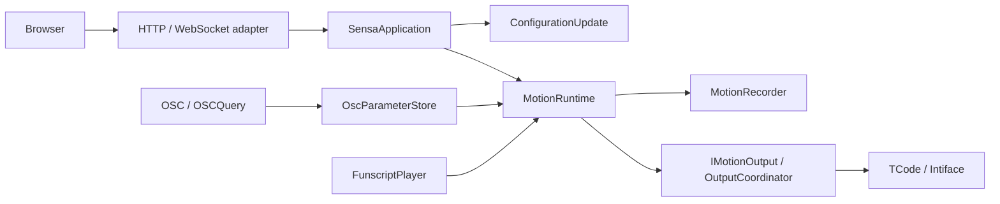

# Architecture and behavior contracts

[简体中文](architecture.md) | **English**

The backend turns one actual input into twelve-axis targets and distributes them through output configurations. The browser owns intentions and drafts; the backend owns permission, stopping, validity and save transactions. This page describes boundaries; see the [guide](guide.en.md) for operation and [glossary](../GLOSSARY.md) for terms.

## One command boundary

| Module | Rules it owns |
| --- | --- |
| [SensaApplication](https://github.com/SeaLoong/Sensa/blob/main/src/Application/SensaApplication.cs) | Shared command dispatch, mode/script/recording/connection operations |
| [ConfigurationUpdate](https://github.com/SeaLoong/Sensa/blob/main/src/Application/ConfigurationUpdate.cs) | Serialized validation, disarm, stop, reconnect and persistence; configuration/connection rollback |
| [MotionRuntime](https://github.com/SeaLoong/Sensa/blob/main/src/Runtime/MotionRuntime.cs) | Actual mode, permission, gates, fusion, freshness, request generations and stop |
| [IMotionOutput](https://github.com/SeaLoong/Sensa/blob/main/src/Motion/IMotionOutput.cs) | Send/stop seam replaceable by isolated tests |
| [OutputCoordinator](https://github.com/SeaLoong/Sensa/blob/main/src/Outputs/OutputCoordinator.cs) | Output types, profiles and transport lifecycle without exposing protocols to runtime |
| [OscParameterStore](https://github.com/SeaLoong/Sensa/blob/main/src/Input/Osc/OscModels.cs) | Sources, values, receive/change timestamps, sequences and Avatar lifecycle |

UDP and OSCQuery share Avatar-change cleanup, resetting caches/learning and stopping OSC. Unconsumed bundles preserve structure, order and timetags for forwarding. Input interpretation is not atomic timetag-based frame scheduling.

## Permission and stopping invariants

| Event | Required behavior |
| --- | --- |
| Browse navigation/input tabs | Keep actual mode and permission unchanged |
| Change mode, replace script, save configuration | Disarm/stop first; invalidate old pending requests |
| Emergency stop/clear | Latch stop; clearing does not reactivate |
| Pause/stop/unload script | Stop automatic frames/UDP refresh; explicitly permitted seek/step may still send |
| Gate/spatial invalidity | Stop without falling back to stale same-axis values |
| Startup | Do not restore input, enabled outputs, scripts or motion |

Connection grants no permission, but an already active input may send its valid current target to a new connection. Recording precedes distribution. Command telemetry, recordings and UDP sends do not establish mechanical execution.

## Signal and spatial validity

Ordinary scalar processing matches paths/source/role, then calibrates, inverts, curves, fuses and gates. OgbDepth/OgbTouch interpret external parameters without renaming their protocol. Spatial input has a separate default-off experimental permission.

| Family | Coordinate/freshness rules |
| --- | --- |
| Legacy Point/Handle/Pose | ReferenceLocal; oldest participating channel, including Handle grab; default 1000 ms or positive timeout |
| Fixed Sensa SPS | AvatarRootLocal; known P0–P3 geometry, unsaturated inputs and residual checks; stationary P may cache, changing Sample defaults to 1000 ms, capped at 1250 ms |
| Native Shader | AvatarRootLocal; same-source contiguous Frame/X/Y/Z/Valid with Valid last; Frame change age at most 500 ms; bridge separately owns monotonicity/freeze/two-frame recovery |

A dedicated marker narrows Sender ambiguity without proving atomic frames. Distances from four known non-coplanar anchors locate one local point, not world motion, orientation or a GPU surface. [Positioning](positioning.en.md) and the [dictionary](osc-parameters.en.md) define protocols, equations and stop conditions.

## Browser modules

React retains native controls, dialogs and semantic labels. TDesign styling requires neither MUI nor the TDesign React runtime. The header carries actual state/permission while content scrolls separately. Drafts differ from saved configuration.

| File | Responsibility |
| --- | --- |
| [configuration.js](https://github.com/SeaLoong/Sensa/blob/main/src/web/configuration.js) | Normalize drafts, output references, conflicts and saves |
| [input-workflows.js](https://github.com/SeaLoong/Sensa/blob/main/src/web/input-workflows.js) | Manual/script intentions and timecodes |
| [realtime-session.js](https://github.com/SeaLoong/Sensa/blob/main/src/web/realtime-session.js) | Same-origin session, correlation, timeout, disconnect rejection/reconnect without replay |
| [osc-workspace.js](https://github.com/SeaLoong/Sensa/blob/main/src/web/osc-workspace.js) / [osc-preview.js](https://github.com/SeaLoong/Sensa/blob/main/src/web/osc-preview.js) | Preset drafts, matching, filters, preview and calibration |
| [i18n.js](https://github.com/SeaLoong/Sensa/blob/main/src/web/i18n.js) | URL/preference/environment locale, document routing and text |
| [diagnostics.js](https://github.com/SeaLoong/Sensa/blob/main/src/web/diagnostics.js) | Log/state filtering |

The standalone explorer uses local classic scripts, a pure model and bundled Three.js, with no application session/device dependency. Pages statically publishes Markdown and the same six explorer assets, outside the motion runtime.

## Verification seams

TimeProvider injects time. Isolated tests use virtual clocks, loopback ports and mock transports. Installers preflight managed files before writing and retain user changes; shared smoke tooling owns process cleanup.

Plan affected local checks and reuse valid receipts. Browsers, screenshots, process smoke and World PlayMode run only in Actions. [Development](development.en.md) defines continuation/release gates. EditMode, metadata and browser mocks do not prove uploaded-client or hardware behavior.
