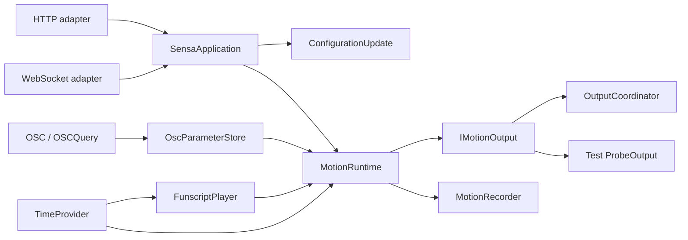

# Architecture and behavior contracts

[简体中文](architecture.md) | **English**

This refactor preserves twelve axes, 29 presets, four output types and existing screenshot scenarios, organizing implementation and tests around observable user workflows. See the [feature reference](features.en.md), [development workflow](development.en.md) and [glossary](../GLOSSARY.md).

## Control and state

- [SensaApplication](https://github.com/SeaLoong/Sensa/blob/main/src/Application/SensaApplication.cs) is the control module, with HTTP and WebSocket as two real adapters. Methods, paths, bodies and errors have one dispatch implementation; multipart uploads use the same script-loading operation. Existing HTTP entry points retain their external behavior.
- [ConfigurationUpdate](https://github.com/SeaLoong/Sensa/blob/main/src/Application/ConfigurationUpdate.cs) validates, disarms, stops, changes connections and persists within one serialized transaction. Failure restores configuration and connections, including failures during configuration copy or processor rebuilding.
- [MotionRuntime](https://github.com/SeaLoong/Sensa/blob/main/src/Runtime/MotionRuntime.cs) owns activation, gates, spatial validity, request generations, coalescing and distribution. It depends only on [IMotionOutput](https://github.com/SeaLoong/Sensa/blob/main/src/Motion/IMotionOutput.cs), without separate serial/UDP/TCP/Intiface dependencies.
- [OscParameterStore.ChangeAvatar](https://github.com/SeaLoong/Sensa/blob/main/src/Input/Osc/OscModels.cs) owns source lifecycle. UDP and OSCQuery both clear data, reset learning and stop activated OSC input through it. Unconsumed messages in mixed OSC bundles now reach raw preview/passthrough in filtered bundles preserving nesting, order and timetags. [OSC bundle semantics](https://opensoundcontrol.stanford.edu/spec-1_0.html).
- TimeProvider supplies time to playback, runtime, storage, positional validity, recording and UDP refresh. Production uses system time; tests use virtual time without sleeps or reflection into private watchdogs.

## Workflow invariants

| Operation | Activation and motion targets |
| --- | --- |
| Browse an input tab | Selects a workspace without changing the running mode |
| Change actual input mode | Disarms, stops and invalidates queued requests; explicit reactivation is required |
| Update a target in the same manual mode | Sends when enabled; otherwise stores the target |
| Import or replace a script | Disarms before loading, even if already in Script mode |
| Save full configuration | Disarms first and stays disarmed afterward |
| Emergency stop / clear | Stop latches; clearing does not reactivate |
| Pause, stop or unload a script | Requests output stop; resetting the cursor does not home hardware |
| Explicit paused seek/step | Can send the target while Script input remains enabled |
| Invalid geometry / PB release | Closes spatial gating and stops, without scalar fallback |
| Restart | Does not restore output activation, input, loaded script or motion |

Script import skips invalid actions and rejects a file with no valid actions. Nonfinite rates are rejected. Fractional time remainder prevents accumulated rounding error, and reading a finished snapshot between ticks does not drop the final frame. Recording captures L0 targets before distribution, without transport/hardware confirmation. TCode tokens with ramp suffixes now update per-output telemetry too.

## Browser modules

| Module | Concentrated knowledge |
| --- | --- |
| [configuration.js](https://github.com/SeaLoong/Sensa/blob/main/src/web/configuration.js) | Drafts, unique default profiles, reference repair, connection conflicts and save rules |
| [input-workflows.js](https://github.com/SeaLoong/Sensa/blob/main/src/web/input-workflows.js) | Manual requests, script timecodes, loop ranges, rates and input intent |
| [realtime-session.js](https://github.com/SeaLoong/Sensa/blob/main/src/web/realtime-session.js) | Same-origin sessions, correlation, timeouts, disconnect rejection, reconnect and disposal; no motion replay after disconnect |
| [osc-workspace.js](https://github.com/SeaLoong/Sensa/blob/main/src/web/osc-workspace.js) | OSC presets, drafts and workspace selection |
| [diagnostics.js](https://github.com/SeaLoong/Sensa/blob/main/src/web/diagnostics.js) | Structured logs, axis traces and diagnostic filtering |
| JSX views | Controls, configuration, diagnostics and timeline rendering; App composes state and operations |

Existing layout and bilingual catalogs remain. Rules are tested through the same interface used by production callers, rather than private React closures. Existing geometry/encoding implementations keep their focused responsibilities instead of adding shallow modules merely to split files.

## Tests and tools

.NET contracts cover configuration, signals, spatial tracking, runtime, playback, recording, OSC, outputs, presets, Intiface and application control. They share virtual time and isolated output fixtures. Network adapter tests use random loopback ports. Captured geometry fixtures, deterministic random samples, SPS radial limitations and shorter-target relearning remain covered.

Web contracts observe configuration, input, OSC, diagnostics, realtime sessions and localization. E2E workers share mock peers while each scenario keeps a separate temporary configuration and application process. Existing desktop/narrow screenshots remain, with new mode-switch and player-stop scenarios. These run only in GitHub Actions.

Unity tests share AvatarBuildFixture for automatic generation, Pose validation and GPU decoding. Static checks are not Unity compilation or client validation. Both installer CLIs share [lab_installation.py](https://github.com/SeaLoong/Sensa/blob/main/scripts/lab_installation.py) and validate the complete plan before writing. Process smoke CLIs share [process_smoke.py](https://github.com/SeaLoong/Sensa/blob/main/scripts/process_smoke.py) for isolation, sessions, deadlines and cleanup. World PlayMode/screenshot suites and full-process smoke have CI-only guards.

## Verification and publication

[ci-plan.py](https://github.com/SeaLoong/Sensa/blob/main/scripts/ci-plan.py) is the change-impact interface shared by [verify.py](https://github.com/SeaLoong/Sensa/blob/main/scripts/verify.py) and GitHub Actions. Local successful checks have receipts keyed by relevant sources, commands and toolchain. Changes or failure invalidate them; unchanged successful checks are reused.

Previews require full E2E comparison for the candidate commit and the necessary isolated native smoke checks on six platforms. Documentation/test-only changes do not publish products; unknown paths or unavailable diffs select full verification. After publication, paginated identity checks retain the ten newest published prereleases while preserving stable releases, drafts and Git tags. See [development](development.en.md) and the [ADR](adr/0002-impact-based-verification.md).
