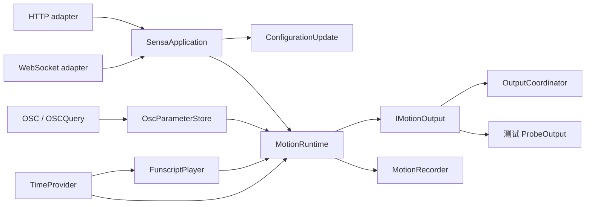

# 架构与行为契约

**简体中文** | [English](architecture.en.md)

本次重构保留十二轴、29 套预设、四类输出和全部既有截图场景，以用户操作对应的行为契约组织实现与测试。完整功能见[功能全景](features.md)，验证流程见[开发与验证](development.md)，领域用语见[术语表](../GLOSSARY.md)。

## 控制与状态

- [SensaApplication](https://github.com/SeaLoong/Sensa/blob/main/src/Application/SensaApplication.cs) 是控制 module；HTTP 与 WebSocket 是两个真实 adapter。方法、路径、请求体及错误结果只有一份分派实现，multipart 上传也进入同一脚本加载操作。旧 HTTP 操作入口保留其对外行为。
- [ConfigurationUpdate](https://github.com/SeaLoong/Sensa/blob/main/src/Application/ConfigurationUpdate.cs) 在同一个串行事务中校验、关闭输入、停止输出、应用连接变化并保存；失败时恢复配置与连接。配置复制与处理器重建也在恢复范围内。
- [MotionRuntime](https://github.com/SeaLoong/Sensa/blob/main/src/Runtime/MotionRuntime.cs) 管理输入启用、门控、空间有效性、旧请求代次、合并与分发；它只依赖 [IMotionOutput](https://github.com/SeaLoong/Sensa/blob/main/src/Motion/IMotionOutput.cs)，不再分别认识串口、UDP、TCP、Intiface。
- [OscParameterStore.ChangeAvatar](https://github.com/SeaLoong/Sensa/blob/main/src/Input/Osc/OscModels.cs) 集中来源生命周期。UDP 和 OSCQuery 都经该入口清数据、复位信号学习状态，并停止已启用的 OSC 输入。混合 OSC bundle 中未消费的消息进入过滤后的原始 bundle，保留嵌套、顺序与 timetag，不再随已处理 Avatar 消息一起丢失。[OSC bundle 语义](https://opensoundcontrol.stanford.edu/spec-1_0.html)
- 时间由 TimeProvider 注入播放器、运行时、参数存储、位置有效性、录制和 UDP 重播。生产使用系统时钟；测试使用虚拟时钟，不靠等待真实时间或反射私有 watchdog。

## 使用流程的不变量

| 操作 | 输入启用与设备目标 |
| --- | --- |
| 浏览输入页签 | 仅选择界面，不切换实际输入 |
| 实际改变输入模式 | 关闭输入、停止输出、使旧待发请求失效；需要显式重新启用 |
| 更新同一手动模式的目标 | 输入已启用时发送；关闭时只保存目标 |
| 导入或替换脚本 | 先关闭输入，再加载；即使原来已是 Script 也不续动 |
| 保存完整配置 | 先关闭输入，成功后仍保持关闭 |
| 紧急停止／解除 | 停止会锁存；解除不重新启用输入 |
| 暂停、停止、卸载脚本 | 请求停止输出；Stop 的游标归零不是设备归位 |
| 暂停时显式定位或步进 | Script 输入仍启用时可以发送该目标 |
| 几何失效／PB 松手 | 关闭几何门控并停止；不回退到同轴旧标量 |
| 重启 | 不恢复输出启用、输入启用、脚本或运动 |

脚本导入会跳过无效动作条目，无任何有效动作时报错；非有限倍速被拒绝。播放器保留小数时间余量，避免分数倍速累积取整误差；在定时器间读取完成快照也不会吞掉最后一帧。录制记录分发前的 L0 目标，不代表传输成功或硬件执行确认。带 ramp 后缀的 TCode 目标现在也进入每输出遥测。

## 浏览器 module

| module | 集中管理的知识 |
| --- | --- |
| [configuration.js](https://github.com/SeaLoong/Sensa/blob/main/src/web/configuration.js) | 配置草稿、唯一默认轴配置、输出引用修复、连接冲突和保存规则 |
| [input-workflows.js](https://github.com/SeaLoong/Sensa/blob/main/src/web/input-workflows.js) | 手动请求、脚本时码、循环区间、倍速和输入意图 |
| [realtime-session.js](https://github.com/SeaLoong/Sensa/blob/main/src/web/realtime-session.js) | 同源会话、请求关联、超时、断线拒绝、重连和关闭；不重放断线期间的动作 |
| [osc-workspace.js](https://github.com/SeaLoong/Sensa/blob/main/src/web/osc-workspace.js) | OSC 预设、草稿和工作区选择 |
| [diagnostics.js](https://github.com/SeaLoong/Sensa/blob/main/src/web/diagnostics.js) | 结构化日志、轴调试与诊断筛选 |
| JSX 视图 | 控件、配置、诊断和时间轴渲染；由 App 组合状态与操作 |

保留已有布局和中英文词典。规则测试通过与生产调用相同的 interface，不依赖 React 闭包中的私有函数。现有几何解算和协议编码已经有明确职责，保留其实现，避免为拆文件而引入 shallow module。

## 测试和工具

.NET 测试按 Configuration、Signal、Spatial、Motion、Script、Recording、OSC、Output、Preset、Intiface 及应用控制契约组织，共用虚拟时钟与隔离输出 fixture。网络 adapter 测试只用回环随机端口。几何 fixture、确定性随机样本、SPS 径向限制及较短目标重新学习都保留。

Web 测试从配置、输入、OSC、诊断、实时会话和双语行为观察结果。E2E worker 复用模拟对端，每个场景仍启动独立临时配置和程序进程，设备输出只指向模拟器；旧桌面／窄屏截图覆盖保留，并增加输入切换与脚本停止场景。仅在 GitHub Actions 执行。

Unity 测试共用 AvatarBuildFixture，覆盖自动生成、Pose 预检和 GPU 解码；本次不把静态校验写成 Unity 编译或客户端验收。安装器的两个 CLI 共用 [lab_installation.py](https://github.com/SeaLoong/Sensa/blob/main/scripts/lab_installation.py)，完整预检后才写入；两个进程冒烟 CLI 共用 [process_smoke.py](https://github.com/SeaLoong/Sensa/blob/main/scripts/process_smoke.py)，集中隔离配置、会话、超时和清理。World PlayMode／截图套件与完整进程冒烟入口有 CI-only 保护。

## 验证与发布

[ci-plan.py](https://github.com/SeaLoong/Sensa/blob/main/scripts/ci-plan.py) 是影响计划的单一 interface；[verify.py](https://github.com/SeaLoong/Sensa/blob/main/scripts/verify.py) 与 GitHub Actions 使用同一计划。本地成功检查按相关源码、命令和工具链保存 receipt，相关输入变化或失败后失效；未改变的成功检查复用结果。

预发布必须经过当前候选提交的全量 E2E 比较与必要的六平台隔离冒烟。文档／纯测试变更不触发产品预发布；未知路径和差异不可用时保守全量。每次发布后分页核对远端，只保留最近十个已发布预发布；稳定版本、草稿和 Git tags 保留。细节见[开发与验证](development.md)和 [ADR](adr/0002-impact-based-verification.md)。
