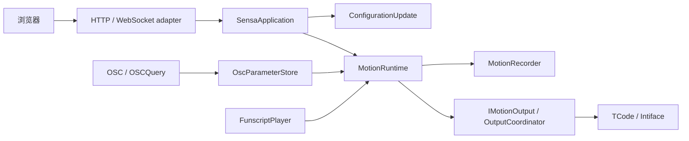

# 架构与行为契约

**简体中文** | [English](architecture.en.md)

后端将一种实际输入转换为十二轴动作目标，并按每个输出的配置分发。浏览器表达意图与草稿；许可、停止、信号有效性和保存事务由后端决定。本文解释职责边界，使用步骤见[工作台指南](guide.md)，术语见[术语表](../GLOSSARY.md)。

## 单一命令入口与数据流

| 模块 | 拥有的规则 |
| --- | --- |
| [SensaApplication](https://github.com/SeaLoong/Sensa/blob/main/src/Application/SensaApplication.cs) | 共用命令分派；模式、脚本、录制与连接操作 |
| [ConfigurationUpdate](https://github.com/SeaLoong/Sensa/blob/main/src/Application/ConfigurationUpdate.cs) | 串行校验、关闭输入、停止、重连、持久化；失败恢复配置与连接 |
| [MotionRuntime](https://github.com/SeaLoong/Sensa/blob/main/src/Runtime/MotionRuntime.cs) | 实际模式、许可、门控、信号融合、时效、请求代次与停止 |
| [IMotionOutput](https://github.com/SeaLoong/Sensa/blob/main/src/Motion/IMotionOutput.cs) | 发送／停止边界；隔离测试可替换输出 |
| [OutputCoordinator](https://github.com/SeaLoong/Sensa/blob/main/src/Outputs/OutputCoordinator.cs) | 输出类型、轴配置、传输生命周期；不向运行时暴露协议细节 |
| [OscParameterStore](https://github.com/SeaLoong/Sensa/blob/main/src/Input/Osc/OscModels.cs) | 来源、值、更新时间／内容变化时间、序列与 Avatar 生命周期 |

UDP 与 OSCQuery 的 Avatar 变化进入同一清理入口，复位缓存和学习并停止 OSC。未消费 bundle 保留结构、顺序与 timetag 转发；输入解释不是按 timetag 的原子帧调度器。

## 许可与停止不变量

| 事件 | 必须保持的行为 |
| --- | --- |
| 浏览导航／输入页签 | 不改变实际模式或许可 |
| 模式改变、脚本替换、配置保存 | 先关闭输入并停止，旧待发请求失效 |
| 急停／解除 | 锁存停止；解除不自动启用 |
| 暂停、停止、卸载脚本 | 停止自动帧／UDP 刷新；已许可的显式 seek／step 仍可发送 |
| 门控／空间失效 | 停止，不回退同轴旧值伪装有效 |
| 启动 | 不恢复输入、输出启用、脚本和运动状态 |

连接不会自动打开许可，但已启用输入可向新连接发送当前有效目标。录制发生在分发前；命令遥测、录制和 UDP 发送都不证明机械执行。

## 信号与空间有效性

普通标量先匹配路径、选择来源与角色，再做校准、反向、曲线、融合和门控。OgbDepth／OgbTouch 在这一边界解释外部参数，不修改外部协议。空间输入另有默认关闭的实验许可。

| 输入族 | 坐标／新鲜度规则 |
| --- | --- |
| 旧 Point／Handle／Pose | ReferenceLocal；最旧参与通道，Handle 包括抓取状态；默认 1000 ms 或正值超时 |
| 固定 Sensa SPS | AvatarRootLocal；P0–P3 已知几何、非饱和与残差检查；静止 P 可缓存，Sample 内容变化默认 1000 ms、上限 1250 ms |
| 原生 Shader | AvatarRootLocal；同来源 Frame/X/Y/Z/Valid 连续序列、Valid 最后；Frame 内容变化上限 500 ms，桥另管单调／冻结／两帧恢复 |

专用根标记缩小 Sender 歧义，不证明同帧原子性。四个已知非共面锚点的同点距离可解局部 XYZ；它不包含世界运动、朝向或 GPU 表面。公开协议、公式和停止条件集中于[定位说明](positioning.md)与[参数字典](osc-parameters.md)。

## 浏览器模块

React 保留原生控件、对话框与语义标签，TDesign 风格不依赖 MUI 或 TDesign React 运行时。顶栏承载实际状态／许可，正文独立滚动；UI 草稿与已保存配置分开。

| 文件 | 职责 |
| --- | --- |
| [configuration.js](https://github.com/SeaLoong/Sensa/blob/main/src/web/configuration.js) | 草稿归一化、输出引用、冲突与保存 |
| [input-workflows.js](https://github.com/SeaLoong/Sensa/blob/main/src/web/input-workflows.js) | 手动／脚本意图与时码 |
| [realtime-session.js](https://github.com/SeaLoong/Sensa/blob/main/src/web/realtime-session.js) | 同源会话、关联、超时、断线拒绝与重连；不重放控制 |
| [osc-workspace.js](https://github.com/SeaLoong/Sensa/blob/main/src/web/osc-workspace.js)／[osc-preview.js](https://github.com/SeaLoong/Sensa/blob/main/src/web/osc-preview.js) | 预设草稿、匹配、过滤、预览与校准 |
| [i18n.js](https://github.com/SeaLoong/Sensa/blob/main/src/web/i18n.js) | URL／偏好／环境语言，文档路由与呈现文本 |
| [diagnostics.js](https://github.com/SeaLoong/Sensa/blob/main/src/web/diagnostics.js) | 日志与状态筛选 |

独立参数图解使用经典本地脚本、纯模型与打包 Three.js；没有应用会话或设备依赖。Pages 将 Markdown 和同六个图解资产静态发布，不参与运动运行时。

## 验证边界

时间通过 TimeProvider 注入；隔离测试使用虚拟时钟、回环端口和模拟传输。安装器在写入前预检受管源码，保留用户改动；完整进程清理由公共冒烟工具负责。

本机先规划再执行受影响检查并复用有效 receipt。浏览器、截图、进程冒烟和 World PlayMode 仅在 Actions；主线接续与发布门槛见[开发流程](development.md)。EditMode、元数据和浏览器模拟不能替代真实上传／客户端／硬件验收。
