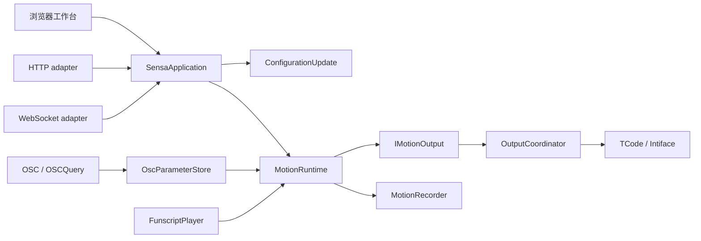

# 架构与行为契约

**简体中文** | [English](architecture.en.md)

Sensa 把选定输入转换为十二轴动作目标，再按每个输出的配置分发。浏览器负责操作与预览；后端负责输入许可、配置事务、门控与停止。术语见[术语表](../GLOSSARY.md)，能力边界见[功能参考](features.md)。

## 数据流

| 边界 | 职责 |
| --- | --- |
| [SensaApplication](https://github.com/SeaLoong/Sensa/blob/main/src/Application/SensaApplication.cs) | HTTP／WebSocket 共用命令分派；模式、脚本、录制、连接操作 |
| [ConfigurationUpdate](https://github.com/SeaLoong/Sensa/blob/main/src/Application/ConfigurationUpdate.cs) | 串行校验、关闭输入、停止、应用、重连与持久化；失败恢复配置和连接 |
| [MotionRuntime](https://github.com/SeaLoong/Sensa/blob/main/src/Runtime/MotionRuntime.cs) | 实际模式、输入许可、信号处理、时效、门控、合并、请求代次和停止 |
| [IMotionOutput](https://github.com/SeaLoong/Sensa/blob/main/src/Motion/IMotionOutput.cs) | 运行时只依赖动作发送与停止接口；测试替换为隔离输出 |
| [OutputCoordinator](https://github.com/SeaLoong/Sensa/blob/main/src/Outputs/OutputCoordinator.cs) | 按输出类型和配置分发，不向运行时暴露传输细节 |
| [OscParameterStore](https://github.com/SeaLoong/Sensa/blob/main/src/Input/Osc/OscModels.cs) | 来源、参数值、更新时间、序列与 Avatar 生命周期 |

UDP 与 OSCQuery 共用 Avatar 变更入口：清除对应数据、复位学习状态，停止已启用的 OSC 输入。混合 OSC bundle 的未消费部分保留结构、顺序和 timetag 供转发；参数输入不因此具备按 timetag 调度的完整帧语义。[OSC parser](https://github.com/SeaLoong/Sensa/blob/main/src/Input/Osc/OscPacketParser.cs)

## 输入许可是不变量

| 操作 | 后端行为 |
| --- | --- |
| 浏览页面或输入页签 | 不改变实际模式和输入许可 |
| 实际改变输入模式 | 关闭输入，停止输出，使旧待发请求失效 |
| 替换／导入脚本 | 先关闭输入；即使原来已是 Script 也不续动 |
| 保存配置 | 先关闭输入；成功后仍保持关闭 |
| 急停／解除急停 | 急停锁存；解除不恢复运动 |
| 脚本暂停／停止／卸载 | 停止自动帧和 UDP 刷新；旧定时帧失效 |
| 暂停时显式定位／步进 | Script 输入仍启用时可发送该目标 |
| 门控或空间有效性失效 | 停止，不能回退旧同轴标量伪装有效 |
| 启动程序 | 不恢复输入、输出启用、脚本或运动 |

输出目标不是位置回读。录制位于分发前，不能证明传输成功；UDP 也没有远端执行确认。

## Web 工作台

Web 使用 React 与本项目的基本组件，样式和控件由 [ui.jsx](https://github.com/SeaLoong/Sensa/blob/main/src/web/ui.jsx)、[controls.jsx](https://github.com/SeaLoong/Sensa/blob/main/src/web/controls.jsx)、[styles.css](https://github.com/SeaLoong/Sensa/blob/main/src/web/styles.css) 管理，不依赖 Material UI。

主导航是控制／OSC／设置，详细选项逐层展开。顶栏保留实际模式、输入许可与急停；界面草稿不等于已保存配置。

| 模块 | 集中管理的规则 |
| --- | --- |
| [configuration.js](https://github.com/SeaLoong/Sensa/blob/main/src/web/configuration.js) | 配置草稿、默认轴配置、输出引用、目标冲突与保存 |
| [input-workflows.js](https://github.com/SeaLoong/Sensa/blob/main/src/web/input-workflows.js) | 手动目标、脚本时码、倍速和循环意图 |
| [realtime-session.js](https://github.com/SeaLoong/Sensa/blob/main/src/web/realtime-session.js) | 同源会话、请求关联、超时、断线拒绝、重连和页面生命周期；不重放旧动作 |
| [osc-workspace.js](https://github.com/SeaLoong/Sensa/blob/main/src/web/osc-workspace.js) | 预设和映射草稿 |
| [osc-preview.js](https://github.com/SeaLoong/Sensa/blob/main/src/web/osc-preview.js) | 路径匹配、FT 前缀过滤、参数预览和实验校准 |
| [diagnostics.js](https://github.com/SeaLoong/Sensa/blob/main/src/web/diagnostics.js) | 日志与诊断筛选 |

## 空间输入单独隔离

Contact 解算保留为 `ReferenceLocal` 实验估计。默认 `allowExperimentalSpatialInput=false`，旧空间配置也受限；内置目录不再推荐 Point／Pose。所有参与通道采用最旧更新时间，默认空间年龄上限为 1 秒，正值输入超时可覆盖。新鲜并不证明同帧，低残差并不证明同一 Sender。

四个非共面锚点的真实同点距离足以解相对 XYZ，但普通 Proximity 不提供上述身份／批次保证，也观测不到共同世界运动。可信生产者的同批 XYZ＋frameId＋valid 是后续设计条件，当前未实现。[定位论证](positioning.md)

## 验证与工具

时间依赖通过 TimeProvider 注入，隔离契约测试用虚拟时钟和 mock transports。网络适配器测试仅用回环随机端口。Unity 测试与元数据检查不冒充上传后的客户端验收。

安装器共用 [lab_installation.py](https://github.com/SeaLoong/Sensa/blob/main/scripts/lab_installation.py)，完整预检后写入；冒烟共用 [process_smoke.py](https://github.com/SeaLoong/Sensa/blob/main/scripts/process_smoke.py)，负责隔离配置、超时和清理。

本地先执行 `python -X utf8 scripts/verify.py --plan`，再执行验证入口；有效 receipt 可复用。浏览器 E2E、截图、完整进程冒烟与 World PlayMode 仅在 Actions。CI 按影响运行，并继承／恢复尚未完成的产品验证；意图 artifact 不能替代真实必要 jobs 成功。预发布要求候选同一 SHA 的全量截图比较及必要产品链，只保留最新十个已发布预发布，保留稳定版、草稿和 tags。[开发流程](development.md)、[E2E](e2e.md)、[决策](adr/0002-impact-based-verification.md)
