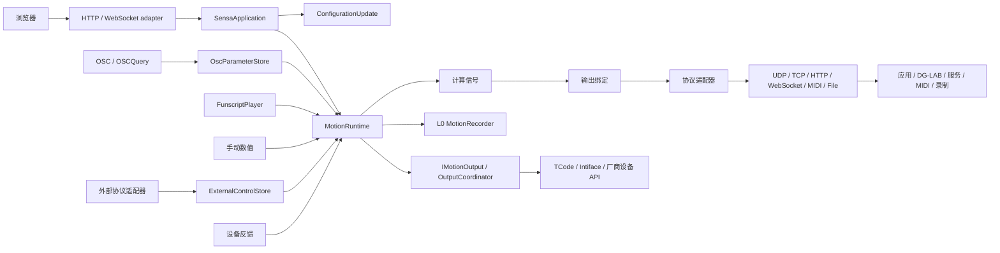

# 架构与行为契约

**简体中文** | [English](architecture.en.md)

Sensa 桌面版通过共用运行时连接输入、计算和输出；WebSensa 在浏览器运行手动／脚本工作台，直接管理浏览器设备连接。两个版本展示相同的来源到输出流程，具体传输与输入由运行方式决定。本页说明职责、时序与生命周期。[使用指南](guide.md) · [术语](../GLOSSARY.md)

## 单一命令入口与数据流

| 模块 | 拥有的规则 |
| --- | --- |
| [SensaApplication](https://github.com/SeaLoong/Sensa/blob/main/src/Application/SensaApplication.cs) | 共用命令分派；模式、脚本、录制与连接操作 |
| [ConfigurationUpdate](https://github.com/SeaLoong/Sensa/blob/main/src/Application/ConfigurationUpdate.cs) | 串行校验、关闭输入、停止、重连、持久化；失败恢复配置与连接 |
| [MotionRuntime](https://github.com/SeaLoong/Sensa/blob/main/src/Runtime/MotionRuntime.cs) | 实际模式、许可、门控、信号融合、时效、请求代次与停止 |
| [ProtocolInputCoordinator](https://github.com/SeaLoong/Sensa/blob/main/src/Input/Protocols/ProtocolInputCoordinator.cs)／[ExternalControlStore](https://github.com/SeaLoong/Sensa/blob/main/src/Input/Protocols/ExternalControl.cs) | 独立协议监听、单来源会话、原子多通道命令、类型与时长、租约和当前命令身份 |
| [ComputedSignalEvaluator](https://github.com/SeaLoong/Sensa/blob/main/src/Signals/ComputedSignalEvaluator.cs) | 有界依赖图、计算复用、同来源／坐标框检查、最旧样本时间与数值有效性 |
| [SignalInputSource](https://github.com/SeaLoong/Sensa/blob/main/src/Signals/SignalInputSource.cs) | 将配置来源解析为带时间的有效或无效样本 |
| [ISignalProcessor](https://github.com/SeaLoong/Sensa/blob/main/src/Signals/ISignalProcessor.cs) | 共用计算帧求值与时序复位边界 |
| [SignalOutputCoordinator](https://github.com/SeaLoong/Sensa/blob/main/src/Outputs/SignalOutputCoordinator.cs) | 每绑定有效性、当前值交付、事件队列、停止与协议适配器 |
| [FunscriptTrackRecorder](https://github.com/SeaLoong/Sensa/blob/main/src/Recording/FunscriptTrackRecorder.cs) | 每绑定有效片段、轴文件命名、有界动作与完成文件发布 |
| [SignalSession](https://github.com/SeaLoong/Sensa/blob/main/src/Recording/SignalSession.cs) | 录制格式、文件列表与 funscript／诊断信号回放 |
| [IMotionOutput](https://github.com/SeaLoong/Sensa/blob/main/src/Motion/IMotionOutput.cs) | 发送／停止边界；隔离测试可替换输出 |
| [OutputCoordinator](https://github.com/SeaLoong/Sensa/blob/main/src/Outputs/OutputCoordinator.cs) | 输出类型、轴配置、传输生命周期；在输出层封装协议细节 |
| [OscParameterStore](https://github.com/SeaLoong/Sensa/blob/main/src/Input/Osc/OscModels.cs) | 来源、值、更新时间／内容变化时间、序列与 Avatar 生命周期 |

UDP 与 OSCQuery 的 Avatar 变化进入同一清理入口，复位缓存和学习并停止 OSC。未消费 bundle 保留结构、顺序与 timetag 转发。输入按消息逐项解释；bundle 的 timetag 随转发保留，原子帧调度属于当前实现范围之外。

## 许可与停止不变量

| 事件 | 必须保持的行为 |
| --- | --- |
| 浏览导航／输入页签 | 切换查看内容，保留实际模式和许可 |
| 模式改变、脚本替换、配置保存 | 先关闭输入并停止，旧待发请求失效 |
| 急停／解除 | 锁存停止；解除后等待手动启用输入 |
| 暂停、停止、卸载脚本 | 停止自动帧／UDP 刷新；已许可的显式 seek／step 仍可发送 |
| 门控／空间失效 | 停止相应动作或绑定，并使旧目标失效 |
| 启动 | 以输入关闭、输出禁用、脚本未加载和运动停止的状态启动 |

连接与输入启用分别管理；已启用输入可向新连接发送当前有效目标。L0 录制位于动作分发前；录制输出默认将绑定换算后的 0～1 数值保存为 funscript 轨道，每个有效片段独立计时和存档。高级 JSON Lines／CSV 保留同一时间线上的原始值、换算值和有效性。命令遥测、录制与设备回报分别呈现各自含义。

## 信号与空间有效性

普通标量先匹配路径与来源，再做校准、反向、曲线、角色融合和门控。OgbDepth／OgbTouch 按外部协议定义解释对应参数。空间输入另有默认关闭的实验许可。

计算信号在校准前生成可复用的原始数值，输入可以是 OSC 参数、已通过模型检查的定位指标、手动／脚本读数、设备反馈、常量或另一计算。时间处理属于当前求值器实例，使用注入时钟。配置校验限制图规模与引用深度，并拒绝缺失引用和循环；运行时按依赖顺序复用结果，同次求值共用叶子输入。每个结果保留参与输入的来源、坐标框和最旧样本时间，必需输入失效会沿引用链传播到依赖它的绑定，现有轴映射保留动作运行时的门控。关闭输入、重新配置和来源变化会复位相应时序状态。浏览器使用同一后端求值结果展示已保存状态。[运算与配置](computed-signals.md)

| 输入族 | 坐标／新鲜度规则 |
| --- | --- |
| 旧 Point／Handle／Pose | ReferenceLocal；最旧参与通道，Handle 包括抓取状态；默认 1000 ms 或正值超时 |
| Contact 直接定位（SDK Beta） | AvatarRootMeters；一个专用 Self Sender／Receiver，十二字段完整、Proximity 为正且 Radius 受支持；Sample 变化寿命最多 1000 ms |
| SPS 四点定位 | AvatarRootLocal；P0–P3 已知几何、非饱和与残差检查；静止 P 可缓存，Sample 内容变化默认 1000 ms、上限 1250 ms |
| 原生 Shader | AvatarRootLocal；检查完整测量包、来源、帧推进与有效状态；字段、编码与恢复规则见[定位协议](positioning.md) |

专用根标记与唯一通道将每个根点测量对应到期望的自身目标。四点距离按制作尺度的 AvatarRootLocal 解算单点位置；Contact 使用物理米制 AvatarRootMeters，报告中点位置与接触点相对速度。Contact 位置和速度指标共用 SensaPoint 校准、启用与失效停止。原生报告提供 Contact 属性值，Sensa Sample 补充生产端活动检查；时钟、序号与稳定 Sender ID 超出该原生报告的字段范围。[SDK 契约与依据](contact-sdk.md)。公开协议、公式和停止条件集中于[定位说明](positioning.md)与[参数字典](osc-parameters.md)。

输出绑定选择来源、换算、数值类型、量程、停止值与发送方式。协议适配器编码 OSC 数值、JSON 消息、DG-LAB 任务或记录；传输负责连接生命周期、有界交付、取消与关闭。状态发送保留最新目标，事件通过有界队列按序交付；设备反馈通过来源解析重新进入计算。[输入、计算与输出决策](adr/0008-signal-pipeline-and-shared-session.md) · [用户配置](signal-pipeline.md)

## 外部协议输入与设备 API

Buttplug v2/v3/v4、TCode、JSON 与厂商兼容入口将控制解释为带通道、目标、时长和方向的外部命令。直接动作路径按通道保留独立时长，停止是有序屏障；协议样本也可作为计算／绑定来源。首次位置轨迹起点未知时，当前值保持无效而目标可读；位置插值表示命令状态，不代表设备回读。原有设备反馈仍是独立来源，协议输入不伪装成 OSC 或硬件反馈。

协议监听与管理 API 分离。共享 HTTP 监听通过不同 `Path` 前缀提供 Buttplug、JSON、厂商 API 与 TCode WebSocket。最长完整路径匹配先选择来源，再交给该来源的会话、通道与时序处理；原始 TCP 与 UDP 保留各自监听。

## 跟随平面与空间计算

空间计算以测量点 `P`、参考原点 `O` 和平面朝向为输入。沿法线的有符号深度与平面内偏移分别描述前后和横向运动；两点距离与方向夹角可单独用于输出绑定。自己 Avatar 内的测量点和参考对象都可移动或旋转；参考原点与朝向来自实时定位时，计算随当前读数更新。结果保留输入的位置单位，角度使用度，最后由输出绑定设置需要的范围和方向。跨 Avatar 互动使用[配对三点姿态](positioning.md#跨-avatar-互动配对三点姿态)的专用深度、偏移和角度指标。

`SensaTrackingFrame` 将目标的平移和旋转变成三个同坐标系测量点：原点、前向和右向。前向点减原点得到虚拟平面的正法线。Shader 直接测得根点和 X/Z 两条轴向；单轴可以定义与其垂直的工作平面，两条独立切向轴可以定义实际采样平面。后者使用叉积，适合需要保留非均匀缩放影响的场景。两种方式的几何含义见[参考平面决策](adr/0009-following-reference-planes.md)。

空间运算核对各组三分量的坐标框、位置单位与方向用途，保留同一 OSC 来源和最旧样本时间。零法线、共线平面轴或无效输入会使依赖该结果的绑定停止。AvatarRootLocal 与 AvatarRootMeters 可用同一来源的 AvatarScale 换算位置单位；不同局部参照的坐标不直接混用。[配置例子](computed-signals.md)

## Unity 作者与定位生成

Unity 作者组件保存配置并实现 SDK `IEditorOnly`。`SensaPlugin` 在 NDMF Generating 中、MA 同阶段处理之前统一读取配置，生成 Contact、约束及临时 Animator／参数／菜单，再由 MA 合并。每次构建的完成状态保存在 `BuildContext.GetState`；源场景与作者预制件保持可编辑。

SPS 四点定位、Contact 直接定位与 Shader 捕获共用该入口，分别输出既有协议。三个根点预制件都可明确选择 Avatar 内的 Transform、SPS、Sensa Component 或原生 Contact。根点参照先读取，再移除可能被其引用的 Sensa 作者组件；上传结果保留原生测量组件与参照 Transform。

只读 SDK 检查点在已核验的 Fury 加工之后、SDK 默认作者清理之前诊断残留设置；NDMF Optimizing 中另检查作者清理和此时 Contact 数量。具体阶段、组件与 GameObject 的 EditorOnly 区别，以及官方版本依据见[Unity 构建指南](unity-build.md)。

## 浏览器模块

React 使用原生控件、对话框与语义标签，本地样式呈现 TDesign 风格。顶栏承载实际状态／许可，正文独立滚动；UI 草稿与已保存配置分开。

| 文件 | 职责 |
| --- | --- |
| [configuration.js](https://github.com/SeaLoong/Sensa/blob/main/src/web/configuration.js) | 草稿归一化、输出引用、冲突与保存 |
| [input-workflows.js](https://github.com/SeaLoong/Sensa/blob/main/src/web/input-workflows.js) | 手动／脚本意图与时码 |
| [realtime-session.js](https://github.com/SeaLoong/Sensa/blob/main/src/web/realtime-session.js) | 同源会话、关联、超时、断线拒绝与重连；重连后等待新的控制请求 |
| [shared-realtime.js](https://github.com/SeaLoong/Sensa/blob/main/src/web/shared-realtime.js) | 页面引用计数客户端、共享会话消息代理与标签页请求隔离 |
| [elected-realtime.js](https://github.com/SeaLoong/Sensa/blob/main/src/web/elected-realtime.js) | Web Locks 独占连接归属，BroadcastChannel 传递跨标签页消息 |
| [osc-workspace.js](https://github.com/SeaLoong/Sensa/blob/main/src/web/osc-workspace.js)／[osc-preview.js](https://github.com/SeaLoong/Sensa/blob/main/src/web/osc-preview.js) | 预设草稿、匹配、过滤、预览与校准 |
| [i18n.js](https://github.com/SeaLoong/Sensa/blob/main/src/web/i18n.js) | 会话偏好／浏览器语言，文档路由与呈现文本 |
| [diagnostics.js](https://github.com/SeaLoong/Sensa/blob/main/src/web/diagnostics.js) | 日志与状态筛选 |

每页通过一个会话复用状态与命令。同源标签页优先通过 SharedWorker 共用一条后端 WebSocket；其不可用时，通过 Web Locks 确保一个标签页拥有连接，再用 BroadcastChannel 传递消息；两种共享方式均不可用时采用每标签页单例。请求分别关联，各页保留本地草稿。页面进入缓存时分离当前客户端，恢复时重新附着。HTTP 连接池与服务器 WebSocket 会话预算分别限制，共用连接减少了受支持标签页占用的后端会话数。

独立参数图解通过经典本地脚本、纯模型与打包 Three.js 在浏览器内展示参数，查看时可独立于应用会话和设备运行。Pages 静态发布 Markdown 与同一套图解资源，运动运行时由 Sensa 服务承载。

## 浏览器原生 WebSensa

`src/core/index.ts` 提供浏览器与 Node.js 可直接使用的信号引擎、脚本时钟和输出队列；`src/websensa` 提供 React 入口与浏览器适配器。静态站与桌面包提供同一 `websensa/` 页面。手动轴、funscript 和明确连接的参数图解送入共用引擎，输出适配器使用 WebSocket、fetch、Web Serial、Web Bluetooth 或 Web MIDI。[共享核心与宿主迁移](adr/0011-shared-core-and-capability-adapters.md)说明 Node.js／Electron 的目标结构。

每个输出按序写入并保留连接代次；兼容 WebSocket 使用者共用目标连接，使用者结束时清理其排队工作。停止先清空待发指令，再调用适配器停止操作。脚本时钟与传输依赖可注入以便单元测试，浏览器权限请求由用户连接操作触发。

## 桌面启动与实例归属

一个配置由一个进程持有。再次启动时联系持有进程并复用其工作台，页面存活状态决定是否打开新页。命名实例分别保存全新配置。启动时绑定配置端口或可用端口，并报告实际地址；共用入口的协议来源一起调整。手动保存配置保留冲突校验。

配置归属与实例协调独立于跨标签页实时共享，后台服务可以关闭自动打开浏览器。[启动选项](quick-start.md#运行多个实例)

## 兼容输入的脚本下载

兼容输入下载器对 URL、响应大小和任务时长设置边界。连接时重新校验公网地址，固定已检查 IP 并核对远端；重定向和入站凭据不会被转发。系统代理隐藏最终目标时，URL 路径无法完成此校验，可使用 multipart 文件上传。真实设备输出则将脚本 URL 交给设备／厂商下载，由对应 API 使用自己的获取策略。

## 验证边界

时间通过 TimeProvider 注入；隔离测试使用虚拟时钟、回环端口和模拟传输。安装器在写入前预检受管源码，保留用户改动；完整进程清理由公共冒烟工具负责。

CI 将单元测试、完整 E2E 和隔离原生冒烟作为构建与发布条件，浏览器与进程检查使用模拟传输。EditMode、元数据和浏览器模拟分别验证作者处理、资产结构与界面行为；真实上传、客户端和硬件行为须在对应环境中验收。World PlayMode 和真实客户端检查另行安排，流程见[开发与发布](development.md)。
