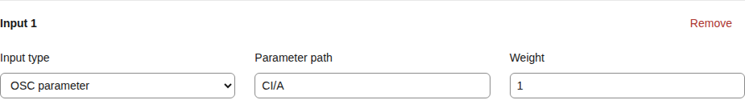

# Computed signals: combine inputs before mapping

[简体中文](computed-signals.md) | **English**

Add a computed signal when you need to combine inputs or process a reading with smoothing, thresholds or delays. Give the result a name, then reuse it in several outputs. For example, blend two touch regions into Contact intensity and use it for both a device and an Avatar effect.

| Desired effect | Choose |
| --- | --- |
| Set each reading's influence | [Weighted average](#weighted-average-choose-each-inputs-influence) |
| Scale, subtract or choose the strongest reading | [Numeric operations](#supported-operations) |
| Reduce jitter, require sustained contact or trigger an effect | [Time and condition processing](#process-time-thresholds-and-events) |
| Measure distance, plane depth, lateral offset or angles | [Spatial calculations](#combine-root-coordinates) |
| Use Shader direction or convert displacement to metres | [Axes and scale](#use-shader-axes-and-scale) |

[Workbench operation](guide.en.md) · [Sources and outputs](signal-pipeline.en.md)

## From inputs to motion

```text
OSC/tracking, manual, script, feedback, replay or constants
                         ↓
                  Named calculation
                         ↓
    Each output's range, curve and target → one or more outputs
```

Choose Tracking measurement (SensaPoint), then the object and metric. SPS four-anchor tracking provides solved positions, Contact provides position/velocity and Shader adds axes/scale. Calculations retain the measurements' validity checks. [Metric meanings](positioning.en.md)

Each computed signal has a stable identifier and a readable name. Other computations, axis mappings and output bindings refer to its identifier, allowing several destinations to reuse the result. Computation retains the raw numeric result; each mapping then converts it to its own motion range.

## Create a computation in the workbench

1. Open **Flow** and choose Add computed signal in the Computed signals area. **OSC → Mappings** also provides an editor for the same calculations.
2. Enter a recognizable name, choose an operation and add the inputs.
3. Choose an OSC parameter, tracking measurement, pose metric, manual, script, device feedback, recording replay, another calculation or a constant. Parameters need their actual path; tracking selects both object path and metric.
4. Select Computed signal as an axis mapping or output binding source, choose the new computation, then configure its destination and input/output ranges.
5. Save calculations and mappings. Live previews use the saved setup. Check readings and ranges before enabling current input.

Saving configuration disables input. Computations containing tracking metrics retain experimental spatial-input permission and the selected route's validity conditions. A constant-only computation needs a consuming mapping or binding and enabled input before it can drive an output.

## Weighted average: choose each input's influence

For inputs A=0.2 and B=0.8, with weights 1 and 3:

```text
result = (0.2 × 1 + 0.8 × 3) ÷ (1 + 3) = 0.65
```

B has 75% of the influence and A has 25%. Weights may be any finite nonnegative numbers with a positive total. Multiplying every weight by the same number preserves the result. A zero-weight input does not participate and needs no sample.

When both inputs express the same kind of intensity from 0 to 1, the result can keep a 0–1 input range. Use constants and operations to bring different ranges into a comparable meaning before combining them. A mapping's range applies to the final computed result.



[Narrow layout](screenshots/mobile/computed-signal-input-en-US.png)

## Supported operations

| Operation | Configuration value | Calculation and use |
| --- | --- | --- |
| Weighted average | `WeightedAverage` | `Σ(value×weight) ÷ Σweight`; blend inputs in chosen proportions |
| Average | `Average` | Arithmetic mean, giving every input equal influence |
| Sum | `Sum` | Add all inputs; add a constant for an offset |
| Difference | `Difference` | First input minus second; exactly two inputs |
| Product | `Product` | Multiply all inputs; use a constant for scaling |
| Ratio | `Ratio` | First input divided by second; exactly two inputs, invalid with a zero denominator |
| Minimum | `Minimum` | Smallest input; useful for the degree jointly reached by all inputs |
| Maximum | `Maximum` | Largest input; use the strongest current reading |
| Magnitude | `Magnitude` | `√Σ(value²)`; combine coordinate components or velocity components with matching units |

Numeric combinations accept 1–16 inputs; Difference and Ratio require exactly two. Temporal and threshold operations use one input, while Sine accepts zero or one. Only Weighted average uses weights. Computations run in dependency order and each result is evaluated once per evaluation. A configuration holds at most 64 computations with at most 16 reference levels. Saving checks duplicate identifiers, missing references and cycles. Update dependent computations and mappings before deleting a referenced definition.

## Process time, thresholds and events

| Operation | Configuration value | Meaning |
| --- | --- | --- |
| Smooth | `Smooth` | Exponential smoothing; `timeMs` is the time constant, and zero follows the input directly |
| Dead zone | `DeadZone` | Output zero while the absolute input is at or below `threshold`; otherwise retain the reading |
| Hysteresis | `Hysteresis` | Switch to 1 at `threshold`, switch to 0 at `releaseThreshold`, and retain state between them |
| Delay | `Delay` | Output a sample after `timeMs`; wait until the first delayed sample is available |
| Rate of change | `Derivative` | Numeric change divided by elapsed seconds; the first reading establishes the baseline |
| Peak hold | `PeakHold` | Retain the current peak for `timeMs`; a higher reading replaces it immediately |
| Rising/falling edge | `RisingEdge` / `FallingEdge` | Output 1 for the evaluation that crosses the threshold in the selected direction |
| Pulse | `Pulse` | A rising edge starts or renews a pulse lasting `timeMs` |
| Cooldown | `Cooldown` | Accept a rising edge only after the cooldown has elapsed; output 1 for that evaluation |
| Sustained threshold | `Duration` | Output 1 after input has continuously met the threshold for `timeMs` |
| Sine wave | `Sine` | `offset + amplitude × sin(2π × frequencyHz × elapsedSeconds)`; an optional input multiplies the amplitude |
| Envelope | `Envelope` | Ramp toward 1 while the threshold is met and toward 0 otherwise; `timeMs` is the full-scale ramp time |

`timeMs` accepts 0–60000 ms. Hysteresis release must be at or below its active threshold. Sine frequency accepts 0–100 Hz; amplitude, offset and thresholds must be finite. A device or binding’s sending rate separately determines how frequently the result is delivered.

For example, set hysteresis to turn on at 0.7 and off at 0.5 to stabilize a touch switch. Use Duration to require 500 ms of continuous contact. Use Pulse when an event should remain high for a defined time. Edge and cooldown results are single-evaluation events that can feed a positive-trigger output; the backend delivers events in order while observing that binding's send rate.

Invalid input, source changes, backward time, reconfiguration or input stopping clears the relevant temporal history. Edge operations first establish a baseline, then react to subsequent crossings. Delay retains the historical sample time, so additional age limits should accommodate its intended delay. The delay buffer is bounded to 4096 samples.

## Use Shader axes and scale

Choose **Tracking measurement (SensaPoint)**, use a root pattern such as `Sensa/Shader/42/**` and select `RightX/Y/Z`, `ForwardX/Y/Z` or `AvatarScale`. The two axes retain direction and length; scale expresses world metres per root-local unit. This source checks all twelve fields, spatial-input activation, validity and frame freshness. Freezing also invalidates dependent calculations.

To convert local X displacement to metres, use **Product** with X and AvatarScale from the same source. The result uses `AvatarRootMeters`. For the reverse conversion, use **Ratio** with metre displacement divided by AvatarScale, yielding `AvatarRootLocal`. Axis components of the same kind can also form magnitudes or dot products. Position, axes and scale retain separate quantities.

## Combine root coordinates

In **Flow → Computed signals**, expand **Spatial calculation presets**, choose an operation and select **Add spatial calculation**. XYZ components are grouped together: enter fixed values, choose a tracked position, or select a Shader Forward/Right direction. Expand individual components to use OSC parameters or other computed signals.

| Operation | Configuration value | Inputs and result |
| --- | --- | --- |
| Distance between points | `PointDistance` | Positions P and Q, 6 components; the straight-line distance between them |
| Depth along plane normal | `PlaneDepth` | Measured position P, plane origin O and normal N, 9 components; positive along the normal and negative in the opposite direction |
| Offset within plane | `PlaneOffset` | The same P, O and N; distance from O to P projected onto the plane, always zero or positive |
| Plane depth (two axes) | `PlaneDepthFromAxes` | P, O, first plane axis U and second axis V, 12 components; use U×V as the normal to measure signed depth |
| Plane offset (two axes) | `PlaneOffsetFromAxes` | The same P, O, U and V; lateral distance within the plane defined by the axes |
| Angle between directions | `VectorAngle` | Two direction vectors, 6 components; an angle from 0° to 180° |
| Angle to plane | `PlaneAngle` | One direction and the plane normal, 6 components; 0° parallel to the plane, +90° along its positive normal and −90° in the opposite direction |

A **normal** points perpendicular to a plane. The default `(0,0,1)` describes the XY plane with +Z as positive depth. The normal is normalized, so `(0,0,1)` and `(0,0,2)` produce the same result. Two axes establish the plane's orientation: default U=`(1,0,0)` and V=`(0,1,0)` produce a +Z normal. Swapping U and V reverses signed depth while preserving lateral distance.

For example, choose origin O=`(0,0,0)`, measured position P=`(0.03,0.04,0.12)` and a +Z normal:

| Result | Value | Example meaning |
| --- | --- | --- |
| Distance from P to O | 0.13 | Overall proximity |
| Plane depth | +0.12 | Movement into or away from a chosen direction |
| Offset within plane | 0.05 | Deviation from the centre |

If positions use metres, these results also use metres. The existing single-point `Distance` metric measures from the point's coordinate origin. Distance between points lets you choose another measured position as the reference.

### Follow an Avatar's movement with a plane

Tracking Frame and Shader templates measure **relative movement between a target and reference on your own Avatar**. For interaction between Avatars, use [paired three-marker pose](positioning.en.md#interaction-between-avatars-paired-three-marker-pose) in the receiving Socket’s local frame, selecting its SensaPose depth fraction, opening offsets and angles directly.

Add a Unity [Tracking Frame](unity-build.en.md), choose the bone, SPS root or marker it follows, then adjust its centre and orientation. It publishes positions for `<name>_Origin`, `<name>_Forward` and `<name>_Right`. Forward−Origin gives the current depth direction, which changes with measured bone rotation.

In the workbench, expand **Spatial calculation presets → Follow a moving plane** and select **Tracking Frame · Origin / Forward**. Enter the Tracking object path and Plane reference object path, such as `Sensa/Contact/Target/**` and `Sensa/Contact/Frame_Origin/**`, then choose **Add following-plane drafts**. The template reads the matching `_Forward` and creates three direction differences, depth and offset: 5 calculations in total. Select Also create point distance to add one more. Review the instances, save calculations and mappings, then connect the results to outputs. One target can then control both depth and off-centre feedback. [Unity setup and coordinates](positioning.en.md)

Alternatively, choose **Shader · Position and Forward**. The selected Shader position supplies the plane origin and Forward supplies its normal, creating depth and offset directly as two drafts.

Shader already provides Forward/Right directions for a normal or a plane defined by two axes. Using Forward as the normal makes the depth direction follow measured Forward: +Z in the default orientation, changing as it rotates. With Right as U and Forward as V, the default orientation produces a −Y normal; reverse their order for +Y.

### Coordinates, units and valid inputs

Positions in a calculation share one OSC source, reference, axis directions and units. SPS four-anchor tracking and Shader use **AvatarRootLocal**, expressed in authored Avatar-root units; Contact direct tracking uses **AvatarRootMeters**. The system checks coordinate metadata carried by tracking sources. Independent Point/Handle/Pose have a separate ReferenceLocal frame for each instance. Select matching frames before combining positions, using AvatarScale from the same source for unit conversion when needed.

Shader axes describe direction without position units. Known AvatarRootLocal axes can provide directions for AvatarRootMeters positions because both use the Avatar root's axes. You assign meaning to raw OSC parameters and constants; configure them with consistent references and units. Length results retain position units, while angles use degrees.

A zero coordinate is a valid position. Normals and direction vectors need nonzero length, and two plane axes need a clear angle between them: their normalized cross-product length must exceed `0.0001`. Invalid inputs, an undefined direction or a nonfinite result invalidate the calculation, retaining the source's sample-age checks.

Three-point pose angles participate as their reported numeric values; Roll, for example, uses the raw −180° to 180° angle. Crossing the ±180° boundary causes a numeric jump, so choose a mapping range within a continuous interval. Average uses the ordinary arithmetic mean.

## Validity and sample age

Every required input must uniquely match one parameter or tracking object. Use source fixes the OSC source to read. When several parameters or sources match, the UI reports the waiting or invalidity reason. Complete the path and source selection, then check again.

A computation retains the oldest contributing sample time, including through references to other computations. Input validity (ms) defaults to **0**, following OSC receiver settings without an additional computation-specific age limit. Ordinary OSC receive timeout defaults off, allowing parameters that publish only when their value changes to remain useful while stationary.

To require periodic updates from every input, set computation validity to **100–60000 ms**. At 1000, any contributing sample older than one second invalidates the result; another input's updates do not renew it. Constant-only results remain valid at the current evaluation. Tracking inputs always retain their own Sample/Frame, geometry and age checks.

Missing or expired inputs, invalid tracking, division by zero and nonfinite results invalidate the computation and its dependents. Invalidity propagates to dependent output bindings; existing axis mappings retain their motion-runtime stop rules. Input remains enabled. New valid samples can automatically resume linkage. Disable input or use emergency stop to keep motion stopped; explicitly enable input again after saving configuration or clearing emergency stop.

When several mappings target the same role, existing fusion selects by normalized priority. For a proportional blend, first create a weighted average and map its result to that role. [Features](features.en.md) · [Parameter dictionary](osc-parameters.en.md)

Ordinary SensaPoint/SensaPose mappings have priority on their destination axes; other direct mappings, computed mappings and DepthOverride retain that priority relationship. To combine or weight tracking results first, map the computed signal to the axis and replace its original single-point/pose mapping.

Manual inputs use an axis such as `L0`; script inputs select `L0`, `Progress` (0–1) or `Time` (seconds). Device feedback uses identifiers provided by its output. For recording replay, funscript uses `recording-output-id/value` for 0–1 positions, while JSON Lines/CSV use `recording-output-id/signal-id` for raw readings. Combined mode lets these sources participate together. OSC inputs still share one selected OSC source, and spatial inputs retain compatible coordinate-frame checks. [Source and destination setup](signal-pipeline.en.md)

## Configuration example

The workbench handles ordinary setup. For manual editing, replace `TouchA` and `TouchB` with actual parameter names and retain other settings. Names allow up to 80 characters. Identifiers start with an English letter and may contain letters, digits, underscores and hyphens, up to 48 characters; the workbench generates these automatically.

```json
{
  "computedSignals": [
    {
      "id": "touch_mix",
      "name": "Two-zone touch",
      "operation": "WeightedAverage",
      "maxAgeMs": 0,
      "inputs": [
        { "sourceMode": "Direct", "oscPath": "TouchA", "weight": 1 },
        { "sourceMode": "Direct", "oscPath": "TouchB", "weight": 3 }
      ]
    }
  ],
  "signals": [
    {
      "sourceMode": "Computed",
      "oscPath": "touch_mix",
      "role": "V0",
      "vrchatMin": 0,
      "vrchatMax": 1,
      "curve": "Linear"
    }
  ]
}
```

Computed signals live in Sensa's configuration while the Avatar continues publishing its existing OSC parameters. Their identifiers are internal Sensa references. Custom presets store OSC parameter and tracking mappings. Flow exports axis mappings, axis profiles, computations and outputs as a complete plan, with review before importing. [Presets](presets.en.md) · [Complete plans](signal-pipeline.en.md#save-and-reuse-a-complete-plan)
