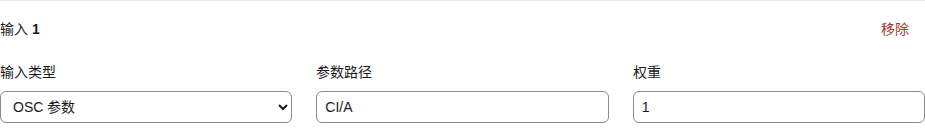

# 计算信号：组合多个输入再映射

**简体中文** | [English](computed-signals.en.md)

需要把几个输入混合，或让一个读数经过平滑、阈值和延迟后再输出时，添加“计算信号”。给处理结果起一个名称，就能在多个输出中重复使用。例如，把两个触碰区按比例合成“接触强度”，再同时控制设备和 Avatar 效果。

| 想得到什么效果 | 选择什么 |
| --- | --- |
| 决定多个读数各占多少影响 | [加权平均](#加权平均决定每个输入的影响) |
| 调比例、做差值、取最强的一项 | [数值运算](#支持的运算) |
| 减少抖动、等待持续接触、触发一次效果 | [时间与条件处理](#处理时间门限与事件) |
| 计算距离、相对平面的深度、侧向偏移或角度 | [空间计算](#组合根点坐标) |
| 使用 Shader 方向或换算米制位移 | [轴向与缩放](#使用-shader-的轴向与缩放) |

[工作台操作](guide.md) · [来源与输出](signal-pipeline.md)

## 从输入到动作

```text
OSC／定位、手动、脚本、反馈、回放或常量
                   ↓
              具名计算结果
                   ↓
      各输出的范围、曲线与目标 → 一个或多个输出
```

定位输入选择“定位测量”（SensaPoint），再选对象和指标。例如，SPS 四点定位提供解算后的位置，Contact 提供位置与速度，Shader 还提供轴向和缩放。计算会沿用这些测量的有效性检查。[指标含义](positioning.md)

每个计算信号有一个固定标识和一个便于辨认的名称。其他计算、轴映射或输出绑定通过标识引用它，所以同一个结果可以用于多个目标。计算结果保留原始数值，之后由每条映射分别转换为需要的动作范围。

## 在工作台中建立计算

1. 打开 **流程**，在“计算信号”区点击“新增计算信号”；**OSC → 映射**也提供同一组计算的编辑入口。
2. 填写便于辨认的名称，选择运算方式，再逐项添加输入。
3. 选择 OSC 参数、定位测量、姿态指标、手动、脚本、设备反馈、录制回放、另一计算或固定数值。参数填写真实路径；定位同时选择对象路径和指标。
4. 在轴映射或输出绑定中选择“计算信号”作为来源，再选择刚建立的计算，设置目标和输入／输出范围。
5. 点击“保存计算与映射”。实时预览随已保存设置计算；检查读数和范围后，再启用当前输入。

保存配置会关闭输入。含定位指标的计算沿用实验空间输入开关和对应定位方案的有效性条件。纯常量计算也要被映射或绑定使用，并启用输入，才会驱动输出。

## 加权平均：决定每个输入的影响

设输入 A=0.2、B=0.8，权重分别为 1 和 3：

```text
结果 = (0.2 × 1 + 0.8 × 3) ÷ (1 + 3) = 0.65
```

B 的影响占 75%，A 占 25%。权重可以使用任意非负有限数，只要总和大于零；同时把所有权重乘以相同数，结果保持不变。权重为零的输入不参与此次计算，也不要求它提供样本。

两个输入都按 0～1 表示同类强度时，结果可继续使用 0～1 输入量程。组合不同量程的数据前，先用常量和运算把它们调整到有可比含义的范围。映射中的量程设置作用于最终计算结果。



[窄屏输入设置](screenshots/mobile/computed-signal-input-zh-CN.png)

## 支持的运算

| 运算 | 配置值 | 计算方式与用途 |
| --- | --- | --- |
| 加权平均 | `WeightedAverage` | `Σ(数值×权重) ÷ Σ权重`；按影响比例融合输入 |
| 平均值 | `Average` | 所有输入的算术平均；每项影响相同 |
| 求和 | `Sum` | 所有输入相加；也可加上常量形成偏移 |
| 相减 | `Difference` | 第一项减第二项；用于差值，恰好两项 |
| 相乘 | `Product` | 所有输入相乘；配合常量调整比例 |
| 相除 | `Ratio` | 第一项除以第二项；恰好两项，分母为零时结果无效 |
| 最小值 | `Minimum` | 取最小输入；用于要求各项同时达到的程度 |
| 最大值 | `Maximum` | 取最大输入；用于采用当前最强的一项 |
| 向量长度 | `Magnitude` | `√Σ(数值²)`；组合坐标分量或同单位的速度分量 |

数值组合支持 1～16 个输入，相减与相除固定为两项；时间与门限处理使用一个输入，正弦波可使用零或一个输入。权重只在加权平均中使用。计算按依赖顺序执行，每个结果在同一次求值中只计算一次；配置最多包含 64 个计算，引用层数最多 16 层。保存时会检查重复标识、缺失引用和循环引用；删除计算前，先调整引用它的计算和映射。

## 处理时间、门限与事件

| 运算 | 配置值 | 含义 |
| --- | --- | --- |
| 平滑 | `Smooth` | 指数平滑；`timeMs` 为时间常数，设为 0 时直接跟随输入 |
| 死区 | `DeadZone` | 输入绝对值不超过 `threshold` 时输出 0，超出后保留原读数 |
| 迟滞开关 | `Hysteresis` | 达到 `threshold` 时变为 1，降到 `releaseThreshold` 时变为 0，中间区间保留状态 |
| 延迟 | `Delay` | 延后 `timeMs` 输出样本，首次等待对应历史样本到达 |
| 变化率 | `Derivative` | 数值变化量除以经过的秒数，首个读数建立基准 |
| 峰值保持 | `PeakHold` | 保留当前峰值 `timeMs`，更高读数立即替换 |
| 上升沿／下降沿 | `RisingEdge` / `FallingEdge` | 在读数沿指定方向越过阈值的那次求值输出 1 |
| 脉冲 | `Pulse` | 上升沿开始或延长持续 `timeMs` 的脉冲 |
| 冷却 | `Cooldown` | 冷却结束后才接受新的上升沿，在接受的那次求值输出 1 |
| 持续达到阈值 | `Duration` | 输入连续达到阈值 `timeMs` 后输出 1 |
| 正弦波 | `Sine` | `offset + amplitude × sin(2π × frequencyHz × 经过秒数)`；可选输入用于乘上幅度 |
| 包络 | `Envelope` | 达到阈值时渐升到 1，否则渐降到 0；`timeMs` 为全幅渐变时间 |

`timeMs` 可设为 0～60000 ms，迟滞关闭阈值不高于开启阈值。正弦频率为 0～100 Hz，幅度、偏移和阈值应为有限数值。设备或绑定的发送频率另行决定结果交付的节奏。

例如，将迟滞设为 0.7 开启、0.5 关闭，可让触碰开关在边界附近保持稳定；用“持续达到阈值”要求接触保持 500 ms；需要事件维持一段时间时使用“脉冲”。边沿和冷却只在一次求值中输出事件，可连接到“正向触发时发送”输出；后端按顺序交付事件，并遵守该绑定的发送频率。

输入失效、切换来源、时钟倒退、重新配置或关闭输入时，时间处理会清除相应历史状态。边沿处理先建立基准，再响应之后的跨阈值变化。延迟保留历史样本时间，额外有效期应覆盖需要的延迟；延迟缓冲最多 4096 项。

## 使用 Shader 的轴向与缩放

将来源设为**定位测量（SensaPoint）**，填写 `Sensa/Shader/42/**` 这样的根点路径，再选择 `RightX/Y/Z`、`ForwardX/Y/Z` 或 `AvatarScale`。两条轴保留方向和长度，缩放表示每根局部单位对应的世界米数。来源自动检查完整十二字段、空间输入启用、有效状态与帧时效；冻结后依赖它的计算也会失效。

要把局部 X 位移换算成米，建立“相乘”，输入同一来源的 X 和 AvatarScale，结果采用 `AvatarRootMeters`。反向换算使用“比值”：米制位移除以 AvatarScale，得到 `AvatarRootLocal`。也可以用同类轴向分量求向量长度或点积；位置、轴向和缩放分别保留各自的量纲。

## 组合根点坐标

在“流程 → 计算信号”展开“空间计算预设”，选好运算后点击“新增空间计算”。界面把 XYZ 放在一组：可以填写固定坐标、选择某个定位对象的位置，或选择 Shader 的 Forward／Right 方向；需要组合其他来源时，展开逐分量设置，分别指定 OSC 参数或计算结果。

| 运算 | 配置值 | 输入与结果 |
| --- | --- | --- |
| 两点距离 | `PointDistance` | 两个位置 P、Q，共 6 分量；得到两点之间的直线距离 |
| 平面深度 | `PlaneDepth` | 测量位置 P、平面参考点 O、法线 N，共 9 分量；沿法线方向为正，反向为负 |
| 平面内偏移 | `PlaneOffset` | 同样选择 P、O、N；得到 P 投影到平面后，离 O 的距离，结果大于或等于 0 |
| 平面深度（两条轴） | `PlaneDepthFromAxes` | P、O、平面第一条轴 U、第二条轴 V，共 12 分量；由 U×V 确定法线后计算深度 |
| 平面内偏移（两条轴） | `PlaneOffsetFromAxes` | 同样选择 P、O、U、V；用两条轴所在的平面计算侧向距离 |
| 向量夹角 | `VectorAngle` | 两个方向向量，共 6 分量；结果为 0°～180° |
| 相对平面夹角 | `PlaneAngle` | 一个方向向量和一个平面法线，共 6 分量；平行平面为 0°，沿正法线为 +90°，反向为 −90° |

**法线**就是垂直于平面的方向。默认 `(0,0,1)` 表示 XY 平面，+Z 为深度正方向。系统会归一化法线，因此 `(0,0,1)` 与 `(0,0,2)` 得到相同结果。两条轴只需确定平面方向；默认 U=`(1,0,0)`、V=`(0,1,0)` 得到 +Z 法线。交换 U、V 会翻转深度正负，侧向距离保持不变。

例如，参考点 O=`(0,0,0)`，测量位置 P=`(0.03,0.04,0.12)`，法线沿 +Z：

| 结果 | 数值 | 可用来表达什么 |
| --- | --- | --- |
| P 到 O 的距离 | 0.13 | 整体接近程度 |
| 平面深度 | +0.12 | 沿选定方向深入或离开的程度 |
| 平面内偏移 | 0.05 | 偏离中心的程度 |

如果位置采用米，以上结果也采用米。已有单点 `Distance` 指标表示该点到其坐标原点的距离；“两点距离”可以直接选择另一个测量位置作为参照。

### 让平面跟随 Avatar 动作

Tracking Frame 与 Shader 模板用于**自己 Avatar 内测量点与参考对象的相对运动**。双方 Avatar 的互动使用接收方 Socket 局部系下的[配对三点姿态](positioning.md#跨-avatar-互动配对三点姿态)，可直接选择 SensaPose 的深度比例、入口偏移和角度指标。

在 Unity 添加 [Tracking Frame](unity-build.md)，选择它跟随的骨骼、SPS 根点或标记，调整中心和朝向。它发布 `<名称>_Origin`、`<名称>_Forward`、`<名称>_Right` 三个点的位置。Forward−Origin 给出当前深度方向；骨骼转动后，方向会随实际读数改变。

在工作台展开“空间计算预设 → 跟随移动平面”，定位方式选择 **Tracking Frame · Origin / Forward**。填写“测量对象路径”和“平面参考对象路径”，例如 `Sensa/Contact/Target/**` 与 `Sensa/Contact/Frame_Origin/**`，再点击“添加跟随平面草稿”。模板自动读取同名 `_Forward`，生成三个方向差值，以及深度和偏移，共 5 个计算；勾选“同时创建两点距离”可再增加一项。检查实例并保存计算与映射，再把结果连接到输出。这样同一个目标可以同时提供深度和偏离中心的反馈。[Unity 配置与坐标](positioning.md)

定位方式也可选择 **Shader · 位置与 Forward 方向**，以所选 Shader 的位置为平面中心、Forward 为法线，直接生成深度和偏移两个草稿。

Shader 已提供 Forward／Right 方向，可直接用于法线或两轴平面。例如用 Forward 作法线，深度方向就跟随测得的 Forward：默认姿态下朝 +Z，旋转后随该方向改变；用 Right 与 Forward 作为 U、V 时，默认姿态下法线朝 −Y，调换顺序则朝 +Y。

### 坐标、单位与有效输入

参与计算的位置使用同一 OSC 来源、参照、坐标轴和单位。SPS 四点定位与 Shader 的 **AvatarRootLocal** 使用制作时的 Avatar 根局部单位；Contact 直接定位的 **AvatarRootMeters** 使用米。系统检查定位来源携带的坐标标识；独立 Point／Handle／Pose 的 ReferenceLocal 按实例区分。先选择相同坐标框，再组合位置；必要时用同一来源的 AvatarScale 完成单位换算。

Shader 的轴向没有位置单位。已知的 AvatarRootLocal 轴向可为 AvatarRootMeters 位置提供方向，因为它们共用 Avatar 根坐标轴。原始 OSC 参数和固定数值由你指定含义，配置时确认它们使用同一参照和单位。长度结果沿用位置单位，角度结果以度表示。

零坐标是有效位置。法线或方向向量需要非零长度，两条平面轴需要形成明确夹角；归一化后的叉积长度大于 `0.0001` 才能确定平面。输入失效、方向无法确定或结果超出有限数值范围时，该计算显示无效，并保留来源的样本时效检查。

三点姿态的角度按读到的数值参与运算；例如 Roll 使用 −180°～180° 的原始角度。动作经过 ±180° 边界时会发生数值跳转，选取连续区间内的量程进行映射；平均值运算采用普通算术平均。

## 有效结果与样本时效

每个必需输入都应唯一匹配一个参数或一个定位对象。选择“使用来源”可固定要读取的 OSC 来源；多个参数或来源同时匹配时，界面会显示等待或无效的原因，补全路径和来源选择后再检查。

计算的样本时间取所有参与输入中最旧的时间，引用另一计算时继续保留这个时间。“输入有效期（ms）”默认 **0**，表示沿用 OSC 接收设置，计算本身不额外限制时效。常规 OSC 接收超时默认关闭，适合数值变化时才发送的参数；静止值可继续参与计算。

需要定期确认每项输入更新时，可将计算有效期设为 **100～60000 ms**。例如设为 1000，任一参与样本超过 1 秒就会使计算失效，其他输入更新不会为它续期。纯常量结果随当前求值有效。定位输入始终遵守其自身的 Sample／Frame、几何和时效检查。

缺失或过期输入、定位失效、除以零和非有限结果都会使相关计算无效；引用它的计算同样失效。计算无效时，相关输出绑定沿依赖关系停止，现有轴映射保留动作运行时的停止规则；输入启用状态保持不变，新的有效样本到达后，联动可自动恢复。需要持续保持停止时，关闭输入或使用急停；配置保存或急停解除后，再明确启用输入。

多条映射指向同一个角色时，现有融合规则按归一化优先级选择结果。要按比例混合多个输入，应先建立加权平均，再把它映射到该角色。[功能参考](features.md) · [参数字典](osc-parameters.md)

普通 SensaPoint／SensaPose 映射优先控制其目标轴，该轴的其他直接映射、计算映射或 DepthOverride 保留这一优先关系。需要先组合或加权定位结果时，用计算信号映射该轴，并替换原来通往同轴的单点／姿态映射。

手动输入使用 `L0` 等轴名；脚本输入可选 `L0`、`Progress`（0～1）或 `Time`（秒）。设备反馈使用对应输出提供的标识。录制回放中，funscript 使用 `录制输出标识/value` 提供 0～1 位置；JSON Lines／CSV 使用 `录制输出标识/信号标识` 读取原始值。组合方式允许这些来源共同参与；OSC 输入仍使用同一选定来源，空间输入保留坐标框相容性检查。[来源与目标设置](signal-pipeline.md)

## 配置文件示例

通常在工作台配置即可。需要手工编辑时，下面展示对应字段：将 `TouchA`、`TouchB` 换成实际参数名，并保留配置中的其他设置。名称最长 80 个字符；计算标识以英文字母开头，可使用字母、数字、下划线和连字符，最长 48 个字符。工作台会自动生成标识。

```json
{
  "computedSignals": [
    {
      "id": "touch_mix",
      "name": "双区域触碰",
      "operation": "WeightedAverage",
      "maxAgeMs": 0,
      "inputs": [
        { "sourceMode": "Direct", "oscPath": "TouchA", "weight": 1 },
        { "sourceMode": "Direct", "oscPath": "TouchB", "weight": 3 }
      ]
    }
  ],
  "signals": [
    {
      "sourceMode": "Computed",
      "oscPath": "touch_mix",
      "role": "V0",
      "vrchatMin": 0,
      "vrchatMax": 1,
      "curve": "Linear"
    }
  ]
}
```

计算信号保存在 Sensa 配置中；Avatar 继续发送原有 OSC 参数。新的标识用于 Sensa 内部引用。自定义预设保存 OSC 参数和定位映射；流程页可将轴映射、轴配置、计算与输出一起导出为整套方案，导入时先检查再应用。[预设](presets.md) · [整套方案](signal-pipeline.md#保存与复用整套方案)
