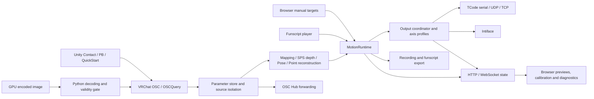

# Sensa features and implementation reference

[简体中文](features.md) | **English**

This living reference follows the current repository implementation across the application, WebUI, Unity package, Avatar/world labs, support scripts and CI. Source links point to the current implementation on the main repository's main branch and intentionally omit line numbers that drift during refactors. Tests describe the contract surface; their presence does not imply real Unity, VRChat or hardware acceptance. Third-party capabilities are described only where this project calls them.

For operating instructions, start with the [user guide](guide.en.md), [first-run guide](quick-start.en.md) and [preset guide](presets.en.md). This document explains the complete feature set, configuration boundaries and implementation responsibilities.

## Contents

- [System and data flow](#system-and-data-flow)
- [Service startup, configuration changes and access](#service-startup-configuration-changes-and-access)
- [Backend inputs, signal processing and outputs](#backend-inputs-signal-processing-and-outputs)
- [Browser interface and interactions](#browser-interface-and-interactions)
- [Unity assets and lab tools](#unity-assets-and-lab-tools)
- [API and state protocol index](#api-and-state-protocol-index)
- [Build, validation and releases](#build-validation-and-releases)
- [Implementation and verification boundaries](#implementation-and-verification-boundaries)
- [Source coverage index](#source-coverage-index)

## System and data flow

Sensa is a local motion bridge configured in a browser. OSC parameters, reconstructed local geometry, manual targets and funscript trajectories become a common motion frame, which is distributed to multiple Intiface/TCode outputs. The application hosts a .NET HTTP/WebSocket service and serves its React interface directly. The Unity package bakes authoring configuration into native VRChat components. The optional Shader capture path uses a separate Python tool. [Entry point](https://github.com/SeaLoong/Sensa/blob/main/src/Program.cs), [service composition](https://github.com/SeaLoong/Sensa/blob/main/src/Hosting/SensaHost.cs), [runtime](https://github.com/SeaLoong/Sensa/blob/main/src/Runtime/MotionRuntime.cs), [output coordinator](https://github.com/SeaLoong/Sensa/blob/main/src/Outputs/OutputCoordinator.cs), [Unity build processor](https://github.com/SeaLoong/Sensa/blob/main/unity/top.sealoong.sensa/Editor/SensaProcessor.cs).



OSC Hub is a forwarding branch. It forwards the selected source, separately from the device input enable switch. GPU capture is optional: ordinary parameter mappings, QuickStart and native Contact/PB paths do not need it. [Hub and input responsibilities](https://github.com/SeaLoong/Sensa/blob/main/src/Hosting/SensaHost.cs), [Unity QuickStart builder](https://github.com/SeaLoong/Sensa/blob/main/unity/top.sealoong.sensa/Editor/SensaQuickStartBuilder.cs), [Shader bridge](https://github.com/SeaLoong/Sensa/blob/main/scripts/shader-osc-bridge.py).

| Layer | Responsibilities | Boundary |
| --- | --- | --- |
| Service and configuration | Local site, sessions, APIs, validation, persistence and connections | Local HTTP by default; connecting an output does not enable motion |
| Inputs and runtime | Three input modes, signal fusion, geometry, gates and stops | One input mode at a time; sources and incomplete geometry cannot be arbitrarily combined |
| Outputs | Multiple outputs, independent axis profiles, TCode encoding and Intiface features | Sends targets; no physical position feedback loop is implemented |
| WebUI | Configuration, discovery, presets, calibration, timeline, output and log previews | Browser drafts are distinguished from saved server configuration |
| Unity and labs | Authoring components, baking, sample interactions, geometry/GPU validation | Authoring components do not run as arbitrary custom scripts on VRChat Avatars |
| Engineering tools | Builds, isolated tests, reproducible archives, previews and VPM index | Public CI static checks do not replace Unity/client/hardware validation |

Sources: [runtime](https://github.com/SeaLoong/Sensa/blob/main/src/Runtime/MotionRuntime.cs), [output telemetry](https://github.com/SeaLoong/Sensa/blob/main/src/Outputs/OutputTelemetry.cs), [WebUI](https://github.com/SeaLoong/Sensa/blob/main/src/web/app.js), [NDMF plugin](https://github.com/SeaLoong/Sensa/blob/main/unity/top.sealoong.sensa/Editor/SensaProcessor.cs), [native platform workflow](https://github.com/SeaLoong/Sensa/blob/main/.github/workflows/build-platforms.yml).

### Current module responsibilities

HTTP and WebSocket adapters handle their own framing before crossing the same `SensaApplication.ExecuteAsync` interface. Input, script, output and recording command rules are no longer duplicated in transport branches. `SensaHost` owns composition, listeners, overviews and state delivery. The `ConfigurationUpdate` module serializes the validate/disarm/stop/apply/persist/rollback transaction, keeping its rules in one locality. [Application commands](https://github.com/SeaLoong/Sensa/blob/main/src/Application/SensaApplication.cs), [HTTP adapter](https://github.com/SeaLoong/Sensa/blob/main/src/Hosting/HttpCommandAdapter.cs), [WebSocket adapter](https://github.com/SeaLoong/Sensa/blob/main/src/Hosting/WebSocketCommandAdapter.cs), [configuration transaction](https://github.com/SeaLoong/Sensa/blob/main/src/Application/ConfigurationUpdate.cs).

In the browser, `app.js` assembles React state and interactions. `editConfiguration` in `configuration.js` owns draft saves, conflicts, the default axis profile and output-reference repair. `input-workflows.js` owns manual command and script time/A-B rules. `realtime-session.js` owns authentication, reconnects, request correlation and timeouts; disconnected requests are never replayed. Diagnostics, preferences, shared controls, configuration views and the timeline keep their implementation locality. [Configuration module](https://github.com/SeaLoong/Sensa/blob/main/src/web/configuration.js), [input workflows](https://github.com/SeaLoong/Sensa/blob/main/src/web/input-workflows.js), [realtime session](https://github.com/SeaLoong/Sensa/blob/main/src/web/realtime-session.js), [diagnostics](https://github.com/SeaLoong/Sensa/blob/main/src/web/diagnostics.js), [preferences](https://github.com/SeaLoong/Sensa/blob/main/src/web/preferences.js), [shared controls](https://github.com/SeaLoong/Sensa/blob/main/src/web/controls.jsx), [configuration views](https://github.com/SeaLoong/Sensa/blob/main/src/web/configuration-views.jsx), [diagnostic views](https://github.com/SeaLoong/Sensa/blob/main/src/web/diagnostic-views.jsx), [timeline](https://github.com/SeaLoong/Sensa/blob/main/src/web/script-timeline.jsx), [OSC preview calculations](https://github.com/SeaLoong/Sensa/blob/main/src/web/osc-workspace.js).

Runtime, player, parameter-store time, recording duration and output telemetry consume time through a `TimeProvider` seam. Production uses the system clock; contract tests use an advanceable clock adapter, exercising time-dependent behavior without sleeps or reflection into private fields. Clock and output-fixture interfaces live in test support. [Parameter clock](https://github.com/SeaLoong/Sensa/blob/main/src/Input/Osc/OscModels.cs), [runtime](https://github.com/SeaLoong/Sensa/blob/main/src/Runtime/MotionRuntime.cs), [player](https://github.com/SeaLoong/Sensa/blob/main/src/Input/Script/FunscriptPlayer.cs), [recorder](https://github.com/SeaLoong/Sensa/blob/main/src/Recording/MotionRecorder.cs), [telemetry](https://github.com/SeaLoong/Sensa/blob/main/src/Outputs/OutputTelemetry.cs), [advanceable clock adapter](https://github.com/SeaLoong/Sensa/blob/main/tests/Sensa.Tests/Support/ManualTimeProvider.cs), [motion fixture](https://github.com/SeaLoong/Sensa/blob/main/tests/Sensa.Tests/Support/MotionRig.cs).

## Service startup, configuration changes and access

### Startup and shutdown

- The entry point calls `SensaHost.RunAsync(args)`, loads and normalizes configuration, and serves static resources relative to the executable directory. The default address is `http://127.0.0.1:5086`. Host, port and automatic browser opening are configurable. These fields are consumed at startup; saving them through the full configuration API requires a restart and does not rebind HTTP or reopen the browser immediately. Windows sets the console title. [Entry](https://github.com/SeaLoong/Sensa/blob/main/src/Program.cs), [startup](https://github.com/SeaLoong/Sensa/blob/main/src/Hosting/SensaHost.cs), [Web configuration](https://github.com/SeaLoong/Sensa/blob/main/src/Configuration/AppConfig.cs).
- Startup creates OSC, OSCQuery, Hub, player, recorder, runtime and output coordinator instances. Loading configuration clears output enable flags, and the runtime starts in Manual mode with input off. Restarting therefore does not restore previous output activation or motion; startup retains a common entry point for connecting currently enabled outputs. [Loading](https://github.com/SeaLoong/Sensa/blob/main/src/Configuration/AppConfig.cs), [composition](https://github.com/SeaLoong/Sensa/blob/main/src/Hosting/SensaHost.cs), [runtime initialization](https://github.com/SeaLoong/Sensa/blob/main/src/Runtime/MotionRuntime.cs).
- Shutdown stops recording, closes WebSockets, disposes outputs, stops OSC/OSCQuery/Hub, releases the runtime and attempts to save configuration. Both application shutdown and normal completion have cleanup paths. [Shutdown](https://github.com/SeaLoong/Sensa/blob/main/src/Hosting/SensaHost.cs).

### Configuration changes are controlled transitions

The service copies and validates a candidate configuration, checking duplicate targets, Query polling, receiver advertisement and Hub targets. It then disables input, stops outputs, applies configuration, rebuilds processors, updates listeners/connections as needed and saves. On application errors it attempts to restore the previous configuration and connections; a failed application is not reported as success. Input must be explicitly enabled again after saving, so changing mappings does not silently continue motion. [Apply and rollback](https://github.com/SeaLoong/Sensa/blob/main/src/Application/ConfigurationUpdate.cs).

Connections are managed by output ID and type. Adding/removing outputs or changing type rebuilds topology. Changes to serial port, host, network port or Intiface address reconnect as needed. Axis settings can update through the same connection. [Output differences](https://github.com/SeaLoong/Sensa/blob/main/src/Application/ConfigurationUpdate.cs).

### Access policy and resource limits

| Capability | Implemented behavior |
| --- | --- |
| Local browser session | `GET /api/session` issues a random session cookie for later API requests |
| Cookie attributes | `HttpOnly`, `SameSite=Strict`, and `Secure` on HTTPS |
| Remote access | Configure the listener and `SENSA_ACCESS_TOKEN`; accepts Bearer or Basic with the token as password |
| Same-origin checks | Checks Origin scheme/authority, rejects `Sec-Fetch-Site: cross-site`; local requests must use a loopback/localhost Host |
| HTTP limit | Kestrel request body maximum: 4 MiB |
| WebSocket limits | 16 concurrent sessions, 4 MiB messages, 429 for excess connections, 3-second send timeout |
| Static resources | HTML/main bundle/CSS are not cached; responses set anti-framing, MIME-sniffing and referrer headers |

This is a local service/shared credential mechanism; accounts, roles and multi-user authorization are not implemented. The configured service URL uses HTTP. Setting a remote credential does not enable TLS. [Access policy](https://github.com/SeaLoong/Sensa/blob/main/src/Hosting/LocalAccessPolicy.cs), [HTTP setup](https://github.com/SeaLoong/Sensa/blob/main/src/Hosting/SensaHost.cs), [WS admission and receive loop](https://github.com/SeaLoong/Sensa/blob/main/src/Hosting/SensaHost.cs), [session sends](https://github.com/SeaLoong/Sensa/blob/main/src/Hosting/ApiContracts.cs).

### State and logs

Dirty state is coalesced approximately every 100 ms, including runtime, input/player, OSC sources/previews, Query/Hub, outputs, geometry, recording and mappings. Each browser has a coalesced pending state to limit buildup. New WebSocket connections receive state immediately. [State delivery](https://github.com/SeaLoong/Sensa/blob/main/src/Hosting/SensaHost.cs).

Logs are classified by Debug/Info/Warning/Error and message prefix. The in-memory buffer holds up to 2,000 entries; ordinary queries default to the latest 200, while pushed envelopes include the latest 50. Warning/Error goes to stderr and other levels to stdout. No persistent log database is implemented. [Buffer](https://github.com/SeaLoong/Sensa/blob/main/src/Runtime/RuntimeLogBuffer.cs), [logging](https://github.com/SeaLoong/Sensa/blob/main/src/Hosting/SensaHost.cs).

## Backend inputs, signal processing and outputs

### Runtime model and shared motion state

Sensa represents 12 normalized axes in MotionFrame: L0/L1/L2, R0/R1/R2, V0/V1/V2 and A0/A1/A2. A frame also carries the elapsed event time DeltaMs and optional TCode command-mode and speed/duration requests. The runtime neutral pose sets position, rotation and auxiliary axes to 0.5, and V0–V2 to 0. MotionPatch contains only the axes controlled by an update, rejects non-finite values and clamps values to 0–1. An input controlling a subset of axes therefore preserves the remaining pose. (Sources: [src/Motion/MotionFrame.cs](https://github.com/SeaLoong/Sensa/blob/main/src/Motion/MotionFrame.cs); [src/Motion/MotionAxes.cs](https://github.com/SeaLoong/Sensa/blob/main/src/Motion/MotionAxes.cs).)

The input modes are Manual, Osc and Script. The initial mode is Manual with input inactive. Output is allowed only while the runtime is not disposed, emergency stop is clear, input is active, every gate is satisfied and spatial input is not blocked. OSC/OSCQuery values pass through source-aware storage, mappings or geometry reconstruction, processing and fusion to form an axis patch. Manual input forms a full-axis patch, while Funscript produces an L0 patch. Patches update the current motion frame, which is then passed to the recorder and output coordinator. (Sources: [src/Runtime/RuntimeInputMode.cs](https://github.com/SeaLoong/Sensa/blob/main/src/Runtime/RuntimeInputMode.cs); [src/Runtime/MotionRuntime.cs](https://github.com/SeaLoong/Sensa/blob/main/src/Runtime/MotionRuntime.cs).)

Input events drive the runtime; scripts use their own 20ms timer. Pending manual requests retain the latest patch to avoid a backlog. Mode changes, input deactivation and emergency stop advance a generation counter so stale pending requests are discarded. A frame normally emits no command when neither the effective pose nor motion parameters change; transitions such as reactivation force a resend. The host additionally refreshes the full UDP pose once per second while sending is allowed. (Sources: [src/Runtime/MotionRuntime.cs](https://github.com/SeaLoong/Sensa/blob/main/src/Runtime/MotionRuntime.cs); [src/Input/Script/FunscriptPlayer.cs](https://github.com/SeaLoong/Sensa/blob/main/src/Input/Script/FunscriptPlayer.cs); [src/Hosting/SensaHost.cs](https://github.com/SeaLoong/Sensa/blob/main/src/Hosting/SensaHost.cs).)

#### Stop, emergency stop and avatar changes

Emergency stop deactivates input, clears pending patches, pauses the script and requests a stop on every output. Clearing emergency stop does not reactivate input. Every actual input-mode change disarms input; selecting the already-active mode leaves it unchanged. Both UDP /avatar/change and OSCQuery AvatarChanged call the same parameter-store ChangeAvatar interface, clearing the affected source or full store and resetting observed ranges, learned SPS lengths and continuous roll. The runtime latches emergency stop when OSC mode and input are active. [Notification wiring](https://github.com/SeaLoong/Sensa/blob/main/src/Hosting/SensaHost.cs), [shared change interface](https://github.com/SeaLoong/Sensa/blob/main/src/Input/Osc/OscModels.cs), [runtime transitions](https://github.com/SeaLoong/Sensa/blob/main/src/Runtime/MotionRuntime.cs).

### Configuration persistence, output instances and axis profiles

Configuration uses JSON, serializes enums as strings and reads property names case-insensitively. The current schema is 5. The default file is config.json beside the executable; SENSA_CONFIG_PATH can select another path. A load failure logs an error, backs up the file with an .invalid-timestamp suffix and returns defaults. Saving writes a GUID-named temporary file, flushes it to disk and then replaces the destination. Both the saved snapshot and the loaded configuration disable every output, so device activation does not survive a restart. (Sources: [src/Configuration/AppConfig.cs](https://github.com/SeaLoong/Sensa/blob/main/src/Configuration/AppConfig.cs).)

Multiple output instances each store an ID, name, type, enabled state and connection settings. Types are TCodeSerial, TCodeUdp, TCodeTcp and Intiface. TCode instances reference the shared axis-profile library by MotionProfileId. Each profile has an ID, name, unique default flag and settings for all 12 axes. Missing or unknown references fall back to the default. Normalization supplies missing names and IDs, makes IDs unique and ensures there is one default profile. (Sources: [src/Configuration/AppConfig.cs](https://github.com/SeaLoong/Sensa/blob/main/src/Configuration/AppConfig.cs).)

| Per-axis field | Default and range | Purpose |
|---|---|---|
| Min / Max | 0 / 999; 0–999, swapped when reversed | Hard output bounds |
| RemapMin / RemapMax | 0 / 999; 0–999, swapped when reversed | Map the full input span to an output interval |
| MaxSpeed | 999; 1–999 | Logical speed limit |
| Invert | false | Reverse output direction |
| Mode | Normal | Normal, Locked or Ignored |
| CommandMode | Interval | None, Interval or Speed |
| RampType | None | None, Linear, EaseIn, EaseOut or EaseInOut |
| LockValue | 0.5; 0–1 | Fixed input for Locked mode |

These defaults and normalized ranges come from [src/Configuration/AppConfig.cs](https://github.com/SeaLoong/Sensa/blob/main/src/Configuration/AppConfig.cs).

Connection defaults are COM3 for serial, 127.0.0.1:9999 for UDP, 127.0.0.1:9998 for TCP and ws://localhost:12345 for Intiface. Intiface manages an embedded engine by default. TCode uses speed units per 100ms, and the output-level SlopeMode defaults to None, which follows each axis's command mode. Invalid network ports fall back to the corresponding defaults. (Sources: [src/Configuration/AppConfig.cs](https://github.com/SeaLoong/Sensa/blob/main/src/Configuration/AppConfig.cs).)

Target-conflict validation covers all output instances: serial ports, host-and-port pairs within the same protocol, Intiface WebSocket addresses and managed engine ports must be unique. Comparison ignores case and some surrounding whitespace but does not resolve DNS aliases. It therefore cannot guarantee that every pair of addresses pointing to the same hardware is detected. (Sources: [src/Configuration/AppConfig.cs](https://github.com/SeaLoong/Sensa/blob/main/src/Configuration/AppConfig.cs).)

The older TCode, UdpTCode, TcpTCode, Intiface and TCodeProfiles structures remain. Normalization mirrors the first output of each type and the default axis profile into those fields; the output list and axis-profile library are the main current data model. (Sources: [src/Configuration/AppConfig.cs](https://github.com/SeaLoong/Sensa/blob/main/src/Configuration/AppConfig.cs).)

### OSC reception, source isolation and parameter catalog

The UDP receiver listens on 127.0.0.1:9001 by default. It accepts configured IP addresses, DNS names, 0.0.0.0 / * / any and IPv6. A failed rebind restores the original address. Async reception is cancellable, and an old receive loop cannot consume a newer socket generation. Each UDP source is identified by its address and port, and source filtering runs before parsing. (Sources: [src/Input/Osc/OscInputReceiver.cs](https://github.com/SeaLoong/Sensa/blob/main/src/Input/Osc/OscInputReceiver.cs).)

Motion parsing consumes the first float, int, true or false argument of /avatar/parameters/... messages, plus /avatar/change notifications. It supports bundles nested up to 16 levels and rejects non-finite floats. Bundle timestamps are skipped rather than scheduled, and motion parsing does not consume arbitrary OSC types or multiple arguments. Unconsumed messages reach raw preview/passthrough. Mixed bundles filter those messages while preserving original nesting, order and timetags; entirely unconsumed bundles retain their original bytes. Avatar scalar processing itself still does not schedule future timetags. (Sources: [src/Input/Osc/OscPacketParser.cs](https://github.com/SeaLoong/Sensa/blob/main/src/Input/Osc/OscPacketParser.cs); [src/Input/Osc/OscInputReceiver.cs](https://github.com/SeaLoong/Sensa/blob/main/src/Input/Osc/OscInputReceiver.cs).)

Parameters are stored by path and source, with the latest value, timestamp and increasing sequence number. The store provides source statistics, snapshots and source-specific clearing. Paths are limited to 512 characters, with up to 4096 path/source entries and 32 sources. Writes trigger pruning at most once every 10 seconds, removing sources with no new data for more than five minutes. An explicitly selected source never falls back to another sender when a parameter is missing. (Sources: [src/Input/Osc/OscModels.cs](https://github.com/SeaLoong/Sensa/blob/main/src/Input/Osc/OscModels.cs).)

Path matching is case-sensitive. A single * matches one path segment, while ** matches any number of segments. Semicolons or newlines combine up to 32 patterns; a pattern or path may contain up to 64 segments. (Source: [src/Input/Osc/OscModels.cs](https://github.com/SeaLoong/Sensa/blob/main/src/Input/Osc/OscModels.cs).)

Input timeout defaults to 0, meaning disabled; copying configuration clamps it to 0–600000ms. The source-IP allowlist holds up to 32 distinct IPs and rejects invalid IPs instead of turning an invalid allowlist into unrestricted access. The parameter classifier provides relevance hints for face tracking, OGB/Sensa paths, known names, keywords and approximate names. These are display hints and never create device mappings automatically. (Sources: [src/Configuration/AppConfig.cs](https://github.com/SeaLoong/Sensa/blob/main/src/Configuration/AppConfig.cs); [src/Input/Osc/OscParameterClassifier.cs](https://github.com/SeaLoong/Sensa/blob/main/src/Input/Osc/OscParameterClassifier.cs).)

### OSCQuery client, polling and receiver advertisement

The client reads the root address tree and HOST_INFO to obtain the service name, OSC address/port/transport, WebSocket address and LISTEN capability, together with parameter types, descriptions, access flags, current values, ranges and allowed values. Only the /avatar/parameters/ subtree becomes the motion-parameter catalog. The default HTTP timeout is six seconds and the response buffer limit is 4MiB. URLs support HTTP/HTTPS only and receive an HTTP prefix if the scheme is omitted. (Sources: [src/Input/Osc/OscQueryClient.cs](https://github.com/SeaLoong/Sensa/blob/main/src/Input/Osc/OscQueryClient.cs).)

For a service advertising LISTEN with available parameters, the client opens a WebSocket, sends LISTEN for current nodes and IGNORE for nodes no longer needed. Binary frames are decoded as avatar OSC. PATH_CHANGED / PATH_RENAMED / PATH_REMOVED / PATH_ADDED text notifications trigger a structure refresh. A disconnected client retries about every 1.5 seconds. WebSocket messages over 4MiB are rejected. (Sources: [src/Input/Osc/OscQueryClient.cs](https://github.com/SeaLoong/Sensa/blob/main/src/Input/Osc/OscQueryClient.cs).)

An OSCQuery runtime source key is URL-based. Its persistent identity prefers the service name and otherwise uses the URL. HTTP snapshots parse a single f/d/i/h/T/F value; h must fit a 32-bit integer. Strings and other values remain display metadata. (Sources: [src/Input/Osc/OscQueryClient.cs](https://github.com/SeaLoong/Sensa/blob/main/src/Input/Osc/OscQueryClient.cs).)

Polling fallback is disabled by default, defaults to 10Hz and is clamped to 1–30Hz. Enabling it requires the OSCQuery client to be enabled. The service executes a callback and then waits 1000/rate milliseconds, so request duration also affects the actual frequency. Its snapshot records the last poll time, applied-value count and error. (Sources: [src/Configuration/AppConfig.cs](https://github.com/SeaLoong/Sensa/blob/main/src/Configuration/AppConfig.cs); [src/Input/Osc/OscQueryPollingService.cs](https://github.com/SeaLoong/Sensa/blob/main/src/Input/Osc/OscQueryPollingService.cs).)

Receiver advertisement is disabled by default, with service name Sensa, HTTP port 9010 and both /avatar and /tracking/vrsystem advertised. It runs only when the host reports active OSC mode, advertisement is enabled and at least one category is selected. HTTP binds to 0.0.0.0, and mDNS advertises _oscjson._tcp and _osc._udp. Only GET is supported, with root-tree, child-node, HOST_INFO and selected-attribute queries. This service describes receive capabilities; it does not implement LISTEN or a dynamic avatar-value server. Validation requires at least one category and prevents an HTTP-port conflict with the WebUI. (Sources: [src/Configuration/AppConfig.cs](https://github.com/SeaLoong/Sensa/blob/main/src/Configuration/AppConfig.cs); [src/Input/Osc/OscQueryReceiverService.cs](https://github.com/SeaLoong/Sensa/blob/main/src/Input/Osc/OscQueryReceiverService.cs).)

### OSC Hub and raw-packet preview

The Hub supports multiple named UDP targets. It defaults to disabled, event-driven forwarding, a fixed-rate setting of 10Hz and no avatar-change forwarding. Event-driven mode immediately re-encodes and forwards parameters. Fixed-rate mode retains only the newest pending value per path and flushes once per cycle, at 1–240Hz, so intermediate values on the same path are coalesced. Raw-packet passthrough sends immediately and is not subject to parameter coalescing. An existing parameter snapshot can be replayed to targets. (Sources: [src/Configuration/AppConfig.cs](https://github.com/SeaLoong/Sensa/blob/main/src/Configuration/AppConfig.cs); [src/Input/Osc/OscHubForwarder.cs](https://github.com/SeaLoong/Sensa/blob/main/src/Input/Osc/OscHubForwarder.cs).)

Avatar changes clear pending parameters. If forwarding is allowed, fixed-rate mode sends the change notification before subsequent parameter values. Statistics include target and active-target counts, pending packets, forwarded/failed counts, last send/failure times and per-target errors. Validation rejects duplicate targets and recognized direct loops to the current listening port. (Sources: [src/Input/Osc/OscHubForwarder.cs](https://github.com/SeaLoong/Sensa/blob/main/src/Input/Osc/OscHubForwarder.cs); [src/Configuration/AppConfig.cs](https://github.com/SeaLoong/Sensa/blob/main/src/Configuration/AppConfig.cs).)

Packet preview keeps the latest 64 entries by default, grouped as tracking or raw. It shows the address, type tags, value summary, timestamp and source address/port/persistent identity. Summaries parse float/double/int/int64/bool/string, with placeholders for unknown types. Parsing is limited to 16 bundle levels and 64 entries per packet. Preview is diagnostic information; tracking passthrough is not body-pose reconstruction or a device-motion mapping. (Sources: [src/Input/Osc/OscPacketPreviewStore.cs](https://github.com/SeaLoong/Sensa/blob/main/src/Input/Osc/OscPacketPreviewStore.cs).)

### Signal mapping, calibration, curves and fusion

A mapping contains a path pattern, SourceMode, target Role, input range VrchatMin/Max, InvertDirection, Curve and MappedMin/Max. Source modes are Direct, SpsSocketDepth, SensaPose and SensaPoint. Defaults are Direct, a 0–1 input range, Linear and Depth; spatial metrics default to Pose Depth and Point Z. (Sources: [src/Signals/SignalMapping.cs](https://github.com/SeaLoong/Sensa/blob/main/src/Signals/SignalMapping.cs); [src/Configuration/AppConfig.cs](https://github.com/SeaLoong/Sensa/blob/main/src/Configuration/AppConfig.cs).)

Processing follows input-range calibration, with swapped endpoints for inversion, then clamping to 0–1, a response curve and output-range mapping. Curves are Linear, quadratic EaseIn, inverse-quadratic EaseOut and a piecewise-quadratic SCurve. A near-zero input range normalizes to 0. Mapped output is configured as a 0–999 position and divided by 1000, making the maximum internal value 0.999. The processor records observed input minima and maxima but never changes calibration automatically. (Sources: [src/Signals/SignalPipeline.cs](https://github.com/SeaLoong/Sensa/blob/main/src/Signals/SignalPipeline.cs).)

| Role | Output axis |
|---|---|
| Depth / Surge / Sway | L0 / L1 / L2 |
| Twist / AngleX / AngleY | R0 / R1 / R2 |
| V0 / V1 / V2 | V0 / V1 / V2 |
| Auxiliary / Auxiliary1 / Auxiliary2 | A0 / A1 / A2 |

For multiple signals targeting the same axis, fusion selects the highest calibrated normalized strength. At approximately equal strength, centered axes prefer the output farther from 0.5; other axes prefer the larger output. This is neither latest-value replacement nor addition or averaging. (Sources: [src/Signals/SignalPipeline.cs](https://github.com/SeaLoong/Sensa/blob/main/src/Signals/SignalPipeline.cs); [src/Runtime/MotionRuntime.cs](https://github.com/SeaLoong/Sensa/blob/main/src/Runtime/MotionRuntime.cs).)

For GateEnable, any processed value above 0.5 satisfies one mapping with multiple matches. All separate gate mappings must be satisfied, and a missing gate is closed. DepthOverride takes the largest override value and replaces ordinary Depth. Roles controlled by Pose/Point suppress direct mappings for the same role, and spatial-input loss does not fall back to an older depth signal. (Sources: [src/Runtime/MotionRuntime.cs](https://github.com/SeaLoong/Sensa/blob/main/src/Runtime/MotionRuntime.cs).)

The input watchdog runs every 500ms and measures an overall outage from the newest relevant timestamp for the current input type and the current activation time. Exceeding the threshold latches emergency stop; it is not an independent global-stop timer for every mapping. One continuously updating relevant scalar can prevent global timeout while another scalar ages. Spatial mode uses relevant geometry timestamps, so gates, grab state and metadata cannot keep frozen coordinates alive. Output construction also checks the freshness of the data it uses. (Sources: [src/Runtime/MotionRuntime.cs](https://github.com/SeaLoong/Sensa/blob/main/src/Runtime/MotionRuntime.cs).)

### SPS depth estimation

SpsSocketDepth uses NewRoot and NewTip from the same source and socket. NewTip is a root-centered length sphere, not a tip landmark. The estimator learns length while that sphere is unsaturated and restores the native Root sender sphere's 1cm radius. Learned length must be at least 2cm. It emits depth only when Tip reaches 0.99 and a length is already known. Invalid, exited or inconsistent samples reset the estimate. A shorter replacement can be learned rather than retaining the largest length forever. (Sources: [src/Signals/SpsDepthEstimator.cs](https://github.com/SeaLoong/Sensa/blob/main/src/Signals/SpsDepthEstimator.cs).)

A real update to either Root or Tip refreshes that pair. Other sockets, sources and gates cannot refresh it. Delta-only OSC can retain the other coordinate from cache. Geometric events are coalesced for about 30ms before processing. This remains a radial approximation: it cannot correct lateral or angular offset, establish sender identity or fully resolve geometry when Root saturates. (Sources: [src/Runtime/MotionRuntime.cs](https://github.com/SeaLoong/Sensa/blob/main/src/Runtime/MotionRuntime.cs); [src/Signals/SpsDepthEstimator.cs](https://github.com/SeaLoong/Sensa/blob/main/src/Signals/SpsDepthEstimator.cs); [tests/Sensa.Tests/Contracts/SignalContracts.cs](https://github.com/SeaLoong/Sensa/blob/main/tests/Sensa.Tests/Contracts/SignalContracts.cs).)

### Spatial Pose, Point, Handle and root diagnostics

Pose fits geometry from Root/Tip/Side landmarks sharing a source and rig prefix, using eight proximity samples per landmark and requiring all 24 channels. Fitting also searches sender-sphere radii from 0 to 2cm. Observations expose root, tip and side positions, the axis intersection with the aperture plane, depth, axial depth, length, Yaw/Pitch/Roll, residual and estimated radius. A single sphere cannot reveal orientation or roll. (Sources: [src/Signals/PoseReconstruction.cs](https://github.com/SeaLoong/Sensa/blob/main/src/Signals/PoseReconstruction.cs).)

Rejection conditions include missing/non-finite/near-zero/near-one samples, excessive residual, a fitted position more than 0.245m from the center, root-to-tip length outside 0.02–0.5m, an axis parallel to the plane, a side point nearly on the axis or a near-singular direction. Protocol constants are a 0.35m receiver radius, 0.06m anchor half-span, 0.001m default local marker radius and 0.002m maximum residual. Pose is Engaged only when tilt is at most 65°, the axis intersection lies within the 0.04m aperture radius and tip Z is positive. A valid but unengaged pose does not drive output. (Sources: [src/Signals/PoseReconstruction.cs](https://github.com/SeaLoong/Sensa/blob/main/src/Signals/PoseReconstruction.cs); [unity/top.sealoong.sensa/Runtime/SensaPoseProtocol.cs](https://github.com/SeaLoong/Sensa/blob/main/unity/top.sealoong.sensa/Runtime/SensaPoseProtocol.cs).)

Among valid engaged rigs, the runtime selects the deepest. It keeps the current target when a new candidate is less than 0.05 deeper, reducing switching. Pose is blocked when multiple sources exist without explicit source selection. Roll is unwrapped continuously across ±180° to avoid abrupt jumps between actuator endpoints. (Sources: [src/Runtime/MotionRuntime.cs](https://github.com/SeaLoong/Sensa/blob/main/src/Runtime/MotionRuntime.cs); [src/Signals/ContinuousAngle.cs](https://github.com/SeaLoong/Sensa/blob/main/src/Signals/ContinuousAngle.cs).)

Point and Handle use four known-radius tetrahedral samples and offer X/Y/Z or distance from the origin. There must be exactly one valid matching local point. Handle additionally requires Handle_IsGrabbed=1; release blocks output. Eight-channel SpsRoot reconstruction and the SharedRoot array provide diagnostic positions; they are not mappable local points or complete poses. SharedRoot requires an integer Slot from 1–16, Ready=1, and Ready plus every geometric sample to have a sequence number later than the slot selection, preventing stale samples after switching. (Sources: [src/Signals/PoseReconstruction.cs](https://github.com/SeaLoong/Sensa/blob/main/src/Signals/PoseReconstruction.cs); [src/Signals/SpsPositionTracking.cs](https://github.com/SeaLoong/Sensa/blob/main/src/Signals/SpsPositionTracking.cs); [src/Runtime/MotionRuntime.cs](https://github.com/SeaLoong/Sensa/blob/main/src/Runtime/MotionRuntime.cs).)

A configuration cannot mix Pose and Point. All axes within one spatial mode must share one path pattern, and Pose/Point cannot target GateEnable or DepthOverride. Missing, invalid or ambiguous spatial input blocks motion and sends stop. Valid input can subsequently produce output again, unlike the global emergency state that requires user clearing. (Sources: [src/Configuration/AppConfig.cs](https://github.com/SeaLoong/Sensa/blob/main/src/Configuration/AppConfig.cs); [src/Runtime/MotionRuntime.cs](https://github.com/SeaLoong/Sensa/blob/main/src/Runtime/MotionRuntime.cs).)

### Funscript playback

The player requires an object JSON root and an actions array. Valid actions contain integer at milliseconds and finite numeric pos percentages. Non-object or incomplete entries, non-integer times and non-finite positions are skipped. Invalid roots or arrays, and arrays with no valid actions, still produce errors. Negative times clamp to 0, positions clamp to 0–100 and actions are sorted by time. Limits are 500000 actions and seven days; duration comes from the last action with a minimum of 1ms. Only actions are consumed; metadata such as inverted and range is ignored. [Player parsing](https://github.com/SeaLoong/Sensa/blob/main/src/Input/Script/FunscriptPlayer.cs), [player contracts](https://github.com/SeaLoong/Sensa/blob/main/tests/Sensa.Tests/Contracts/ScriptContracts.cs).

Supported operations are load, play/restart, pause, stop, clear, seek, previous/next keyframe, looping, 0.1–4× speed and A/B loop ranges. Non-finite rates are rejected. Fractional rates retain the fractional time remainder, avoiding accumulated rounding error at each timer tick. Loop boundaries clamp to duration and swap when reversed; a range is active only when both boundaries are set and end exceeds start. A 20ms timer samples elapsed time, finds keyframes by binary search and interpolates linearly. Reaching the end enters finished. If GetSnapshot advances playback to the end between ticks, the final frame remains pending for the next tick instead of losing the last target. [Player clock and state](https://github.com/SeaLoong/Sensa/blob/main/src/Input/Script/FunscriptPlayer.cs), [rate and final-frame contracts](https://github.com/SeaLoong/Sensa/blob/main/tests/Sensa.Tests/Contracts/ScriptContracts.cs).

Snapshots include Loaded, Playing, Paused, the empty/stopped/playing/paused/finished state, filename, playhead, duration, action count, current L0, loop boundaries, speed and a 64-bin action-density histogram. Scripts affect only L0 and preserve other axes; their patches explicitly request commands without I/S suffixes. The runtime consumes script frames only in Script mode with input active and emergency stop clear. (Sources: [src/Input/Script/FunscriptPlayer.cs](https://github.com/SeaLoong/Sensa/blob/main/src/Input/Script/FunscriptPlayer.cs); [src/Runtime/MotionRuntime.cs](https://github.com/SeaLoong/Sensa/blob/main/src/Runtime/MotionRuntime.cs).)

### Recording and Funscript export

The thread-safe recorder captures L0 targets after runtime gates and change detection, before output distribution, with milliseconds relative to recording start. Recording can occur without connected outputs or despite a send failure; it is not transport or hardware execution confirmation. Start clears previous samples; stop retains them. Recording stops automatically at 100000 frames. States skipped by runtime change detection add no samples. This is not a 12-axis recorder. (Sources: [src/Recording/MotionRecorder.cs](https://github.com/SeaLoong/Sensa/blob/main/src/Recording/MotionRecorder.cs); [src/Runtime/MotionRuntime.cs](https://github.com/SeaLoong/Sensa/blob/main/src/Runtime/MotionRuntime.cs).)

Exported JSON contains version=1.0, inverted=false and range=100, with L0 multiplied by 100 and rounded for pos. An iterative Ramer–Douglas–Peucker simplifier uses epsilon=0.02, with time converted to seconds for geometric distance. Empty recordings return empty content. The current WebUI export endpoint calls Serialize and returns a filename plus JSON text for browser download. A separate Export helper can write to Documents/Sensa/recordings, but that is not the current UI's automatic save location. (Sources: [src/Recording/MotionRecorder.cs](https://github.com/SeaLoong/Sensa/blob/main/src/Recording/MotionRecorder.cs); [src/Hosting/SensaHost.cs](https://github.com/SeaLoong/Sensa/blob/main/src/Hosting/SensaHost.cs).)

### Multiple outputs and command preview

The coordinator maps output IDs to connections. Reload reuses matching IDs/types and disposes transports that were removed or changed type. Different outputs send concurrently while each connection serializes its operations. Global CanSend and instance state are checked again before actual transmission. Emergency stop covers every connection, and connecting alone does not move a device. The overview includes type, enabled/connected state, axis profile, capabilities, command preview and device information. (Sources: [src/Outputs/OutputCoordinator.cs](https://github.com/SeaLoong/Sensa/blob/main/src/Outputs/OutputCoordinator.cs).)

Preview records target commands accepted by the local transport/API, not hardware sensor feedback or actual position. TCode records 0–999 targets per axis; Intiface records percentages per device feature. Stops, disconnects and device removal update or clear the relevant state. (Sources: [src/Outputs/OutputTelemetry.cs](https://github.com/SeaLoong/Sensa/blob/main/src/Outputs/OutputTelemetry.cs); [src/Outputs/Intiface/IntifaceOutputClient.cs](https://github.com/SeaLoong/Sensa/blob/main/src/Outputs/Intiface/IntifaceOutputClient.cs).)

#### TCode encoding and transports

Each axis goes through the Ignored check, Locked substitution, Invert, Remap and Min/Max clamp, then becomes a three-digit 000–999 position. Ignored axes emit nothing. Locked values still pass through inversion, mapping and bounds. Command-mode precedence is an explicit frame request, then output-level slope mode, then per-axis CommandMode. None emits position only; Interval adds an I duration; Speed adds an S speed. Frame-requested speed remains limited by MaxSpeed. Logical speed is based on units per 100ms; PerSecond multiplies the wire S value by ten. (Sources: [src/Outputs/TCode/TCodeEncoder.cs](https://github.com/SeaLoong/Sensa/blob/main/src/Outputs/TCode/TCodeEncoder.cs); [src/Outputs/TCode/TCodeAxisDebug.cs](https://github.com/SeaLoong/Sensa/blob/main/src/Outputs/TCode/TCodeAxisDebug.cs).)

RampType suffixes are respectively empty, =, <, > and <>. They express the requested ramp to a device supporting the extension; the host does not add interpolated trajectories. Speed estimation uses the previous target change and event time, returning 0 without history. Automatic Interval mode derives duration from distance and speed limit; an explicitly requested Interval duration is encoded directly. (Sources: [src/Outputs/TCode/TCodeEncoder.cs](https://github.com/SeaLoong/Sensa/blob/main/src/Outputs/TCode/TCodeEncoder.cs); [src/Signals/SignalPipeline.cs](https://github.com/SeaLoong/Sensa/blob/main/src/Signals/SignalPipeline.cs); [src/Outputs/TCode/TCodeAxisDebug.cs](https://github.com/SeaLoong/Sensa/blob/main/src/Outputs/TCode/TCodeAxisDebug.cs).)

Serial is fixed at 115200, 8N1, with 100ms read and 200ms write timeouts. Connection queries D0 firmware, D1 protocol and D2 axis descriptions, supporting UTF-8, GB18030 and fallback decoding. UDP does not support D-command readback, and TCP readback is not implemented. TCP has a three-second connection deadline and 500ms send/stream-write timeouts. (Sources: [src/Outputs/TCode/TCodeSerialOutput.cs](https://github.com/SeaLoong/Sensa/blob/main/src/Outputs/TCode/TCodeSerialOutput.cs); [src/Outputs/TCode/TCodeTcpOutput.cs](https://github.com/SeaLoong/Sensa/blob/main/src/Outputs/TCode/TCodeTcpOutput.cs); [src/Outputs/OutputCoordinator.cs](https://github.com/SeaLoong/Sensa/blob/main/src/Outputs/OutputCoordinator.cs).)

All three transports initially send every non-ignored axis, then send changed axes and deduplicate commands. UDP resends all axes from Send when at least one second has passed since the previous full send; the host's one-second refresh helps recover target state after packet loss. Stop/disconnect attempts DSTOP. The adapter-level Center method requests V axes at 0 and other axes at 0.5 using I1000, still subject to profile settings. Its user visibility depends on actual host entry points; a low-level method alone does not establish a UI feature. (Sources: [src/Outputs/TCode/TCodeSerialOutput.cs](https://github.com/SeaLoong/Sensa/blob/main/src/Outputs/TCode/TCodeSerialOutput.cs); [src/Outputs/TCode/TCodeUdpOutput.cs](https://github.com/SeaLoong/Sensa/blob/main/src/Outputs/TCode/TCodeUdpOutput.cs); [src/Hosting/SensaHost.cs](https://github.com/SeaLoong/Sensa/blob/main/src/Hosting/SensaHost.cs).)

#### Intiface / Buttplug

Intiface uses the Buttplug v5 feature API and supports connect/disconnect, explicit scan start/stop, device-added/removed notifications and stop-all. The position target is 1−L0. HwPositionWithDuration receives a timed command when available; otherwise a Position feature receives raw position. Devices with position features use V0 for vibration; devices without them use L0. Every device shares this L0/V0 logic, changes of at least 0.001 trigger sends and an output batch has a 500ms deadline. There are no mappings for other Buttplug functions such as rotation, pumps or suction. (Sources: [src/Outputs/Intiface/IntifaceOutputClient.cs](https://github.com/SeaLoong/Sensa/blob/main/src/Outputs/Intiface/IntifaceOutputClient.cs); [src/Outputs/Intiface/IntifacePositionFeatures.cs](https://github.com/SeaLoong/Sensa/blob/main/src/Outputs/Intiface/IntifacePositionFeatures.cs).)

Sensa can manage an embedded intiface-engine or connect to external Intiface Central with process management disabled. It searches beside the program and in LocalApplicationData/Sensa. The engine starts as a hidden child process with BLE/HID enabled and crash reporting disabled. The coordinator waits 1500ms before connecting, and disconnect/disposal terminates the managed process tree. (Sources: [src/Outputs/Intiface/IntifaceOutputClient.cs](https://github.com/SeaLoong/Sensa/blob/main/src/Outputs/Intiface/IntifaceOutputClient.cs); [src/Outputs/OutputCoordinator.cs](https://github.com/SeaLoong/Sensa/blob/main/src/Outputs/OutputCoordinator.cs).)

### Implementation boundaries and retained fields

The following fields exist in configuration or type definitions but do not establish connected features:

- WebUi.Title is normalized, copied and saved, but the page title remains Sensa WebUI from index.html; no runtime title update is connected. [Configuration field](https://github.com/SeaLoong/Sensa/blob/main/src/Configuration/AppConfig.cs), [page title](https://github.com/SeaLoong/Sensa/blob/main/src/web/index.html).

- DeviceRoutes and DeviceName / SendL0 / SendV0 / Enabled are declared, copied and saved only. The Intiface sender does not read them, so per-device routing is not implemented. (Sources: [src/Configuration/AppConfig.cs](https://github.com/SeaLoong/Sensa/blob/main/src/Configuration/AppConfig.cs); [src/Outputs/Intiface/IntifaceOutputClient.cs](https://github.com/SeaLoong/Sensa/blob/main/src/Outputs/Intiface/IntifaceOutputClient.cs).)
- IsOgbSocket / IsOgbPlug are declared and copied without affecting backend processing. (Sources: [src/Signals/SignalMapping.cs](https://github.com/SeaLoong/Sensa/blob/main/src/Signals/SignalMapping.cs); [src/Configuration/AppConfig.cs](https://github.com/SeaLoong/Sensa/blob/main/src/Configuration/AppConfig.cs).)
- PreferSpeedMode is retained, copied or mirrored. The encoder uses RequestedCommandMode, SlopeMode and per-axis CommandMode, not that Boolean. (Sources: [src/Configuration/AppConfig.cs](https://github.com/SeaLoong/Sensa/blob/main/src/Configuration/AppConfig.cs); [src/Outputs/TCode/TCodeEncoder.cs](https://github.com/SeaLoong/Sensa/blob/main/src/Outputs/TCode/TCodeEncoder.cs).)
- ObservedMin / ObservedMax and ResetCalibration exist only in the processor, with no host consumer found. They should not be presented as connected automatic-calibration or calibration-suggestion features. (Sources: [src/Signals/SignalPipeline.cs](https://github.com/SeaLoong/Sensa/blob/main/src/Signals/SignalPipeline.cs).)

## Browser interface and interactions

### Page structure, runtime state, and live communication

The WebUI is a React and Material UI single-page interface. Its entry point loads /app.bundle.js, and the page contains input, axis-profile, output, and log sections. The toolbar provides language selection, live-connection status, OSC listener status, the actual input mode, the enabled-output count, and stop/resume output buttons. [index.html](https://github.com/SeaLoong/Sensa/blob/main/src/web/index.html), [app.js](https://github.com/SeaLoong/Sensa/blob/main/src/web/app.js)

Several independent states determine what the system does. The visible tab alone does not identify the input currently driving devices:

| State | Purpose and interaction |
|---|---|
| Actual input mode | One of manual, OSC, or script; the backend snapshot determines the active mode. |
| Selected tab | Browsing tabs alone only changes the displayed workspace and shows a pending mode. “Apply input mode” switches it; submitting manual targets or loading/playing scripts also switches the actual mode. |
| Input enabled | Determines whether input may drive outputs. Turning it off stops devices while OSC observation, diagnostics, and calibration remain available. |
| Output enabled | Each output can be enabled or disabled independently. The UI explains when no output exists or all outputs are disabled. |
| Emergency stop | “Stop outputs” requests emergency-stop. “Resume outputs” clears the emergency state; input must still be enabled manually. |
| OSC receiver | Its configuration switch is independent of input activation; actual listening also requires OSC mode. Disabling the receiver stops listening without changing mode. |
| Draft versus saved configuration | Unsaved mappings affect only browser previews. Saving configuration disables input, which must be enabled manually afterward. |

Sources: [app.js](https://github.com/SeaLoong/Sensa/blob/main/src/web/app.js), [osc-workflow.js](https://github.com/SeaLoong/Sensa/blob/main/src/web/osc-workflow.js).

The realtime-session module obtains the same-origin /api/session cookie before opening /api/ws. Its request interface correlates path/method/body commands with responses, bounds readiness and request waits to 15 seconds, and routes state pushes separately. Authentication failure retries after about 3 seconds and disconnects retry after about 1.5 seconds. Disconnect rejects pending requests without replaying them and stale socket frames are ignored. Pagehide suspends the session and cancels timers; pageshow reconnects after page-cache restoration. Final cleanup removes both listeners and closes the session. Incomplete initialization retries the complete read group after reconnection, while stale attempts cannot apply results. Once initialization completes, reconnects do not overwrite user drafts. [Realtime session](https://github.com/SeaLoong/Sensa/blob/main/src/web/realtime-session.js), [session contracts](https://github.com/SeaLoong/Sensa/blob/main/tests/web/realtime-session.test.mjs).

Browser storage retains the selected input tab, script rate and loop preferences, language, and pinned OSC paths. It is not a complete configuration backup; the backend saves configuration through /api/config. Script A/B markers are not included in local scriptDefaults. Manual continuous updating starts disabled whenever the application initializes. [input-workflows.js](https://github.com/SeaLoong/Sensa/blob/main/src/web/input-workflows.js), [preferences.js](https://github.com/SeaLoong/Sensa/blob/main/src/web/preferences.js), [app.js](https://github.com/SeaLoong/Sensa/blob/main/src/web/app.js), [i18n.js](https://github.com/SeaLoong/Sensa/blob/main/src/web/i18n.js), [osc-preview.js](https://github.com/SeaLoong/Sensa/blob/main/src/web/osc-preview.js)

### Manual input

The manual workspace exposes sliders and numeric inputs from 0 to 999 for all 12 logical axes:

| Axis | Meaning in the interface |
|---|---|
| L0 | Main stroke: 0 retracted, 999 extended. |
| L1 | Front/back translation: lower values forward, higher values backward. |
| L2 | Left/right translation: positive points to the user’s left. |
| R0 | Twist around L0. |
| R1 | Roll around L1. |
| R2 | Pitch around L2. |
| V0, V1, V2 | Three vibration channels: 0 off, 999 maximum. |
| A0, A1, A2 | Three auxiliary channels. |

“Update position” submits every axis together. “Center” sets motion and auxiliary axes to 500 and vibration channels to 0. With continuous updating disabled, controls modify only the local draft. When enabled, edits are combined into the next requestAnimationFrame submission. Changing the continuous-update switch itself does not send an additional command. Logical targets remain subject to output-side axis profiles. [input-workflows.js](https://github.com/SeaLoong/Sensa/blob/main/src/web/input-workflows.js), [app.js](https://github.com/SeaLoong/Sensa/blob/main/src/web/app.js)

Submitting a manual target selects Manual mode without another press of “Apply input mode”. Changing from a different mode disarms input and requires explicit reactivation. Updating a target while already in Manual mode may send immediately when input is enabled. [Manual submission](https://github.com/SeaLoong/Sensa/blob/main/src/Application/SensaApplication.cs), [mode transition](https://github.com/SeaLoong/Sensa/blob/main/src/Runtime/MotionRuntime.cs).

Manual slope modes are “Follow axis profile,” interval I, and speed S. I accepts 1–1000ms; S accepts logical speed 1–999, with 999 as the default. Following the profile lets each axis use interval, speed, or no slope individually. Axis speed limits and each output’s speed-unit basis further determine the transmitted value. [input-workflows.js](https://github.com/SeaLoong/Sensa/blob/main/src/web/input-workflows.js), [configuration.js](https://github.com/SeaLoong/Sensa/blob/main/src/web/configuration.js), [app.js](https://github.com/SeaLoong/Sensa/blob/main/src/web/app.js)

### OSC reception, OSCQuery, and Hub

The OSC workspace contains “Parameters and mappings,” “Spatial diagnostics,” and “Range calibration.” Settings within the parameter workspace have Basic, OSCQuery, and Hub tabs. Basic settings include receiver enabled, bind address, UDP port, allowed source IPs, and input timeout. The default listener is 127.0.0.1:9001. Allowed sources are separated by spaces, commas, semicolons, or newlines; an empty list is unrestricted. A timeout of 0 disables stale-input stopping. The UI explains that incremental OSC may send nothing while values are unchanged, so timeouts suit continuously transmitting sources. [configuration.js](https://github.com/SeaLoong/Sensa/blob/main/src/web/configuration.js), [app.js](https://github.com/SeaLoong/Sensa/blob/main/src/web/app.js)

OSCQuery settings expose the remote root URL, client enabled, polling fallback for peers without LISTEN, polling frequency, and automatic discovery. The frontend normalizes polling to 1–30Hz, default 10Hz. The interface displays synchronized path counts, LISTEN connection, polling status, and synchronization, polling, or discovery errors. Automatic discovery advertises Sensa as an OSCQuery receiver so VRChat can discover its current receiving endpoint. [configuration.js](https://github.com/SeaLoong/Sensa/blob/main/src/web/configuration.js), [app.js](https://github.com/SeaLoong/Sensa/blob/main/src/web/app.js)

Hub forwards live OSC to multiple UDP targets. Event-driven mode forwards changes immediately; fixed-rate mode combines updates into the latest values for each interval. Fixed rates range from 1 to 240Hz, default 10Hz. Targets have a name, host, port, enabled switch, and remove action. New targets avoid occupied ports and the current receiver port. Saving checks duplicate destinations and loops back to the receiver. Each target displays unsaved, disabled, conflicting, waiting, healthy, or error status and its last send time. Multiple sources without an explicitly selected source block forwarding and produce a visible explanation. [configuration.js](https://github.com/SeaLoong/Sensa/blob/main/src/web/configuration.js), [configuration-views.jsx](https://github.com/SeaLoong/Sensa/blob/main/src/web/configuration-views.jsx), [app.js](https://github.com/SeaLoong/Sensa/blob/main/src/web/app.js)

### Parameter workbench and source isolation

The parameter table shows source, path, type, current value, update time, and actions. Rows matching current mapping drafts are highlighted and describe the target roles and inversion. Clicking a path opens its meaning dialog, from which the user can create a mapping draft. [app.js](https://github.com/SeaLoong/Sensa/blob/main/src/web/app.js)

The workbench supports path search, FT visibility, and filters for all visible parameters, haptic candidates, mapped parameters, and positioning arrays. FT is hidden by default, while explicitly mapped or pinned FT parameters can remain visible. Ordering prioritizes pins, mapping matches, semantic relevance, and natural path order. The initial limit is 100 entries, expandable by another 100 at a time; up to 64 pinned paths are persisted. Autocomplete combines live parameters with OSCQuery nodes and prioritizes OGB paths. Freezing the preview retains a table snapshot only: it neither stops devices nor freezes runtime mapping input. [osc-preview.js](https://github.com/SeaLoong/Sensa/blob/main/src/web/osc-preview.js), [app.js](https://github.com/SeaLoong/Sensa/blob/main/src/web/app.js)

With multiple sources, “Use source” calls /api/input/osc/source to choose the default source for mapping previews and runtime input. Source tabs below it filter browsing only; they do not change the controlling source. Ordinary previews select the most recently updated matching parameter within the chosen source and display the match count. Pose previews do not combine sources, and local-point previews require a unique instance and source. [app.js](https://github.com/SeaLoong/Sensa/blob/main/src/web/app.js), [osc-preview.js](https://github.com/SeaLoong/Sensa/blob/main/src/web/osc-preview.js)

Array parameters carry colored probe labels: C1–C8 for eight-point arrays and P1–P4 for four-point local/PB arrays. Raw suffixes still start at A0. These are distance input samples, not device auxiliary axes A0/A1/A2, and an individual sample must not be treated directly as stroke. [osc-preview.js](https://github.com/SeaLoong/Sensa/blob/main/src/web/osc-preview.js), [PosePanel.jsx](https://github.com/SeaLoong/Sensa/blob/main/src/web/PosePanel.jsx)

### Mapping editing and browser simulation

Each mapping contains a path, input interpretation, target role, direction, input range, mapped range, and curve. Paths accept exact matches, single-segment *, multi-segment **, and up to 32 semicolon- or newline-separated alternatives. Wildcard comparison is bounded to 64 segments. [osc-preview.js](https://github.com/SeaLoong/Sensa/blob/main/src/web/osc-preview.js), [configuration-views.jsx](https://github.com/SeaLoong/Sensa/blob/main/src/web/configuration-views.jsx)

| Input interpretation | Data used |
|---|---|
| Direct | Direct calibration and mapping of an OSC scalar. |
| SpsSocketDepth | Depth interpretation from an SPS NewRoot/NewTip pair. |
| SensaPose | Backend-decoded Depth, OffsetX, OffsetY, Yaw, Pitch, or Roll. |
| SensaPoint | Backend-decoded local/PB X, Y, Z, or distance from the reference origin. |

Target roles include GateEnable, DepthOverride, Depth→L0, Surge→L1, Sway→L2, AngleX→R1, AngleY→R2, Twist→R0, V0/V1/V2, and Auxiliary/Auxiliary1/Auxiliary2→A0/A1/A2. [configuration.js](https://github.com/SeaLoong/Sensa/blob/main/src/web/configuration.js), [configuration-views.jsx](https://github.com/SeaLoong/Sensa/blob/main/src/web/configuration-views.jsx)

The input range calibrates and clamps the scalar to 0–1. Inversion exchanges the range direction. Available curves are linear, quadratic ease-in, quadratic ease-out, and ease-in/out; the result is placed in a mapped logical position range from 0 to 999. This is not yet the actual target transmitted by every output, because each output’s axis profile still applies. [configuration.js](https://github.com/SeaLoong/Sensa/blob/main/src/web/configuration.js), [osc-workspace.js](https://github.com/SeaLoong/Sensa/blob/main/src/web/osc-workspace.js), [configuration-views.jsx](https://github.com/SeaLoong/Sensa/blob/main/src/web/configuration-views.jsx)

Mapping rows show live or decoded input, estimated position, the matched path, and the match count. Live frontend position estimates are left blank for paired SPS depth and Pose Roll. Simulation accepts a browser-only raw value and shows “simulated value → normalized value → curve → position.” Simulation flags and values are removed before saving, never enter the backend configuration, and do not drive devices. [configuration.js](https://github.com/SeaLoong/Sensa/blob/main/src/web/configuration.js), [configuration-views.jsx](https://github.com/SeaLoong/Sensa/blob/main/src/web/configuration-views.jsx)

Multiple mappings for one axis are not added together. The higher calibrated intensity takes control. Overlapping mapped ranges produce an explanation that a rule may appear ineffective over part of its range. Gates and depth overrides are distinct roles rather than ordinary translation axes. [configuration.js](https://github.com/SeaLoong/Sensa/blob/main/src/web/configuration.js), [app.js](https://github.com/SeaLoong/Sensa/blob/main/src/web/app.js)

Mappings can be added, removed, cleared with confirmation, restored from the saved list, and saved/applied. Clearing first changes only the browser draft and can be undone with restore. Saving replaces runtime mappings and disables input. Unsaved changes are marked explicitly. [app.js](https://github.com/SeaLoong/Sensa/blob/main/src/web/app.js)

Quick mapping actions depend on parameter type. Point/Handle replaces the entire draft with that object’s Z displacement, and Pose replaces it with that object’s depth; both remove old gates. SpsRoot/SharedRoot only directs the user to diagnostics. NewRoot/NewTip adds a pair sharing the same prefix. Touch/Frot defaults to a new V0 rule; other parameters default to a new Depth rule. Generated drafts still require review and saving. [app.js](https://github.com/SeaLoong/Sensa/blob/main/src/web/app.js)

### Complete built-in preset catalog

There are 29 built-in OSC presets. Unspecified ranges and curves use mapping defaults. Every preset first creates a draft; saving mappings is required before it becomes runtime configuration. [osc-presets.json](https://github.com/SeaLoong/Sensa/blob/main/src/web/data/osc-presets.json), [configuration.js](https://github.com/SeaLoong/Sensa/blob/main/src/web/configuration.js), [app.js](https://github.com/SeaLoong/Sensa/blob/main/src/web/app.js)

| ID | Function | Rules | Implementation |
|---|---|---:|---|
| sensa-quick-start | Test-world Depth plus Active gate. | 2 | [source](https://github.com/SeaLoong/Sensa/blob/main/src/web/data/osc-presets.json) |
| sensa-pose-depth | Geometric depth from a paired Pose setup. | 1 | [source](https://github.com/SeaLoong/Sensa/blob/main/src/web/data/osc-presets.json) |
| sensa-pose-full | Six axes from depth, Yaw, Pitch, Roll, and aperture XY. | 6 | [source](https://github.com/SeaLoong/Sensa/blob/main/src/web/data/osc-presets.json) |
| sensa-point-z | Local Z→L0, with a 0–0.2m template range. | 1 | [source](https://github.com/SeaLoong/Sensa/blob/main/src/web/data/osc-presets.json) |
| sensa-point-xyz | Local Z/X/Y→L0/L2/L1. | 3 | [source](https://github.com/SeaLoong/Sensa/blob/main/src/web/data/osc-presets.json) |
| sensa-point-distance | Local distance from reference origin→L0. | 1 | [source](https://github.com/SeaLoong/Sensa/blob/main/src/web/data/osc-presets.json) |
| sensa-handle-z | PB handle Z→L0. | 1 | [source](https://github.com/SeaLoong/Sensa/blob/main/src/web/data/osc-presets.json) |
| sensa-handle-xyz | PB handle position on three axes. | 3 | [source](https://github.com/SeaLoong/Sensa/blob/main/src/web/data/osc-presets.json) |
| sensa-handle-distance | PB handle distance from reference origin. | 1 | [source](https://github.com/SeaLoong/Sensa/blob/main/src/web/data/osc-presets.json) |
| sensa-aux-vibration | Vibration auxiliary role→V0. | 1 | [source](https://github.com/SeaLoong/Sensa/blob/main/src/web/data/osc-presets.json) |
| sensa-aux-gate | Auxiliary GateEnable. | 1 | [source](https://github.com/SeaLoong/Sensa/blob/main/src/web/data/osc-presets.json) |
| sensa-aux-override | Auxiliary DepthOverride. | 1 | [source](https://github.com/SeaLoong/Sensa/blob/main/src/web/data/osc-presets.json) |
| sensa-aux-angles | Auxiliary AngleX/AngleY. | 2 | [source](https://github.com/SeaLoong/Sensa/blob/main/src/web/data/osc-presets.json) |
| sps-socket-depth-others | SPS Socket NewRoot/NewTip, others only. | 1 | [source](https://github.com/SeaLoong/Sensa/blob/main/src/web/data/osc-presets.json) |
| sps-socket-depth-self | SPS Socket NewRoot/NewTip, self only. | 1 | [source](https://github.com/SeaLoong/Sensa/blob/main/src/web/data/osc-presets.json) |
| sps-plug-depth-others | VRCFury Plug PenOthers, not inverted by default. | 1 | [source](https://github.com/SeaLoong/Sensa/blob/main/src/web/data/osc-presets.json) |
| sps-plug-depth-self | VRCFury Plug PenSelf, not inverted by default. | 1 | [source](https://github.com/SeaLoong/Sensa/blob/main/src/web/data/osc-presets.json) |
| sps-socket-depth | Separate Socket pairs for self and others. | 2 | [source](https://github.com/SeaLoong/Sensa/blob/main/src/web/data/osc-presets.json) |
| sps-plug-depth | Plug self/others alternatives. | 1 | [source](https://github.com/SeaLoong/Sensa/blob/main/src/web/data/osc-presets.json) |
| ogb-socket-full | Legacy OGB depth and split left/right/up/down orientation ranges. | 5 | [source](https://github.com/SeaLoong/Sensa/blob/main/src/web/data/osc-presets.json) |
| ogb-plug-full | Legacy OGB self and others depth, inverted. | 2 | [source](https://github.com/SeaLoong/Sensa/blob/main/src/web/data/osc-presets.json) |
| ogb-plug-others | Legacy OGB others only, inverted. | 1 | [source](https://github.com/SeaLoong/Sensa/blob/main/src/web/data/osc-presets.json) |
| ogb-plug-self | Legacy OGB self only, inverted. | 1 | [source](https://github.com/SeaLoong/Sensa/blob/main/src/web/data/osc-presets.json) |
| osr-inserted-pussy | OGB/Orf/Pussy/PenOthers→Depth. | 1 | [source](https://github.com/SeaLoong/Sensa/blob/main/src/web/data/osc-presets.json) |
| osr-inserted-ass | OGB/Orf/Ass/PenOthers→Depth. | 1 | [source](https://github.com/SeaLoong/Sensa/blob/main/src/web/data/osc-presets.json) |
| sps-touch | TouchOthers/TouchSelf/FrotOthers→V0. | 1 | [source](https://github.com/SeaLoong/Sensa/blob/main/src/web/data/osc-presets.json) |
| sensa-aux | Combined vibration, gate, override, and two orientation roles; remove unused rules. | 5 | [source](https://github.com/SeaLoong/Sensa/blob/main/src/web/data/osc-presets.json) |
| sensa-lab-pb-stretch | Native PB Stretch→Depth with IsGrabbed gate. | 2 | [source](https://github.com/SeaLoong/Sensa/blob/main/src/web/data/osc-presets.json) |
| sensa-lab-shader-z | Experimental Shader Z 0–0.2m→Depth with Valid gate. | 2 | [source](https://github.com/SeaLoong/Sensa/blob/main/src/web/data/osc-presets.json) |

The six-axis Pose template uses ±65° for Yaw/Pitch, ±180° for Roll, and ±0.04m for XY offsets. Local-point X/Y templates use ±0.1m. Templates still require calibration for the installation and device. PB handles are valid only while grabbed. Inverted legacy OGB Plug presets and non-inverted-by-default VRCFury Plug presets are different templates and must not be confused because of similar names. [osc-presets.json](https://github.com/SeaLoong/Sensa/blob/main/src/web/data/osc-presets.json)

Preset management can replace or append drafts, copy built-ins into custom presets, edit custom names/descriptions/mappings, save the current list as a preset, create an empty preset, and delete custom presets. Built-ins cannot be edited in place or deleted. Custom presets are stored in backend oscMappingPresets; user-written names and descriptions are not translated during language switching. [configuration.js](https://github.com/SeaLoong/Sensa/blob/main/src/web/configuration.js), [app.js](https://github.com/SeaLoong/Sensa/blob/main/src/web/app.js)

### Spatial diagnostics and two-point calibration

The Pose panel is labeled experimental Sensa Pose v1 and displays 24 samples from paired Root, Tip, and Side markers. Users can select an observation and distinguish valid, engaged, and actively controlling objects. SVG plots show side Z/X and front X/Y projections with 5cm grid spacing. Metrics include insertion ratio, inserted length along the Pen, aperture XY offset, Yaw/Pitch, Roll, maximum fitting residual, Socket axial depth, marker-axis length, and the last parameter change time. [PosePanel.jsx](https://github.com/SeaLoong/Sensa/blob/main/src/web/PosePanel.jsx)

A selected Pose can replace the whole draft with depth or six-axis mappings for that object. The interface explains that observed markers/bones are not the GPU-deformed mesh. Both parties need matching channels and correctly aligned Root/Tip/Side markers. Supported conditions are a single matching target and uniform scaling. Residual measures fitting consistency, not real-world positioning accuracy. Being outside the aperture, excessive angle, or invalid geometry stops output without falling back to legacy OGB. Unchanged values do not imply a disconnected source. [PosePanel.jsx](https://github.com/SeaLoong/Sensa/blob/main/src/web/PosePanel.jsx), [app.js](https://github.com/SeaLoong/Sensa/blob/main/src/web/app.js)

The position-diagnostics panel displays Point/Handle, SpsRoot, and SharedRoot observations. Point/Handle uses four samples to reconstruct a local bone or PB handle position in its reference coordinate system. Root/SharedRoot uses eight samples to estimate root XYZ for diagnostics only; it cannot recover the tip, full orientation, or insertion ratio. The panel shows XZ/YZ projections, XYZ, transverse distance, fitting residual, sample count, and validity reasons. SharedRoot shows its active slot and measures one slot at a time. PB requires grabbing; diagnostics remain available while input is disabled. [SpsRootPanel.jsx](https://github.com/SeaLoong/Sensa/blob/main/src/web/SpsRootPanel.jsx)

Two-point range calibration applies only to Point/Handle. After selecting X, Y, Z, or distance from the reference origin, the user captures 0% and 100%. Each endpoint records object key, prefix, sourceKey, metric, and value. Capture rejects invalid or non-finite positions. Draft generation rejects changed objects/sources/metrics, missing endpoints, and endpoint separation below 1mm. Decreasing coordinates automatically invert increasing travel. The live percentage is clamped to 0–100%, with an out-of-range explanation. Captured endpoints stay in the page only. Root/SharedRoot cannot be calibrated as a full stroke. [SpsRootPanel.jsx](https://github.com/SeaLoong/Sensa/blob/main/src/web/SpsRootPanel.jsx), [osc-preview.js](https://github.com/SeaLoong/Sensa/blob/main/src/web/osc-preview.js)

“Replace with calibration” replaces all mapping drafts and removes old gates. The user then reviews and saves mappings in the parameter workspace; input is not enabled automatically. A lost selected object must be explicitly reselected, and its endpoints are not transferred to another object. Previously captured valid endpoints can remain for draft review, but invalid current samples cannot be captured. [SpsRootPanel.jsx](https://github.com/SeaLoong/Sensa/blob/main/src/web/SpsRootPanel.jsx), [app.js](https://github.com/SeaLoong/Sensa/blob/main/src/web/app.js)

### Script player

The player imports, replaces and unloads .funscript or .json files. The browser submits text, filename and loop/rate preferences. Every load or replacement disarms input before replacing the script, including replacement within Script mode. Loading or playing may select Script mode; any actual mode change also disarms input. The player shows filename, ready/playing/paused/finished state, position, duration, remaining time, action count, current L0, progress, playback rate and single-pass/full-loop/A-B status. [Script commands](https://github.com/SeaLoong/Sensa/blob/main/src/Application/SensaApplication.cs), [mode transitions](https://github.com/SeaLoong/Sensa/blob/main/src/Runtime/MotionRuntime.cs), [player interface](https://github.com/SeaLoong/Sensa/blob/main/src/web/app.js).

Pause, Stop and Unload emit the player stop event. An active Script runtime first blocks automatic output and periodic UDP refresh, then requests stops and discards pending motion. The player serializes frame admission and stopping, rejecting late frames by revision. Each output also serializes sends and stops, finishing admitted sends before sending the stop command. These actions do not latch top-level emergency stop or require hardware to return to zero. Input may remain enabled; explicit Play, Seek, keyframe Step or input reactivation permits target output again. [Player stop event](https://github.com/SeaLoong/Sensa/blob/main/src/Input/Script/FunscriptPlayer.cs), [runtime stop handling](https://github.com/SeaLoong/Sensa/blob/main/src/Runtime/MotionRuntime.cs), [input-safety scenarios](https://github.com/SeaLoong/Sensa/blob/main/tests/e2e/input-safety.spec.js).

Controls include play/resume, pause, stop, restart from the beginning, previous/next action keyframe, timeline dragging, beginning/end, ±5 seconds, ±10 seconds, and timecode seeking. Timecodes accept plain seconds, s/ms suffixes, minutes:seconds, hours:minutes:seconds, and fractions; seeking is clamped to the script. Rates range from 0.1 to 4x in 0.05 slider increments, with 0.25, 0.5, 1, 1.5, 2, 3, and 4x presets. [input-workflows.js](https://github.com/SeaLoong/Sensa/blob/main/src/web/input-workflows.js), [app.js](https://github.com/SeaLoong/Sensa/blob/main/src/web/app.js)

The action-density timeline displays backend activityBins, the playhead, hover time/density, A/B markers, and the loop region. Clicking seeks; Shift+click sets A; Alt+click sets B. Dragging selects a complete A-B region, commits it on release, and can be canceled with Esc. The current playback or drag-preview position can also become A/B; users can jump to either marker or clear the region. Reversed selections swap endpoints; zero-length regions are inactive. With looping enabled and both markers valid, playback loops within A-B; otherwise it loops the whole script. Disabling looping gives one-pass playback. [input-workflows.js](https://github.com/SeaLoong/Sensa/blob/main/src/web/input-workflows.js), [script-timeline.jsx](https://github.com/SeaLoong/Sensa/blob/main/src/web/script-timeline.jsx), [app.js](https://github.com/SeaLoong/Sensa/blob/main/src/web/app.js)

| Shortcut | Action |
|---|---|
| Space / K | Play/pause |
| R | Restart from the beginning |
| J / L | Previous/next keyframe |
| ← / → | Seek backward/forward 5 seconds |
| Shift + ← / → | Seek backward/forward 10 seconds |
| Home / End | Beginning/end |
| Shift + A / B | Set A/B |
| [ / ] | Jump to A/B |
| Shift + C | Clear A-B |
| - / + | Decrease/increase rate by 0.1x |

Shortcuts operate only in the script workspace. Inputs, editable content, buttons, and sliders retain keyboard focus; repeated keydown events and Ctrl/Meta combinations are ignored. Instructions and shortcut references have separate helper tabs. [input-workflows.js](https://github.com/SeaLoong/Sensa/blob/main/src/web/input-workflows.js), [app.js](https://github.com/SeaLoong/Sensa/blob/main/src/web/app.js)

Playback rate changes timeline progression, not hardware TCode S speed. Script mode outputs position keyframes directly. Ordinary funscript does not have S/I automatically calculated from axis or output profiles. There is no graphical editor for adding, deleting, or changing keyframe content. [app.js](https://github.com/SeaLoong/Sensa/blob/main/src/web/app.js)

### Axis-profile management

Axis profiles are reusable cards that can be created, named, edited, made default, or removed when not default. Cards show axis settings and the number of TCode outputs using them. Removing a non-default profile reassigns its outputs to the default profile; the default cannot be deleted. [configuration.js](https://github.com/SeaLoong/Sensa/blob/main/src/web/configuration.js), [app.js](https://github.com/SeaLoong/Sensa/blob/main/src/web/app.js)

Each axis supports normal, inverted normal, locked, inverted locked, and ignored modes. Normal mode first remaps logical 0–1 into a device position interval, then applies independent boundary clamping. Locked mode specifies a fixed position, internally 0–1 and displayed as 0–999. Ignored axes do not participate in output. Per-axis options include I/S/no slope, logical speed limits and corresponding I duration, plus nonstandard ramp extensions: none, = linear, < ease-in, > ease-out, and <> ease-in/out. [configuration.js](https://github.com/SeaLoong/Sensa/blob/main/src/web/configuration.js), [configuration-views.jsx](https://github.com/SeaLoong/Sensa/blob/main/src/web/configuration-views.jsx)

Five quick templates are available: OSR first-run small stroke, SR6/OSR6 six axes, OSR2 three axes, L0 only, and L0 plus fixed pose. The first-run template enables only L0, uses 400–600 for both remapping and limits, caps logical speed at 100, and ignores every other axis. A template is not hardware calibration and does not enable motion automatically. [configuration.js](https://github.com/SeaLoong/Sensa/blob/main/src/web/configuration.js), [first-run-motion.json](https://github.com/SeaLoong/Sensa/blob/main/src/web/data/first-run-motion.json)

### Output management and target preview

Multiple TCode serial, UDP, TCP, and Intiface outputs can be added. New outputs are disabled by default and open their configuration dialog. Each card can be renamed, enabled/disabled, or removed independently. [configuration.js](https://github.com/SeaLoong/Sensa/blob/main/src/web/configuration.js), [app.js](https://github.com/SeaLoong/Sensa/blob/main/src/web/app.js)

TCode outputs select an independent axis profile, output slope override (follow each axis, force I, force S, or position only), and speed basis (per 100ms or per second). Serial ports come from backend enumeration. Descriptions containing CH340/CH341/CP210/FTDI/Arduino and similar keywords receive preference; already assigned ports are disabled in the selector. UDP/TCP expose Host/Port and choose unused endpoints when added. Duplicate serial ports, same-transport network destinations, Intiface WebSocket addresses, or managed-engine ports block saving. [configuration.js](https://github.com/SeaLoong/Sensa/blob/main/src/web/configuration.js), [app.js](https://github.com/SeaLoong/Sensa/blob/main/src/web/app.js)

Serial cards and configuration dialogs display D0 firmware version, D1 TCode version, and D2 axis descriptions. Connected devices can be refreshed; query time, failed queries, and missing replies have separate states. The UI has no baud-rate selector, and help states that serial is currently fixed at 115200. [diagnostics.js](https://github.com/SeaLoong/Sensa/blob/main/src/web/diagnostics.js), [diagnostic-views.jsx](https://github.com/SeaLoong/Sensa/blob/main/src/web/diagnostic-views.jsx), [app.js](https://github.com/SeaLoong/Sensa/blob/main/src/web/app.js), [HelpDialog.jsx](https://github.com/SeaLoong/Sensa/blob/main/src/web/HelpDialog.jsx)

Intiface settings include the WebSocket address, engine port, and backend management of intiface-engine.exe. Cards list discovered devices and expose start/stop scanning. There are no per-device selection, per-feature binding, or calibration controls in this interface; backend code determines device mapping. [app.js](https://github.com/SeaLoong/Sensa/blob/main/src/web/app.js)

Each output shows its own telemetry targets, state, last-send time, and progress bars. TCode uses 0–999, while other devices display percentages. States include disabled, disconnected, waiting to send, last transmitted target, stop requested, and send error. With no transmitted target, the display stays empty; connecting does not manufacture a position value. These values are output-processed commands most recently accepted by the local transport/API, not position-sensor feedback or proof that hardware arrived. UDP also has no remote acknowledgement. [output-preview.js](https://github.com/SeaLoong/Sensa/blob/main/src/web/output-preview.js), [OutputPositionPanel.jsx](https://github.com/SeaLoong/Sensa/blob/main/src/web/OutputPositionPanel.jsx), [HelpDialog.jsx](https://github.com/SeaLoong/Sensa/blob/main/src/web/HelpDialog.jsx)

TCode target telemetry accepts bare positions and numeric I/S tokens with ramp suffixes =, <, > and <>. Enabling those ramps no longer prevents the target from appearing on the output card; telemetry still records accepted commands rather than physical feedback. [Telemetry parser](https://github.com/SeaLoong/Sensa/blob/main/src/Outputs/OutputTelemetry.cs), [ramp encoding](https://github.com/SeaLoong/Sensa/blob/main/src/Outputs/TCode/TCodeEncoder.cs), [send order](https://github.com/SeaLoong/Sensa/blob/main/src/Outputs/TCode/TCodeSerialOutput.cs).

### Recording and structured logs

The input section provides L0 recording/stop, frame count, and export controls calling /api/recording/start, stop, and export. Export downloads a JSON Blob using backend-provided content and filename; empty recordings produce a message. Sampling time, deduplication, and funscript content are backend responsibilities. [app.js](https://github.com/SeaLoong/Sensa/blob/main/src/web/app.js)

Logs can be filtered by severity, category, axis, processing result, and keyword, or restricted to axis diagnostics. Axis-only filtering automatically includes debug entries. The frontend displays at most the latest 300 matching entries and summarizes total matches, visible axis diagnostics, emissions, unchanged targets, and ignored axes. [diagnostics.js](https://github.com/SeaLoong/Sensa/blob/main/src/web/diagnostics.js), [app.js](https://github.com/SeaLoong/Sensa/blob/main/src/web/app.js)

AXIS text logs become structured cards showing previous/current input and output, normalization, remapping, boundary clamping, requested logical speed, speed limit, final logical speed, transmitted S, I milliseconds, axis mode, inversion, ranges, locked position, and skip reason. Ordinary entries retain category, time, severity color, and message. [diagnostics.js](https://github.com/SeaLoong/Sensa/blob/main/src/web/diagnostics.js), [diagnostic-views.jsx](https://github.com/SeaLoong/Sensa/blob/main/src/web/diagnostic-views.jsx)

### Help, languages, and narrow screens

Help contains seven topics: three-part integration, getting started, OSC and Unity, calibration and mappings, output troubleshooting, choosing presets, and OSR first test. The preset topic searches every built-in by Chinese/English name, description, or ID. Links open the full guide, Unity guide, and test-world documentation. The help dialog becomes full-screen on narrow displays. [HelpDialog.jsx](https://github.com/SeaLoong/Sensa/blob/main/src/web/HelpDialog.jsx)

Simplified Chinese and English are supported. A saved language takes priority, then browser preferences; unsupported preferences fall back to English. Switching immediately updates application text, the MUI locale, html lang, date formatting, and documentation links to English .en.md files. Only explicitly marked application strings and controlled diagnostics are translated. User names, endpoints, paths, and unknown third-party messages remain literal. Application and diagnostic dictionaries are checked for bilingual coverage and matching placeholders. [i18n.js](https://github.com/SeaLoong/Sensa/blob/main/src/web/i18n.js), [i18n.en.json](https://github.com/SeaLoong/Sensa/blob/main/src/web/i18n.en.json), [i18n-diagnostics.json](https://github.com/SeaLoong/Sensa/blob/main/src/web/i18n-diagnostics.json), [app.js](https://github.com/SeaLoong/Sensa/blob/main/src/web/app.js)

Responsive CSS provides breakpoint-based grids, single-column output cards on phones, horizontal parameter-table scrolling, stacked calibration steps and spatial plots, script-workspace rearrangement, and keyboard focus styles. The phone toolbar hides supplementary state chips while keeping language and stop controls. Responsive implementation does not establish acceptance on every physical device; verification coverage is described separately. [styles.css](https://github.com/SeaLoong/Sensa/blob/main/src/web/styles.css)

### Limits of the visible interface

The page has no controls for the WebUI bind host/port or browser auto-opening. OSC receiverHost configures only OSC reception. OSCQuery receiver serviceName/httpPort are retained in drafts but have no visible editor. Saving fixes advertiseAvatar and advertiseTracking to true, and Hub forwardAvatarChange to true; there are no switches for those fields. [configuration.js](https://github.com/SeaLoong/Sensa/blob/main/src/web/configuration.js), [app.js](https://github.com/SeaLoong/Sensa/blob/main/src/web/app.js)

The implemented disableManualInput function has no visible button; the general input switch is the main control. There is no complete configuration import/export, log download, or keyframe-content editor. The direct file download described here is recording export. Browser simulation, estimated mapping values, saved runtime targets, each output’s last transmitted target, and physical position must be distinguished so previews are not presented as device feedback. [app.js](https://github.com/SeaLoong/Sensa/blob/main/src/web/app.js), [OutputPositionPanel.jsx](https://github.com/SeaLoong/Sensa/blob/main/src/web/OutputPositionPanel.jsx)

## Unity assets and lab tools

This section describes the Unity package, Avatar lab tools, World lab tools, and supporting scripts from their source code. Having generation or validation code is a different conclusion from having verified the behavior in VRChat, a headset, or physical hardware. This review only read source code; it did not launch Unity, generate screenshots, run full-process smoke tests, or connect devices.

### Unity package scope and build process

- The package is named `top.sealoong.sensa`, targets Unity 2022.3, and declares dependencies on VRChat Avatars, Modular Avatar, and NDMF. It provides Avatar authoring components, build-time generators, prefabs, and tests. The declared minimum SDK is 3.7.0; Raycast is enabled separately through a compile condition for 3.10.3. [Package manifest](https://github.com/SeaLoong/Sensa/blob/main/unity/top.sealoong.sensa/package.json), [SDK condition](https://github.com/SeaLoong/Sensa/blob/main/unity/top.sealoong.sensa/Runtime/UnityBox.Sensa.asmdef)
- NDMF's Generating phase processes QuickStart, automatic SPS, local points, Pose, and the traditional SensaComponent in that order. The Optimizing phase checks the final Contact count again. The source also retains an SDK preprocess callback, which returns immediately when NDMF is present to avoid duplicate generation. The Editor assembly itself still explicitly references NDMF and Modular Avatar, so this callback does not establish that removing those declared dependencies has been verified. [Build entry points](https://github.com/SeaLoong/Sensa/blob/main/unity/top.sealoong.sensa/Editor/SensaProcessor.cs), [Assembly dependencies](https://github.com/SeaLoong/Sensa/blob/main/unity/top.sealoong.sensa/Editor/UnityBox.Sensa.Editor.asmdef)
- Generation removes Sensa's authoring components while preserving native VRC Contacts, PhysBones, constraints, Animators, and Modular Avatar merge content. Automatic SPS, local points, Pose, and QuickStart generate only enabled configurations and remove disabled authoring components. The traditional `SensaComponent` traversal has no enabled filter. [Automatic setup cleanup](https://github.com/SeaLoong/Sensa/blob/main/unity/top.sealoong.sensa/Editor/SensaAutoBuilder.cs), [Local point cleanup](https://github.com/SeaLoong/Sensa/blob/main/unity/top.sealoong.sensa/Editor/SensaPointBuilder.cs), [Pose cleanup](https://github.com/SeaLoong/Sensa/blob/main/unity/top.sealoong.sensa/Editor/SensaPoseBuilder.cs), [Traditional entry point](https://github.com/SeaLoong/Sensa/blob/main/unity/top.sealoong.sensa/Editor/SensaProcessor.cs)
- The newer sensor generators require names containing 1–48 ASCII letters, digits, underscores, or hyphens. Every ancestor Transform must have positive uniform scale, and the scaled receiver radius must not exceed 3 meters. Existing and generated Senders/Receivers together must not exceed 256. Modular Avatar parameters default to localOnly, unsaved, and an explicit zero default; the shared utility also rejects parameter names that conflict with existing declarations elsewhere on the Avatar. [Shared constraints](https://github.com/SeaLoong/Sensa/blob/main/unity/top.sealoong.sensa/Editor/SensaSensorUtility.cs), [Pose validation](https://github.com/SeaLoong/Sensa/blob/main/unity/top.sealoong.sensa/Editor/SensaPoseBuilder.cs)

### Traditional OGB / TPS Contact generation

`SensaComponent` can act as a Socket or Plug. Socket paths are `OGB/Orf/{type}/{instance}`, with Pussy, Ass, Mouth, or a custom string as the type; Plug paths are `OGB/Pen/{instance}`. The instance defaults to Main and must be nonempty and contain no `/` at build time. The Inspector can preview full `/avatar/parameters/...` paths, draw Scene guides, and assign the current Transform as the depth axis. [Configuration fields](https://github.com/SeaLoong/Sensa/blob/main/unity/top.sealoong.sensa/Runtime/SensaComponent.cs), [Inspector](https://github.com/SeaLoong/Sensa/blob/main/unity/top.sealoong.sensa/Editor/SensaComponentEditor.cs)

| Capability | Generated behavior and output | Conditions and limitations |
| --- | --- | --- |
| Socket proximity depth | Evenly places 1–10 proximity rings along depthAxis +Z within socketLength. Defaults are 0.15 m and 5 rings, with radii shrinking from 0.10 at the entrance to 0.03 at the deepest ring. Outputs TouchZones/Tip, Middle, Root, or RingN | A missing depthAxis produces a warning and skips the main Socket generation. socketLength must be positive and finite. Rings filter the standard TPS_Pen_Penetrating tag; detectDps no longer has an effect |
| Socket main depth | Adds a PenOthers receiver of radius 0.10 at the entrance, with an optional separate PenSelf | PenOthers receives Others only, and PenSelf receives Self only. Enabling generateSelfParam lets the depth rings receive both Self and Others |
| Socket raw direction values | Optionally creates right, left, up, and down receivers at offsets of ±0.03 and radius 0.06, outputting AngleRight_Raw, AngleLeft_Raw, AngleUp_Raw, and AngleDown_Raw | All receive Others. Unity does not generate AngleX/AngleY parameters; desktop OGB presets map the four channels to two output ranges and select by same-role fusion rules rather than subtracting them |
| Plug standard tags | Creates TPS_Pen_Penetrating / TPS_Pen_Root Senders of radius 0.02 at the build-time tipBone/rootBone positions | A missing bone produces a warning and skips the main Plug generation. These objects belong to the generated Sensa_Plug subtree; the code copies the bone poses during the build |
| Plug proximity and touch | Creates PenOthers at the tip position (Proximity, radius 0.10) and TouchOthers (OnEnter, radius 0.04), with optional PenSelf/TouchSelf | Detects TPS_Orf_Root, TPS_Orf_Norm, SPSLL_Socket_Root, and SPSLL_Socket_Front. Touch uses an entry-event receiver type and should not be interpreted as a sustained Constant contact gate |

Sources for this generation behavior: [Socket generation](https://github.com/SeaLoong/Sensa/blob/main/unity/top.sealoong.sensa/Editor/SensaProcessor.cs). Traditional Receivers have localOnly=false, while the registered expression parameters have localOnly=true; these are separate settings.

The auxiliary signal list supports the following sources. Each item has a role label of Vibrate, GateEnable, DepthOverride, AngleX, or AngleY. Unity produces the parameters, and the desktop application handles device mapping. [Auxiliary signal model](https://github.com/SeaLoong/Sensa/blob/main/unity/top.sealoong.sensa/Runtime/SensaComponent.cs)

- PhysBone: reuses a PhysBone on the specified root or current object and registers only the selected `_Angle`, `_Stretch`, `_Squish`, or `_IsGrabbed` parameter. If an existing nonempty PhysBone parameter prefix differs from the intended prefix, generation refuses to overwrite it and advises using ExistingParameter. [Auxiliary generation](https://github.com/SeaLoong/Sensa/blob/main/unity/top.sealoong.sensa/Editor/SensaProcessor.cs)
- Contact: creates a proximity Receiver of the configured radius at the current object, allows both Self and Others, and outputs `Sensa/{instance}/Aux{index}/{role}`. The supplied collisionTags list is empty here; the source adds no dedicated identity tag. [Contact branch](https://github.com/SeaLoong/Sensa/blob/main/unity/top.sealoong.sensa/Editor/SensaProcessor.cs)
- ExistingParameter: registers the user-specified nonempty parameter name directly without creating a sensor. [ExistingParameter branch](https://github.com/SeaLoong/Sensa/blob/main/unity/top.sealoong.sensa/Editor/SensaProcessor.cs)
- Raycast: on SDK 3.10.3 or newer, creates a VRCRaycast and Result Transform, outputs `_Hit` and `_Ratio`, and clamps the range to 0.01–1000. Selecting this source on an older SDK fails explicitly. [Raycast branch and version guard](https://github.com/SeaLoong/Sensa/blob/main/unity/top.sealoong.sensa/Editor/SensaProcessor.cs)

### Pose, single-sided Root tracking, local points, and PB handles

| Mode | Unity-generated content | Parameter naming | Scope and limitations |
| --- | --- | --- | --- |
| Paired Pose Socket | 8 Proximity Receivers each for Root, Tip, and Side: 24 per Self/Others group, all localOnly | `Sensa/Pose/v1/{instance}/{Self or Others}/{Root or Tip or Side}/A0..A7` | The other side needs the matching three markers and channel. Only one matching Plug should enter an array at a time |
| Paired Pose Plug | 3 spherical Senders of radius 0.001, following rootMarker, tipMarker, and sideMarker and detectable by other Avatars | Tags are `SensaPoseV1_{channel}_{marker}` | Root/Tip define a straight axis; Side defines twist. This does not represent the actual mesh after SPS Shader deformation |
| Single-sided standard SPS Root | Only 8 Root Receivers per Self/Others group, filtering TPS_Pen_Root | `Sensa/SpsRoot/v1/{instance}/{Self or Others}/Root/A0..A7` | The other side does not need Sensa. The channel does not filter standard tags. Provides root-position diagnostics only, without tip, orientation, or stroke |
| Local bone / point | A tetrahedron of 4 Receivers plus 1 separate Sender of radius 0.001. A PositionConstraint makes the separate marker follow target | `Sensa/Point/v1/{instance}/Self/Root/A0..A3` | reference and target must belong to the current Avatar. Tracks a local bone/landmark in reference coordinates, without measuring GPU deformation |
| Generated PB handle | Adds a HandleRoot→Joint→Grip PhysBone to the local-point scheme; a separate follower measures Grip | `Sensa/Handle/v1/{instance}/Self/Root/A0..A3`, plus `.../Handle_IsGrabbed` and `.../Handle_Stretch` | Length is 0.02–0.18 local meters. Grabbing is enabled, posing and collision are disabled, and there is no Collider. The PB and position constraint are not placed on the same object |

Sources: [Protocol constants](https://github.com/SeaLoong/Sensa/blob/main/unity/top.sealoong.sensa/Runtime/SensaPoseProtocol.cs), [Socket generation](https://github.com/SeaLoong/Sensa/blob/main/unity/top.sealoong.sensa/Editor/SensaPoseBuilder.cs), [Local point and handle generation](https://github.com/SeaLoong/Sensa/blob/main/unity/top.sealoong.sensa/Editor/SensaPointBuilder.cs), [Scope guidance](https://github.com/SeaLoong/Sensa/blob/main/unity/top.sealoong.sensa/Editor/SensaPoseEditor.cs).

Pose receiver arrays occupy cube corners at ±0.06, with receiver radius 0.35. Local points use corner indices 0, 3, 5, and 6 to form a tetrahedron. The protocol also declares aperture radius 0.04, maximum tilt 65°, and fit residual threshold 0.002. The Inspector describes a practical solved-position range of about 24 local centimeters and notes that saturation can still occur inside it. These are conditions for geometric fitting; proximity values cannot unconditionally be treated as accurate spatial measurements. [Constants](https://github.com/SeaLoong/Sensa/blob/main/unity/top.sealoong.sensa/Runtime/SensaPoseProtocol.cs), [Scene range guidance](https://github.com/SeaLoong/Sensa/blob/main/unity/top.sealoong.sensa/Editor/SensaPoseEditor.cs), [Local point guidance](https://github.com/SeaLoong/Sensa/blob/main/unity/top.sealoong.sensa/Editor/SensaAutoEditor.cs)

Pose Plugs require at least 2 cm between Root and Tip, at least 5 mm between Side and the axis, and all markers to belong to the Avatar being built. Sockets must receive at least Self or Others. Duplicate Socket instance names, a missing profile, invalid channels, and repeated baking fail. Standalone local points also reject reuse of a Sender identity within the same Avatar and create writable FX parameters, rather than only declaring expression parameters. [Pose validation](https://github.com/SeaLoong/Sensa/blob/main/unity/top.sealoong.sensa/Editor/SensaPoseBuilder.cs), [Point identity and Animator](https://github.com/SeaLoong/Sensa/blob/main/unity/top.sealoong.sensa/Editor/SensaPointBuilder.cs)

Included assets are DefaultPair (Pair01, Others only), SelfTest (SensaCalibration, Self only), Pose Socket, a single-sided Root Probe, a Pose Plug with Tip at +Z 0.15 and Side at +X 0.03, LocalPoint, GrabHandle, and AutoSetup. Menus can create these Pose objects and a local calibration pair, or bake a copy into a native VRC prefab. Standalone baking requires all markers to be inside the selected object; external bone references need a full Avatar build. [Default profile](https://github.com/SeaLoong/Sensa/blob/main/unity/top.sealoong.sensa/Profiles/DefaultPair.asset), [Self-test profile](https://github.com/SeaLoong/Sensa/blob/main/unity/top.sealoong.sensa/Profiles/SelfTest.asset), [Menus and copy baking](https://github.com/SeaLoong/Sensa/blob/main/unity/top.sealoong.sensa/Editor/SensaPoseEditor.cs), [Asset templates](https://github.com/SeaLoong/Sensa/blob/main/scripts/generate-pose-assets.py)

### Automatic discovery of existing SPS and array policies

`SensaAutoSetup` discovers all VRCFury Haptic Sockets/Plugs under an Avatar, or processes only selectedTargets after excluding excludedTargets. Targets are sorted by hierarchy path and component type. Generated instance names contain the group name, the first 6 ASCII alphanumeric characters, and the first 8 hexadecimal characters of a SHA-256 hash of the hierarchy/type. Group names must be unique and no longer than 30 characters; an SPS target cannot belong to two automatic groups. [Target selection and identity](https://github.com/SeaLoong/Sensa/blob/main/unity/top.sealoong.sensa/Editor/SensaAutoBuilder.cs)

The adapter uses reflection to invoke the installed VRCFury Socket geometry API and PlugSizeDetector to read the actual position, rotation, and Plug length. It refuses to guess a placement if those interfaces are unavailable. Socket standard Root tracking, paired Sockets, paired Plug markers, local Plug reference tips, and Plug PB handles can be enabled separately. A local tip needs an explicit reference Socket unless exactly one selected Socket makes that choice unambiguous. The reference tip comes from the Plug's build geometry length and is an undeformed reference point. [Adapter](https://github.com/SeaLoong/Sensa/blob/main/unity/top.sealoong.sensa/Editor/SensaSpsAdapter.cs), [Automatic capabilities](https://github.com/SeaLoong/Sensa/blob/main/unity/top.sealoong.sensa/Editor/SensaAutoBuilder.cs), [Reference limitation](https://github.com/SeaLoong/Sensa/blob/main/unity/top.sealoong.sensa/Editor/SensaAutoEditor.cs)

| Policy | Generation and activation | Cost / conditions |
| --- | --- | --- |
| Dedicated | Keeps independent measurement objects for every target, allowing simultaneous activation | Per target: 8 for Socket Root, 24 for a paired Socket, 3 for Plug markers, 5 for a local tip, and 5 for a PB handle; enabled capabilities add together |
| Exclusive | Still generates Contacts for each target, but a local menu enables all Sensa helpers for only one target at a time | Defaults to Off. Affects Sensa markers, Receivers, local points, and PBs while leaving original SPS objects enabled |
| SharedRootArray | One bank of 8 standard Root Receivers follows the selected Socket through a ParentConstraint; Plug helpers still switch with the selected slot | Requires 1–16 standard Root Sockets, no paired Sockets, and Socket scale equal to the Avatar root. At most 16 measured Sockets/Plugs in total |

Sources: [Cost calculation](https://github.com/SeaLoong/Sensa/blob/main/unity/top.sealoong.sensa/Editor/SensaAutoBuilder.cs).

Exclusive/Shared use the integer `Sensa/Select/{group}` as a local selector: 0 is Off, other values correspond to menu slots, and invalid values return to Off. Switching clears Contact values, PB grab state, and Stretch. Shared first disables reception, updates the position, waits 0.25 seconds, then publishes Ready; it additionally outputs `Sensa/SharedRoot/v1/{group}/Others/{Ready,Slot}`. An internal selected-slot parameter prevents repeated entry into the same state from continuously restarting the wait. Menus automatically add a More submenu when pagination is needed. [Selection Animator](https://github.com/SeaLoong/Sensa/blob/main/unity/top.sealoong.sensa/Editor/SensaSelectionAnimator.cs)

The visible automatic PB grip stays outside the SPS Plug's renderer-discovery subtree so VRCFury does not automatically treat it as an SPS deformation mesh. Its ParentConstraint follows the Plug reference frame. [Handle isolation](https://github.com/SeaLoong/Sensa/blob/main/unity/top.sealoong.sensa/Editor/SensaAutoBuilder.cs)

Reset on a newly added component defaults to Exclusive, and the currently committed AutoSetup prefab is also serialized as Exclusive (arrayPolicy: 1). The asset-rebuild script's template still writes Dedicated (arrayPolicy: 0), however, so rerunning that generator changes this default. The generator template should not be substituted for the actual current prefab configuration. [Component default](https://github.com/SeaLoong/Sensa/blob/main/unity/top.sealoong.sensa/Runtime/SensaAutoSetup.cs), [Current prefab](https://github.com/SeaLoong/Sensa/blob/main/unity/top.sealoong.sensa/Prefabs/SensaAutoSetup.prefab), [Generator template](https://github.com/SeaLoong/Sensa/blob/main/scripts/generate-pose-assets.py)

The Inspector offers Chinese/English labels, quick selection of the current object, and target/geometry/Contact-cost reports. Presentation labels do not alter serialized field names, enum values, or OSC identifiers. [Automatic Inspector](https://github.com/SeaLoong/Sensa/blob/main/unity/top.sealoong.sensa/Editor/SensaAutoEditor.cs), [Label implementation](https://github.com/SeaLoong/Sensa/blob/main/unity/top.sealoong.sensa/Editor/SensaInspectorLabels.cs)

### QuickStart: testing the world-to-own-Avatar signal chain

Adding `SensaQuickStart` at the Avatar root automatically creates 2 local Receivers on the right-hand bone during upload/preview. Depth is Proximity with a radius of 15% of Avatar view height; Active is Constant with a radius of 2% of view height. It requires a root Humanoid Animator, an Avatar Descriptor, a mapped RightHand, and view height of 0.1–5 m. It adds 2 Contacts and creates writable FX parameters `Sensa/QuickStart/Depth` and `Sensa/QuickStart/Active`, without requiring SPS or manual placement. [Generation process](https://github.com/SeaLoong/Sensa/blob/main/unity/top.sealoong.sensa/Editor/SensaQuickStartBuilder.cs), [Protocol](https://github.com/SeaLoong/Sensa/blob/main/unity/top.sealoong.sensa/Runtime/SensaQuickStartProtocol.cs)

The World's START HERE bench can request 0%, 25%, 50%, 75%, 100%, or TOUCH mode. Step mode places a world Sender at a distance calculated from the right-hand position and Avatar view height; TOUCH uses the distance from the pickup test ball to the right hand. The Active Sender follows the right hand. A selection starts a 60-second local session. STOP, moving more than 3 m away, changing Avatar, invalid bone/view-height data, or expiry disables the Senders. RESET also restores the ball and clears rigidbody velocity. [Runtime logic](https://github.com/SeaLoong/Sensa/blob/main/tools/unity-world-lab/Runtime/QuickStartStation.cs), [Bench generation](https://github.com/SeaLoong/Sensa/blob/main/tools/unity-world-lab/Editor/QuickStartLab.cs)

The bench displays expected values and cannot know what Sensa actually received. The complete path is world Contact Sender → uploaded Avatar Receiver → VRChat OSC → desktop application. 100% means the upper end of the user's configured mapping range. STOP closes the input gate and triggers desktop output stopping; it does not home or power off hardware. This is a signal-chain test, not a measurement of SPS insertion depth. [Status guidance](https://github.com/SeaLoong/Sensa/blob/main/tools/unity-world-lab/Runtime/QuickStartStation.cs), [Avatar Inspector](https://github.com/SeaLoong/Sensa/blob/main/unity/top.sealoong.sensa/Editor/SensaQuickStartBuilder.cs)

### GPU model probe and offline geometry analysis

`Tools/Sensa/SPS GPU Model Probe (Experimental)` is an EditorWindow requiring a rendering non-VR camera, a baked SPS Resolver material, and a surface material. It supports only Built-in, non-stereo cameras, AsyncGPUReadback, and ARGBFloat. It checks the Resolver Shader name, both materials' SPS identity properties and configuration, and normalized-line-ending SHA-256 hashes of 13 installed VRCFury SPS source files, stopping on a version mismatch. It waits for the selected camera's next render with a 10-second timeout. An identity change during the wait, an undersized camera, or entering stereo mode also rejects capture. [Tool and input checks](https://github.com/SeaLoong/Sensa/blob/main/unity/top.sealoong.sensa/Editor/SensaGpuProbe.cs)

The probe does not bundle or modify VRCFury. Its optional Shader text includes the user's installed SPS implementation, locates a specific Plug in Resolver GPU data, and exports a 36×1 floating-point texture: a header, entryPosition, entryNormal, and 33 unblended centerline samples, with firstSegmentStrength in each sample's alpha. CPU decoding validates the fixed header, finite values, length range, unit normal, and strength range, generates `sensa.sps-gpu-model.v1` JSON, and draws a centerline snapshot in the Scene. [Shader readout](https://github.com/SeaLoong/Sensa/blob/main/unity/top.sealoong.sensa/Editor/SpsGpuProbe.shader.txt), [Decoding](https://github.com/SeaLoong/Sensa/blob/main/unity/top.sealoong.sensa/Editor/SensaGpuProbe.cs)

The data represents the unblended SPS model centerline, not the final skinned/deformed mesh, a live complete stroke, or a calibrated device command. The continuous PNG option encodes the world-axis displacement entryPosition minus the first centerline point, limited to ±1 m per axis, into a 256×128 diagnostic image and atomically replaces the file through a temporary file. The probe itself does not send OSC. [Experimental scope](https://github.com/SeaLoong/Sensa/blob/main/unity/top.sealoong.sensa/Editor/SensaGpuProbe.cs)

`scripts/analyze-gpu-capture.py` reads a valid-schema capture of at most 64 KiB offline. It requires exactly 33 points and strengths and rejects nonfinite values, collapsed segments, partial blending, tangent/endpoint contact, coplanar segments, multiple crossings, and the absence of a unique forward crossing. Successful analysis computes sampled polyline length, the coarse-to-fine arc-length difference, the material/arc-length fraction after the entry plane, tangent, incidence angle, and entry offset. An explicit aperture radius and minimum incidence angle can impose further rejection. It sends no OSC and controls no devices; the coarse-to-fine difference is not an upper bound on error in the unsampled curve. [Input validation](https://github.com/SeaLoong/Sensa/blob/main/scripts/analyze-gpu-capture.py)

### Experimental PNG / screen-region-to-OSC transport

`SensaLab/Telemetry` encodes 16 bytes in a 16×8 black-and-white grid: SN magic, protocol 1, a validity flag, a 16-bit sequence, X/Y/Z each quantized to 16 bits over [-1,1], 2 reserved bytes, and CRC-16 (initial value 0xffff, polynomial 0x1021). It accepts an explicit sequence or a synthetic time sequence and supports CRC fault injection and private test-camera filtering. `TextureOutput` draws only for a specific orthographic test-camera signature and suppresses mirror/stereo output by default. This is an experimental convention, not a general VRChat camera-identity API. [Encoding Shader](https://github.com/SeaLoong/Sensa/blob/main/tools/unity-world-lab/Shaders/Telemetry.shader), [Output Shader](https://github.com/SeaLoong/Sensa/blob/main/tools/unity-world-lab/Shaders/TextureOutput.shader)

`scripts/shader-osc-bridge.py` accepts a PNG (`--image`) or an exact desktop rectangle in physical pixels (`--region`, at least 64×32). Decoding recognizes vertical flips and requires a uniform central 3×3 patch in every cell, correct SN/version/validity fields, and a correct CRC. Blended, shifted, or corrupted images are rejected. On Windows, file reads share delete access to avoid blocking Unity's atomic PNG replacement. [Frame reading](https://github.com/SeaLoong/Sensa/blob/main/scripts/shader-osc-bridge.py)

The default is decode-only. Only an explicit `--port` sends UDP OSC bundles to 127.0.0.1 at `Sensa/Lab/Shader/{Valid,Frame,X,Y,Z}`. Watching/sending requires two successive advancing sequences before becoming valid. By default, no advance for 350 ms invalidates the stream; reordered frames and a reused sequence with different coordinates are rejected. The last sequence is retained after an error so old frames cannot reopen the gate, and recovery needs two new advancing frames. Invalid output sends only Valid=0, with another Valid=0 on exit. Default watch duration is 30 seconds; timeout can be 0.05–5 seconds, duration up to 3600 seconds, and polling is approximately 30 Hz. [Freshness](https://github.com/SeaLoong/Sensa/blob/main/scripts/shader-osc-bridge.py)

`smoke-shader-bridge.py` provides a replay check through the real bridge process into an isolated Sensa process: a temporary configuration with outputs=[], random local ports, and two Unity-generated frames verify XYZ, Z→L0 mapping (0.12/0.2=0.6), and gate closure after a freeze. Optional corrupted/recovery frames verify CRC failure, rejection of old frames, and two-frame recovery. This is a full-process smoke test; the project workflow requires running it only in GitHub Actions, and it was not run during this review. [Isolated configuration and mapping](https://github.com/SeaLoong/Sensa/blob/main/scripts/smoke-shader-bridge.py)

### Avatar lab tools

The installer copies first-party sources into an existing VRChat Avatars project, together with the Sensa package and two experimental Shaders. It checks local modifications against SHA-256 values in source-manifest and refuses conflicting overwrites. `--tests` adds Sensa to the manifest's testables. It does not include paid model assets or perform uploads. [Installer](https://github.com/SeaLoong/Sensa/blob/main/scripts/install-avatar-lab.py)

| Lab entry point | Main capabilities | Dependencies and scope |
| --- | --- | --- |
| AvatarLab Create authoring scenes | Creates Exclusive/Shared Avatars with palm/forearm Sockets, an SPS Lollipop Plug, automatic Root/Pose/local-tip/handle measurement, and an independent PB handle. Clears blueprintId and can add Gesture Manager | Requires importing licensed Chocolat and Lollipop assets at the source-specified paths, a Humanoid, and a Descriptor. Existing scenes cannot be overwritten by rebuilding |
| AvatarCapabilities | Creates seven separate scenes: Contact, PB, PBContact, SPS, SPSContact, Shader, and SPSShader | Separately checks a Contact tetrahedron, PB only, combined handle, native SPS, SPS plus point measurement, synthetic transport, and SPS GPU model to keep distinct signal sources identifiable |
| QuickStartAvatar | Adds QuickStart to the base Avatar and checks two Receivers, expression/Animator parameters, and local defaults in preprocessing and the actual .vrca | Validates build artifacts only; client OSC and hardware remain unverified |
| FullFlowAvatar | Combines Exclusive, QuickStart, and Shader diagnostics into one testable Avatar | Verifies that all Contact/PB parameters are writable, there are 2 cameras, selectors/Shader default to Off, and probe guides and menus are complete |
| FullFlowInteraction | Offers Home, Left hand, Right hand, and Place in world for Palm, Forearm, PB, and Shader, and combines Plug/measurement/SPS OSC/CRC menus | Uses VRCParentConstraint for hand attachment or FreezeToWorld, retaining the last source weights when frozen. Visual guides distinguish arrays with C1–C8 / P1–P4 |
| SDK Build | Calls SDK builder.Build to produce a local .vrca, copies it to Builds, and writes a JSON report. QuickStart/FullFlow then read and validate the actual bundle | The source does not call an upload API. Packaging success does not establish client integration |

Sources: [Scene creation](https://github.com/SeaLoong/Sensa/blob/main/tools/unity-avatar-lab/Editor/AvatarLab.cs), [Capability matrix](https://github.com/SeaLoong/Sensa/blob/main/tools/unity-avatar-lab/Editor/AvatarCapabilities.cs), [QuickStart validation](https://github.com/SeaLoong/Sensa/blob/main/tools/unity-avatar-lab/Editor/QuickStartAvatar.cs), [FullFlow](https://github.com/SeaLoong/Sensa/blob/main/tools/unity-avatar-lab/Editor/FullFlowAvatar.cs), [Placement actions](https://github.com/SeaLoong/Sensa/blob/main/tools/unity-avatar-lab/Editor/FullFlowInteraction.cs).

FullFlow bakes TextMesh labels into a static font atlas and double-sided meshes using the ProbeLabel Shader with instancing/stereo support. Preview/bundle checks require no remaining TextMesh components, 28 aligned probe guides, and 4 executable sets of placement-constraint actions. The inserted Shader experiment uses synthetic XYZ=(.25,-.5.75), two non-stereo cameras, and a local selector that defaults to Off; it does not capture actual SPS values. [Label baking](https://github.com/SeaLoong/Sensa/blob/main/tools/unity-avatar-lab/Editor/FullFlowInteraction.cs), [Guide and constraint validation](https://github.com/SeaLoong/Sensa/blob/main/tools/unity-avatar-lab/Editor/FullFlowAvatar.cs), [Shader experiment](https://github.com/SeaLoong/Sensa/blob/main/tools/unity-avatar-lab/Editor/AvatarCapabilities.cs), [Label Shader](https://github.com/SeaLoong/Sensa/blob/main/tools/unity-avatar-lab/Shaders/ProbeLabel.shader)

AvatarLab also validates complete SDK preprocessing on a clone: Humanoid, missing scripts, Contacts≤256, expression parameter cost≤256, Sensa Receivers/PBs, a local selector defaulting to Off, SPS Resolver presence, no Shader errors, and handles that allow grabbing without collision. Batch dependency warmup waits for the VRCFury temporary package with a 120-second timeout. Its special batch-mode compatibility adjustment only removes Editor Toolbox's visible-toolbar callback. [Build inspection](https://github.com/SeaLoong/Sensa/blob/main/tools/unity-avatar-lab/Editor/AvatarLab.cs)

### World lab tools

The World installer targets an existing VRChat Worlds project and copies first-party sources, shared protocols, and the GPU probe to Assets/SensaLab. It does not install SDKs or change Git remotes, and its ownership manifest prevents overwriting unknown directories or local modifications. The included sensa-preview.json binds Web/OSC to loopback, disables OSCQuery, and leaves outputs/signals empty. [Installer](https://github.com/SeaLoong/Sensa/blob/main/scripts/install-world-lab.py), [Isolated preview configuration](https://github.com/SeaLoong/Sensa/blob/main/tools/unity-world-lab/sensa-preview.json)

The generators provide two kinds of world; all runtime Udon components use local, unsynchronized behavior:

- Base geometry world: an eight-corner standard Root experiment, Pair01 three-marker Senders, an SPS 20 cm Plug/Socket, a Telemetry display, desktop output disabled by default, a camera-only prototype, and a local PB/Contact station. LabController moves the target over time and displays SDK proximity values, CRC, and GPU readback lag. Clicking pause stops only the motion clock; sequences continue. The camera-only prefab has no Udon dependency and still displays a synthetic pattern; it can be exported as a unitypackage. [Base generation](https://github.com/SeaLoong/Sensa/blob/main/tools/unity-world-lab/Editor/LabBuilder.cs), [Runtime logic](https://github.com/SeaLoong/Sensa/blob/main/tools/unity-world-lab/Runtime/LabController.cs)
- Functional world: seven capability stations cover Contact, PB, PB+Contact, native SPS, SPS+PB+Contact, Shader transport, and the SPS Shader model, alongside START HERE and MY AVATAR SPS areas. Applicable stations offer Rest/Near/Offset/Outside, Freeze, output toggles, and CRC faults. PBs allow grabbing with collision disabled. SPS length is known to be 0.2 m: Near has axial/radial truth of 0.4, while lateral offset leaves axial depth at 0.4 but radial depth around 0.329, explicitly demonstrating error in the traditional radial estimate. [Functional world generation](https://github.com/SeaLoong/Sensa/blob/main/tools/unity-world-lab/Editor/FunctionalLab.cs), [Station runtime](https://github.com/SeaLoong/Sensa/blob/main/tools/unity-world-lab/Runtime/CapabilityStation.cs)
- MY AVATAR SPS area: pickup world Plugs and Sockets interact with the corresponding parts of the user's Avatar. Instructions call for separation first to learn length, enabling SPS OSC, and confirming actual OGB values in the desktop application. World Contacts may reach both Self/Others; their labels are not acknowledgements of received OSC. [Interaction area](https://github.com/SeaLoong/Sensa/blob/main/tools/unity-world-lab/Editor/InteractiveLab.cs)
- Placement and visual guidance: fixtures, world Plugs/Sockets, and the QuickStart ball can follow LEFT/RIGHT hands, remain in place with PLACE, or reset with HOME. Manual pickup cancels automatic hand-following; changing Avatar resets placement. Probe colors and P/C numbers link the readouts to input samples; P/C are not TCode output axes. [Placement runtime](https://github.com/SeaLoong/Sensa/blob/main/tools/unity-world-lab/Runtime/LabPlacement.cs), [Guide generation](https://github.com/SeaLoong/Sensa/blob/main/tools/unity-world-lab/Editor/InteractiveLab.cs)
- Eleven geometry cases: front, behind, lateral, no contact, saturation, wrong Sender radius, ×2 uniform scale, rotated frame, missing P4, beyond the fit volume, and origin. Pickup white balls have reset/pause/missing-sample injection controls, four channel bars, and a position line. Decoding rejects proximity≤0.00001 or ≥0.99999, residual>0.002, or position magnitude>0.245. Expected validity is fixed per baseline case; moving away from its initial position displays an exploration state. [Case definitions](https://github.com/SeaLoong/Sensa/blob/main/tools/unity-world-lab/Editor/LabPointCases.cs), [Interaction and fitting](https://github.com/SeaLoong/Sensa/blob/main/tools/unity-world-lab/Runtime/PointCaseStation.cs)
- Walkable layout: default walk/run/strafe speeds are 2/4/2, jump impulse 3.5, and gravity 1. It includes continuous flooring, boundaries, 20/40 cm jump blocks, reachable controls at 0.85–1.15 m, and ray/capsule checks of standing areas. NeutralFloor updates only owned floor materials, preserving scene layouts. [Locomotion](https://github.com/SeaLoong/Sensa/blob/main/tools/unity-world-lab/Runtime/LabLocomotion.cs), [Layout](https://github.com/SeaLoong/Sensa/blob/main/tools/unity-world-lab/Editor/LabPlayability.cs), [Floor materials](https://github.com/SeaLoong/Sensa/blob/main/tools/unity-world-lab/Editor/NeutralFloor.cs)

World Transforms, CalculateProximity, PB IsGrabbed/Stretch, and GPU readback provide local experimental ground truth. Udon does not automatically export them as Avatar OSC; actual Avatar OSC requires Avatar sensors or an explicitly running external PNG bridge. The Shader transport station's fixed XYZ is a transport calibration fixture, not an SPS measurement. [Station guidance](https://github.com/SeaLoong/Sensa/blob/main/tools/unity-world-lab/Runtime/CapabilityStation.cs), [Local PB station](https://github.com/SeaLoong/Sensa/blob/main/tools/unity-world-lab/Runtime/LocalProbeStation.cs)

Runtime encoding materials use Renderer.material on a disabled, meshless host to create a separate instance for every station, preventing runtime frame numbers, samples, or CRC faults from contaminating shared project materials. Validation checks that effective in-memory properties and source-file bytes are unchanged and that instances are nonpersistent and unshared. [Instance host](https://github.com/SeaLoong/Sensa/blob/main/tools/unity-world-lab/Editor/LabEncoderMaterials.cs), [Material validation](https://github.com/SeaLoong/Sensa/blob/main/tools/unity-world-lab/Editor/LabMaterialValidation.cs)

### Implemented Unity validation and its boundaries

The repository contains these validation entry points; this source review did not execute them:

| Validation module | Checks | Real behavior explicitly outside its coverage |
| --- | --- | --- |
| SensaPoseTests | 8 standard Root Receivers, 24 local Float receivers on a Pose Socket, three distinct tiny spherical Plug Senders, and failure before generation on nonuniform scale | VRChat client output, mixed remote identities, physical hardware |
| SensaAutoTests | Local-point tetrahedron, preservation of the original target, writable Contact/PB parameters, separate PB/constraint objects, automatic SPS geometry, one shared bank, Off defaults, transitions for 16 targets, NDMF merging, a Socket reference for local Tip, handles that do not interfere with SPS, one selector controlling all helpers, and actual shared-constraint movement | Real VR grabbing and GPU mesh tracking |
| SensaGpuProbeTests | Invalid missing-target/header data, a valid 33-point snapshot, and NaN rejection | GPU drivers and actual Resolver rendering |
| LabValidation | Shader compilation, sequence boundaries, quantization/CRC, resolution scaling, camera rotation, simulated mirror filtering, a Udon-free camera prototype, SDK contact formulas, SPS adapter version checks, and rejection of absent targets | HMD invisibility, VRChat camera filtering, actual remote Avatar Contact/OSC |
| FunctionalValidation / InteractiveValidation | Actual Udon on seven Play Mode stations, known SPS length/proximity/offset, native SPS baking, hand-following/placement/reset, probe colors, an actual GPU model, fault PNGs, and material isolation | Real VR hands, client screen-capture latency, Avatar OSC |
| LabPlayValidation | Straight and offset/tilted scenarios, GPU model, eleven cases and Reset/Pause/Missing controls, actual ClientSim walking/jumping, and runtime material instances | Physical devices and the user's headset |
| QuickStartValidation | A local ClientSim witness for five depth steps, initial Stop, Stop, Touch, and expiry | Actual OSC from an uploaded Avatar |
| Avatar bundle inspection | Reopening .vrca after an SDK build to inspect the actual runtime Animator, Receivers, parameters, menus, placement, and guides | Client behavior after upload |

Sources: [Pose tests](https://github.com/SeaLoong/Sensa/blob/main/unity/top.sealoong.sensa/Tests/Editor/SensaPoseTests.cs), [Auto tests](https://github.com/SeaLoong/Sensa/blob/main/unity/top.sealoong.sensa/Tests/Editor/SensaAutoTests.cs), [GPU tests](https://github.com/SeaLoong/Sensa/blob/main/unity/top.sealoong.sensa/Tests/Editor/SensaGpuProbeTests.cs), [Editor validation](https://github.com/SeaLoong/Sensa/blob/main/tools/unity-world-lab/Editor/LabValidation.cs), [Functional validation](https://github.com/SeaLoong/Sensa/blob/main/tools/unity-world-lab/Editor/FunctionalValidation.cs), [Interaction validation](https://github.com/SeaLoong/Sensa/blob/main/tools/unity-world-lab/Editor/InteractiveValidation.cs), [Play Mode validation](https://github.com/SeaLoong/Sensa/blob/main/tools/unity-world-lab/Editor/LabPlayValidation.cs), [QuickStart validation](https://github.com/SeaLoong/Sensa/blob/main/tools/unity-world-lab/Editor/QuickStartValidation.cs).

`scripts/validate-labs.py` wraps six Unity suites: world-editor, world-functional, world-geometry, world-offset, avatar-tests, and avatar-build. It creates a fresh output directory each time and requires both exit code 0 and newly generated passing JSON/XML reports. XML results must be nonempty, fully passing, and unskipped. It verifies that original authoring-scene hashes are unchanged, copies reports, and generates a summary, with a default timeout of 900 seconds per suite. This tool launches actual Unity graphics/Play Mode and generates screenshots. Under the current project workflow it must not run automatically on the local machine; it was only reviewed here. Even a passing summary continues to list client Avatar OSC, VR hand interaction, HMD visibility, and physical devices as unverified. [Suites](https://github.com/SeaLoong/Sensa/blob/main/scripts/validate-labs.py)

### Asset generation and synthetic pose fixtures

- `scripts/generate-pose-assets.py` directly generates profile/prefab YAML and stable .meta GUIDs using repository-relative paths as UUIDv5 input. It adds the corresponding importer metadata for code, folders, assets, prefabs, asmdefs, and other items that lack .meta files. This is an asset-rebuild tool that rewrites target profiles/prefabs, not a read-only check. The difference between its AutoSetup default policy template and the committed asset is described above. [Generator](https://github.com/SeaLoong/Sensa/blob/main/scripts/generate-pose-assets.py)
- `scripts/pose-demo.py` is a Pose v1 fixture requiring an explicit local UDP port. It synthesizes 24 proximity values for three markers using ±0.06 anchors, receiver radius 0.35, and sender radius 0.001, with OSC bundle paths `Sensa/Pose/v1/Demo/Others/...`. Defaults are 10 seconds at approximately 30 Hz, generating motion with a 20° axis, 18 cm length, lateral offset, and sinusoidal depth. `--static` fixes the geometry. It sends local input data only and neither configures devices nor automatically activates outputs; it cannot replace a real Contact/OSC integration test. [Sample formula and bundling](https://github.com/SeaLoong/Sensa/blob/main/scripts/pose-demo.py)

## API and state protocol index

### HTTP endpoints

These are implemented endpoints, not a separate authorization layer. All `/api` requests use the session/explicit credential policy. JSON enums are strings. [Shared command routes](https://github.com/SeaLoong/Sensa/blob/main/src/Application/SensaApplication.cs), [HTTP adapter](https://github.com/SeaLoong/Sensa/blob/main/src/Hosting/HttpCommandAdapter.cs), [request contracts](https://github.com/SeaLoong/Sensa/blob/main/src/Hosting/ApiContracts.cs), [access policy](https://github.com/SeaLoong/Sensa/blob/main/src/Hosting/LocalAccessPolicy.cs).

| Method | Path | Purpose |
| --- | --- | --- |
| GET | `/api/session` | Establish a browser session; returns 204 and cookie |
| GET / PUT | `/api/config` | Read/apply full configuration through a controlled transition |
| GET | `/api/state/overview`, `/api/state/logs` | Current overview and recent logs |
| GET | `/api/meta/serial-ports` | Enumerate serial ports; Windows adds WMI/registry names |
| PUT | `/api/input/mode` | Apply Manual/Osc/Script mode |
| PUT | `/api/input/active` | Explicitly enable/disable current input |
| PUT / DELETE | `/api/input/manual` | Set twelve-axis targets/motion parameters, or clear override |
| PUT | `/api/input/osc/source` | Select a source; save preference when a stable ID exists |
| POST | `/api/input/oscquery/refresh` | Refresh Query host information and tree |
| POST | `/api/input/script/load` | HTTP multipart file upload with loop/speed |
| POST | `/api/input/script/play`, `pause`, `stop` | Player transport |
| PUT | `/api/input/script/configure`, `seek` | Speed/loop range and position |
| POST | `/api/input/script/action-prev`, `action-next` | Previous/next keyframe |
| DELETE | `/api/input/script` | Unload |
| POST | `/api/recording/start`, `stop`, `export` | Recording; export returns a filename and content |
| POST | `/api/control/runtime/emergency-stop`, `clear-emergency` | Latch stop or clear latch |
| POST | `/api/control/output/{outputId}/connect`, `disconnect` | Control a specific output connection |
| POST | `/api/control/output/{outputId}/scan-start`, `scan-stop` | Intiface scanning |
| POST | `/api/control/output/{outputId}/device-info-refresh` | Refresh TCode firmware/protocol/axes |
| WebSocket | `/api/ws` | Commands, responses and state pushes |

HTTP also retains `/api/control/loop/*` stop aliases and primary-output routes under `/api/control/intiface/*`, `tcode/*`, `udp/*` and `tcp/*`. These select the first configured output of the relevant type. Use output-ID routes for multiple outputs. [Shared alias dispatch](https://github.com/SeaLoong/Sensa/blob/main/src/Application/SensaApplication.cs), [primary selection](https://github.com/SeaLoong/Sensa/blob/main/src/Configuration/AppConfig.cs).

### WebSocket protocol and overview

A client request looks like:

```json
{"id":"request-1","method":"GET","path":"/api/state/overview"}
```

Add `body` when needed. Responses use `{id, ok, data}`; failures normally return `ok:false` and `data.error`, including unknown commands. State pushes use `{type:"state", data:overview, logs:[...]}`. WS script loading uses textual `body.fileName`/`body.content`. Runtime, configuration, source, recording, player and output-ID commands reuse the same core operations. Both transports now dispatch through the same SensaApplication interface, including its supported stop and primary-output aliases. HTTP alone handles session establishment and multipart upload framing. [WS dispatch](https://github.com/SeaLoong/Sensa/blob/main/src/Application/SensaApplication.cs), [script contract](https://github.com/SeaLoong/Sensa/blob/main/src/Hosting/ApiContracts.cs), [state envelope](https://github.com/SeaLoong/Sensa/blob/main/src/Hosting/SensaHost.cs).

| Overview field | Contents |
| --- | --- |
| `runtime` / `loop` | Two fields containing the same runtime state: mode, activation, emergency, gates, geometry blocking, current/manual commands |
| `input.script` | File, transport, duration/position, speed, loop range and 64 activity-density bins |
| `osc.preview` / `sources` | Values, classifications, timestamps, source identities and selection |
| `osc.query` | HOST_INFO, nodes, LISTEN connection and polling |
| `osc.queryReceiver` | Local advertisement, paths, startup and recent receive activity |
| `osc.rawPreview` / `trackingPreview` | Raw/tracking packets not consumed as Avatar scalar parameters |
| `osc.hub` | Effective source, destinations, pending/forwarded/dropped statistics and reasons |
| `outputs` | Per-output connection, firmware, devices and recent sent targets |
| `tcode` / `udpTCode` / `tcpTCode` / `intiface` | Primary-output mirrors |
| `poseTracking` | Paired poses, active target and point/root observations |
| `recording` / `signals` | Recording counts and mappings with recent matches |

Source: [overview construction](https://github.com/SeaLoong/Sensa/blob/main/src/Hosting/SensaHost.cs). These are application observations. `connected`, `sent` and valid geometry do not prove physical arrival.

## Build, validation and releases

### Builds and distribution

- esbuild bundles/minifies the Web entry into `app.bundle.js`; CSS is separate. Syntax targets are Chrome 110/Firefox 115/Safari 16, not a claim of manual compatibility testing on every browser. [Web build](https://github.com/SeaLoong/Sensa/blob/main/scripts/build-web.mjs).
- The application targets `net10.0`, builds Web resources before compilation, shares the Unity Pose protocol source and embeds OSC presets. Dependency lock files participate in restore. The base project version remains 0.4.0. [Project](https://github.com/SeaLoong/Sensa/blob/main/src/Sensa.csproj), [SDK](https://github.com/SeaLoong/Sensa/blob/main/global.json), [package](https://github.com/SeaLoong/Sensa/blob/main/package.json).
- Native builds cover x64 and ARM64 on Windows/Linux/macOS. After shared interface checks pass, each runner performs self-contained publish, isolated process smoke and archiving. Windows x64 also replays GPU PNGs and corruption/recovery gates. Windows archives are ZIP; Unix tar.gz preserves executable permissions. [Build script](https://github.com/SeaLoong/Sensa/blob/main/scripts/build-platform.py), [matrix](https://github.com/SeaLoong/Sensa/blob/main/.github/workflows/build-platforms.yml).
- Packaging requires a complete semantic-version tag matching the manifest. Preview labels affect artifact names. Fixed timestamps and related rules make identical inputs reproducible; SHA-256 is generated. Desktop archives include bilingual guides, images, bridge support and build information. [Packaging](https://github.com/SeaLoong/Sensa/blob/main/scripts/release.py).
- Unity static checks validate metadata, unique GUIDs, Prefab/Asset references and optional VRCRaycast macro consistency. They do not prove Unity compilation. [Checks](https://github.com/SeaLoong/Sensa/blob/main/scripts/release.py).

### Automated testing capabilities

| Layer | Coverage | Isolation/boundary |
| --- | --- | --- |
| Web units/static checks | Configuration/profile/preset lifecycles, source isolation/calibration, manual/script rules, session reconnect/timeout, telemetry and translation contracts | `npm test`; no browser |
| .NET units | Mappings, SPS depth, Pose/Point, QuickStart, presets, OSC lifecycle, outputs and Intiface features | Isolated configuration; loopback mock network endpoints |
| Python units | Installer protection, report freshness, GPU decoding, bridge gates, archives/index, upload failures and bilingual docs | Fixtures, temporary directories and mocks |
| Browser E2E | Manual control across four mock transports, recording/stops, QuickStart, FT filtering, PB calibration, SPS learning, player/help, lost Pose samples, Query/Hub, sessions and bilingual draft preservation | Real service process plus UDP/TCP/PTY/Buttplug/Query mock peers; GitHub Actions only |
| Process smoke | Sessions/origin rejection, concurrent WS responses, FT flood, five QuickStart steps/STOP, disarm on save, Pose/root isolation and PB release | Temporary configuration with `outputs:[]`; no real devices |
| Unity tests/labs | Authoring, protocol geometry, native components, scenes/GPU and SDK bundles | Separate Unity projects/resources required; full Unity projects are not run by public CI |

Sources: [Web tests](https://github.com/SeaLoong/Sensa/blob/main/tests/web/osc-workspace.test.mjs), [.NET test project](https://github.com/SeaLoong/Sensa/blob/main/tests/Sensa.Tests/Sensa.Tests.csproj), [Python tests](https://github.com/SeaLoong/Sensa/blob/main/tests/scripts/test_lab_validation.py), [E2E scenarios](https://github.com/SeaLoong/Sensa/blob/main/tests/e2e/flows.spec.js), [English E2E](https://github.com/SeaLoong/Sensa/blob/main/tests/e2e/i18n.spec.js), [mocks](https://github.com/SeaLoong/Sensa/blob/main/tests/e2e/mocks.js), [process smoke](https://github.com/SeaLoong/Sensa/blob/main/scripts/smoke.py), [Unity runner](https://github.com/SeaLoong/Sensa/blob/main/scripts/validate-labs.py).

Playwright refuses execution unless `GITHUB_ACTIONS=true`. Desktop is 1280×900 and narrow layout is 390×844, with one worker, zero retries and a maximum screenshot difference ratio of 0.001. Failure traces/videos/screenshots are retained. The narrow project tests layout, not a physical phone. Ordinary CI compares existing baselines; manual candidate runs export review artifacts without automatically committing baselines. [Playwright configuration](https://github.com/SeaLoong/Sensa/blob/main/playwright.config.js), [E2E workflow](https://github.com/SeaLoong/Sensa/blob/main/.github/workflows/e2e.yml), [segmented captures](https://github.com/SeaLoong/Sensa/blob/main/tests/e2e/fixtures.js).

E2E shares loopback mock peers within a worker while creating an independent Sensa process and temporary configuration for every test. Capability tags support diagnosis; product publication still requires the complete comparison suite, never a tagged subset. The local unit contract validates mock-only endpoints without starting Sensa or browsers. [Rig](https://github.com/SeaLoong/Sensa/blob/main/tests/e2e/rig.js), [fixture lifecycle](https://github.com/SeaLoong/Sensa/blob/main/tests/e2e/fixtures.js), [isolation contract](https://github.com/SeaLoong/Sensa/blob/main/tests/web/e2e-contract.test.mjs).

### Necessary local verification

`python -X utf8 scripts/verify.py` consumes the same changed-path plan as CI. It compares HEAD (or `--base`) to staged/unstaged files plus untracked files, selects local static/unit lanes, and reuses successful receipts only when source content, commands and toolchain fingerprints match. `--plan` prints without running checks; `--all` selects all and `--force` bypasses receipts. Local verification does not read GitHub product-verification records; it uses working-tree differences and content receipts only. Browser E2E, process smoke, screenshots, platform publishing and prereleases remain GitHub Actions work. [Local verifier](https://github.com/SeaLoong/Sensa/blob/main/scripts/verify.py), [impact plan](https://github.com/SeaLoong/Sensa/blob/main/scripts/ci-plan.py), [verification contracts](https://github.com/SeaLoong/Sensa/blob/main/tests/scripts/test_verification.py), [development workflow](development.en.md).

### Local code and documentation search

The development helper `scripts/xerj.py` manages a shared local XERJ index and requires `XERJ_BIN` to name an installed executable by absolute path. `python scripts/xerj.py mcp` reuses or automatically starts the service and connects MCP; `serve` runs the supervisor directly, `status` checks readiness and displays the state directory, and `stop` requests shutdown of its managed children. The service binds to `127.0.0.1:19200`, also checks ports 19201/19202, uses lexical mode and disables reranking and feedback. Initial indexing completes before file watching starts, and readiness is published only after the current watcher reports ready. Per-checkout locks, indexes and logs default to a directory outside the repository, preventing duplicate starts and stale readiness; failure or shutdown cleans up owned children. This supports development-time code/document retrieval: it does not start Sensa, connect devices or replace product verification. Source changes receive development-tool checks; outstanding product verification still follows the continuation rules below. [Local search management](https://github.com/SeaLoong/Sensa/blob/main/scripts/xerj.py), [isolated lifecycle contracts](https://github.com/SeaLoong/Sensa/blob/main/tests/scripts/test_xerj.py).

### CI gates and release lifecycle

1. The shared changed-path plan selects affected checks. **With no outstanding product verification**, documentation-only changes skip runtime checks, E2E, platform builds and prereleases, while test-only changes verify their affected interfaces. Ordinary main pushes also automatically continue product verification: a test fix after a failed product run completes necessary checks, full E2E, native builds and gated prerelease publication for the current commit, without commit-message markers or manual overrides. Unknown paths or unavailable diffs use conservative verification.
2. Runtime/build changes require a complete E2E comparison, followed by the six platform builds and Unity package. Platform packaging reuses the passed interface checks.
3. Automatic main prereleases require every dependency and a passing comparison for the same candidate SHA. The publisher gathers and hashes archives, creates a draft, uploads and verifies remote assets and the target commit, then publishes without marking latest. Failed uploads leave a draft; assets have bounded retries.
4. After successful publication, retention keeps the newest ten published prereleases. Stable releases and drafts are excluded from retention; stable tags still require an explicit request.
5. Desktop `v*` and Unity `unity-v*` tags retain separate E2E-gated stable release workflows. VPM uses published stable Unity releases, validating identities and hashes; previews do not enter the stable index.

When a later documentation-only push finds the responsible product-verification owner still running, it inherits the outstanding record without duplicating necessary product CI. The documentation workflow's own success cannot clear it. An artifact records intent; actual required owner jobs must succeed. Missing, unknown or unreadable evidence and skipped required jobs trigger conservative continuation. [Impact and recovery plan](https://github.com/SeaLoong/Sensa/blob/main/scripts/ci-plan.py), [execution-evidence adapter](https://github.com/SeaLoong/Sensa/blob/main/scripts/ci_evidence.py).

Sources: [main CI](https://github.com/SeaLoong/Sensa/blob/main/.github/workflows/ci.yml), [complete prerelease publisher](https://github.com/SeaLoong/Sensa/blob/main/scripts/publish-preview.py), [desktop release](https://github.com/SeaLoong/Sensa/blob/main/.github/workflows/release-app.yml), [Unity release](https://github.com/SeaLoong/Sensa/blob/main/.github/workflows/release-unity.yml), [VPM index](https://github.com/SeaLoong/Sensa/blob/main/scripts/vpm-index.py).

The VPM page has bilingual VCC/ALCOM registration, manual URL/copy, version, license and repository links. Weekly dependency checks cover npm/NuGet/GitHub Actions, with React/React DOM grouped together. [VPM page](https://github.com/SeaLoong/Sensa/blob/main/.github/pages/index.html), [Dependabot](https://github.com/SeaLoong/Sensa/blob/main/.github/dependabot.yml).

## Implementation and verification boundaries

- **Implemented control capabilities:** one input mode, multiple outputs, axis profiles/calibration, parameter/SPS/spatial reconstruction, player, recording, discovery/forwarding, diagnostics, Unity baking and labs. Preconditions are documented in the corresponding sections and source.
- **Measurement:** cards and diagrams show sent targets; single-sided SPS probes show local root positions. Full pose or lateral estimates require their stated paired geometry, radius and other conditions. Valid reconstructed geometry does not prove hardware arrival. [Telemetry](https://github.com/SeaLoong/Sensa/blob/main/src/Outputs/OutputTelemetry.cs), [reconstruction](https://github.com/SeaLoong/Sensa/blob/main/src/Signals/PoseReconstruction.cs), [SPS estimator](https://github.com/SeaLoong/Sensa/blob/main/src/Signals/SpsDepthEstimator.cs).
- **Persistence:** configuration saves retain settings but clear output activation in the on-disk snapshot. Active input, emergency latch, manual override, loaded script, recording frames and logs are process state. Language and some preview preferences live in browser storage, separately from server configuration. [Saving](https://github.com/SeaLoong/Sensa/blob/main/src/Configuration/AppConfig.cs), [runtime](https://github.com/SeaLoong/Sensa/blob/main/src/Runtime/MotionRuntime.cs), [player](https://github.com/SeaLoong/Sensa/blob/main/src/Input/Script/FunscriptPlayer.cs), [recorder](https://github.com/SeaLoong/Sensa/blob/main/src/Recording/MotionRecorder.cs), [i18n](https://github.com/SeaLoong/Sensa/blob/main/src/web/i18n.js).
- **Not implemented or not established by code inspection:** physical position feedback, multi-user roles, built-in TLS or a general synchronized video player. World labs, NDMF baking, GPU capture and Intiface engines have external environment requirements. Their checks/diagnostics do not replace real VRChat clients, VR grabbing, HMD visibility and hardware validation. [Access](https://github.com/SeaLoong/Sensa/blob/main/src/Hosting/LocalAccessPolicy.cs), [player](https://github.com/SeaLoong/Sensa/blob/main/src/Input/Script/FunscriptPlayer.cs), [Unity manifest](https://github.com/SeaLoong/Sensa/blob/main/unity/top.sealoong.sensa/package.json).
- **Research verification:** repository implementation/configuration/tests were read and permitted local static/unit checks were run. Browser E2E, full-process smoke and screenshot comparisons were delegated to GitHub Actions. Unity, VRChat and real hardware were not started for this task. Actual check results are recorded in the delivery message and the associated commit's CI.

## Source coverage index

This index follows existing tracked files plus non-ignored new files, grouped by current implementation responsibility. Generated outputs and deleted historical tests are excluded. Test files describe contracts; results are recorded by the corresponding verification run.

| Implementation directory | Current code, styles, Shader, workflow and project files |
| --- | --- |
| `.github/` | [dependabot.yml](https://github.com/SeaLoong/Sensa/blob/main/.github/dependabot.yml) |
| `.github/pages/` | [index.html](https://github.com/SeaLoong/Sensa/blob/main/.github/pages/index.html) |
| `.github/workflows/` | [build-platforms.yml](https://github.com/SeaLoong/Sensa/blob/main/.github/workflows/build-platforms.yml), [checks.yml](https://github.com/SeaLoong/Sensa/blob/main/.github/workflows/checks.yml), [ci.yml](https://github.com/SeaLoong/Sensa/blob/main/.github/workflows/ci.yml), [e2e.yml](https://github.com/SeaLoong/Sensa/blob/main/.github/workflows/e2e.yml), [release-app.yml](https://github.com/SeaLoong/Sensa/blob/main/.github/workflows/release-app.yml), [release-unity.yml](https://github.com/SeaLoong/Sensa/blob/main/.github/workflows/release-unity.yml) |
| `root/` | [Directory.Build.props](https://github.com/SeaLoong/Sensa/blob/main/Directory.Build.props), [eslint.config.js](https://github.com/SeaLoong/Sensa/blob/main/eslint.config.js), [playwright.config.js](https://github.com/SeaLoong/Sensa/blob/main/playwright.config.js) |
| `scripts/` | [analyze-gpu-capture.py](https://github.com/SeaLoong/Sensa/blob/main/scripts/analyze-gpu-capture.py), [build-platform.py](https://github.com/SeaLoong/Sensa/blob/main/scripts/build-platform.py), [build-web.mjs](https://github.com/SeaLoong/Sensa/blob/main/scripts/build-web.mjs), [ci-plan.py](https://github.com/SeaLoong/Sensa/blob/main/scripts/ci-plan.py), [ci_evidence.py](https://github.com/SeaLoong/Sensa/blob/main/scripts/ci_evidence.py), [generate-pose-assets.py](https://github.com/SeaLoong/Sensa/blob/main/scripts/generate-pose-assets.py), [install-avatar-lab.py](https://github.com/SeaLoong/Sensa/blob/main/scripts/install-avatar-lab.py), [install-world-lab.py](https://github.com/SeaLoong/Sensa/blob/main/scripts/install-world-lab.py), [lab_installation.py](https://github.com/SeaLoong/Sensa/blob/main/scripts/lab_installation.py), [pose-demo.py](https://github.com/SeaLoong/Sensa/blob/main/scripts/pose-demo.py), [process_smoke.py](https://github.com/SeaLoong/Sensa/blob/main/scripts/process_smoke.py), [publish-preview.py](https://github.com/SeaLoong/Sensa/blob/main/scripts/publish-preview.py), [release.py](https://github.com/SeaLoong/Sensa/blob/main/scripts/release.py), [shader-osc-bridge.py](https://github.com/SeaLoong/Sensa/blob/main/scripts/shader-osc-bridge.py), [smoke-shader-bridge.py](https://github.com/SeaLoong/Sensa/blob/main/scripts/smoke-shader-bridge.py), [smoke.py](https://github.com/SeaLoong/Sensa/blob/main/scripts/smoke.py), [validate-labs.py](https://github.com/SeaLoong/Sensa/blob/main/scripts/validate-labs.py), [verify.py](https://github.com/SeaLoong/Sensa/blob/main/scripts/verify.py), [vpm-index.py](https://github.com/SeaLoong/Sensa/blob/main/scripts/vpm-index.py), [xerj.py](https://github.com/SeaLoong/Sensa/blob/main/scripts/xerj.py) |
| `src/Application/` | [ConfigurationUpdate.cs](https://github.com/SeaLoong/Sensa/blob/main/src/Application/ConfigurationUpdate.cs), [SensaApplication.cs](https://github.com/SeaLoong/Sensa/blob/main/src/Application/SensaApplication.cs) |
| `src/Configuration/` | [AppConfig.cs](https://github.com/SeaLoong/Sensa/blob/main/src/Configuration/AppConfig.cs) |
| `src/Hosting/` | [ApiContracts.cs](https://github.com/SeaLoong/Sensa/blob/main/src/Hosting/ApiContracts.cs), [HttpCommandAdapter.cs](https://github.com/SeaLoong/Sensa/blob/main/src/Hosting/HttpCommandAdapter.cs), [LocalAccessPolicy.cs](https://github.com/SeaLoong/Sensa/blob/main/src/Hosting/LocalAccessPolicy.cs), [SensaHost.cs](https://github.com/SeaLoong/Sensa/blob/main/src/Hosting/SensaHost.cs), [WebSocketCommandAdapter.cs](https://github.com/SeaLoong/Sensa/blob/main/src/Hosting/WebSocketCommandAdapter.cs) |
| `src/Input/Osc/` | [OscHubForwarder.cs](https://github.com/SeaLoong/Sensa/blob/main/src/Input/Osc/OscHubForwarder.cs), [OscInputReceiver.cs](https://github.com/SeaLoong/Sensa/blob/main/src/Input/Osc/OscInputReceiver.cs), [OscModels.cs](https://github.com/SeaLoong/Sensa/blob/main/src/Input/Osc/OscModels.cs), [OscPacketEncoder.cs](https://github.com/SeaLoong/Sensa/blob/main/src/Input/Osc/OscPacketEncoder.cs), [OscPacketParser.cs](https://github.com/SeaLoong/Sensa/blob/main/src/Input/Osc/OscPacketParser.cs), [OscPacketPreviewStore.cs](https://github.com/SeaLoong/Sensa/blob/main/src/Input/Osc/OscPacketPreviewStore.cs), [OscParameterClassifier.cs](https://github.com/SeaLoong/Sensa/blob/main/src/Input/Osc/OscParameterClassifier.cs), [OscQueryClient.cs](https://github.com/SeaLoong/Sensa/blob/main/src/Input/Osc/OscQueryClient.cs), [OscQueryPollingService.cs](https://github.com/SeaLoong/Sensa/blob/main/src/Input/Osc/OscQueryPollingService.cs), [OscQueryReceiverService.cs](https://github.com/SeaLoong/Sensa/blob/main/src/Input/Osc/OscQueryReceiverService.cs) |
| `src/Input/Script/` | [FunscriptPlayer.cs](https://github.com/SeaLoong/Sensa/blob/main/src/Input/Script/FunscriptPlayer.cs) |
| `src/Motion/` | [IMotionOutput.cs](https://github.com/SeaLoong/Sensa/blob/main/src/Motion/IMotionOutput.cs), [MotionAxes.cs](https://github.com/SeaLoong/Sensa/blob/main/src/Motion/MotionAxes.cs), [MotionFrame.cs](https://github.com/SeaLoong/Sensa/blob/main/src/Motion/MotionFrame.cs) |
| `src/Outputs/Intiface/` | [IntifaceOutputClient.cs](https://github.com/SeaLoong/Sensa/blob/main/src/Outputs/Intiface/IntifaceOutputClient.cs), [IntifacePositionFeatures.cs](https://github.com/SeaLoong/Sensa/blob/main/src/Outputs/Intiface/IntifacePositionFeatures.cs) |
| `src/Outputs/` | [OutputCoordinator.cs](https://github.com/SeaLoong/Sensa/blob/main/src/Outputs/OutputCoordinator.cs), [OutputTelemetry.cs](https://github.com/SeaLoong/Sensa/blob/main/src/Outputs/OutputTelemetry.cs) |
| `src/Outputs/TCode/` | [TCodeAxisDebug.cs](https://github.com/SeaLoong/Sensa/blob/main/src/Outputs/TCode/TCodeAxisDebug.cs), [TCodeDeviceInfo.cs](https://github.com/SeaLoong/Sensa/blob/main/src/Outputs/TCode/TCodeDeviceInfo.cs), [TCodeEncoder.cs](https://github.com/SeaLoong/Sensa/blob/main/src/Outputs/TCode/TCodeEncoder.cs), [TCodeSerialOutput.cs](https://github.com/SeaLoong/Sensa/blob/main/src/Outputs/TCode/TCodeSerialOutput.cs), [TCodeTcpOutput.cs](https://github.com/SeaLoong/Sensa/blob/main/src/Outputs/TCode/TCodeTcpOutput.cs), [TCodeUdpOutput.cs](https://github.com/SeaLoong/Sensa/blob/main/src/Outputs/TCode/TCodeUdpOutput.cs) |
| `src/` | [Program.cs](https://github.com/SeaLoong/Sensa/blob/main/src/Program.cs), [Sensa.csproj](https://github.com/SeaLoong/Sensa/blob/main/src/Sensa.csproj) |
| `src/Recording/` | [MotionRecorder.cs](https://github.com/SeaLoong/Sensa/blob/main/src/Recording/MotionRecorder.cs) |
| `src/Runtime/` | [MotionRuntime.cs](https://github.com/SeaLoong/Sensa/blob/main/src/Runtime/MotionRuntime.cs), [RuntimeInputMode.cs](https://github.com/SeaLoong/Sensa/blob/main/src/Runtime/RuntimeInputMode.cs), [RuntimeLogBuffer.cs](https://github.com/SeaLoong/Sensa/blob/main/src/Runtime/RuntimeLogBuffer.cs) |
| `src/Signals/` | [ContinuousAngle.cs](https://github.com/SeaLoong/Sensa/blob/main/src/Signals/ContinuousAngle.cs), [PoseReconstruction.cs](https://github.com/SeaLoong/Sensa/blob/main/src/Signals/PoseReconstruction.cs), [SignalMapping.cs](https://github.com/SeaLoong/Sensa/blob/main/src/Signals/SignalMapping.cs), [SignalPipeline.cs](https://github.com/SeaLoong/Sensa/blob/main/src/Signals/SignalPipeline.cs), [SpsDepthEstimator.cs](https://github.com/SeaLoong/Sensa/blob/main/src/Signals/SpsDepthEstimator.cs), [SpsPositionTracking.cs](https://github.com/SeaLoong/Sensa/blob/main/src/Signals/SpsPositionTracking.cs) |
| `src/web/` | [HelpDialog.jsx](https://github.com/SeaLoong/Sensa/blob/main/src/web/HelpDialog.jsx), [OscFlowStatus.jsx](https://github.com/SeaLoong/Sensa/blob/main/src/web/OscFlowStatus.jsx), [OutputPositionPanel.jsx](https://github.com/SeaLoong/Sensa/blob/main/src/web/OutputPositionPanel.jsx), [PosePanel.jsx](https://github.com/SeaLoong/Sensa/blob/main/src/web/PosePanel.jsx), [SpsRootPanel.jsx](https://github.com/SeaLoong/Sensa/blob/main/src/web/SpsRootPanel.jsx), [app.js](https://github.com/SeaLoong/Sensa/blob/main/src/web/app.js), [configuration-views.jsx](https://github.com/SeaLoong/Sensa/blob/main/src/web/configuration-views.jsx), [configuration.js](https://github.com/SeaLoong/Sensa/blob/main/src/web/configuration.js), [controls.jsx](https://github.com/SeaLoong/Sensa/blob/main/src/web/controls.jsx), [diagnostic-views.jsx](https://github.com/SeaLoong/Sensa/blob/main/src/web/diagnostic-views.jsx), [diagnostics.js](https://github.com/SeaLoong/Sensa/blob/main/src/web/diagnostics.js), [i18n.js](https://github.com/SeaLoong/Sensa/blob/main/src/web/i18n.js), [index.html](https://github.com/SeaLoong/Sensa/blob/main/src/web/index.html), [input-workflows.js](https://github.com/SeaLoong/Sensa/blob/main/src/web/input-workflows.js), [numeric.js](https://github.com/SeaLoong/Sensa/blob/main/src/web/numeric.js), [osc-preview.js](https://github.com/SeaLoong/Sensa/blob/main/src/web/osc-preview.js), [osc-workflow.js](https://github.com/SeaLoong/Sensa/blob/main/src/web/osc-workflow.js), [osc-workspace.js](https://github.com/SeaLoong/Sensa/blob/main/src/web/osc-workspace.js), [output-preview.js](https://github.com/SeaLoong/Sensa/blob/main/src/web/output-preview.js), [preferences.js](https://github.com/SeaLoong/Sensa/blob/main/src/web/preferences.js), [realtime-session.js](https://github.com/SeaLoong/Sensa/blob/main/src/web/realtime-session.js), [script-timeline.jsx](https://github.com/SeaLoong/Sensa/blob/main/src/web/script-timeline.jsx), [styles.css](https://github.com/SeaLoong/Sensa/blob/main/src/web/styles.css) |
| `tests/Sensa.Tests/` | [ApplicationBehaviorTests.cs](https://github.com/SeaLoong/Sensa/blob/main/tests/Sensa.Tests/ApplicationBehaviorTests.cs), [Sensa.Tests.csproj](https://github.com/SeaLoong/Sensa/blob/main/tests/Sensa.Tests/Sensa.Tests.csproj) |
| `tests/Sensa.Tests/Contracts/` | [ConfigurationContracts.cs](https://github.com/SeaLoong/Sensa/blob/main/tests/Sensa.Tests/Contracts/ConfigurationContracts.cs), [IntifaceContracts.cs](https://github.com/SeaLoong/Sensa/blob/main/tests/Sensa.Tests/Contracts/IntifaceContracts.cs), [MotionContracts.cs](https://github.com/SeaLoong/Sensa/blob/main/tests/Sensa.Tests/Contracts/MotionContracts.cs), [OscContracts.cs](https://github.com/SeaLoong/Sensa/blob/main/tests/Sensa.Tests/Contracts/OscContracts.cs), [OutputContracts.cs](https://github.com/SeaLoong/Sensa/blob/main/tests/Sensa.Tests/Contracts/OutputContracts.cs), [PresetContracts.cs](https://github.com/SeaLoong/Sensa/blob/main/tests/Sensa.Tests/Contracts/PresetContracts.cs), [RecordingContracts.cs](https://github.com/SeaLoong/Sensa/blob/main/tests/Sensa.Tests/Contracts/RecordingContracts.cs), [ScriptContracts.cs](https://github.com/SeaLoong/Sensa/blob/main/tests/Sensa.Tests/Contracts/ScriptContracts.cs), [SignalContracts.cs](https://github.com/SeaLoong/Sensa/blob/main/tests/Sensa.Tests/Contracts/SignalContracts.cs), [SpatialContracts.cs](https://github.com/SeaLoong/Sensa/blob/main/tests/Sensa.Tests/Contracts/SpatialContracts.cs) |
| `tests/Sensa.Tests/Support/` | [ManualTimeProvider.cs](https://github.com/SeaLoong/Sensa/blob/main/tests/Sensa.Tests/Support/ManualTimeProvider.cs), [MotionRig.cs](https://github.com/SeaLoong/Sensa/blob/main/tests/Sensa.Tests/Support/MotionRig.cs) |
| `tests/e2e/` | [fixtures.js](https://github.com/SeaLoong/Sensa/blob/main/tests/e2e/fixtures.js), [flows.spec.js](https://github.com/SeaLoong/Sensa/blob/main/tests/e2e/flows.spec.js), [i18n.spec.js](https://github.com/SeaLoong/Sensa/blob/main/tests/e2e/i18n.spec.js), [input-safety.spec.js](https://github.com/SeaLoong/Sensa/blob/main/tests/e2e/input-safety.spec.js), [mocks.js](https://github.com/SeaLoong/Sensa/blob/main/tests/e2e/mocks.js), [rig.js](https://github.com/SeaLoong/Sensa/blob/main/tests/e2e/rig.js), [screenshot.css](https://github.com/SeaLoong/Sensa/blob/main/tests/e2e/screenshot.css), [serial-device.py](https://github.com/SeaLoong/Sensa/blob/main/tests/e2e/serial-device.py) |
| `tests/scripts/` | [lab_contract_fixtures.py](https://github.com/SeaLoong/Sensa/blob/main/tests/scripts/lab_contract_fixtures.py), [test_avatar_lab_installer.py](https://github.com/SeaLoong/Sensa/blob/main/tests/scripts/test_avatar_lab_installer.py), [test_bilingual_docs.py](https://github.com/SeaLoong/Sensa/blob/main/tests/scripts/test_bilingual_docs.py), [test_build_platform.py](https://github.com/SeaLoong/Sensa/blob/main/tests/scripts/test_build_platform.py), [test_ci_evidence.py](https://github.com/SeaLoong/Sensa/blob/main/tests/scripts/test_ci_evidence.py), [test_ci_plan.py](https://github.com/SeaLoong/Sensa/blob/main/tests/scripts/test_ci_plan.py), [test_gpu_capture.py](https://github.com/SeaLoong/Sensa/blob/main/tests/scripts/test_gpu_capture.py), [test_lab_validation.py](https://github.com/SeaLoong/Sensa/blob/main/tests/scripts/test_lab_validation.py), [test_preview_upload.py](https://github.com/SeaLoong/Sensa/blob/main/tests/scripts/test_preview_upload.py), [test_release.py](https://github.com/SeaLoong/Sensa/blob/main/tests/scripts/test_release.py), [test_shader_bridge.py](https://github.com/SeaLoong/Sensa/blob/main/tests/scripts/test_shader_bridge.py), [test_smoke_wait.py](https://github.com/SeaLoong/Sensa/blob/main/tests/scripts/test_smoke_wait.py), [test_verification.py](https://github.com/SeaLoong/Sensa/blob/main/tests/scripts/test_verification.py), [test_world_lab_installer.py](https://github.com/SeaLoong/Sensa/blob/main/tests/scripts/test_world_lab_installer.py), [test_xerj.py](https://github.com/SeaLoong/Sensa/blob/main/tests/scripts/test_xerj.py) |
| `tests/web/` | [configuration-workflows.test.mjs](https://github.com/SeaLoong/Sensa/blob/main/tests/web/configuration-workflows.test.mjs), [diagnostics.test.mjs](https://github.com/SeaLoong/Sensa/blob/main/tests/web/diagnostics.test.mjs), [e2e-contract.test.mjs](https://github.com/SeaLoong/Sensa/blob/main/tests/web/e2e-contract.test.mjs), [input-workflows.test.mjs](https://github.com/SeaLoong/Sensa/blob/main/tests/web/input-workflows.test.mjs), [localization.test.mjs](https://github.com/SeaLoong/Sensa/blob/main/tests/web/localization.test.mjs), [osc-workspace.test.mjs](https://github.com/SeaLoong/Sensa/blob/main/tests/web/osc-workspace.test.mjs), [realtime-session.test.mjs](https://github.com/SeaLoong/Sensa/blob/main/tests/web/realtime-session.test.mjs) |
| `tools/unity-avatar-lab/Editor/` | [AvatarCapabilities.cs](https://github.com/SeaLoong/Sensa/blob/main/tools/unity-avatar-lab/Editor/AvatarCapabilities.cs), [AvatarLab.cs](https://github.com/SeaLoong/Sensa/blob/main/tools/unity-avatar-lab/Editor/AvatarLab.cs), [FullFlowAvatar.cs](https://github.com/SeaLoong/Sensa/blob/main/tools/unity-avatar-lab/Editor/FullFlowAvatar.cs), [FullFlowInteraction.cs](https://github.com/SeaLoong/Sensa/blob/main/tools/unity-avatar-lab/Editor/FullFlowInteraction.cs), [QuickStartAvatar.cs](https://github.com/SeaLoong/Sensa/blob/main/tools/unity-avatar-lab/Editor/QuickStartAvatar.cs) |
| `tools/unity-avatar-lab/Shaders/` | [ProbeLabel.shader](https://github.com/SeaLoong/Sensa/blob/main/tools/unity-avatar-lab/Shaders/ProbeLabel.shader) |
| `tools/unity-world-lab/Editor/` | [FunctionalLab.cs](https://github.com/SeaLoong/Sensa/blob/main/tools/unity-world-lab/Editor/FunctionalLab.cs), [FunctionalValidation.cs](https://github.com/SeaLoong/Sensa/blob/main/tools/unity-world-lab/Editor/FunctionalValidation.cs), [InteractiveLab.cs](https://github.com/SeaLoong/Sensa/blob/main/tools/unity-world-lab/Editor/InteractiveLab.cs), [InteractiveValidation.cs](https://github.com/SeaLoong/Sensa/blob/main/tools/unity-world-lab/Editor/InteractiveValidation.cs), [LabBuilder.cs](https://github.com/SeaLoong/Sensa/blob/main/tools/unity-world-lab/Editor/LabBuilder.cs), [LabEncoderMaterials.cs](https://github.com/SeaLoong/Sensa/blob/main/tools/unity-world-lab/Editor/LabEncoderMaterials.cs), [LabMaterialValidation.cs](https://github.com/SeaLoong/Sensa/blob/main/tools/unity-world-lab/Editor/LabMaterialValidation.cs), [LabPlayValidation.cs](https://github.com/SeaLoong/Sensa/blob/main/tools/unity-world-lab/Editor/LabPlayValidation.cs), [LabPlayability.cs](https://github.com/SeaLoong/Sensa/blob/main/tools/unity-world-lab/Editor/LabPlayability.cs), [LabPointCases.cs](https://github.com/SeaLoong/Sensa/blob/main/tools/unity-world-lab/Editor/LabPointCases.cs), [LabValidation.cs](https://github.com/SeaLoong/Sensa/blob/main/tools/unity-world-lab/Editor/LabValidation.cs), [NeutralFloor.cs](https://github.com/SeaLoong/Sensa/blob/main/tools/unity-world-lab/Editor/NeutralFloor.cs), [QuickStartLab.cs](https://github.com/SeaLoong/Sensa/blob/main/tools/unity-world-lab/Editor/QuickStartLab.cs), [QuickStartValidation.cs](https://github.com/SeaLoong/Sensa/blob/main/tools/unity-world-lab/Editor/QuickStartValidation.cs) |
| `tools/unity-world-lab/Runtime/` | [CapabilityButton.cs](https://github.com/SeaLoong/Sensa/blob/main/tools/unity-world-lab/Runtime/CapabilityButton.cs), [CapabilityStation.cs](https://github.com/SeaLoong/Sensa/blob/main/tools/unity-world-lab/Runtime/CapabilityStation.cs), [LabController.cs](https://github.com/SeaLoong/Sensa/blob/main/tools/unity-world-lab/Runtime/LabController.cs), [LabLocomotion.cs](https://github.com/SeaLoong/Sensa/blob/main/tools/unity-world-lab/Runtime/LabLocomotion.cs), [LabPlacement.cs](https://github.com/SeaLoong/Sensa/blob/main/tools/unity-world-lab/Runtime/LabPlacement.cs), [LabPlacementButton.cs](https://github.com/SeaLoong/Sensa/blob/main/tools/unity-world-lab/Runtime/LabPlacementButton.cs), [LabToggle.cs](https://github.com/SeaLoong/Sensa/blob/main/tools/unity-world-lab/Runtime/LabToggle.cs), [LocalProbeStation.cs](https://github.com/SeaLoong/Sensa/blob/main/tools/unity-world-lab/Runtime/LocalProbeStation.cs), [PointCaseButton.cs](https://github.com/SeaLoong/Sensa/blob/main/tools/unity-world-lab/Runtime/PointCaseButton.cs), [PointCaseStation.cs](https://github.com/SeaLoong/Sensa/blob/main/tools/unity-world-lab/Runtime/PointCaseStation.cs), [QuickStartButton.cs](https://github.com/SeaLoong/Sensa/blob/main/tools/unity-world-lab/Runtime/QuickStartButton.cs), [QuickStartStation.cs](https://github.com/SeaLoong/Sensa/blob/main/tools/unity-world-lab/Runtime/QuickStartStation.cs) |
| `tools/unity-world-lab/Shaders/` | [Telemetry.shader](https://github.com/SeaLoong/Sensa/blob/main/tools/unity-world-lab/Shaders/Telemetry.shader), [TextureOutput.shader](https://github.com/SeaLoong/Sensa/blob/main/tools/unity-world-lab/Shaders/TextureOutput.shader) |
| `unity/top.sealoong.sensa/Editor/` | [SensaAutoBuilder.cs](https://github.com/SeaLoong/Sensa/blob/main/unity/top.sealoong.sensa/Editor/SensaAutoBuilder.cs), [SensaAutoEditor.cs](https://github.com/SeaLoong/Sensa/blob/main/unity/top.sealoong.sensa/Editor/SensaAutoEditor.cs), [SensaComponentEditor.cs](https://github.com/SeaLoong/Sensa/blob/main/unity/top.sealoong.sensa/Editor/SensaComponentEditor.cs), [SensaGpuProbe.cs](https://github.com/SeaLoong/Sensa/blob/main/unity/top.sealoong.sensa/Editor/SensaGpuProbe.cs), [SensaInspectorLabels.cs](https://github.com/SeaLoong/Sensa/blob/main/unity/top.sealoong.sensa/Editor/SensaInspectorLabels.cs), [SensaPointBuilder.cs](https://github.com/SeaLoong/Sensa/blob/main/unity/top.sealoong.sensa/Editor/SensaPointBuilder.cs), [SensaPoseBuilder.cs](https://github.com/SeaLoong/Sensa/blob/main/unity/top.sealoong.sensa/Editor/SensaPoseBuilder.cs), [SensaPoseEditor.cs](https://github.com/SeaLoong/Sensa/blob/main/unity/top.sealoong.sensa/Editor/SensaPoseEditor.cs), [SensaProcessor.cs](https://github.com/SeaLoong/Sensa/blob/main/unity/top.sealoong.sensa/Editor/SensaProcessor.cs), [SensaQuickStartBuilder.cs](https://github.com/SeaLoong/Sensa/blob/main/unity/top.sealoong.sensa/Editor/SensaQuickStartBuilder.cs), [SensaSelectionAnimator.cs](https://github.com/SeaLoong/Sensa/blob/main/unity/top.sealoong.sensa/Editor/SensaSelectionAnimator.cs), [SensaSensorUtility.cs](https://github.com/SeaLoong/Sensa/blob/main/unity/top.sealoong.sensa/Editor/SensaSensorUtility.cs), [SensaSpsAdapter.cs](https://github.com/SeaLoong/Sensa/blob/main/unity/top.sealoong.sensa/Editor/SensaSpsAdapter.cs), [SpsGpuProbe.shader.txt](https://github.com/SeaLoong/Sensa/blob/main/unity/top.sealoong.sensa/Editor/SpsGpuProbe.shader.txt), [UnityBox.Sensa.Editor.asmdef](https://github.com/SeaLoong/Sensa/blob/main/unity/top.sealoong.sensa/Editor/UnityBox.Sensa.Editor.asmdef) |
| `unity/top.sealoong.sensa/Runtime/` | [SensaAutoSetup.cs](https://github.com/SeaLoong/Sensa/blob/main/unity/top.sealoong.sensa/Runtime/SensaAutoSetup.cs), [SensaComponent.cs](https://github.com/SeaLoong/Sensa/blob/main/unity/top.sealoong.sensa/Runtime/SensaComponent.cs), [SensaPointProbe.cs](https://github.com/SeaLoong/Sensa/blob/main/unity/top.sealoong.sensa/Runtime/SensaPointProbe.cs), [SensaPosePlug.cs](https://github.com/SeaLoong/Sensa/blob/main/unity/top.sealoong.sensa/Runtime/SensaPosePlug.cs), [SensaPoseProfile.cs](https://github.com/SeaLoong/Sensa/blob/main/unity/top.sealoong.sensa/Runtime/SensaPoseProfile.cs), [SensaPoseProtocol.cs](https://github.com/SeaLoong/Sensa/blob/main/unity/top.sealoong.sensa/Runtime/SensaPoseProtocol.cs), [SensaPoseSocket.cs](https://github.com/SeaLoong/Sensa/blob/main/unity/top.sealoong.sensa/Runtime/SensaPoseSocket.cs), [SensaQuickStart.cs](https://github.com/SeaLoong/Sensa/blob/main/unity/top.sealoong.sensa/Runtime/SensaQuickStart.cs), [SensaQuickStartProtocol.cs](https://github.com/SeaLoong/Sensa/blob/main/unity/top.sealoong.sensa/Runtime/SensaQuickStartProtocol.cs), [UnityBox.Sensa.asmdef](https://github.com/SeaLoong/Sensa/blob/main/unity/top.sealoong.sensa/Runtime/UnityBox.Sensa.asmdef) |
| `unity/top.sealoong.sensa/Tests/Editor/` | [AvatarBuildFixture.cs](https://github.com/SeaLoong/Sensa/blob/main/unity/top.sealoong.sensa/Tests/Editor/AvatarBuildFixture.cs), [SensaAutoTests.cs](https://github.com/SeaLoong/Sensa/blob/main/unity/top.sealoong.sensa/Tests/Editor/SensaAutoTests.cs), [SensaGpuProbeTests.cs](https://github.com/SeaLoong/Sensa/blob/main/unity/top.sealoong.sensa/Tests/Editor/SensaGpuProbeTests.cs), [SensaPoseTests.cs](https://github.com/SeaLoong/Sensa/blob/main/unity/top.sealoong.sensa/Tests/Editor/SensaPoseTests.cs), [UnityBox.Sensa.Tests.asmdef](https://github.com/SeaLoong/Sensa/blob/main/unity/top.sealoong.sensa/Tests/Editor/UnityBox.Sensa.Tests.asmdef) |

Additional configuration and declarative resources reviewed:

- Root `package.json`, `global.json`, `Directory.Build.props`, `eslint.config.js`, `playwright.config.js`, application/test project files and dependency declarations governing builds, checks and packaging.
- `src/web/data/osc-presets.json`, `first-run-motion.json`, `i18n.en.json`, `i18n-diagnostics.json`: built-in mappings, first-run profiles and application/diagnostic translations.
- Unity `package.json`, three asmdefs, six Prefabs, two Profile Assets and GPU dependency hashes: dependencies, optional capability macros, authoring defaults, protocol geometry and version checks.
- World `sensa-preview.json`, .NET geometry fixtures, Shader PNG fixtures and existing screenshot baselines: sample configuration and validation inputs. Binary images are not business implementations; CI comparison determines visual differences.
- Lock files, Unity `.meta` and generated build outputs have no separate feature entries. Third-party `node_modules`, SDK/plugin internals and independent Unity test projects are outside the main repository's implementation scope.

[Current repository](https://github.com/SeaLoong/Sensa). Update the relevant sections and module references whenever behavior changes; publishing a preview alone does not update this reference.
