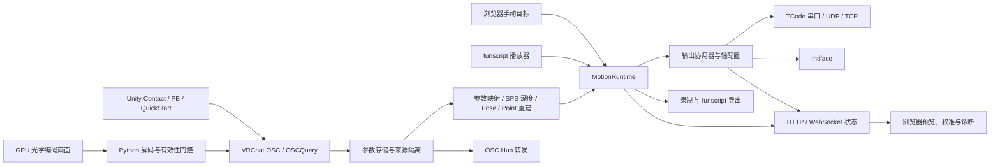

# Sensa 功能全景与实现说明

**简体中文** | [English](features.en.md)

本文是跟随当前仓库实现维护的功能说明，覆盖主程序、WebUI、Unity 包、Avatar／世界实验工具、辅助脚本和 CI。源码使用仓库相对链接，不保留重构后会漂移的行号。测试用于说明契约覆盖，不能据此推断已完成真实 Unity、VRChat 或硬件验收；第三方依赖仅描述本项目实际调用的能力。

阅读操作步骤可先看[使用指南](guide.md)、[首次使用](quick-start.md)和[预设说明](presets.md)。本文供需要完整了解现有功能、配置边界和实现分工的使用者与开发者阅读。

## 阅读导航

- [系统组成与数据流](#系统组成与数据流)
- [服务启动、配置应用与访问控制](#服务启动配置应用与访问控制)
- [后端输入、信号处理与输出](#后端输入信号处理与输出)
- [浏览器界面与交互](#浏览器界面与交互)
- [Unity 资产与实验工具](#unity-资产与实验工具)
- [API 与状态协议索引](#api-与状态协议索引)
- [构建、验证和发布](#构建验证和发布)
- [实现范围与验证边界](#实现范围与验证边界)
- [代码覆盖索引](#代码覆盖索引)

## 系统组成与数据流

Sensa 是浏览器配置的本地动作桥接服务：把 OSC 参数、重建的局部几何、手动目标或 funscript 轨迹转换为统一动作帧，再分发到多个 Intiface／TCode 输出。桌面程序提供 .NET HTTP／WebSocket 服务，React 界面由服务直接提供；Unity 包负责把作者配置烘焙成 VRChat 原生组件，额外的 Shader 捕获链路由独立 Python 工具实现。[程序入口](https://github.com/SeaLoong/Sensa/blob/main/src/Program.cs)、[服务组装](https://github.com/SeaLoong/Sensa/blob/main/src/Hosting/SensaHost.cs)、[运行时](https://github.com/SeaLoong/Sensa/blob/main/src/Runtime/MotionRuntime.cs)、[输出协调器](https://github.com/SeaLoong/Sensa/blob/main/src/Outputs/OutputCoordinator.cs)、[Unity 构建处理器](https://github.com/SeaLoong/Sensa/blob/main/unity/top.sealoong.sensa/Editor/SensaProcessor.cs)



图中的 OSC Hub 是转发支路；它转发选定来源的数据，并不以设备输入启用开关作为设备动作开关。GPU 捕获也不是所有输入路径的共同前置条件：普通参数映射、QuickStart 和原生 Contact／PB 路径不需要它。[Hub 与输入开关分工](https://github.com/SeaLoong/Sensa/blob/main/src/Hosting/SensaHost.cs)、[Unity QuickStart 构建](https://github.com/SeaLoong/Sensa/blob/main/unity/top.sealoong.sensa/Editor/SensaQuickStartBuilder.cs)、[Shader 桥接](https://github.com/SeaLoong/Sensa/blob/main/scripts/shader-osc-bridge.py)

| 层次 | 主要职责 | 功能边界 |
| --- | --- | --- |
| 服务与配置 | 启动本地站点、会话、API、配置校验与持久化、连接管理 | 默认本机 HTTP 访问；启用输出连接不等于启用动作 |
| 输入与运行时 | 三种输入模式、信号融合、几何重建、门控、停止 | 同时使用一个输入模式；不同来源与不完整几何不能随意拼接 |
| 输出 | 多输出分发、独立轴配置、TCode 编码、Intiface 特征路由 | 发送的是控制目标；没有实现物理位置反馈闭环 |
| WebUI | 配置、发现、预设、校准、轨迹、输出和日志预览 | 编辑中的草稿与后端保存状态有区分 |
| Unity 与实验工具 | 作者组件、自动烘焙、样例交互、几何与 GPU 验证 | 作者组件不会作为任意自定义脚本在 VRChat Avatar 中运行 |
| 工程工具 | 构建、隔离测试、可复现归档、预发布、VPM 索引 | 公共 CI 静态包检查不能替代 Unity／客户端／硬件验收 |

依据：[运行时](https://github.com/SeaLoong/Sensa/blob/main/src/Runtime/MotionRuntime.cs)、[输出遥测](https://github.com/SeaLoong/Sensa/blob/main/src/Outputs/OutputTelemetry.cs)、[WebUI](https://github.com/SeaLoong/Sensa/blob/main/src/web/app.js)、[NDMF 插件](https://github.com/SeaLoong/Sensa/blob/main/unity/top.sealoong.sensa/Editor/SensaProcessor.cs)、[原生平台工作流](https://github.com/SeaLoong/Sensa/blob/main/.github/workflows/build-platforms.yml)。

### 当前实现的 module 分工

HTTP 与 WebSocket 在各自 adapter 中处理请求帧，随后跨越同一个 `SensaApplication.ExecuteAsync` interface；输入、脚本、输出和录制的命令规则不再分别存在于两套传输分支。`SensaHost` 负责实例组装、监听、状态总览与推送。配置更新单独由 `ConfigurationUpdate` module 串行管理，保持“校验、关闭输入、停止、应用、持久化、失败回滚”的 transaction locality。[应用命令](https://github.com/SeaLoong/Sensa/blob/main/src/Application/SensaApplication.cs)、[HTTP adapter](https://github.com/SeaLoong/Sensa/blob/main/src/Hosting/HttpCommandAdapter.cs)、[WebSocket adapter](https://github.com/SeaLoong/Sensa/blob/main/src/Hosting/WebSocketCommandAdapter.cs)、[配置 transaction](https://github.com/SeaLoong/Sensa/blob/main/src/Application/ConfigurationUpdate.cs)

浏览器的 `app.js` 负责 React 状态和交互组装；`configuration.js` 的 `editConfiguration` 集中处理保存草稿、冲突校验、默认轴配置和输出引用修复；`input-workflows.js` 统一手动命令与脚本时间／A-B 规则；`realtime-session.js` 管理会话鉴权、重连、请求关联和超时，断线请求不会重放。诊断、偏好、共享控件、配置视图与时间轴各自保留实现 locality。[配置 module](https://github.com/SeaLoong/Sensa/blob/main/src/web/configuration.js)、[输入流程](https://github.com/SeaLoong/Sensa/blob/main/src/web/input-workflows.js)、[实时会话](https://github.com/SeaLoong/Sensa/blob/main/src/web/realtime-session.js)、[诊断](https://github.com/SeaLoong/Sensa/blob/main/src/web/diagnostics.js)、[偏好](https://github.com/SeaLoong/Sensa/blob/main/src/web/preferences.js)、[共享控件](https://github.com/SeaLoong/Sensa/blob/main/src/web/controls.jsx)、[配置视图](https://github.com/SeaLoong/Sensa/blob/main/src/web/configuration-views.jsx)、[诊断视图](https://github.com/SeaLoong/Sensa/blob/main/src/web/diagnostic-views.jsx)、[时间轴](https://github.com/SeaLoong/Sensa/blob/main/src/web/script-timeline.jsx)、[OSC 预览运算](https://github.com/SeaLoong/Sensa/blob/main/src/web/osc-workspace.js)

运行时、播放器、参数存储、录制时长和输出遥测通过 `TimeProvider` seam 消费时间；生产使用系统时钟，契约测试使用可推进时钟 adapter，覆盖时间相关行为时无需 sleep 或反射修改私有字段。时钟与输出 fixture 的具体 interface 保存在测试支持目录。[参数时钟](https://github.com/SeaLoong/Sensa/blob/main/src/Input/Osc/OscModels.cs)、[运行时](https://github.com/SeaLoong/Sensa/blob/main/src/Runtime/MotionRuntime.cs)、[播放器](https://github.com/SeaLoong/Sensa/blob/main/src/Input/Script/FunscriptPlayer.cs)、[录制器](https://github.com/SeaLoong/Sensa/blob/main/src/Recording/MotionRecorder.cs)、[遥测](https://github.com/SeaLoong/Sensa/blob/main/src/Outputs/OutputTelemetry.cs)、[可推进时钟 adapter](https://github.com/SeaLoong/Sensa/blob/main/tests/Sensa.Tests/Support/ManualTimeProvider.cs)、[动作 fixture](https://github.com/SeaLoong/Sensa/blob/main/tests/Sensa.Tests/Support/MotionRig.cs)

## 服务启动、配置应用与访问控制

### 启动与关闭

- 入口调用 `SensaHost.RunAsync(args)`，加载并规范化配置，以程序所在目录为静态资源根目录，默认地址为 `http://127.0.0.1:5086`。可配置主机、端口和自动打开浏览器；这些字段在启动时消费，通过完整配置接口保存后需重启生效，不会在线重绑 HTTP 或重新打开浏览器。Windows 会设置控制台标题。[入口](https://github.com/SeaLoong/Sensa/blob/main/src/Program.cs)、[启动过程](https://github.com/SeaLoong/Sensa/blob/main/src/Hosting/SensaHost.cs)、[Web 配置](https://github.com/SeaLoong/Sensa/blob/main/src/Configuration/AppConfig.cs)
- 启动时创建 OSC、OSCQuery、Hub、脚本播放器、录制器、动作运行时与输出协调器。加载配置会把输出启用标志重置为关闭，运行时从 Manual／输入关闭开始，所以重启不会恢复上次的设备启用和动作；启动流程保留了连接当前启用输出的统一入口。[配置加载与瞬态重置](https://github.com/SeaLoong/Sensa/blob/main/src/Configuration/AppConfig.cs)、[服务组装](https://github.com/SeaLoong/Sensa/blob/main/src/Hosting/SensaHost.cs)、[运行时初始化](https://github.com/SeaLoong/Sensa/blob/main/src/Runtime/MotionRuntime.cs)
- 关闭时停止录制、关闭 WebSocket、处置输出、停止 OSC 与 OSCQuery／Hub，释放运行时并尝试保存配置。资源处置和正常运行结束各有相应清理路径。[关闭过程](https://github.com/SeaLoong/Sensa/blob/main/src/Hosting/SensaHost.cs)

### 配置更新是一次受控切换

更新配置先复制候选配置并校验目标重复、OSCQuery 轮询、接收器服务和 Hub 目标；随后关闭输入、停止输出、应用新配置、重建处理器并按需要重配监听和输出连接，最后保存。发生应用错误时尝试恢复原配置与连接；恢复失败不会被包装成成功。保存后需要用户重新启用输入，切换映射不会悄悄继续动作。[配置应用与回滚](https://github.com/SeaLoong/Sensa/blob/main/src/Application/ConfigurationUpdate.cs)

输出连接按输出 ID 和类型管理。增加、删除、改变类型会触发拓扑重建；仅改变串口、主机、端口、Intiface 地址等连接目标时会按需重连。轴参数可以使用相同连接更新。[输出差异处理](https://github.com/SeaLoong/Sensa/blob/main/src/Application/ConfigurationUpdate.cs)

### 访问策略与资源限制

| 能力 | 当前行为 |
| --- | --- |
| 本机浏览器会话 | 先 `GET /api/session` 取得随机会话 Cookie，后续 API 使用它 |
| Cookie 属性 | `HttpOnly`、`SameSite=Strict`；HTTPS 时设 `Secure` |
| 远程访问 | 需自行配置监听地址，并设置 `SENSA_ACCESS_TOKEN`；接受 Bearer，或以该 token 为密码的 Basic |
| 同源检查 | 检查 Origin 的 scheme／authority，拒绝 `Sec-Fetch-Site: cross-site`；本机请求也检查 Host 是否为 loopback／localhost |
| HTTP 限制 | Kestrel 请求体上限 4 MiB |
| WebSocket 限制 | 最多 16 个并发会话；消息上限 4 MiB；超额连接返回 429；单次发送有 3 秒超时 |
| 静态资源 | HTML、主 bundle、CSS 设置不缓存；站点设置禁止嵌入、禁 MIME 嗅探和不发送 Referrer 的响应头 |

访问控制是本地服务与显式共享凭据机制，未实现账号、角色或多用户权限管理。源码默认服务 URL 使用 HTTP；配置远程凭据不会自动启用 TLS。[访问策略完整实现](https://github.com/SeaLoong/Sensa/blob/main/src/Hosting/LocalAccessPolicy.cs)、[HTTP 设置](https://github.com/SeaLoong/Sensa/blob/main/src/Hosting/SensaHost.cs)、[WebSocket 限额与接收](https://github.com/SeaLoong/Sensa/blob/main/src/Hosting/SensaHost.cs)、[会话发送](https://github.com/SeaLoong/Sensa/blob/main/src/Hosting/ApiContracts.cs)

### 状态推送和日志

状态以约 100 ms 的脏标记合并推送，包含运行时、输入／脚本、OSC 来源与预览、Query／Hub、输出、几何观测、录制、信号等；为每个浏览器合并待发送状态，减少积压。WebSocket 初次连接会收到状态。[状态推送](https://github.com/SeaLoong/Sensa/blob/main/src/Hosting/SensaHost.cs)

运行日志按 Debug／Info／Warning／Error 和消息前缀分类，内存最多保留 2000 条，普通查询默认取最后 200 条，推送信封取最后 50 条。Warning／Error 写入标准错误，其余写入标准输出；这不是持久化日志数据库。[日志缓冲](https://github.com/SeaLoong/Sensa/blob/main/src/Runtime/RuntimeLogBuffer.cs)、[日志入口](https://github.com/SeaLoong/Sensa/blob/main/src/Hosting/SensaHost.cs)

## 后端输入、信号处理与输出

### 运行模型与统一运动状态

Sensa 使用 MotionFrame 表示 12 个归一化轴：L0/L1/L2、R0/R1/R2、V0/V1/V2、A0/A1/A2，并携带事件间隔 DeltaMs、可选 TCode 命令模式及速度/时长请求。运行时中立姿态将位置、旋转和辅助轴设为 0.5，将 V0–V2 设为 0。MotionPatch 仅包含本次控制的轴，拒绝非有限数并将值限制在 0–1；因此局部输入不会把未控制轴重置为默认位置。（来源：[src/Motion/MotionFrame.cs](https://github.com/SeaLoong/Sensa/blob/main/src/Motion/MotionFrame.cs)；[src/Motion/MotionAxes.cs](https://github.com/SeaLoong/Sensa/blob/main/src/Motion/MotionAxes.cs)）

输入模式有 Manual、Osc、Script，初始为 Manual 且输入未激活。输出条件为：运行时未释放、没有急停、输入已激活、所有门控满足、空间输入未阻断。OSC/OSCQuery 参数经来源存储、映射或几何重建、处理和融合产生轴补丁；手动输入形成完整轴补丁；Funscript 形成 L0 补丁；补丁作用于当前运动帧，再交给录制器和多输出协调器。（来源：[src/Runtime/RuntimeInputMode.cs](https://github.com/SeaLoong/Sensa/blob/main/src/Runtime/RuntimeInputMode.cs)；[src/Runtime/MotionRuntime.cs](https://github.com/SeaLoong/Sensa/blob/main/src/Runtime/MotionRuntime.cs)）

运行时由输入事件触发，脚本使用自身 20ms 定时器。待发送手动请求会保留最新补丁，避免积压；模式切换、关闭输入和急停会更新代次，丢弃旧待发送请求。姿态未有效变化且运动参数未改变时通常不发新命令，重新激活等状态转换会强制重发。UDP 输出另由宿主每秒在允许发送时刷新全量姿态。（来源：[src/Runtime/MotionRuntime.cs](https://github.com/SeaLoong/Sensa/blob/main/src/Runtime/MotionRuntime.cs)；[src/Input/Script/FunscriptPlayer.cs](https://github.com/SeaLoong/Sensa/blob/main/src/Input/Script/FunscriptPlayer.cs)；[src/Hosting/SensaHost.cs](https://github.com/SeaLoong/Sensa/blob/main/src/Hosting/SensaHost.cs)）

#### 停止、急停与 Avatar 切换

急停关闭输入、清空待发送补丁、暂停脚本，并请求所有输出停止。解除急停不会重新开启输入。实际输入模式改变时总会关闭输入；再次选择已生效的同一模式不改变开关。UDP /avatar/change 与 OSCQuery AvatarChanged 统一调用参数存储的 ChangeAvatar interface，清除相关来源或整个存储，并重置观测量程、SPS 长度估计和连续滚转。当前为 OSC 且输入已激活时，运行时进入急停。[通知接线](https://github.com/SeaLoong/Sensa/blob/main/src/Hosting/SensaHost.cs)、[统一变更 interface](https://github.com/SeaLoong/Sensa/blob/main/src/Input/Osc/OscModels.cs)、[运行时状态转换](https://github.com/SeaLoong/Sensa/blob/main/src/Runtime/MotionRuntime.cs)

### 配置保存、输出实例与轴配置

配置为 JSON，枚举按字符串保存，读取属性名不区分大小写，当前 schema 为 5。默认保存在可执行文件目录的 config.json，可通过 SENSA_CONFIG_PATH 指定其他路径。读取失败会记录错误、备份为 .invalid-时间戳 并返回默认配置；保存先写 GUID 临时文件、刷新至磁盘后替换目标。保存快照和加载结果都会将所有输出设为禁用，设备激活状态不会跨重启恢复。（来源：[src/Configuration/AppConfig.cs](https://github.com/SeaLoong/Sensa/blob/main/src/Configuration/AppConfig.cs)）

多个输出实例分别保存 ID、名称、类型、启用状态和连接参数，类型为 TCodeSerial、TCodeUdp、TCodeTcp、Intiface。TCode 实例通过 MotionProfileId 引用共享轴配置库；每套轴配置有 ID、名称、唯一默认标记及全部 12 轴。缺少或不存在的引用回退默认项。规范化补齐名称和 ID、消除 ID 冲突并保证唯一默认项。（来源：[src/Configuration/AppConfig.cs](https://github.com/SeaLoong/Sensa/blob/main/src/Configuration/AppConfig.cs)）

| 每轴字段 | 默认值与范围 | 作用 |
|---|---|---|
| Min / Max | 0 / 999；0–999，反序时交换 | 输出硬边界 |
| RemapMin / RemapMax | 0 / 999；0–999，反序时交换 | 将整个输入范围映射到指定输出区间 |
| MaxSpeed | 999；1–999 | 逻辑速度上限 |
| Invert | false | 输出方向反转 |
| Mode | Normal | Normal、Locked、Ignored |
| CommandMode | Interval | None、Interval、Speed |
| RampType | None | None、Linear、EaseIn、EaseOut、EaseInOut |
| LockValue | 0.5；0–1 | Locked 模式固定输入 |

以上默认值与规范化范围来自 [src/Configuration/AppConfig.cs](https://github.com/SeaLoong/Sensa/blob/main/src/Configuration/AppConfig.cs)、。

连接默认值为串口 COM3、UDP 127.0.0.1:9999、TCP 127.0.0.1:9998、Intiface ws://localhost:12345；Intiface 默认管理内置引擎，TCode 默认速度单位为每 100ms，输出级 SlopeMode 默认 None（跟随每轴命令模式）。非法网络端口回退对应默认值。（来源：[src/Configuration/AppConfig.cs](https://github.com/SeaLoong/Sensa/blob/main/src/Configuration/AppConfig.cs)）

目标冲突验证检查所有输出实例：串口名、同协议主机加端口、Intiface WebSocket 地址及托管引擎端口不能重复。配置比较会忽略大小写和部分首尾空白，但不通过 DNS 统一不同主机别名，不能据此保证识别所有指向同一硬件的地址。（来源：[src/Configuration/AppConfig.cs](https://github.com/SeaLoong/Sensa/blob/main/src/Configuration/AppConfig.cs)）

旧 TCode、UdpTCode、TcpTCode、Intiface、TCodeProfiles 结构仍存在，规范化时由每种类型的第一个输出及默认轴配置生成镜像；多输出列表与轴配置库是当前主要数据模型。（来源：[src/Configuration/AppConfig.cs](https://github.com/SeaLoong/Sensa/blob/main/src/Configuration/AppConfig.cs)）

### OSC 接收、来源隔离与参数目录

UDP 接收器默认监听 127.0.0.1:9001，可配置 IP、DNS 主机名、0.0.0.0 / * / any 及 IPv6。重新绑定失败会恢复原地址。异步接收可取消，旧接收循环不会读取新一代 socket。每个 UDP 来源由地址加端口标识，接收前先调用来源过滤器。（来源：[src/Input/Osc/OscInputReceiver.cs](https://github.com/SeaLoong/Sensa/blob/main/src/Input/Osc/OscInputReceiver.cs)）

运动参数解析消费 /avatar/parameters/... 的首个 float、int、true 或 false 值，以及 /avatar/change 通知，支持最多 16 层嵌套 bundle，拒绝非有限浮点。bundle 时间戳被跳过，不进行未来时间调度；运动解析不消费任意类型或多个参数。未消费的消息进入原始预览／透传；混合 bundle 会过滤出这些消息，同时保留原始嵌套、顺序和 timetag。全未消费的 bundle 保持原包字节；Avatar 标量处理自身仍不实现未来时间调度。（来源：[src/Input/Osc/OscPacketParser.cs](https://github.com/SeaLoong/Sensa/blob/main/src/Input/Osc/OscPacketParser.cs)；[src/Input/Osc/OscInputReceiver.cs](https://github.com/SeaLoong/Sensa/blob/main/src/Input/Osc/OscInputReceiver.cs)）

参数按“路径加来源”保存最新值、时间戳和递增序号，并支持来源统计、快照及按来源清除。路径最长 512 字符，最多 4096 条路径/来源组合和 32 个来源；写入时每隔至少 10 秒清理超过 5 分钟无新数据的来源。明确选定来源后，缺失参数不会回退到其他发送者。（来源：[src/Input/Osc/OscModels.cs](https://github.com/SeaLoong/Sensa/blob/main/src/Input/Osc/OscModels.cs)）

路径匹配区分大小写：* 匹配一个路径段，** 匹配任意数量路径段；分号或换行可并列最多 32 个模式，每个模式及路径最多 64 段。（来源：[src/Input/Osc/OscModels.cs](https://github.com/SeaLoong/Sensa/blob/main/src/Input/Osc/OscModels.cs)）

输入超时默认 0，表示关闭；接收配置副本时限制为 0–600000ms。来源 IP 白名单最多 32 个独立 IP，非法 IP 抛错，避免错误白名单变成允许全部来源。参数分类器对面部追踪、OGB/Sensa 路径、已知名称、关键词及近似名称提供相关性提示；这是展示辅助，不会自动创建设备映射。（来源：[src/Configuration/AppConfig.cs](https://github.com/SeaLoong/Sensa/blob/main/src/Configuration/AppConfig.cs)；[src/Input/Osc/OscParameterClassifier.cs](https://github.com/SeaLoong/Sensa/blob/main/src/Input/Osc/OscParameterClassifier.cs)）

### OSCQuery 客户端、轮询与接收器广播

客户端读取根地址树和 HOST_INFO，取得服务名称、OSC 地址/端口/传输类型、WebSocket 地址、LISTEN 能力，以及参数类型、描述、访问权限、当前值、范围和枚举值。只将 /avatar/parameters/ 子树转成运动参数目录。默认 HTTP 超时 6 秒、响应缓冲上限 4MiB；URL 仅支持 HTTP/HTTPS，省略协议时补 HTTP。（来源：[src/Input/Osc/OscQueryClient.cs](https://github.com/SeaLoong/Sensa/blob/main/src/Input/Osc/OscQueryClient.cs)）

对支持 LISTEN 且存在参数的服务，客户端建立 WebSocket，为当前节点发送 LISTEN，对不再需要的节点发送 IGNORE。二进制帧按 Avatar OSC 解码，PATH_CHANGED / PATH_RENAMED / PATH_REMOVED / PATH_ADDED 文本通知触发结构刷新；断开后约每 1.5 秒重连。单条 WebSocket 消息超过 4MiB 时拒绝。（来源：[src/Input/Osc/OscQueryClient.cs](https://github.com/SeaLoong/Sensa/blob/main/src/Input/Osc/OscQueryClient.cs)）

OSCQuery 的运行时来源 key 基于 URL；持久来源标识优先使用服务名，否则使用 URL。HTTP 快照支持单一 f/d/i/h/T/F 值，其中 h 必须可表示为 32 位整数；字符串等保留为元数据展示。（来源：[src/Input/Osc/OscQueryClient.cs](https://github.com/SeaLoong/Sensa/blob/main/src/Input/Osc/OscQueryClient.cs)）

轮询回退默认关闭、10Hz，限制 1–30Hz；启用时必须同时开启 OSCQuery 客户端。服务执行一次回调后等待 1000/rate 毫秒，实际频率受请求耗时影响；快照记录最近轮询时间、应用值数和错误。（来源：[src/Configuration/AppConfig.cs](https://github.com/SeaLoong/Sensa/blob/main/src/Configuration/AppConfig.cs)；[src/Input/Osc/OscQueryPollingService.cs](https://github.com/SeaLoong/Sensa/blob/main/src/Input/Osc/OscQueryPollingService.cs)）

接收器广播默认关闭，服务名 Sensa、HTTP 端口 9010，默认声明 /avatar 与 /tracking/vrsystem。仅在上层传入 OSC 模式有效、广播开启且至少选择一个分类时启动；HTTP 绑定 0.0.0.0，mDNS 广告 _oscjson._tcp 与 _osc._udp。仅支持 GET，可查询根树、子节点、HOST_INFO 及指定属性；此服务描述接收能力，没有实现 LISTEN 或动态 Avatar 参数值服务。配置验证要求至少一个广播分类，且 HTTP 端口不与 WebUI 冲突。（来源：[src/Configuration/AppConfig.cs](https://github.com/SeaLoong/Sensa/blob/main/src/Configuration/AppConfig.cs)；[src/Input/Osc/OscQueryReceiverService.cs](https://github.com/SeaLoong/Sensa/blob/main/src/Input/Osc/OscQueryReceiverService.cs)）

### OSC Hub 与原始包预览

Hub 支持多个独立命名 UDP 目标，默认关闭、事件驱动、固定速率 10Hz、默认不转发 Avatar 改变。事件模式立即重编码并转发参数；固定速率模式按路径仅保留最新待发送值，每周期冲刷一次，范围 1–240Hz，因此会合并同一路径的中间值。原始包透传直接发送，不受参数固定速率合并约束。可将已有参数快照重放到目标。（来源：[src/Configuration/AppConfig.cs](https://github.com/SeaLoong/Sensa/blob/main/src/Configuration/AppConfig.cs)；[src/Input/Osc/OscHubForwarder.cs](https://github.com/SeaLoong/Sensa/blob/main/src/Input/Osc/OscHubForwarder.cs)）

Avatar 改变会清空待发参数；允许转发时，固定速率模式先发送改变通知再发后续参数。统计含目标数、活动目标数、待发数、发送/失败数、最近发送/失败时间及各目标错误。验证拒绝重复目标与已识别的直接指回当前监听端口回环。（来源：[src/Input/Osc/OscHubForwarder.cs](https://github.com/SeaLoong/Sensa/blob/main/src/Input/Osc/OscHubForwarder.cs)；[src/Configuration/AppConfig.cs](https://github.com/SeaLoong/Sensa/blob/main/src/Configuration/AppConfig.cs)）

包预览默认保留最近 64 条，分 tracking 与 raw，展示地址、类型标签、值摘要、时间、来源地址/端口/稳定标识。摘要解析 float/double/int/int64/bool/string，未知类型为占位符；最多解析 16 层 bundle、单包 64 条。预览是诊断信息，tracking 透传不等于身体姿态重建或设备运动映射。（来源：[src/Input/Osc/OscPacketPreviewStore.cs](https://github.com/SeaLoong/Sensa/blob/main/src/Input/Osc/OscPacketPreviewStore.cs)）

### 信号映射、校准、曲线与融合

映射包含路径模式、SourceMode、目标 Role、输入区间 VrchatMin/Max、InvertDirection、Curve 和 MappedMin/Max。来源模式为 Direct、SpsSocketDepth、SensaPose、SensaPoint；默认 Direct、0–1 输入、Linear、Depth。空间度量分别默认 Pose Depth 与 Point Z。（来源：[src/Signals/SignalMapping.cs](https://github.com/SeaLoong/Sensa/blob/main/src/Signals/SignalMapping.cs)；[src/Configuration/AppConfig.cs](https://github.com/SeaLoong/Sensa/blob/main/src/Configuration/AppConfig.cs)）

处理顺序为输入区间校准（反向则交换端点）→限制 0–1→曲线→输出区间。曲线为线性、平方 EaseIn、反平方 EaseOut、分段二次 SCurve；输入范围近似零时归一化为 0。映射输出按位置数值 0–999 配置，再除以 1000，因此最大内部值为 0.999。处理器记录观察到的最小/最大输入，不会自行修改校准区间。（来源：[src/Signals/SignalPipeline.cs](https://github.com/SeaLoong/Sensa/blob/main/src/Signals/SignalPipeline.cs)）

| Role | 输出轴 |
|---|---|
| Depth / Surge / Sway | L0 / L1 / L2 |
| Twist / AngleX / AngleY | R0 / R1 / R2 |
| V0 / V1 / V2 | V0 / V1 / V2 |
| Auxiliary / Auxiliary1 / Auxiliary2 | A0 / A1 / A2 |

同轴多个信号按校准后的归一化强度选最高优先级；强度近似相同时，中心轴选偏离 0.5 更远的输出，其余轴选较大值。这不是按最近参数覆盖，也不是求和或平均。（来源：[src/Signals/SignalPipeline.cs](https://github.com/SeaLoong/Sensa/blob/main/src/Signals/SignalPipeline.cs)；[src/Runtime/MotionRuntime.cs](https://github.com/SeaLoong/Sensa/blob/main/src/Runtime/MotionRuntime.cs)）

GateEnable 的同一映射匹配多个值时，任一处理后值大于 0.5 即满足；多个门控映射之间必须全部满足，缺失视为关闭。DepthOverride 取所有覆盖值最大者，替代普通 Depth。Pose/Point 控制的角色会屏蔽同角色直接映射，空间输入丢失时不会退回旧深度信号。（来源：[src/Runtime/MotionRuntime.cs](https://github.com/SeaLoong/Sensa/blob/main/src/Runtime/MotionRuntime.cs)）

输入 watchdog 每 500ms 检查一次，以当前输入类型相关采样的最新时间戳和本次激活时间计算整体断流时限；超过阈值会急停，并非每条映射各自独立触发全局急停。某个相关标量持续更新时，不保证另一标量过期就急停。空间模式只以相关几何采样计时，门控、抓取及其他元数据不会为冻结坐标续期；构建输出时还会检查所用数据的新鲜度。（来源：[src/Runtime/MotionRuntime.cs](https://github.com/SeaLoong/Sensa/blob/main/src/Runtime/MotionRuntime.cs)）

### SPS 深度估计

SpsSocketDepth 使用同一来源、同一 Socket 的 NewRoot 与 NewTip。NewTip 是根部中心的长度球，不是尖端标记；估计器在长度球未饱和时学习长度，加回原生 Root 发送球 1cm 半径；长度至少 2cm。Tip 达到 0.99 且已有长度后才输出深度。无效、离开或不一致样本会重置，更换较短目标可重新学习，不永久保留最大长度。（来源：[src/Signals/SpsDepthEstimator.cs](https://github.com/SeaLoong/Sensa/blob/main/src/Signals/SpsDepthEstimator.cs)）

Root 或 Tip 任一个实际坐标更新都能刷新该输入对；其他 Socket、来源和门控不能刷新。对 delta-only OSC 允许另一坐标保留缓存。几何事件合并约 30ms 后再处理。此模式仍为径向近似，不能校正侧偏和倾角，不能确认发送者身份，Root 饱和时也存在几何分辨限制。（来源：[src/Runtime/MotionRuntime.cs](https://github.com/SeaLoong/Sensa/blob/main/src/Runtime/MotionRuntime.cs)；[src/Signals/SpsDepthEstimator.cs](https://github.com/SeaLoong/Sensa/blob/main/src/Signals/SpsDepthEstimator.cs)；[tests/Sensa.Tests/Contracts/SignalContracts.cs](https://github.com/SeaLoong/Sensa/blob/main/tests/Sensa.Tests/Contracts/SignalContracts.cs)）

### 空间 Pose、Point、Handle 与根部诊断

Pose 从同一来源和 rig 前缀的 Root/Tip/Side 三个标记、每标记八路接近度拟合几何，要求完整 24 路。拟合同时搜索 0–2cm 发送球半径。观察结果提供根部、尖端、侧点、轴线与孔口平面交点、深度、轴向深度、长度、Yaw/Pitch/Roll、残差及估计半径。单球本身不能观测朝向或扭转。（来源：[src/Signals/PoseReconstruction.cs](https://github.com/SeaLoong/Sensa/blob/main/src/Signals/PoseReconstruction.cs)）

拒绝条件包括采样缺失/非有限/接近 0 或 1、拟合残差超限、位置离中心超过 0.245m、根尖距离不在 0.02–0.5m、轴线与平面平行、侧点与轴线近似重合、接近方向奇异位置。协议接收球半径 0.35m、锚点半跨距 0.06m、默认本地标记半径 0.001m、最大拟合残差 0.002m。Pose 只有倾角不超过 65°、轴线交点位于半径 0.04m 孔口内且尖端 Z>0 时才 Engaged；有效但未进入不会驱动输出。（来源：[src/Signals/PoseReconstruction.cs](https://github.com/SeaLoong/Sensa/blob/main/src/Signals/PoseReconstruction.cs)；[unity/top.sealoong.sensa/Runtime/SensaPoseProtocol.cs](https://github.com/SeaLoong/Sensa/blob/main/unity/top.sealoong.sensa/Runtime/SensaPoseProtocol.cs)）

多个有效已进入 rig 中选深度最大者；新候选比当前目标深不足 0.05 时保留当前目标以降低跳变。未明确选来源而存在多个来源时阻断 Pose。Roll 跨 ±180° 使用连续角展开，避免突然在执行器两端之间跳转。（来源：[src/Runtime/MotionRuntime.cs](https://github.com/SeaLoong/Sensa/blob/main/src/Runtime/MotionRuntime.cs)；[src/Signals/ContinuousAngle.cs](https://github.com/SeaLoong/Sensa/blob/main/src/Signals/ContinuousAngle.cs)）

Point 与 Handle 使用已知半径的四面体四路采样，度量为 X/Y/Z/距原点距离；必须唯一匹配且有效。Handle 额外要求 Handle_IsGrabbed=1，释放即阻断。SpsRoot 八路重建与 SharedRoot 共享阵列为诊断位置，不是可映射的本地点，也不被当作完整 Pose。SharedRoot 要求 Slot 为 1–16 整数、Ready=1，且 Ready 与全部几何样本序号晚于槽位选择，避免换槽使用旧数据。（来源：[src/Signals/PoseReconstruction.cs](https://github.com/SeaLoong/Sensa/blob/main/src/Signals/PoseReconstruction.cs)；[src/Signals/SpsPositionTracking.cs](https://github.com/SeaLoong/Sensa/blob/main/src/Signals/SpsPositionTracking.cs)；[src/Runtime/MotionRuntime.cs](https://github.com/SeaLoong/Sensa/blob/main/src/Runtime/MotionRuntime.cs)）

同一配置不能混用 Pose 与 Point，同模式的各轴必须共享一个路径模式，不能把 Pose/Point 映射至 GateEnable 或 DepthOverride。空间输入缺失、失效或歧义会阻断运动并发出停止；有效输入恢复后可重新形成输出，区别于需要用户解除的全局急停。（来源：[src/Configuration/AppConfig.cs](https://github.com/SeaLoong/Sensa/blob/main/src/Configuration/AppConfig.cs)；[src/Runtime/MotionRuntime.cs](https://github.com/SeaLoong/Sensa/blob/main/src/Runtime/MotionRuntime.cs)）

### Funscript 播放

播放器要求 JSON 根为 object，actions 为数组；每条有效动作读取整数 at 毫秒与有限数值 pos 百分比。非 object、不完整、时间非整数或位置非有限值的条目会跳过；根或数组无效、或最终没有有效动作时仍报错。负时间限制为 0、位置限制为 0–100，动作按时间排序；最多 500000 动作与 7 天时长，实际时长取末动作时间且至少 1ms。当前只消费 actions，不使用文件 inverted、range 等元数据。[播放器解析](https://github.com/SeaLoong/Sensa/blob/main/src/Input/Script/FunscriptPlayer.cs)、[播放器契约](https://github.com/SeaLoong/Sensa/blob/main/tests/Sensa.Tests/Contracts/ScriptContracts.cs)

支持加载、播放／重播、暂停、停止、清空、时间定位、前后关键帧跳转、循环、0.1–4 倍速及 A/B 循环范围。非有限倍速会被拒绝；分数倍速保留推进时间的小数余量，避免每个 timer tick 取整导致累计误差。循环边界限制在时长内，反序时交换；两端均设置且终点大于起点才有效。20ms 定时器按经过时间采样，二分定位关键帧并线性插值。到末尾进入 finished；即使 GetSnapshot 在两个 tick 之间先推进到结束，也会保留最终帧供后续 tick 发出，不会吞掉末目标。[播放器时钟与状态](https://github.com/SeaLoong/Sensa/blob/main/src/Input/Script/FunscriptPlayer.cs)、[速率与末帧契约](https://github.com/SeaLoong/Sensa/blob/main/tests/Sensa.Tests/Contracts/ScriptContracts.cs)

快照包括 Loaded、Playing、Paused、empty/stopped/playing/paused/finished 状态、文件名、播放位置、时长、动作数、当前 L0、循环边界、速度及 64 格动作密度。脚本只改变 L0，保留其他轴；补丁显式请求无 I/S 后缀命令。运行时仅在 Script 模式、输入已激活且非急停时消费脚本帧。（来源：[src/Input/Script/FunscriptPlayer.cs](https://github.com/SeaLoong/Sensa/blob/main/src/Input/Script/FunscriptPlayer.cs)；[src/Runtime/MotionRuntime.cs](https://github.com/SeaLoong/Sensa/blob/main/src/Runtime/MotionRuntime.cs)）

### 录制与 Funscript 导出

录制器在线程安全的缓存中采集通过运行时门控、去重后，交给输出分发前的 L0 目标帧及相对开始毫秒数；没有已连接输出或发送失败时也可录制，不代表传输或硬件执行确认；开始清空旧样本，停止保留缓存；达到 100000 帧后自动停止。被运行时判定为无变化而跳过的运动状态不新增样本；当前不是 12 轴录制器。（来源：[src/Recording/MotionRecorder.cs](https://github.com/SeaLoong/Sensa/blob/main/src/Recording/MotionRecorder.cs)；[src/Runtime/MotionRuntime.cs](https://github.com/SeaLoong/Sensa/blob/main/src/Runtime/MotionRuntime.cs)）

导出 JSON 包含 version=1.0、inverted=false、range=100，L0 乘 100 四舍五入为 pos；使用迭代 Ramer–Douglas–Peucker 简化，epsilon=0.02，时间轴转换成秒参与几何距离计算。空录制返回空内容。当前 WebUI 导出接口调用 Serialize 返回文件名与 JSON 文本，由浏览器下载；代码中另保留 Export 辅助方法，可落盘至 Documents/Sensa/recordings，但这不是当前用户界面的自动保存路径。（来源：[src/Recording/MotionRecorder.cs](https://github.com/SeaLoong/Sensa/blob/main/src/Recording/MotionRecorder.cs)；[src/Hosting/SensaHost.cs](https://github.com/SeaLoong/Sensa/blob/main/src/Hosting/SensaHost.cs)）

### 多输出分发与命令预览

输出协调器维护 ID 对应连接，重载时同 ID/类型可复用，删除或变更类型释放旧 transport。不同输出并行发送，单连接操作串行；真正发送前再次检查全局 CanSend 和实例状态。急停覆盖全部连接，连接本身不自动移动设备。输出概览包含类型、启用/连接状态、轴配置、功能列表、命令预览和设备信息。（来源：[src/Outputs/OutputCoordinator.cs](https://github.com/SeaLoong/Sensa/blob/main/src/Outputs/OutputCoordinator.cs)）

预览记录本地 transport/API 已接受的目标命令，不是硬件传感器回读或实际位置。TCode 按轴记录 0–999，Intiface 按设备功能记录百分比；停止、断开和设备移除会更新/清空相关状态。（来源：[src/Outputs/OutputTelemetry.cs](https://github.com/SeaLoong/Sensa/blob/main/src/Outputs/OutputTelemetry.cs)；[src/Outputs/Intiface/IntifaceOutputClient.cs](https://github.com/SeaLoong/Sensa/blob/main/src/Outputs/Intiface/IntifaceOutputClient.cs)）

#### TCode 编码及 transport

每轴依次进行 Ignored 判断、Locked 替代、Invert、Remap、Min/Max 钳制，最终编码三位 000–999 位置。Ignored 不发送，Locked 仍经过反向、映射和边界。命令模式优先级为帧明确请求 > 输出级斜坡模式 > 每轴 CommandMode。None 只发位置；Interval 加 I时长；Speed 加 S速度，帧速度仍受 MaxSpeed 限制。逻辑速度基于每 100ms，选择 PerSecond 时线上 S 数值乘 10。（来源：[src/Outputs/TCode/TCodeEncoder.cs](https://github.com/SeaLoong/Sensa/blob/main/src/Outputs/TCode/TCodeEncoder.cs)；[src/Outputs/TCode/TCodeAxisDebug.cs](https://github.com/SeaLoong/Sensa/blob/main/src/Outputs/TCode/TCodeAxisDebug.cs)）

RampType 的命令后缀依次为空、=、<、>、<>，向支持该扩展的设备表达相应斜坡；主机没有额外插值轨迹。速度估计根据上一目标变化与事件时间计算，首次无历史时为 0。Interval 自动模式按距离和限速计算时长；明确请求的 Interval 时长直接进入编码。（来源：[src/Outputs/TCode/TCodeEncoder.cs](https://github.com/SeaLoong/Sensa/blob/main/src/Outputs/TCode/TCodeEncoder.cs)；[src/Signals/SignalPipeline.cs](https://github.com/SeaLoong/Sensa/blob/main/src/Signals/SignalPipeline.cs)；[src/Outputs/TCode/TCodeAxisDebug.cs](https://github.com/SeaLoong/Sensa/blob/main/src/Outputs/TCode/TCodeAxisDebug.cs)）

串口固定 115200、8N1，读超时 100ms、写超时 200ms。连接查询 D0 固件、D1 协议、D2 轴说明，并支持 UTF-8、GB18030 及容错回退解码。UDP 不支持 D 指令回读，TCP 目前也未实现回读。TCP 连接期限 3 秒、发送与流写超时 500ms。（来源：[src/Outputs/TCode/TCodeSerialOutput.cs](https://github.com/SeaLoong/Sensa/blob/main/src/Outputs/TCode/TCodeSerialOutput.cs)；[src/Outputs/TCode/TCodeTcpOutput.cs](https://github.com/SeaLoong/Sensa/blob/main/src/Outputs/TCode/TCodeTcpOutput.cs)；[src/Outputs/OutputCoordinator.cs](https://github.com/SeaLoong/Sensa/blob/main/src/Outputs/OutputCoordinator.cs)）

三种 transport 首次发送全部非忽略轴，后续只发送变化轴并去重；UDP 距上次全量至少 1 秒时，在 Send 中重发全轴，配合宿主每秒刷新改善丢包后的目标状态恢复。停止/断开尝试发送 DSTOP。adapter 的 Center 方法以 I1000 请求 V轴0、其他轴0.5，仍经过轴配置；当前应按实际宿主入口判断其可见性，不把仅有底层方法写成已提供的 UI 功能。（来源：[src/Outputs/TCode/TCodeSerialOutput.cs](https://github.com/SeaLoong/Sensa/blob/main/src/Outputs/TCode/TCodeSerialOutput.cs)；[src/Outputs/TCode/TCodeUdpOutput.cs](https://github.com/SeaLoong/Sensa/blob/main/src/Outputs/TCode/TCodeUdpOutput.cs)；[src/Hosting/SensaHost.cs](https://github.com/SeaLoong/Sensa/blob/main/src/Hosting/SensaHost.cs)）

#### Intiface / Buttplug

Intiface 使用 Buttplug v5 功能 API，支持连接/断开、显式扫描开始/停止、设备增删通知、停止全部设备。位置目标为 1−L0；支持 HwPositionWithDuration 时优先发送带时长命令，否则仅向 Position 功能发原始位置。有位置功能的设备振动使用 V0，没有位置功能的设备使用 L0 驱动振动。所有设备共享该 L0/V0 逻辑，变化达到 0.001 才重发，整批输出期限 500ms；没有实现其他旋转、泵、吸力等 Buttplug 功能映射。（来源：[src/Outputs/Intiface/IntifaceOutputClient.cs](https://github.com/SeaLoong/Sensa/blob/main/src/Outputs/Intiface/IntifaceOutputClient.cs)；[src/Outputs/Intiface/IntifacePositionFeatures.cs](https://github.com/SeaLoong/Sensa/blob/main/src/Outputs/Intiface/IntifacePositionFeatures.cs)）

可管理内置 intiface-engine，也可关闭进程管理连接外部 Intiface Central。内置引擎从程序同目录或 LocalApplicationData/Sensa 查找，以无窗口子进程启动、启用 BLE/HID、关闭崩溃报告；宿主等待 1500ms 后连接，断开或释放时终止所管理的子进程树。（来源：[src/Outputs/Intiface/IntifaceOutputClient.cs](https://github.com/SeaLoong/Sensa/blob/main/src/Outputs/Intiface/IntifaceOutputClient.cs)；[src/Outputs/OutputCoordinator.cs](https://github.com/SeaLoong/Sensa/blob/main/src/Outputs/OutputCoordinator.cs)）

### 实现边界与保留字段

以下字段目前存在于配置或类型定义中，但不代表已接通的功能：

- WebUi.Title 目前只规范化、复制和保存；页面标题固定为 index.html 中的 Sensa WebUI，未接入运行时标题更新。[配置字段](https://github.com/SeaLoong/Sensa/blob/main/src/Configuration/AppConfig.cs)、[页面标题](https://github.com/SeaLoong/Sensa/blob/main/src/web/index.html)

- DeviceRoutes 以及 DeviceName / SendL0 / SendV0 / Enabled 仅声明、复制和保存；Intiface 发送器不读取它，不能描述为已实现逐设备路由。（来源：[src/Configuration/AppConfig.cs](https://github.com/SeaLoong/Sensa/blob/main/src/Configuration/AppConfig.cs)；[src/Outputs/Intiface/IntifaceOutputClient.cs](https://github.com/SeaLoong/Sensa/blob/main/src/Outputs/Intiface/IntifaceOutputClient.cs)）
- IsOgbSocket / IsOgbPlug 仅声明和复制，不参与后端处理。（来源：[src/Signals/SignalMapping.cs](https://github.com/SeaLoong/Sensa/blob/main/src/Signals/SignalMapping.cs)；[src/Configuration/AppConfig.cs](https://github.com/SeaLoong/Sensa/blob/main/src/Configuration/AppConfig.cs)）
- PreferSpeedMode 被保留、复制或镜像，当前编码器依据 RequestedCommandMode、SlopeMode、每轴 CommandMode，不读取该布尔值。（来源：[src/Configuration/AppConfig.cs](https://github.com/SeaLoong/Sensa/blob/main/src/Configuration/AppConfig.cs)；[src/Outputs/TCode/TCodeEncoder.cs](https://github.com/SeaLoong/Sensa/blob/main/src/Outputs/TCode/TCodeEncoder.cs)）
- ObservedMin / ObservedMax 与 ResetCalibration 只存在于处理器，未发现宿主消费入口；不能写成已接通的自动校准建议或自动校准功能。（来源：[src/Signals/SignalPipeline.cs](https://github.com/SeaLoong/Sensa/blob/main/src/Signals/SignalPipeline.cs)）

## 浏览器界面与交互

### 页面结构、运行状态与实时通信

WebUI 是 React 与 Material UI 单页界面，入口加载 /app.bundle.js，页面分为输入、轴配置、输出、日志四大区域。顶部提供中英文切换、实时连接、OSC 监听、实际输入方式、启用输出数量，以及停止/恢复输出按钮。[index.html](https://github.com/SeaLoong/Sensa/blob/main/src/web/index.html)、[app.js](https://github.com/SeaLoong/Sensa/blob/main/src/web/app.js)

界面有几组互相独立的状态，不能仅凭当前显示的页签判断设备正在做什么：

| 状态 | 作用与操作 |
|---|---|
| 当前输入方式 | 手动、OSC、脚本三选一，后端快照决定实际生效方式。 |
| 当前页签 | 仅切页签只浏览界面，显示“待应用”；可点击“应用输入方式”切换。提交手动目标、导入或播放脚本也会切换实际模式。 |
| 输入开关 | 控制是否允许输入驱动输出；关闭时停止设备，仍可观察 OSC、诊断和校准。 |
| 输出启用 | 每个输出独立启用或禁用；没有输出或全部禁用时显示提示。 |
| 急停 | “停止输出”请求 emergency-stop；“恢复输出”解除急停后仍须手动重新打开输入。 |
| OSC 接收器 | 配置开关独立于输入激活开关；实际监听还要求当前输入模式为 OSC。关闭接收器停止监听，不切换输入模式。 |
| 草稿与已保存配置 | 未保存映射只影响当前浏览器预览；保存配置会关闭输入，之后需手动重新打开。 |

来源：[app.js](https://github.com/SeaLoong/Sensa/blob/main/src/web/app.js)、[osc-workflow.js](https://github.com/SeaLoong/Sensa/blob/main/src/web/osc-workflow.js)。

realtime-session module 先取得同源 /api/session Cookie，再打开 /api/ws。request interface 关联 path／method／body 命令与响应，将连接就绪和请求等待各限制为 15 秒，状态推送单独分发。鉴权失败约 3 秒后重试，断线约 1.5 秒后重连；断线拒绝待处理请求且不重放，忽略旧 socket 帧。pagehide 暂停会话并取消计时器，pageshow 从页面缓存恢复时重新连接；最终清理移除两个监听器并关闭会话。初始化尚未完成时会在连接恢复后重试整组读取，失效代次的结果不应用；完整初始化后重连不再覆盖用户草稿。[实时会话](https://github.com/SeaLoong/Sensa/blob/main/src/web/realtime-session.js)、[会话契约](https://github.com/SeaLoong/Sensa/blob/main/tests/web/realtime-session.test.mjs)

浏览器本地保存当前输入页签、脚本倍率与循环偏好、语言和 OSC 路径置顶列表；这些不构成完整配置备份。完整配置通过后端 /api/config 保存。脚本 A/B 区间不进入本地 scriptDefaults，手动持续更新开关每次初始化为关闭。[input-workflows.js](https://github.com/SeaLoong/Sensa/blob/main/src/web/input-workflows.js)、[preferences.js](https://github.com/SeaLoong/Sensa/blob/main/src/web/preferences.js)、[app.js](https://github.com/SeaLoong/Sensa/blob/main/src/web/app.js)、[i18n.js](https://github.com/SeaLoong/Sensa/blob/main/src/web/i18n.js)、[osc-preview.js](https://github.com/SeaLoong/Sensa/blob/main/src/web/osc-preview.js)

### 手动输入

手动页提供以下全部 12 个逻辑轴的 0–999 滑条和数值编辑：

| 轴 | 界面含义 |
|---|---|
| L0 | 主往复行程，0 缩回、999 伸出。 |
| L1 | 前后平移，小值朝前、大值朝后。 |
| L2 | 左右平移，正向为用户左侧。 |
| R0 | 绕 L0 的扭转。 |
| R1 | 绕 L1 的滚转。 |
| R2 | 绕 L2 的俯仰。 |
| V0、V1、V2 | 三路震动，0 关闭、999 最大。 |
| A0、A1、A2 | 三路辅助通道。 |

“更新位置”一次提交所有轴；“回正”把运动轴和辅助轴设为 500，震动设为 0。关闭“持续更新”时只修改本地草稿，开启后每次修改合并到下一次 requestAnimationFrame 提交；切换该开关本身不会额外发送一次命令。逻辑目标仍受输出侧轴配置限制。[input-workflows.js](https://github.com/SeaLoong/Sensa/blob/main/src/web/input-workflows.js)、[app.js](https://github.com/SeaLoong/Sensa/blob/main/src/web/app.js)

提交手动目标会选择 Manual 模式，无需额外点击“应用输入方式”。从其他模式切入会关闭输入，必须显式重新开启；已处于 Manual 且输入开启时，更新目标可以立即发送。[手动提交](https://github.com/SeaLoong/Sensa/blob/main/src/Application/SensaApplication.cs)、[模式切换](https://github.com/SeaLoong/Sensa/blob/main/src/Runtime/MotionRuntime.cs)

手动斜率方式可以选择“跟随轴配置”、时间 I 或速度 S。I 指定 1–1000ms；S 指定逻辑速度 1–999，默认 999。跟随轴配置时，各轴分别选择时间、速度或无斜率；实际发送速度继续经过轴上限和每个输出的速度单位换算。[input-workflows.js](https://github.com/SeaLoong/Sensa/blob/main/src/web/input-workflows.js)、[configuration.js](https://github.com/SeaLoong/Sensa/blob/main/src/web/configuration.js)、[app.js](https://github.com/SeaLoong/Sensa/blob/main/src/web/app.js)

### OSC 接收、OSCQuery 与 Hub

OSC 工作区分“参数与映射”“空间诊断”“量程校准”；参数页设置再分“基础”“OSCQuery”“Hub”。基础项包括接收器启用、监听地址、UDP 端口、允许来源 IP、断流停止毫秒数。默认监听 127.0.0.1:9001；来源列表按空格、逗号、分号或换行拆分，留空不限；断流停止为 0 时关闭。UI 提醒增量 OSC 静止时可能不发包，只有持续发送的来源适合配置断流时间。[configuration.js](https://github.com/SeaLoong/Sensa/blob/main/src/web/configuration.js)、[app.js](https://github.com/SeaLoong/Sensa/blob/main/src/web/app.js)

OSCQuery 提供远端根地址、客户端启用、LISTEN 不支持时的轮询回退、轮询频率、自动发现开关。前端把轮询频率归一到 1–30Hz，默认 10Hz；显示已同步路径数、LISTEN 连接、轮询运行状态及同步/轮询/自动发现错误。自动发现把 Sensa 广播为 OSCQuery receiver，便于 VRChat 发现当前接收端。[configuration.js](https://github.com/SeaLoong/Sensa/blob/main/src/web/configuration.js)、[app.js](https://github.com/SeaLoong/Sensa/blob/main/src/web/app.js)

Hub 向多个 UDP 目标转发实时 OSC，可选参数变化立即转发的事件驱动，或每周期合并最新值的固定频率缓冲。固定频率范围 1–240Hz，默认 10Hz。每个目标可设置名称、主机、端口、启用或移除；新增时自动避开已占用端口和当前接收器端口。保存前检查重复目标及向当前接收器回发的环路。每目标显示待保存、禁用、冲突、待数据、正常、异常及最近发送时间；多个来源但未固定“使用来源”时提示 Hub 被阻塞。[configuration.js](https://github.com/SeaLoong/Sensa/blob/main/src/web/configuration.js)、[configuration-views.jsx](https://github.com/SeaLoong/Sensa/blob/main/src/web/configuration-views.jsx)、[app.js](https://github.com/SeaLoong/Sensa/blob/main/src/web/app.js)

### 参数工作台与来源隔离

参数表展示来源、路径、类型、当前值、更新时间和操作。命中当前映射的行高亮，提示对应目标角色和反向；点击路径打开“参数含义”，再生成映射草稿。[app.js](https://github.com/SeaLoong/Sensa/blob/main/src/web/app.js)

工作台支持路径搜索、显示/隐藏 FT，以及全部可见、触觉候选、已映射、定位阵列筛选。FT 默认隐藏，但显式映射或置顶的 FT 可继续显示；排序依次优先置顶、已映射、相关性、自然路径。初始最多显示 100 项，可每次再显示 100 项；最多持久化 64 个置顶路径。自动补全候选合并实时参数和 OSCQuery 节点，OGB 路径优先。“冻结预览”只保留表格快照，不停止设备，也不冻结运行映射输入。[osc-preview.js](https://github.com/SeaLoong/Sensa/blob/main/src/web/osc-preview.js)、[app.js](https://github.com/SeaLoong/Sensa/blob/main/src/web/app.js)

存在多个来源时，“使用来源”通过 /api/input/osc/source 决定映射预览和运行输入默认来源；下方来源标签页只负责浏览，不改变实际控制来源。普通参数预览在指定来源内取最近更新项并显示命中数；姿态预览不混合来源，本地点必须限定唯一实例和来源。[app.js](https://github.com/SeaLoong/Sensa/blob/main/src/web/app.js)、[osc-preview.js](https://github.com/SeaLoong/Sensa/blob/main/src/web/osc-preview.js)

原始阵列参数有探针颜色和编号：八点阵列 C1–C8、四点本地点/PB 阵列 P1–P4，原始路径后缀仍为 A0 起始编号。这些是输入距离样本，不是设备 A0/A1/A2 辅助轴，也不能把单个样本直接当作行程。[osc-preview.js](https://github.com/SeaLoong/Sensa/blob/main/src/web/osc-preview.js)、[PosePanel.jsx](https://github.com/SeaLoong/Sensa/blob/main/src/web/PosePanel.jsx)

### 映射编辑与浏览器模拟

每条映射包含路径、输入解释、目标角色、方向、输入范围、映射范围和曲线。路径支持精确匹配、单段 *、多段 **，以及分号或换行分隔的最多 32 个候选；通配比较有最多 64 段的边界。[osc-preview.js](https://github.com/SeaLoong/Sensa/blob/main/src/web/osc-preview.js)、[configuration-views.jsx](https://github.com/SeaLoong/Sensa/blob/main/src/web/configuration-views.jsx)

| 输入解释 | 数据含义 |
|---|---|
| Direct | 原始 OSC 标量直接校准和映射。 |
| SpsSocketDepth | SPS NewRoot/NewTip 配对的深度解释。 |
| SensaPose | 后端解算的 Depth、OffsetX、OffsetY、Yaw、Pitch、Roll。 |
| SensaPoint | 后端解算的本地点/PB 局部 X、Y、Z 或距参考原点。 |

目标角色覆盖 GateEnable、DepthOverride、Depth→L0、Surge→L1、Sway→L2、AngleX→R1、AngleY→R2、Twist→R0、V0/V1/V2，以及 Auxiliary/Auxiliary1/Auxiliary2→A0/A1/A2。[configuration.js](https://github.com/SeaLoong/Sensa/blob/main/src/web/configuration.js)、[configuration-views.jsx](https://github.com/SeaLoong/Sensa/blob/main/src/web/configuration-views.jsx)

输入范围把标量校准为 0–1并夹紧，反向交换范围方向；曲线可选线性、缓入平方、缓出平方、缓入缓出，再进入 0–999 的逻辑位置映射区间。它还不是每个设备实际发送的目标值，输出自身的轴配置继续处理。[configuration.js](https://github.com/SeaLoong/Sensa/blob/main/src/web/configuration.js)、[osc-workspace.js](https://github.com/SeaLoong/Sensa/blob/main/src/web/osc-workspace.js)、[configuration-views.jsx](https://github.com/SeaLoong/Sensa/blob/main/src/web/configuration-views.jsx)

映射行展示实时输入或解算输入、预估位置、实际命中路径和数量；SPS 配对深度和 Pose Roll 的前端实时预估位置留空。“模拟”允许在浏览器中输入测试原始值，显示“模拟值→归一化→曲线→位置”；模拟开关和数值保存前被剔除，不进入配置或后端，不驱动设备。[configuration.js](https://github.com/SeaLoong/Sensa/blob/main/src/web/configuration.js)、[configuration-views.jsx](https://github.com/SeaLoong/Sensa/blob/main/src/web/configuration-views.jsx)

同轴多条规则不相加，按校准后更高强度者接管；映射区间重叠时提示可能出现某条规则在部分区间看似无效。门控和覆盖是独立目标角色，不能当作普通位移轴理解。[configuration.js](https://github.com/SeaLoong/Sensa/blob/main/src/web/configuration.js)、[app.js](https://github.com/SeaLoong/Sensa/blob/main/src/web/app.js)

映射支持新增、移除、确认清空、恢复已保存列表、保存并应用。清空先改变页面草稿，可用“恢复映射”撤销；真正保存后替换运行时映射并关闭输入。未保存状态有单独提示。[app.js](https://github.com/SeaLoong/Sensa/blob/main/src/web/app.js)

参数表的快捷映射依据参数种类处理：Point/Handle 替换整套草稿为该对象 Z 位移，Pose 替换为该对象深度，均移除旧门控；SpsRoot/SharedRoot 只提示查看诊断；NewRoot/NewTip 追加同前缀配对规则；Touch/Frot 默认追加 V0，其他参数默认追加 Depth。生成草稿后仍须确认含义和保存。[app.js](https://github.com/SeaLoong/Sensa/blob/main/src/web/app.js)

### 完整内置预设目录

当前有 29 套内置 OSC 预设。表中未显式规定的范围和曲线使用映射默认值；所有预设首先生成草稿，保存映射后才进入运行配置。[osc-presets.json](https://github.com/SeaLoong/Sensa/blob/main/src/web/data/osc-presets.json)、[configuration.js](https://github.com/SeaLoong/Sensa/blob/main/src/web/configuration.js)、[app.js](https://github.com/SeaLoong/Sensa/blob/main/src/web/app.js)

| id | 功能 | 规则数 | 实现 |
|---|---|---:|---|
| sensa-quick-start | 测试世界 Depth + Active 门控。 | 2 | [源码](https://github.com/SeaLoong/Sensa/blob/main/src/web/data/osc-presets.json) |
| sensa-pose-depth | 配套 Pose 几何深度。 | 1 | [源码](https://github.com/SeaLoong/Sensa/blob/main/src/web/data/osc-presets.json) |
| sensa-pose-full | 深度、Yaw、Pitch、Roll、孔口 XY 六轴。 | 6 | [源码](https://github.com/SeaLoong/Sensa/blob/main/src/web/data/osc-presets.json) |
| sensa-point-z | 本地点局部 Z→L0，模板 0–0.2m。 | 1 | [源码](https://github.com/SeaLoong/Sensa/blob/main/src/web/data/osc-presets.json) |
| sensa-point-xyz | 本地点 Z/X/Y→L0/L2/L1。 | 3 | [源码](https://github.com/SeaLoong/Sensa/blob/main/src/web/data/osc-presets.json) |
| sensa-point-distance | 本地点距参考原点→L0。 | 1 | [源码](https://github.com/SeaLoong/Sensa/blob/main/src/web/data/osc-presets.json) |
| sensa-handle-z | PB 把手 Z→L0。 | 1 | [源码](https://github.com/SeaLoong/Sensa/blob/main/src/web/data/osc-presets.json) |
| sensa-handle-xyz | PB 把手三轴位置。 | 3 | [源码](https://github.com/SeaLoong/Sensa/blob/main/src/web/data/osc-presets.json) |
| sensa-handle-distance | PB 把手距参考原点。 | 1 | [源码](https://github.com/SeaLoong/Sensa/blob/main/src/web/data/osc-presets.json) |
| sensa-aux-vibration | 振动辅助角色→V0。 | 1 | [源码](https://github.com/SeaLoong/Sensa/blob/main/src/web/data/osc-presets.json) |
| sensa-aux-gate | 辅助 GateEnable。 | 1 | [源码](https://github.com/SeaLoong/Sensa/blob/main/src/web/data/osc-presets.json) |
| sensa-aux-override | 辅助 DepthOverride。 | 1 | [源码](https://github.com/SeaLoong/Sensa/blob/main/src/web/data/osc-presets.json) |
| sensa-aux-angles | 辅助 AngleX/AngleY。 | 2 | [源码](https://github.com/SeaLoong/Sensa/blob/main/src/web/data/osc-presets.json) |
| sps-socket-depth-others | SPS Socket NewRoot/NewTip，仅他人。 | 1 | [源码](https://github.com/SeaLoong/Sensa/blob/main/src/web/data/osc-presets.json) |
| sps-socket-depth-self | SPS Socket NewRoot/NewTip，仅自身。 | 1 | [源码](https://github.com/SeaLoong/Sensa/blob/main/src/web/data/osc-presets.json) |
| sps-plug-depth-others | VRCFury Plug PenOthers，默认不反向。 | 1 | [源码](https://github.com/SeaLoong/Sensa/blob/main/src/web/data/osc-presets.json) |
| sps-plug-depth-self | VRCFury Plug PenSelf，默认不反向。 | 1 | [源码](https://github.com/SeaLoong/Sensa/blob/main/src/web/data/osc-presets.json) |
| sps-socket-depth | Socket 自身与他人各一配对。 | 2 | [源码](https://github.com/SeaLoong/Sensa/blob/main/src/web/data/osc-presets.json) |
| sps-plug-depth | Plug 自身/他人别名。 | 1 | [源码](https://github.com/SeaLoong/Sensa/blob/main/src/web/data/osc-presets.json) |
| ogb-socket-full | 旧 OGB 深度及左右/上下姿态分段映射。 | 5 | [源码](https://github.com/SeaLoong/Sensa/blob/main/src/web/data/osc-presets.json) |
| ogb-plug-full | 旧 OGB 他人与自身深度，反向。 | 2 | [源码](https://github.com/SeaLoong/Sensa/blob/main/src/web/data/osc-presets.json) |
| ogb-plug-others | 旧 OGB 仅他人，反向。 | 1 | [源码](https://github.com/SeaLoong/Sensa/blob/main/src/web/data/osc-presets.json) |
| ogb-plug-self | 旧 OGB 仅自身，反向。 | 1 | [源码](https://github.com/SeaLoong/Sensa/blob/main/src/web/data/osc-presets.json) |
| osr-inserted-pussy | OGB/Orf/Pussy/PenOthers→Depth。 | 1 | [源码](https://github.com/SeaLoong/Sensa/blob/main/src/web/data/osc-presets.json) |
| osr-inserted-ass | OGB/Orf/Ass/PenOthers→Depth。 | 1 | [源码](https://github.com/SeaLoong/Sensa/blob/main/src/web/data/osc-presets.json) |
| sps-touch | TouchOthers/TouchSelf/FrotOthers→V0。 | 1 | [源码](https://github.com/SeaLoong/Sensa/blob/main/src/web/data/osc-presets.json) |
| sensa-aux | 振动、门控、覆盖、双方向组合，须按需删减。 | 5 | [源码](https://github.com/SeaLoong/Sensa/blob/main/src/web/data/osc-presets.json) |
| sensa-lab-pb-stretch | 原生 PB Stretch→Depth，IsGrabbed 门控。 | 2 | [源码](https://github.com/SeaLoong/Sensa/blob/main/src/web/data/osc-presets.json) |
| sensa-lab-shader-z | 实验 Shader Z 0–0.2m→Depth，Valid 门控。 | 2 | [源码](https://github.com/SeaLoong/Sensa/blob/main/src/web/data/osc-presets.json) |

Pose 六轴模板 Yaw/Pitch 范围为 ±65°，Roll 为 ±180°，Offset XY 为 ±0.04m；本地点 X/Y 模板范围为 ±0.1m。模板仍需按安装和设备重新校准；PB 把手仅抓取时有效。旧 OGB Plug 反向与新 VRCFury Plug 默认不反向是两类不同模板，不能因为名称相近混用。[osc-presets.json](https://github.com/SeaLoong/Sensa/blob/main/src/web/data/osc-presets.json)

预设管理支持替换草稿、追加草稿、复制内置为自定义、编辑自定义名称/说明/映射、当前列表另存、新建空预设、删除自定义。内置预设不能原地修改或删除；自定义项保存在后端 oscMappingPresets，用户名称和说明不随语言切换被翻译。[configuration.js](https://github.com/SeaLoong/Sensa/blob/main/src/web/configuration.js)、[app.js](https://github.com/SeaLoong/Sensa/blob/main/src/web/app.js)

### 空间诊断与两点校准

Pose 面板标明实验性 Sensa Pose v1，显示 Root、Tip、Side 三个配套标记的 24 路样本。可选观测对象，区分有效、已进入和当前控制对象；提供侧视 Z/X、正视 X/Y 的 SVG 投影，每格 5cm。数值包括插入比例、沿 Pen 已入长度、孔口 XY 偏移、Yaw/Pitch、Roll、最大拟合残差、Socket 轴向深度、标记轴长和最近参数变化时间。[PosePanel.jsx](https://github.com/SeaLoong/Sensa/blob/main/src/web/PosePanel.jsx)

可将当前 Pose 替换为该对象的深度或六轴整套草稿。界面明确：观测标记/骨骼不等于 GPU 形变后的网格；双方需使用匹配通道并正确对齐 Root/Tip/Side；支持条件是单匹配目标和均匀缩放。残差仅表示拟合一致性，不能当作实际定位精度。未进入孔口、角度过大或定位无效会停止输出，不自动回退旧 OGB；静止值不等于断线。[PosePanel.jsx](https://github.com/SeaLoong/Sensa/blob/main/src/web/PosePanel.jsx)、[app.js](https://github.com/SeaLoong/Sensa/blob/main/src/web/app.js)

位置诊断面板统一展示 Point/Handle、SpsRoot、SharedRoot。Point/Handle 用四路样本解算本地骨骼或 PB 把手参考坐标系位置；Root/SharedRoot 用八路估计根部 XYZ，仅用于诊断，不能恢复尖端、完整姿态或插入比例。面板显示 XZ/YZ 投影、XYZ、横向距离、拟合残差、采样数和原因；SharedRoot 显示当前槽位，一次仅测一个槽位。PB 需抓取；关闭输入仍可诊断。[SpsRootPanel.jsx](https://github.com/SeaLoong/Sensa/blob/main/src/web/SpsRootPanel.jsx)

两点量程校准仅针对 Point/Handle。选择 X/Y/Z/距参考原点后，分别采集 0% 与 100%；每个端点保存对象 key、prefix、sourceKey、metric 和值。采集拒绝无效或非有限位置；生成校准草稿拒绝对象/来源/轴不一致、缺失端点以及差值不足 1mm。坐标下降表示行程增加时自动反向，实时百分比夹紧 0–100%并提示越界。端点仅保留于本页面，Root/SharedRoot 不能当作完整行程校准。[SpsRootPanel.jsx](https://github.com/SeaLoong/Sensa/blob/main/src/web/SpsRootPanel.jsx)、[osc-preview.js](https://github.com/SeaLoong/Sensa/blob/main/src/web/osc-preview.js)

“替换为校准映射”替换全部草稿并移除旧门控，之后回参数页检查并保存，不自动打开输入。所选对象丢失后需重新选择，旧端点不自动用于其他对象；已有有效端点可保留用于检查草稿，但失效时不能采集新点。[SpsRootPanel.jsx](https://github.com/SeaLoong/Sensa/blob/main/src/web/SpsRootPanel.jsx)、[app.js](https://github.com/SeaLoong/Sensa/blob/main/src/web/app.js)

### 脚本播放器

播放器支持导入、更换、卸载 .funscript 或 .json，浏览器提交文本、文件名及循环／倍率偏好。每次载入或替换都先关闭输入，同一 Script 模式内替换也一样；导入或播放可选择 Script 模式，实际模式变化也会关闭输入。播放器显示文件、就绪／播放／暂停／完成状态、位置、总时长、剩余时长、动作数、当前 L0、进度、倍率及单次／整段／A-B 循环状态。[脚本命令](https://github.com/SeaLoong/Sensa/blob/main/src/Application/SensaApplication.cs)、[模式切换](https://github.com/SeaLoong/Sensa/blob/main/src/Runtime/MotionRuntime.cs)、[播放器界面](https://github.com/SeaLoong/Sensa/blob/main/src/web/app.js)

Pause、Stop 与 Unload 发出播放器停止事件；活动的 Script 运行时会请求输出停止并丢弃待发动作。它们不锁存顶部急停，也不保证设备回零。输入开关可以保持开启，因此暂停后显式 Seek 或关键帧 Step 仍可发送用户检查的目标。[播放器停止事件](https://github.com/SeaLoong/Sensa/blob/main/src/Input/Script/FunscriptPlayer.cs)、[运行时停止处理](https://github.com/SeaLoong/Sensa/blob/main/src/Runtime/MotionRuntime.cs)、[输入安全场景](https://github.com/SeaLoong/Sensa/blob/main/tests/e2e/input-safety.spec.js)

控制包括播放/继续、暂停、停止、从头重播、上一/下一动作关键帧、拖动进度、开头/结尾、±5秒、±10秒和时间码跳转。时间码解析支持普通秒数、s/ms 后缀、分:秒、时:分:秒及小数，跳转夹紧到脚本范围。倍率为 0.1–4x，滑条步长 0.05，快捷值为 0.25、0.5、1、1.5、2、3、4x。[input-workflows.js](https://github.com/SeaLoong/Sensa/blob/main/src/web/input-workflows.js)、[app.js](https://github.com/SeaLoong/Sensa/blob/main/src/web/app.js)

动作密度时间轴显示后端 activityBins、播放头、悬停时间/密度、A/B 标记和循环区间。点击定位、Shift+点击设 A、Alt+点击设 B、拖动框选完整 A-B，松开提交，Esc 取消拖选。也可把当前播放/拖动预览位置设为 A/B、跳至边界或清除区间；反向框选会交换起终点，零长度不作为有效区间。循环打开且 A/B 完整时只循环该区间，否则循环整段；关循环为一次播放。[input-workflows.js](https://github.com/SeaLoong/Sensa/blob/main/src/web/input-workflows.js)、[script-timeline.jsx](https://github.com/SeaLoong/Sensa/blob/main/src/web/script-timeline.jsx)、[app.js](https://github.com/SeaLoong/Sensa/blob/main/src/web/app.js)

| 快捷键 | 动作 |
|---|---|
| Space / K | 播放/暂停 |
| R | 从头重播 |
| J / L | 上一/下一关键帧 |
| ← / → | 快退/进 5秒 |
| Shift + ← / → | 快退/进 10秒 |
| Home / End | 开头/结尾 |
| Shift + A / B | 设置 A/B |
| [ / ] | 跳到 A/B |
| Shift + C | 清除 A-B |
| - / + | 倍率降低/增加 0.1x |

快捷键只在脚本页生效；输入框、可编辑内容、按钮和滑条有焦点时让出键盘，忽略长按重复及 Ctrl/Meta 等修饰组合。说明和快捷键有独立辅助页。[input-workflows.js](https://github.com/SeaLoong/Sensa/blob/main/src/web/input-workflows.js)、[app.js](https://github.com/SeaLoong/Sensa/blob/main/src/web/app.js)

倍率只改变脚本时间推进，不是硬件 TCode S 速度；脚本按位置关键帧直接输出，普通 funscript 不由轴配置或输出配置自动补算 S/I。界面没有新增、删除或修改关键帧内容的图形编辑器。[app.js](https://github.com/SeaLoong/Sensa/blob/main/src/web/app.js)

### 轴配置管理

轴配置是可复用卡片，可新建、命名、修改、设默认、移除非默认项。卡片显示各轴配置及使用该配置的 TCode 输出数；删除非默认配置时，其绑定输出回退默认配置，默认项不能删除。[configuration.js](https://github.com/SeaLoong/Sensa/blob/main/src/web/configuration.js)、[app.js](https://github.com/SeaLoong/Sensa/blob/main/src/web/app.js)

每个轴支持普通、普通反向、锁定、锁定反向、忽略。普通模式先把逻辑 0–1 重映射到设备位置区间，再施加独立边界夹紧；锁定指定固定位置，内部为 0–1、界面显示 0–999；忽略不参与输出。每轴可选 I/S/无斜率、逻辑速度上限及 I 对应时长，另有非标准 ramp 扩展：无、= 线性、< 缓入、> 缓出、<> 缓入缓出。[configuration.js](https://github.com/SeaLoong/Sensa/blob/main/src/web/configuration.js)、[configuration-views.jsx](https://github.com/SeaLoong/Sensa/blob/main/src/web/configuration-views.jsx)

五套快速模板为 OSR 首次测试小行程、SR6/OSR6 六轴、OSR2 三轴、仅 L0、L0+固定姿态。首次测试只输出 L0，映射与限位均为 400–600，速度上限 100，其余轴忽略。模板不等于硬件校准，也不会自动启用运动。[configuration.js](https://github.com/SeaLoong/Sensa/blob/main/src/web/configuration.js)、[first-run-motion.json](https://github.com/SeaLoong/Sensa/blob/main/src/web/data/first-run-motion.json)

### 输出管理与目标预览

可添加多个 TCode 串口、UDP、TCP、Intiface 输出，新输出默认禁用并打开配置对话框。每卡独立改名、启用/禁用和移除。[configuration.js](https://github.com/SeaLoong/Sensa/blob/main/src/web/configuration.js)、[app.js](https://github.com/SeaLoong/Sensa/blob/main/src/web/app.js)

TCode 输出可选择独立轴配置、输出斜率覆盖（跟随各轴、强制 I、强制 S、只发位置）和速度单位（每100ms、每秒）。串口从后端枚举，描述含 CH340/CH341/CP210/FTDI/Arduino 等关键词时优先建议；已分配端口在选择器中禁用。UDP/TCP 编辑 Host/Port，新增自动绕过已有端点。重复串口、同传输网络目标、Intiface WebSocket 地址或受托管引擎端口会阻止保存。[configuration.js](https://github.com/SeaLoong/Sensa/blob/main/src/web/configuration.js)、[app.js](https://github.com/SeaLoong/Sensa/blob/main/src/web/app.js)

串口卡和配置窗口显示 D0 固件版本、D1 TCode 版本、D2 轴描述，可连接后刷新，显示最近查询时间、查询失败或未返回。UI 无波特率选择，帮助明确当前串口固定 115200。[diagnostics.js](https://github.com/SeaLoong/Sensa/blob/main/src/web/diagnostics.js)、[diagnostic-views.jsx](https://github.com/SeaLoong/Sensa/blob/main/src/web/diagnostic-views.jsx)、[app.js](https://github.com/SeaLoong/Sensa/blob/main/src/web/app.js)、[HelpDialog.jsx](https://github.com/SeaLoong/Sensa/blob/main/src/web/HelpDialog.jsx)

Intiface 可配置 WebSocket 地址、引擎端口及后台托管 intiface-engine.exe；输出卡列出发现设备，并提供开始/停止扫描。界面没有逐设备选中、逐 feature 绑定或校准控件，具体设备映射由后端实现。[app.js](https://github.com/SeaLoong/Sensa/blob/main/src/web/app.js)

每个输出显示自己的 telemetry 目标、状态、最近发送时间与进度条：TCode 为 0–999，其他设备以百分比显示。状态有禁用、未连接、等待发送、最近发送目标、已请求停止、发送异常。没有发送目标时保持空白，连接不会自动制造位置数值。这些是已包含输出侧处理、最近被传输/API 接受的命令，不是位置传感器回读，不能证明硬件到位；UDP 也没有远端确认。[output-preview.js](https://github.com/SeaLoong/Sensa/blob/main/src/web/output-preview.js)、[OutputPositionPanel.jsx](https://github.com/SeaLoong/Sensa/blob/main/src/web/OutputPositionPanel.jsx)、[HelpDialog.jsx](https://github.com/SeaLoong/Sensa/blob/main/src/web/HelpDialog.jsx)

TCode 目标遥测支持裸位置，以及数字 I／S 命令后的 =、<、>、<> Ramp 后缀。启用这些 Ramp 不再阻止输出卡显示对应目标；遥测仍记录被接受的命令，不代表物理反馈。[遥测解析](https://github.com/SeaLoong/Sensa/blob/main/src/Outputs/OutputTelemetry.cs)、[Ramp 编码](https://github.com/SeaLoong/Sensa/blob/main/src/Outputs/TCode/TCodeEncoder.cs)、[发送顺序](https://github.com/SeaLoong/Sensa/blob/main/src/Outputs/TCode/TCodeSerialOutput.cs)

### 录制与结构化日志

输入区提供“录制 L0”/停止录制、帧数和导出按钮，调用 /api/recording/start、stop、export。导出使用后端返回内容和文件名生成 JSON Blob 下载，空内容仅提示；采样时刻、去重和 funscript 内容由后端负责。[app.js](https://github.com/SeaLoong/Sensa/blob/main/src/web/app.js)

日志可按级别、分类、轴、处理结果和关键词筛选，或仅看轴调试；仅看轴调试自动包含 debug。前端最多显示过滤后最近 300 条，并显示总匹配、可见轴调试、输出更新/保持/忽略统计。[diagnostics.js](https://github.com/SeaLoong/Sensa/blob/main/src/web/diagnostics.js)、[app.js](https://github.com/SeaLoong/Sensa/blob/main/src/web/app.js)

AXIS 文本日志被解析成结构化卡片，展示输入和输出前后值、归一化、重映射、边界裁剪、请求逻辑速度、速度上限、最终逻辑速度、实际 S、I 毫秒、轴模式、反向、范围、锁定位置和跳过原因。普通日志保留类别、时间、级别颜色和消息。[diagnostics.js](https://github.com/SeaLoong/Sensa/blob/main/src/web/diagnostics.js)、[diagnostic-views.jsx](https://github.com/SeaLoong/Sensa/blob/main/src/web/diagnostic-views.jsx)

### 帮助、双语与窄屏

帮助共七个主题：三端联动、开始使用、OSC与Unity、校准与映射、输出与排错、预设选择、OSR首次测试。预设主题可按中英名称、说明和 id 搜索全部内置项；提供完整指南、Unity操作指南和测试世界说明链接。窄屏帮助对话框全屏显示。[HelpDialog.jsx](https://github.com/SeaLoong/Sensa/blob/main/src/web/HelpDialog.jsx)

语言支持简体中文、英文；已保存选择优先，再读取浏览器偏好，均不匹配时默认英文。切换即时更新应用文案、MUI locale、html lang和日期格式，文档自动链接到英文 .en.md。只翻译显式应用字符串和受控诊断，用户名称、地址、路径、第三方未知消息保持原文。应用与诊断词典通过双语覆盖及占位符一致性校验。[i18n.js](https://github.com/SeaLoong/Sensa/blob/main/src/web/i18n.js)、[i18n.en.json](https://github.com/SeaLoong/Sensa/blob/main/src/web/i18n.en.json)、[i18n-diagnostics.json](https://github.com/SeaLoong/Sensa/blob/main/src/web/i18n-diagnostics.json)、[app.js](https://github.com/SeaLoong/Sensa/blob/main/src/web/app.js)

响应式 CSS 包括多断点栅格、手机单列输出卡、参数表横向滚动、校准步骤/空间投影改单列、脚本工作台重排和键盘焦点样式。手机工具栏隐藏辅助状态标签，保留语言与停止按钮。响应式实现不代表所有真实设备已验收，实际测试边界仍以验证章节为准。[styles.css](https://github.com/SeaLoong/Sensa/blob/main/src/web/styles.css)

### 可见界面的能力边界

WebUI 的监听 Host/Port、自动打开浏览器等不在本页表单中；OSC receiverHost 只配置 OSC 接收器。OSCQuery receiver 的 serviceName/httpPort 在草稿中保留但无可见编辑项；保存时 advertiseAvatar、advertiseTracking 固定为 true，Hub forwardAvatarChange 也固定为 true，均无界面开关。[configuration.js](https://github.com/SeaLoong/Sensa/blob/main/src/web/configuration.js)、[app.js](https://github.com/SeaLoong/Sensa/blob/main/src/web/app.js)

手动 disableManualInput 函数有实现但没有对应可见按钮，主要由总输入开关控制。界面没有完整配置导入/导出、日志下载或关键帧内容编辑；此处直接文件下载是录制导出。应区分浏览器模拟、映射预估、已保存运行目标、每输出最近发送目标、实际物理位置，避免把预览描述成真实设备反馈。[app.js](https://github.com/SeaLoong/Sensa/blob/main/src/web/app.js)、[OutputPositionPanel.jsx](https://github.com/SeaLoong/Sensa/blob/main/src/web/OutputPositionPanel.jsx)

## Unity 资产与实验工具

本节按源码描述 Unity 包、Avatar 实验工具、World 实验工具及配套脚本；“具备生成/验证代码”与“已经在 VRChat、头显或真实设备验证”是不同结论。本次仅阅读源码，没有启动 Unity、生成截图、运行全进程 smoke 或连接设备。

### Unity 包的定位与构建流程

- 包名为 `top.sealoong.sensa`，面向 Unity 2022.3，声明依赖 VRChat Avatars、Modular Avatar 和 NDMF；它提供 Avatar 上的编辑配置组件、构建时生成器、预制件和测试。声明的最低 SDK 是 3.7.0，Raycast 则由 3.10.3 的编译条件单独开启。[包清单](https://github.com/SeaLoong/Sensa/blob/main/unity/top.sealoong.sensa/package.json)、[SDK 条件](https://github.com/SeaLoong/Sensa/blob/main/unity/top.sealoong.sensa/Runtime/UnityBox.Sensa.asmdef)
- NDMF 的 Generating 阶段依次处理 QuickStart、自动 SPS、本地点、Pose 和传统 SensaComponent；Optimizing 阶段再次计算最终 Contact 总数。源码还保留 SDK preprocess 回调，NDMF 存在时该回调直接返回，避免重复生成。Editor 程序集自身仍显式引用 NDMF 和 Modular Avatar，所以该回调不等于已经验证“可以卸载这些声明依赖”。[构建入口](https://github.com/SeaLoong/Sensa/blob/main/unity/top.sealoong.sensa/Editor/SensaProcessor.cs)、[程序集依赖](https://github.com/SeaLoong/Sensa/blob/main/unity/top.sealoong.sensa/Editor/UnityBox.Sensa.Editor.asmdef)
- 生成完成后移除 Sensa 的配置组件，保留原生 VRC Contacts、PhysBone、约束、Animator 和 Modular Avatar 合并内容。自动、本地点、Pose、QuickStart 都只生成启用的配置并清除禁用配置；传统 `SensaComponent` 的遍历没有 enabled 筛选。[自动生成清理](https://github.com/SeaLoong/Sensa/blob/main/unity/top.sealoong.sensa/Editor/SensaAutoBuilder.cs)、[本地点清理](https://github.com/SeaLoong/Sensa/blob/main/unity/top.sealoong.sensa/Editor/SensaPointBuilder.cs)、[Pose 清理](https://github.com/SeaLoong/Sensa/blob/main/unity/top.sealoong.sensa/Editor/SensaPoseBuilder.cs)、[传统入口](https://github.com/SeaLoong/Sensa/blob/main/unity/top.sealoong.sensa/Editor/SensaProcessor.cs)
- 新传感器生成器要求命名为 1–48 个 ASCII 字母、数字、下划线或连字符；所有祖先 Transform 必须为正的均匀缩放，接收器缩放后的半径不得超过 3 米；新增与现存 Sender/Receiver 合计不能超过 256。Modular Avatar 参数默认 localOnly、非保存、显式零初值；公共工具还会拒绝参数名与 Avatar 内已有声明冲突。[工具约束](https://github.com/SeaLoong/Sensa/blob/main/unity/top.sealoong.sensa/Editor/SensaSensorUtility.cs)、[Pose 校验](https://github.com/SeaLoong/Sensa/blob/main/unity/top.sealoong.sensa/Editor/SensaPoseBuilder.cs)

### 传统 OGB / TPS Contact 生成功能

`SensaComponent` 可选择 Socket 或 Plug。Socket 名称路径为 `OGB/Orf/{类型}/{实例}`，类型有 Pussy、Ass、Mouth 和自定义字符串；Plug 路径为 `OGB/Pen/{实例}`。实例默认 Main，构建时要求非空且不能含 `/`；Inspector 可预览完整 `/avatar/parameters/...`、绘制场景辅助线并将当前 Transform 指定为深度轴。[配置字段](https://github.com/SeaLoong/Sensa/blob/main/unity/top.sealoong.sensa/Runtime/SensaComponent.cs)、[Inspector](https://github.com/SeaLoong/Sensa/blob/main/unity/top.sealoong.sensa/Editor/SensaComponentEditor.cs)

| 能力 | 生成行为与输出 | 条件和限制 |
| --- | --- | --- |
| Socket 近接深度 | 沿 depthAxis 的 +Z，在 socketLength 内均匀放置 1–10 个近接环；默认长度 0.15 m、5 环，半径从入口 0.10 缩到最深 0.03；输出 TouchZones/Tip、Middle、Root 或 RingN | 缺少 depthAxis 时警告并跳过 Socket 主体；socketLength 必须为正且有限；环过滤标准 TPS_Pen_Penetrating，detectDps 已无作用 |
| Socket 主要深度 | 入口处额外创建半径 0.10 的 PenOthers；可选独立 PenSelf | PenOthers 只接收 Others；PenSelf 只接收 Self；开启 generateSelfParam 时深度环同时接收 Self/Others |
| Socket 方向原始量 | 可选右、左、上、下四个接收器，偏移 ±0.03、半径 0.06，输出 AngleRight_Raw、AngleLeft_Raw、AngleUp_Raw、AngleDown_Raw | 都是 Others 接收器；Unity 不生成 AngleX/AngleY 参数；桌面 OGB 预设把四路分别映射到两段区间，再按同角色融合规则择优，并非差值解算 |
| Plug 标准标签 | 在 tipBone/rootBone 的构建时位置生成半径 0.02 的 TPS_Pen_Penetrating / TPS_Pen_Root Sender | 缺任何一个骨骼时警告并跳过 Plug 主体；这些对象属于生成的 Sensa_Plug 子树，代码在构建时拷贝骨骼位姿 |
| Plug 近接与触碰 | 在尖端位置创建 PenOthers（Proximity，半径 0.10）及 TouchOthers（OnEnter，半径 0.04）；可选 PenSelf/TouchSelf | 检测 TPS_Orf_Root、TPS_Orf_Norm、SPSLL_Socket_Root、SPSLL_Socket_Front；Touch 是进入事件类型，不能直接理解为持续的 Constant 接触门控 |

上述具体生成依据：[Socket 生成](https://github.com/SeaLoong/Sensa/blob/main/unity/top.sealoong.sensa/Editor/SensaProcessor.cs)、。传统 Receiver 的 localOnly 为 false，但注册的表达参数 localOnly 为 true；不要把两种设置混为一谈。

辅助信号列表支持以下来源，每项有 Vibrate、GateEnable、DepthOverride、AngleX、AngleY 的用途标签；Unity 负责产出参数，设备映射在桌面端完成。[辅助模型](https://github.com/SeaLoong/Sensa/blob/main/unity/top.sealoong.sensa/Runtime/SensaComponent.cs)

- PhysBone：复用指定根部或当前对象上的 PhysBone，只注册所选的 `_Angle`、`_Stretch`、`_Squish` 或 `_IsGrabbed`。如果已有非空 PhysBone 参数前缀与计划前缀不同，则拒绝覆盖并提示使用 ExistingParameter。[生成辅助信号](https://github.com/SeaLoong/Sensa/blob/main/unity/top.sealoong.sensa/Editor/SensaProcessor.cs)
- Contact：在当前对象处生成用户半径的近接 Receiver，同时允许 Self/Others，输出 `Sensa/{实例}/Aux{序号}/{用途}`；这里传入的 collisionTags 是空列表，源码没有附加专用身份标签。[Contact 分支](https://github.com/SeaLoong/Sensa/blob/main/unity/top.sealoong.sensa/Editor/SensaProcessor.cs)
- ExistingParameter：直接登记用户指定的非空参数名，不新增传感器。[ExistingParameter 分支](https://github.com/SeaLoong/Sensa/blob/main/unity/top.sealoong.sensa/Editor/SensaProcessor.cs)
- Raycast：在 SDK 3.10.3 及以上生成 VRCRaycast、Result Transform，输出 `_Hit` 和 `_Ratio`，范围钳制到 0.01–1000；较旧 SDK 选择该来源时明确报错。[Raycast 分支与版本保护](https://github.com/SeaLoong/Sensa/blob/main/unity/top.sealoong.sensa/Editor/SensaProcessor.cs)

### Pose、单侧 Root、本地点与 PB 把手

| 模式 | Unity 生成内容 | 参数命名 | 用途边界 |
| --- | --- | --- | --- |
| 配对 Pose Socket | Root、Tip、Side 各 8 个 Proximity Receiver；每个 Self/Others 组共 24 个，均为 localOnly | `Sensa/Pose/v1/{实例}/{Self或Others}/{Root或Tip或Side}/A0..A7` | 需要对方配套三标记及相同 channel；同一阵列同时只应进入一个匹配 Plug |
| 配对 Pose Plug | 3 个半径 0.001 的球形 Sender，跟随 rootMarker、tipMarker、sideMarker，允许其他 Avatar 检测 | 标签为 `SensaPoseV1_{channel}_{marker}` | Root/Tip 定义直线轴，Side 定义扭转；不等同于 SPS Shader 变形后的真实网格 |
| 单侧标准 SPS Root | 每个 Self/Others 组只生成 Root 的 8 个 Receiver，筛选 TPS_Pen_Root | `Sensa/SpsRoot/v1/{实例}/{Self或Others}/Root/A0..A7` | 对方不需要 Sensa，channel 不筛选标准标签；只能得到根部位置诊断，不提供尖端、方向或行程 |
| 本地骨骼 / 点 | 四面体 4 Receiver + 独立的 1 个 0.001 Sender；PositionConstraint 让独立标记跟随 target | `Sensa/Point/v1/{实例}/Self/Root/A0..A3` | reference 和 target 必须属于当前 Avatar；跟踪本地骨骼/标记，测量参考坐标而非 GPU 形变 |
| 自动生成 PB 把手 | 在本地点方案上增加 HandleRoot→Joint→Grip 的 PhysBone，独立跟随对象测 Grip | `Sensa/Handle/v1/{实例}/Self/Root/A0..A3`，另有 `.../Handle_IsGrabbed`、`.../Handle_Stretch` | 把手长 0.02–0.18 本地米，允许抓取、不允许摆姿态、禁碰撞、无 Collider；PB 与位置约束不放在同一对象 |

来源：[协议常量](https://github.com/SeaLoong/Sensa/blob/main/unity/top.sealoong.sensa/Runtime/SensaPoseProtocol.cs)、[Socket 生成](https://github.com/SeaLoong/Sensa/blob/main/unity/top.sealoong.sensa/Editor/SensaPoseBuilder.cs)、[本地点与把手生成](https://github.com/SeaLoong/Sensa/blob/main/unity/top.sealoong.sensa/Editor/SensaPointBuilder.cs)、[用途提示](https://github.com/SeaLoong/Sensa/blob/main/unity/top.sealoong.sensa/Editor/SensaPoseEditor.cs)。

Pose 接收阵列位于 ±0.06 的立方体角点，Receiver 半径 0.35；本地点使用其中索引 0、3、5、6，构成四面体。协议同时声明孔口半径 0.04、最大倾角 65°、拟合残差阈值 0.002。Inspector 将实用解算位置范围描述为约 24 本地厘米，并提示范围内仍可能饱和；这些是几何拟合的条件，不能把近接值无条件解释为准确空间测量。[常量](https://github.com/SeaLoong/Sensa/blob/main/unity/top.sealoong.sensa/Runtime/SensaPoseProtocol.cs)、[场景范围提示](https://github.com/SeaLoong/Sensa/blob/main/unity/top.sealoong.sensa/Editor/SensaPoseEditor.cs)、[本地点提示](https://github.com/SeaLoong/Sensa/blob/main/unity/top.sealoong.sensa/Editor/SensaAutoEditor.cs)

Pose Plug 要求 Root/Tip 至少相距 2 cm，Side 离轴至少 5 mm，所有标记属于被构建 Avatar；Socket 至少选择接收 Self 或 Others。重复 Socket 实例名、无 profile、不合法 channel、重复烘焙都会失败。独立本地点也拒绝同一 Avatar 内复用 Sender 身份；它创建可写 FX 参数，保证不只是表达参数里有声明。[Pose 校验](https://github.com/SeaLoong/Sensa/blob/main/unity/top.sealoong.sensa/Editor/SensaPoseBuilder.cs)、[点身份与 Animator](https://github.com/SeaLoong/Sensa/blob/main/unity/top.sealoong.sensa/Editor/SensaPointBuilder.cs)

配套资产包括：DefaultPair（Pair01、仅 Others）、SelfTest（SensaCalibration、仅 Self）、Pose Socket、单侧 Root Probe、带 +Z 0.15 Tip / +X 0.03 Side 的 Pose Plug、LocalPoint、GrabHandle、AutoSetup。菜单可创建这些 Pose 对象和局部校准对，也可将副本烘焙为原生 VRC prefab；独立烘焙要求标记都在选中对象内部，外部骨骼引用要走完整 Avatar 构建。[默认 profile](https://github.com/SeaLoong/Sensa/blob/main/unity/top.sealoong.sensa/Profiles/DefaultPair.asset)、[自测 profile](https://github.com/SeaLoong/Sensa/blob/main/unity/top.sealoong.sensa/Profiles/SelfTest.asset)、[菜单与副本烘焙](https://github.com/SeaLoong/Sensa/blob/main/unity/top.sealoong.sensa/Editor/SensaPoseEditor.cs)、[资产模板](https://github.com/SeaLoong/Sensa/blob/main/scripts/generate-pose-assets.py)

### 自动识别已有 SPS 与阵列策略

`SensaAutoSetup` 可发现 Avatar 下全部 VRCFury Haptic Socket/Plug，或只处理 selectedTargets 并扣除 excludedTargets；目标按层级路径与组件类型排序。生成实例名包含组名、前 6 个 ASCII 字母数字及层级/类型 SHA-256 的前 8 个十六进制字符。组名唯一且不超过 30 字符，同一个 SPS 目标不能同时归属两个自动组。[目标筛选与标识](https://github.com/SeaLoong/Sensa/blob/main/unity/top.sealoong.sensa/Editor/SensaAutoBuilder.cs)

它通过反射调用已安装 VRCFury 的 Socket 几何 API 和 PlugSizeDetector，读取实际位置、旋转和 Plug 长度；找不到接口时拒绝猜测位置。可分别开启 Socket 标准 Root、配对 Socket、配对 Plug 标记、本地 Plug 参考尖端、Plug PB 把手；本地尖端要显式指定参考 Socket，只有恰好一个选中 Socket 时才可自动选定。参考尖端来自 Plug 构建几何长度，属于未形变参考点。[适配器](https://github.com/SeaLoong/Sensa/blob/main/unity/top.sealoong.sensa/Editor/SensaSpsAdapter.cs)、[自动能力](https://github.com/SeaLoong/Sensa/blob/main/unity/top.sealoong.sensa/Editor/SensaAutoBuilder.cs)、[参考限制](https://github.com/SeaLoong/Sensa/blob/main/unity/top.sealoong.sensa/Editor/SensaAutoEditor.cs)

| 策略 | 生成与启用方式 | 开销 / 条件 |
| --- | --- | --- |
| Dedicated | 各目标保留独立测量对象，可同时启用 | Socket Root 每处 8；配对 Socket 每处 24；Plug 标记 3、本地尖端 5、PB 把手 5，可叠加 |
| Exclusive | Contact 数仍按每个目标生成，通过本地菜单每次只启用一个目标的全部 Sensa 辅助对象 | 默认 Off；只影响 Sensa 标记、Receiver、局部点和 PB，把原 SPS 对象保留启用 |
| SharedRootArray | 一组 8 个标准 Root Receiver 经 ParentConstraint 跟随所选 Socket，Plug 辅助能力仍随所选槽位切换 | 1–16 个标准 Root Socket，不允许配对 Socket，各 Socket 缩放必须等于 Avatar 根；被测 Socket/Plug 总数最多 16 |

来源：[开销计算](https://github.com/SeaLoong/Sensa/blob/main/unity/top.sealoong.sensa/Editor/SensaAutoBuilder.cs)、。

Exclusive/Shared 使用 `Sensa/Select/{组}` 整数作为本地选择参数，0 为 Off，其他值对应菜单槽位；非法值切回 Off。切换时清零 Contact、PB 抓取和 Stretch 参数；Shared 会先禁接收、更新位置、等待 0.25 秒，再发布 Ready，另输出 `Sensa/SharedRoot/v1/{组}/Others/{Ready,Slot}`。内部已选槽位参数阻止重复进入同一状态不断重启等待。菜单超过一页时自动建立 More 子菜单。[选择 Animator](https://github.com/SeaLoong/Sensa/blob/main/unity/top.sealoong.sensa/Editor/SensaSelectionAnimator.cs)

自动 PB 可见把手位于 SPS Plug 的渲染器发现子树之外，以免被 VRCFury 自动当成 SPS 形变网格；其 ParentConstraint 跟随 Plug 的参考框架。[把手隔离](https://github.com/SeaLoong/Sensa/blob/main/unity/top.sealoong.sensa/Editor/SensaAutoBuilder.cs)

新加组件的 Reset 默认 Exclusive；当前提交的 AutoSetup prefab 也序列化为 Exclusive（arrayPolicy: 1）。但资源重建脚本的模板仍写 Dedicated（arrayPolicy: 0），所以重新运行生成器会改变该默认值，不能用生成脚本模板代替当前 prefab 的实际配置。[组件默认](https://github.com/SeaLoong/Sensa/blob/main/unity/top.sealoong.sensa/Runtime/SensaAutoSetup.cs)、[当前 prefab](https://github.com/SeaLoong/Sensa/blob/main/unity/top.sealoong.sensa/Prefabs/SensaAutoSetup.prefab)、[生成器模板](https://github.com/SeaLoong/Sensa/blob/main/scripts/generate-pose-assets.py)

Inspector 提供中英双语标签、当前对象快速选择、目标/几何/Contact 开销报告；显示标签不修改序列化字段、枚举值或 OSC 标识符。[自动 Inspector](https://github.com/SeaLoong/Sensa/blob/main/unity/top.sealoong.sensa/Editor/SensaAutoEditor.cs)、[标签实现](https://github.com/SeaLoong/Sensa/blob/main/unity/top.sealoong.sensa/Editor/SensaInspectorLabels.cs)

### QuickStart：世界到自己 Avatar 的链路测试

Avatar 根部添加 `SensaQuickStart` 后，在上传/预览时自动向右手骨骼生成 2 个本地 Receiver：Depth 为 Proximity，半径是 Avatar 视高的 15%；Active 为 Constant，半径为视高的 2%。它要求根部 Humanoid Animator、Avatar Descriptor、RightHand 映射、0.1–5 m 视高，添加 2 Contacts，生成可写 FX 参数 `Sensa/QuickStart/Depth` 与 `Sensa/QuickStart/Active`；不需要 SPS 或手工摆放。[生成流程](https://github.com/SeaLoong/Sensa/blob/main/unity/top.sealoong.sensa/Editor/SensaQuickStartBuilder.cs)、[协议](https://github.com/SeaLoong/Sensa/blob/main/unity/top.sealoong.sensa/Runtime/SensaQuickStartProtocol.cs)

World 的 START HERE 操作台可请求 0%、25%、50%、75%、100%，或 TOUCH 模式：前者把世界 Sender 放到按右手位置/Avatar 视高计算的距离，后者读取可拾取测试球与右手距离；Active Sender 跟随右手。选择一次开始 60 秒本地会话，STOP、离开 3 m、Avatar 更换、无效骨骼/视高或到期都会关闭 Sender；RESET 同时复原球与刚体速度。[运行逻辑](https://github.com/SeaLoong/Sensa/blob/main/tools/unity-world-lab/Runtime/QuickStartStation.cs)、[操作台生成](https://github.com/SeaLoong/Sensa/blob/main/tools/unity-world-lab/Editor/QuickStartLab.cs)

操作台只显示期望值，不知道 Sensa 实际收到了什么；完整路径是世界 Contact Sender → 已上传 Avatar Receiver → VRChat OSC → 桌面应用。100% 指用户已配置映射范围的顶点；STOP 关闭输入门控并触发桌面端停止输出，不会执行硬件归位或断电。这是信号链路测试，不是 SPS 插入深度测量。[状态提示](https://github.com/SeaLoong/Sensa/blob/main/tools/unity-world-lab/Runtime/QuickStartStation.cs)、[Avatar Inspector](https://github.com/SeaLoong/Sensa/blob/main/unity/top.sealoong.sensa/Editor/SensaQuickStartBuilder.cs)

### GPU 模型探针与离线几何分析

`Tools/Sensa/SPS GPU Model Probe (Experimental)` 是 EditorWindow，要求用户指定正在渲染的非 VR 相机、已烘焙 SPS Resolver 与表面材质；仅支持 Built-in、非立体相机、AsyncGPUReadback 和 ARGBFloat。它检查 Resolver Shader 名称、双方 SPS 身份属性及配置状态，并对已安装 VRCFury 的 13 个 SPS 源文件做规范化换行 SHA-256 检查，版本不匹配就停止。等待选定相机下一次渲染，10 秒超时；等待时身份改变、相机太小或进入立体模式也拒绝采集。[工具与输入检查](https://github.com/SeaLoong/Sensa/blob/main/unity/top.sealoong.sensa/Editor/SensaGpuProbe.cs)

探针不打包或修改 VRCFury：通过可选 Shader 文本包含用户安装的 SPS 实现，从 Resolver 的 GPU 数据定位特定 Plug，导出 36×1 浮点纹理：头部、entryPosition、entryNormal、33 个未混合中心线采样点，采样 alpha 为 firstSegmentStrength。CPU 校验固定头、有限值、长度范围、单位法向和强度范围，生成 `sensa.sps-gpu-model.v1` JSON，并在 Scene 画中心线快照。[Shader 读出](https://github.com/SeaLoong/Sensa/blob/main/unity/top.sealoong.sensa/Editor/SpsGpuProbe.shader.txt)、[解码](https://github.com/SeaLoong/Sensa/blob/main/unity/top.sealoong.sensa/Editor/SensaGpuProbe.cs)

该数据是 SPS 未混合模型中心线，不是最终蒙皮/形变网格、实时完整行程或校准后的设备指令。连续 PNG 选项将 entryPosition 减去中心线首点的世界轴位移（每轴限制在 ±1 m）编码为 256×128 诊断图，临时文件原子替换；本身不发送 OSC。[实验范围提示](https://github.com/SeaLoong/Sensa/blob/main/unity/top.sealoong.sensa/Editor/SensaGpuProbe.cs)

`scripts/analyze-gpu-capture.py` 可离线读最多 64 KiB 的有效 schema，要求恰好 33 点/强度，拒绝非有限值、退化线段、部分混合、切线/端点接触、平面内线段、多次交叉和非正向唯一穿越；成功时计算采样折线长、粗细采样弧长差、穿过入口平面后的材料比例/弧长比例、切向、入射角和入口偏移。可显式设孔口半径和最小入射角进一步拒绝结果；它不会发 OSC 或控制设备，粗细采样差也不表示未采样曲线误差的上界。[输入校验](https://github.com/SeaLoong/Sensa/blob/main/scripts/analyze-gpu-capture.py)

### PNG / 屏幕区域到 OSC 的实验传输

`SensaLab/Telemetry` 用 16×8 黑白网格编码 16 字节：SN 魔数、协议 1、有效位、16 位序号、X/Y/Z 各 16 位 [-1,1] 量化、2 个保留字节、CRC-16（初始 0xffff、多项式 0x1021）。可用显式序号或合成时间序号，支持 CRC 故障注入及私有测试相机过滤。`TextureOutput` 仅在特定正交测试相机签名中绘制，默认过滤镜面/立体输出；这只是实验约定，不是通用 VRChat 相机身份 API。[编码 Shader](https://github.com/SeaLoong/Sensa/blob/main/tools/unity-world-lab/Shaders/Telemetry.shader)、[输出 Shader](https://github.com/SeaLoong/Sensa/blob/main/tools/unity-world-lab/Shaders/TextureOutput.shader)

`scripts/shader-osc-bridge.py` 接受 PNG（`--image`）或精确物理像素桌面区域（`--region`，至少 64×32）。解码可识别纵向翻转，要求每格中心 3×3 区域一致、SN/版本/有效位正确且 CRC 正确，拒绝混色、偏移或损坏画面。Windows 文件打开允许共享删除，避免阻塞 Unity 原子替换 PNG。[读帧](https://github.com/SeaLoong/Sensa/blob/main/scripts/shader-osc-bridge.py)

默认只解码；只有显式传 `--port` 才向 127.0.0.1 发 UDP OSC bundle，路径为 `Sensa/Lab/Shader/{Valid,Frame,X,Y,Z}`。监视/发送时需要连续两个前进序号才 valid；默认 350 ms 无前进会失效，拒绝倒序、同序号异坐标；错误后保留最后序号，旧帧不能重新开门，恢复需要两个新的前进帧。无效时只发送 Valid=0，结束时再次发送 Valid=0；默认监视时长 30 秒，支持 0.05–5 秒超时、最长 3600 秒时长，轮询约 30 Hz。[新鲜度](https://github.com/SeaLoong/Sensa/blob/main/scripts/shader-osc-bridge.py)

`smoke-shader-bridge.py` 提供真正桥接进程→隔离 Sensa 进程的重放验证：临时配置 outputs=[]、随机本地端口、回放 Unity 生成的两帧，检查 XYZ 和 Z→L0 映射（0.12/0.2=0.6）、冻结关门；可附损坏/恢复帧验证 CRC 失败、旧帧拒绝与两帧恢复。它是全进程 smoke，本项目工作流要求只在 GitHub Actions 执行，本次没有运行。[隔离配置与映射](https://github.com/SeaLoong/Sensa/blob/main/scripts/smoke-shader-bridge.py)

### Avatar 实验工具

安装器将第一方源码拷贝到既有 VRChat Avatars 工程，连同 Sensa 包和两个实验 Shader；通过 source-manifest 的 SHA-256 检查本地修改，冲突时拒绝覆盖。`--tests` 可把 Sensa 加入 manifest 的 testables。它不自带付费模型资源，不执行上传。[安装器](https://github.com/SeaLoong/Sensa/blob/main/scripts/install-avatar-lab.py)

| 实验入口 | 主要能力 | 依赖和范围 |
| --- | --- | --- |
| AvatarLab Create authoring scenes | 生成 Exclusive/Shared 两套 Avatar：手掌/前臂 Socket、SPS Lollipop Plug、自动 Root/Pose/本地尖端/把手、独立 PB 把手；清空 blueprintId；可添加 Gesture Manager | 要先导入源码指定路径的已授权 Chocolat 模型和 Lollipop 资源，要求 Humanoid、Descriptor；已有场景拒绝重建覆盖 |
| AvatarCapabilities | 生成 Contact、PB、PBContact、SPS、SPSContact、Shader、SPSShader 七种拆分场景 | Contact 四面体、仅 PB、组合把手、原生 SPS、SPS+点测量、合成传输、SPS GPU 模型分别检查，避免将其中一种信号当作另一种 |
| QuickStartAvatar | 为基础 Avatar 添加 QuickStart，检查 preprocess 与实际 .vrca 中的两个 Receiver、表达/Animator 参数及本地初值 | 仅验证构建产物；客户端 OSC 和硬件仍未验证 |
| FullFlowAvatar | 将 Exclusive、QuickStart、Shader 诊断组合成一个可测试 Avatar | 验证所有 Contact/PB 参数实际可写、2 个相机、选择/Shader 默认 Off、探针引导与菜单完整 |
| FullFlowInteraction | 对 Palm、Forearm、PB、Shader 提供 Home、Left hand、Right hand、Place in world；整合 Plug/测量/SPS OSC/CRC 菜单 | 以 VRCParentConstraint 贴手或 FreezeToWorld，冻结保留最后源权重；可视引导用 C1–C8 / P1–P4 区分阵列 |
| SDK Build | 调用 SDK builder.Build 生成本地 .vrca，复制到 Builds 并写 JSON 报告，QuickStart/FullFlow 再读实际 bundle 校验 | 源码未调用上传 API，不能把打包成功当作客户端集成验证 |

来源：[场景构建](https://github.com/SeaLoong/Sensa/blob/main/tools/unity-avatar-lab/Editor/AvatarLab.cs)、[能力矩阵](https://github.com/SeaLoong/Sensa/blob/main/tools/unity-avatar-lab/Editor/AvatarCapabilities.cs)、[QuickStart 校验](https://github.com/SeaLoong/Sensa/blob/main/tools/unity-avatar-lab/Editor/QuickStartAvatar.cs)、[FullFlow](https://github.com/SeaLoong/Sensa/blob/main/tools/unity-avatar-lab/Editor/FullFlowAvatar.cs)、[放置动作](https://github.com/SeaLoong/Sensa/blob/main/tools/unity-avatar-lab/Editor/FullFlowInteraction.cs)、。

FullFlow 将 TextMesh 标签烘焙成静态字体图集和双面网格，使用支持实例化/立体输出的 ProbeLabel Shader；预览/包校验要求没有残余 TextMesh、28 个探针引导对齐、4 组放置约束动作可执行。自动插入 Shader 实验使用合成 XYZ=(.25,-.5.75)、两台非立体相机和默认关闭的本地选择器；它并不采集真实 SPS 数值。[标签烘焙](https://github.com/SeaLoong/Sensa/blob/main/tools/unity-avatar-lab/Editor/FullFlowInteraction.cs)、[引导与约束校验](https://github.com/SeaLoong/Sensa/blob/main/tools/unity-avatar-lab/Editor/FullFlowAvatar.cs)、[Shader 实验](https://github.com/SeaLoong/Sensa/blob/main/tools/unity-avatar-lab/Editor/AvatarCapabilities.cs)、[标签 Shader](https://github.com/SeaLoong/Sensa/blob/main/tools/unity-avatar-lab/Shaders/ProbeLabel.shader)

AvatarLab 还提供克隆上运行完整 SDK preprocess 的验证：Humanoid、缺失脚本、Contacts≤256、表达参数 cost≤256、Sensa Receiver/PB、选择器本地且默认 Off、SPS Resolver、Shader 无错误，以及把手可抓且不碰撞。批处理依赖热身等 VRCFury 临时包就绪，120 秒超时；特殊批处理兼容仅移除 Editor Toolbox 的可见工具栏回调。[构建检查](https://github.com/SeaLoong/Sensa/blob/main/tools/unity-avatar-lab/Editor/AvatarLab.cs)

### World 实验工具

World 安装器面向既有 VRChat Worlds 工程，把第一方源码、共享协议、GPU 探针复制到 Assets/SensaLab；不安装 SDK、不修改 Git remote，使用归属清单拒绝覆盖未知目录/本地修改。随附 sensa-preview.json 将 Web/OSC 绑定回环，关闭 OSCQuery，outputs/signals 均为空。[安装器](https://github.com/SeaLoong/Sensa/blob/main/scripts/install-world-lab.py)、[隔离预览配置](https://github.com/SeaLoong/Sensa/blob/main/tools/unity-world-lab/sensa-preview.json)

生成工具提供两类世界，运行 Udon 组件均为本地无同步模式：

- 基础几何世界：8 角点标准 Root 实验、Pair01 三标记 Sender、SPS 20 cm Plug/Socket、Telemetry 显示、默认关闭的桌面输出、相机专用原型、Local PB/Contact 站。LabController 按时间移动目标并显示 SDK 近接值、CRC 和 GPU readback 帧延迟；点击暂停只停止运动时钟，序号仍会继续。相机专用 prefab 无 Udon 依赖，数据仍是合成图案；可导出 unitypackage。[基础生成](https://github.com/SeaLoong/Sensa/blob/main/tools/unity-world-lab/Editor/LabBuilder.cs)、[运行逻辑](https://github.com/SeaLoong/Sensa/blob/main/tools/unity-world-lab/Runtime/LabController.cs)
- 功能世界：7 个能力站分别是 Contact、PB、PB+Contact、原生 SPS、SPS+PB+Contact、Shader 传输、SPS Shader 模型，另有 START HERE 和 MY AVATAR SPS 区。各站支持适用的 Rest/Near/Offset/Outside、Freeze、输出开关、CRC 故障；PB 禁碰撞而允许抓取。SPS 已知长度 0.2 m，Near 真值轴向/径向均为 0.4，横向偏移时轴向仍 0.4 而径向约 0.329，用于显式展示传统径向估计误差。[功能世界生成](https://github.com/SeaLoong/Sensa/blob/main/tools/unity-world-lab/Editor/FunctionalLab.cs)、[站点运行](https://github.com/SeaLoong/Sensa/blob/main/tools/unity-world-lab/Runtime/CapabilityStation.cs)
- MY AVATAR SPS 区：可抓取的世界 Plug 和世界 Socket，可与自己的 Avatar 对应部件交互；提示先分离以学习长度、开启 SPS OSC 并在桌面应用确认真实 OGB 值。世界 Contacts 可能到达 Self/Others，两者的标签说明不能作为已收 OSC 的确认。[交互区](https://github.com/SeaLoong/Sensa/blob/main/tools/unity-world-lab/Editor/InteractiveLab.cs)
- 放置和可视提示：夹具、世界 Plug/Socket 和 QuickStart 球可 LEFT/RIGHT 跟手、PLACE 停留、HOME 复位；手动抓取会取消自动跟手，Avatar 切换会复位。探针用颜色和 P/C 标号关联读数，P/C 表示输入采样点，不是 TCode 输出轴。[放置运行](https://github.com/SeaLoong/Sensa/blob/main/tools/unity-world-lab/Runtime/LabPlacement.cs)、[引导生成](https://github.com/SeaLoong/Sensa/blob/main/tools/unity-world-lab/Editor/InteractiveLab.cs)
- 11 个几何案例：前方、后方、侧向、无接触、饱和、错误 Sender 半径、×2 均匀缩放、旋转框架、缺 P4、超出拟合体积、原点。白球可拾取，配重置/暂停/缺失注入、4 通道条和位置线；解码拒绝近接值≤0.00001或≥0.99999、残差>0.002、位置长度>0.245。预期有效性逐例固定，离开初始位置时显示探索状态。[案例定义](https://github.com/SeaLoong/Sensa/blob/main/tools/unity-world-lab/Editor/LabPointCases.cs)、[交互及拟合](https://github.com/SeaLoong/Sensa/blob/main/tools/unity-world-lab/Runtime/PointCaseStation.cs)
- 可行走布局：默认步行/奔跑/侧移速度 2/4/2，跳跃冲量 3.5、重力 1；连续地面、边界、20/40 cm 跳台、0.85–1.15 m 可达按钮区，并用射线/胶囊检测站立点。NeutralFloor 只更新归属地面材质，保留场景布局。[运动](https://github.com/SeaLoong/Sensa/blob/main/tools/unity-world-lab/Runtime/LabLocomotion.cs)、[布局](https://github.com/SeaLoong/Sensa/blob/main/tools/unity-world-lab/Editor/LabPlayability.cs)、[地面材质](https://github.com/SeaLoong/Sensa/blob/main/tools/unity-world-lab/Editor/NeutralFloor.cs)

World 的 Transform、CalculateProximity、PB IsGrabbed/Stretch 和 GPU 回读均用于本地实验真值，Udon 不把这些自动导出成 Avatar OSC；真实 Avatar OSC 要经 Avatar 传感器或明确运行的外部 PNG 桥。Shader 传输站的固定 XYZ 是传输校准 fixture，非 SPS 测量。[站点提示](https://github.com/SeaLoong/Sensa/blob/main/tools/unity-world-lab/Runtime/CapabilityStation.cs)、[本地 PB 站](https://github.com/SeaLoong/Sensa/blob/main/tools/unity-world-lab/Runtime/LocalProbeStation.cs)

运行时编码材质通过禁用、无网格的 Renderer.material 创建每站独立实例，避免运行帧号、样本或 CRC 故障污染工程共享材质；验证器同时检查内存有效属性与源文件字节未改变，并检查实例非持久化且不共享。[实例承载](https://github.com/SeaLoong/Sensa/blob/main/tools/unity-world-lab/Editor/LabEncoderMaterials.cs)、[材质验证](https://github.com/SeaLoong/Sensa/blob/main/tools/unity-world-lab/Editor/LabMaterialValidation.cs)

### 已实现的 Unity 验证与验证边界

以下是仓库具备的验证入口，本次源码调研没有执行它们：

| 验证模块 | 检查内容 | 明确未覆盖的实际行为 |
| --- | --- | --- |
| SensaPoseTests | 标准 Root 8 Receiver、Pose Socket 24 本地 Float、Plug 三独立微型球形 Sender、非均匀缩放先失败 | VRChat 客户端输出、远端身份混合、实际硬件 |
| SensaAutoTests | 本地点四面体、不改原目标、可写 Contact/PB 参数、PB/约束对象分离、自动 SPS 几何、共享只用一组、默认 Off、16 目标状态跳转、NDMF 合并、本地 Tip 参考 Socket、把手不干扰 SPS、选择器同时控制所有辅助物、共享约束实际移动 | 真实 VR 抓取与 GPU 网格跟踪 |
| SensaGpuProbeTests | 缺目标/非法头无效，33 点合法快照成功，NaN 拒绝 | GPU 驱动与真实 Resolver 渲染 |
| LabValidation | Shader 编译、序号边界、量化/CRC、分辨率缩放、相机旋转、模拟镜面过滤、无 Udon 相机原型、SDK 接触公式、SPS 适配器版本和无目标拒绝 | HMD 隐藏性、VRChat 相机过滤、实际远端 Avatar Contact/OSC |
| FunctionalValidation / InteractiveValidation | Play Mode 中 7 站实际 Udon、已知 SPS 长度/近接/偏移、原生 SPS 烘焙、手跟随/放置/复位、探针配色、实际 GPU 模型、故障 PNG、材质隔离 | 真实 VR 手、客户端屏幕捕获时延、Avatar OSC |
| LabPlayValidation | 直线及偏移/倾斜场景，GPU 模型、11 案例及 Reset/Pause/Missing、ClientSim 实际走动跳跃、运行材质实例 | 物理设备、用户头显 |
| QuickStartValidation | 本地 ClientSim witness 检查五档深度、初始 Stop、Stop、Touch、过期 | 已上传 Avatar 的真实 OSC |
| Avatar bundle 检查 | SDK 构建后重读 .vrca，检查真实 runtime Animator、Receiver、参数、菜单、放置和引导 | 上传后客户端表现 |

来源：[Pose 测试](https://github.com/SeaLoong/Sensa/blob/main/unity/top.sealoong.sensa/Tests/Editor/SensaPoseTests.cs)、[Auto 测试](https://github.com/SeaLoong/Sensa/blob/main/unity/top.sealoong.sensa/Tests/Editor/SensaAutoTests.cs)、[GPU 测试](https://github.com/SeaLoong/Sensa/blob/main/unity/top.sealoong.sensa/Tests/Editor/SensaGpuProbeTests.cs)、[Editor 验证](https://github.com/SeaLoong/Sensa/blob/main/tools/unity-world-lab/Editor/LabValidation.cs)、[功能验证](https://github.com/SeaLoong/Sensa/blob/main/tools/unity-world-lab/Editor/FunctionalValidation.cs)、[交互验证](https://github.com/SeaLoong/Sensa/blob/main/tools/unity-world-lab/Editor/InteractiveValidation.cs)、[Play Mode 验证](https://github.com/SeaLoong/Sensa/blob/main/tools/unity-world-lab/Editor/LabPlayValidation.cs)、[QuickStart 验证](https://github.com/SeaLoong/Sensa/blob/main/tools/unity-world-lab/Editor/QuickStartValidation.cs)。

`scripts/validate-labs.py` 封装 world-editor、world-functional、world-geometry、world-offset、avatar-tests、avatar-build 六组 Unity 命令；每次创建新的输出目录，要求进程返回 0 且所需 JSON/XML 报告为本次新生成的通过结果。XML 必须非空、全通过、无跳过；检查原 authoring scene 哈希未变，复制报告并生成 summary，默认每组 900 秒。该工具会启动真实 Unity 图形/Play Mode、生成截图，按本项目当前工作流不应在本机自动运行；本次只审阅。即使报告通过，summary 仍列客户端 Avatar OSC、VR 手交互、HMD 可见性和物理设备为未验证。[套件](https://github.com/SeaLoong/Sensa/blob/main/scripts/validate-labs.py)

### 资源生成与合成姿态 fixture

- `scripts/generate-pose-assets.py` 直接生成 profile/prefab YAML，并以仓库相对路径为 UUIDv5 输入生成稳定 .meta GUID；给尚无 .meta 的代码、文件夹、asset、prefab、asmdef 等补对应 importer。它是资产重建工具，会重写目标 profile/prefab，不是只读校验；目前 AutoSetup 默认策略模板与提交资产的区别见上文。[生成工具](https://github.com/SeaLoong/Sensa/blob/main/scripts/generate-pose-assets.py)
- `scripts/pose-demo.py` 是明确指定本地 UDP 端口的 Pose v1 fixture：基于 ±0.06 锚点、0.35 Receiver 半径和 0.001 Sender 半径合成三标记共 24 个近接值，OSC bundle 路径为 `Sensa/Pose/v1/Demo/Others/...`。默认运行 10 秒、约 30 Hz，以 20° 轴、18 cm 长度、横向偏置和正弦深度生成运动；`--static` 固定几何。它只发本地输入数据，不配置设备或自动启用输出，不能替代真实 Contact/OSC 集成试验。[样本公式与打包](https://github.com/SeaLoong/Sensa/blob/main/scripts/pose-demo.py)

## API 与状态协议索引

### HTTP 接口

以下是实现提供的接口，不是另一个独立的权限层；`/api` 请求统一受会话／显式凭据检查。JSON 枚举使用字符串。[统一命令路由](https://github.com/SeaLoong/Sensa/blob/main/src/Application/SensaApplication.cs)、[HTTP adapter](https://github.com/SeaLoong/Sensa/blob/main/src/Hosting/HttpCommandAdapter.cs)、[请求契约](https://github.com/SeaLoong/Sensa/blob/main/src/Hosting/ApiContracts.cs)、[访问策略](https://github.com/SeaLoong/Sensa/blob/main/src/Hosting/LocalAccessPolicy.cs)

| 方法 | 路径 | 功能 |
| --- | --- | --- |
| GET | `/api/session` | 建立浏览器会话，返回 204 和 Cookie |
| GET / PUT | `/api/config` | 读取／受控应用完整配置 |
| GET | `/api/state/overview`、`/api/state/logs` | 当前总览、最近日志 |
| GET | `/api/meta/serial-ports` | 枚举串口；Windows 补充 WMI／注册表名称 |
| PUT | `/api/input/mode` | 应用 Manual／Osc／Script 输入模式 |
| PUT | `/api/input/active` | 显式启用或关闭当前输入 |
| PUT / DELETE | `/api/input/manual` | 设置十二轴手动目标与运动参数／清除 override |
| PUT | `/api/input/osc/source` | 选择 OSC 来源；有稳定 ID 时保存偏好 |
| POST | `/api/input/oscquery/refresh` | 刷新 Query 主机与参数树 |
| POST | `/api/input/script/load` | HTTP multipart 文件上传；读取 loop／speed |
| POST | `/api/input/script/play`、`pause`、`stop` | 播放、暂停、停止脚本 |
| PUT | `/api/input/script/configure`、`seek` | 倍速／循环段设置、定位 |
| POST | `/api/input/script/action-prev`、`action-next` | 跳到上一个／下一个关键帧 |
| DELETE | `/api/input/script` | 卸载脚本 |
| POST | `/api/recording/start`、`stop`、`export` | 录制控制；导出返回文件名与文本内容 |
| POST | `/api/control/runtime/emergency-stop`、`clear-emergency` | 锁存停止／解除锁存 |
| POST | `/api/control/output/{outputId}/connect`、`disconnect` | 指定输出连接控制 |
| POST | `/api/control/output/{outputId}/scan-start`、`scan-stop` | Intiface 扫描控制 |
| POST | `/api/control/output/{outputId}/device-info-refresh` | 刷新 TCode 固件／协议／轴信息 |
| WebSocket | `/api/ws` | 命令／响应及服务端状态推送 |

HTTP 还保留 `/api/control/loop/*` 的停止别名，以及 `/api/control/intiface/*`、`tcode/*`、`udp/*`、`tcp/*` 的主输出操作路由；它们选择相应类型的第一个配置输出。多输出操作应使用带 `outputId` 的接口。[统一别名分派](https://github.com/SeaLoong/Sensa/blob/main/src/Application/SensaApplication.cs)、[主输出选择](https://github.com/SeaLoong/Sensa/blob/main/src/Configuration/AppConfig.cs)

### WebSocket 协议与总览

客户端请求形如：

```json
{"id":"request-1","method":"GET","path":"/api/state/overview"}
```

有请求体时增加 `body`；响应是 `{id, ok, data}`，失败通常通过 `ok:false` 和 `data.error` 描述；未知命令会返回错误。状态推送是 `{type:"state", data:总览, logs:[...]}`。WebSocket 的脚本加载使用 `body.fileName`／`body.content` 文本形式，其余运行时、配置、来源、录制、脚本和指定输出动作复用同一核心操作。两种传输现统一经 SensaApplication interface 分派，包括其支持的停止与主输出别名；会话建立与 multipart 上传帧由 HTTP adapter 单独处理。[WS 命令分派](https://github.com/SeaLoong/Sensa/blob/main/src/Application/SensaApplication.cs)、[脚本加载契约](https://github.com/SeaLoong/Sensa/blob/main/src/Hosting/ApiContracts.cs)、[状态信封](https://github.com/SeaLoong/Sensa/blob/main/src/Hosting/SensaHost.cs)

| 总览字段 | 包含内容 |
| --- | --- |
| `runtime`／`loop` | 同一运行状态的两个字段：输入模式、启用、紧急停止、门控、几何阻塞、当前／手动命令 |
| `input.script` | 文件、播放状态、时长／进度、倍速、循环范围与 64 格动作密度分箱 |
| `osc.preview`／`sources` | 参数值、分类、时间、来源、稳定 ID 和选择状态 |
| `osc.query` | HOST_INFO、节点、LISTEN 连接和轮询状态 |
| `osc.queryReceiver` | 本地广播服务、路径、启动时间及最近接收活动 |
| `osc.rawPreview`／`trackingPreview` | 未作为 Avatar 标量消费的原始包与 tracking 摘要 |
| `osc.hub` | 有效来源、目标、待发送、发送／丢弃统计与原因 |
| `outputs` | 每输出连接状态、固件、设备、最近发送的目标 |
| `tcode`／`udpTCode`／`tcpTCode`／`intiface` | 主输出的镜像状态 |
| `poseTracking` | 成对姿态、活动目标、单点／根探针观测 |
| `recording`／`signals` | 录制帧数、每条映射及其最近匹配输入 |

依据：[总览构建](https://github.com/SeaLoong/Sensa/blob/main/src/Hosting/SensaHost.cs)。这些数据属于程序观测；`connected`、`sent` 或有效几何状态不构成硬件已到位的证明。

## 构建、验证和发布

### 构建与可分发程序

- Web 入口由 esbuild 打包、压缩为 `app.bundle.js`，CSS 独立提供；目标为 Chrome 110／Firefox 115／Safari 16 语法范围。该构建目标不是所有浏览器版本的实机兼容性验收。[Web 构建](https://github.com/SeaLoong/Sensa/blob/main/scripts/build-web.mjs)
- 主项目目标 `net10.0`，通过 MSBuild 在构建前生成 Web 资源，共享 Unity 的 Pose 协议源码，嵌入内置 OSC 预设；依赖锁文件参与恢复。项目基础版本仍为 0.4.0。[项目配置](https://github.com/SeaLoong/Sensa/blob/main/src/Sensa.csproj)、[SDK 选择](https://github.com/SeaLoong/Sensa/blob/main/global.json)、[Web 包配置](https://github.com/SeaLoong/Sensa/blob/main/package.json)
- 原生构建矩阵包括 Windows／Linux／macOS 的 x64 与 ARM64。共用 interface 检查通过后，各 runner 执行自包含 publish、隔离进程 smoke 和归档；Windows x64 另做 GPU PNG 回放、损坏与恢复门控验证。Windows 使用 ZIP，Unix 使用保留执行权限的 tar.gz。[平台构建](https://github.com/SeaLoong/Sensa/blob/main/scripts/build-platform.py)、[矩阵](https://github.com/SeaLoong/Sensa/blob/main/.github/workflows/build-platforms.yml)
- 归档校验完整的语义版本 tag 与 manifest 一致性，预览标签只影响产物名；归档使用固定时间等规则保证相同输入的可复现性，并生成 SHA-256。桌面包包含两种语言的指南、图片、桥接脚本与构建信息。[归档实现](https://github.com/SeaLoong/Sensa/blob/main/scripts/release.py)
- Unity 静态检查校验所有资源的 `.meta`、GUID 唯一性、Prefab／Asset 引用和可选 VRCRaycast 宏一致性；成功只证明这些静态条件，不表示 Unity 编译通过。[Unity 包校验](https://github.com/SeaLoong/Sensa/blob/main/scripts/release.py)

### 自动化测试能力

| 层次 | 覆盖的功能 | 隔离与限制 |
| --- | --- | --- |
| Web 单元与静态检查 | 配置／轴配置／预设生命周期、来源隔离与校准、手动／脚本规则、会话重连与超时、遥测及翻译契约 | `npm test`；无浏览器 |
| .NET 单元 | 映射、SPS 深度、Pose／Point、QuickStart、预设、OSC 生命周期、输出与 Intiface 特征 | 构造隔离配置；网络测试用 loopback 模拟端点 |
| Python 单元 | 安装器保护、实验报告新鲜度、GPU 解码、桥接门控、归档／索引、上传失败、双语文档 | 使用 fixture、临时目录与 mock |
| 浏览器 E2E | 手动控制到四类模拟输出、录制、停止、QuickStart、FT 过滤、PB 校准、SPS 学习、脚本、帮助、Pose 丢采样、Query／Hub、会话和双语草稿保持 | 真服务进程＋UDP／TCP／PTY／Buttplug／Query 模拟对端；仅 GitHub Actions |
| 进程 smoke | 会话／同源拒绝、WS 并发响应、FT 洪流、QuickStart 五个深度与 STOP、保存后关闭输入、Pose／Root 隔离和 PB 松手 | 临时配置与 `outputs:[]`，不配置真实设备 |
| Unity 测试与实验套件 | 作者构建、协议几何、原生组件、场景／GPU、SDK 构建检查 | 需要独立 Unity 工程与相应资源；公共 CI 没有执行完整 Unity 工程 |

依据：[Web 测试](https://github.com/SeaLoong/Sensa/blob/main/tests/web/osc-workspace.test.mjs)、[.NET 测试项目](https://github.com/SeaLoong/Sensa/blob/main/tests/Sensa.Tests/Sensa.Tests.csproj)、[Python 测试](https://github.com/SeaLoong/Sensa/blob/main/tests/scripts/test_lab_validation.py)、[E2E 场景](https://github.com/SeaLoong/Sensa/blob/main/tests/e2e/flows.spec.js)、[双语 E2E](https://github.com/SeaLoong/Sensa/blob/main/tests/e2e/i18n.spec.js)、[模拟对端](https://github.com/SeaLoong/Sensa/blob/main/tests/e2e/mocks.js)、[进程 smoke](https://github.com/SeaLoong/Sensa/blob/main/scripts/smoke.py)、[Unity 验证器](https://github.com/SeaLoong/Sensa/blob/main/scripts/validate-labs.py)。

Playwright 在非 `GITHUB_ACTIONS=true` 时直接拒绝运行；桌面视口为 1280×900、窄屏为 390×844，单 worker、零重试，截图最大差异比例为 0.001，并保留失败 trace／视频／截图。窄屏项目是布局测试，不是实体手机验收。普通 CI 只比较基线；手动候选基线任务导出待审阅工件，不自动写回仓库。[Playwright 配置](https://github.com/SeaLoong/Sensa/blob/main/playwright.config.js)、[E2E 工作流](https://github.com/SeaLoong/Sensa/blob/main/.github/workflows/e2e.yml)、[分段截图工具](https://github.com/SeaLoong/Sensa/blob/main/tests/e2e/fixtures.js)

E2E 在 worker 内复用回环模拟端，但每个测试创建独立 Sensa 进程与临时配置。能力标签用于定位问题，产品发布仍要求全量比较套件，不能用标签子集代替。本地单元契约只校验模拟端配置，不启动 Sensa 或浏览器。[隔离 rig](https://github.com/SeaLoong/Sensa/blob/main/tests/e2e/rig.js)、[fixture 生命周期](https://github.com/SeaLoong/Sensa/blob/main/tests/e2e/fixtures.js)、[隔离契约](https://github.com/SeaLoong/Sensa/blob/main/tests/web/e2e-contract.test.mjs)

### 必要的本地验证

`python -X utf8 scripts/verify.py` 使用与 CI 相同的变更路径计划，比较 HEAD（或 `--base`）与暂存／未暂存文件并纳入未跟踪文件，只选择对应本地静态／单元检查；源码内容、命令和工具链指纹一致时复用成功凭据。`--plan` 只输出计划，`--all` 选择全套，`--force` 忽略缓存。浏览器 E2E、完整进程 smoke、截图、平台发布和预发布均由 GitHub Actions 完成。[本地验证器](https://github.com/SeaLoong/Sensa/blob/main/scripts/verify.py)、[影响计划](https://github.com/SeaLoong/Sensa/blob/main/scripts/ci-plan.py)、[验证器契约](https://github.com/SeaLoong/Sensa/blob/main/tests/scripts/test_verification.py)、[开发工作流](development.md)

### CI 门槛与发布状态机

1. 共用变更路径计划选择受影响检查。纯文档变更跳过运行时检查、E2E、平台构建与预发布；纯测试变更验证对应 interface；未知路径保守选择全套验证。
2. 运行时／构建变更必须完成全量 E2E 比较，再执行六平台构建与 Unity 包。平台打包复用已通过的 interface 检查。
3. main 自动预发布要求所有依赖成功，且比较通过的 SHA 与候选完全一致。发布器汇总并校验归档，创建草稿，上传并核对远端资产及目标提交后公开，不标记 latest；上传失败保留草稿，单文件重试次数受限。
4. 成功发布后仅保留最近十个已公开预发布。稳定发布与草稿不参与清理；稳定 tag 仍需显式请求。
5. 桌面 `v*` 与 Unity `unity-v*` 保留独立、经过 E2E 门槛的正式发布流程。VPM 只使用已公开稳定 Unity Release，校验身份与散列；预览不进入稳定索引。

依据：[主 CI](https://github.com/SeaLoong/Sensa/blob/main/.github/workflows/ci.yml)、[完整预发布](https://github.com/SeaLoong/Sensa/blob/main/scripts/publish-preview.py)、[桌面发布](https://github.com/SeaLoong/Sensa/blob/main/.github/workflows/release-app.yml)、[Unity 发布](https://github.com/SeaLoong/Sensa/blob/main/.github/workflows/release-unity.yml)、[VPM 索引](https://github.com/SeaLoong/Sensa/blob/main/scripts/vpm-index.py)。

VPM 静态页面提供双语添加 VCC／ALCOM 链接、手动 URL 和剪贴板复制、版本、许可与仓库入口。依赖更新配置按周检查 npm／NuGet／GitHub Actions，并把 React 和 React DOM 配套分组。[VPM 页面](https://github.com/SeaLoong/Sensa/blob/main/.github/pages/index.html)、[依赖更新配置](https://github.com/SeaLoong/Sensa/blob/main/.github/dependabot.yml)

## 实现范围与验证边界

- **已实现的控制能力**：单输入模式、多输出、轴配置与校准、参数／SPS／空间重建、脚本、录制、发现／转发、状态诊断、Unity 烘焙和实验工具；各模块的前置条件见上文源码引用。
- **测量边界**：输出卡片与模型图显示发送目标；单侧 SPS 根探针显示局部位置；只有满足成对几何、独立半径等条件的路径才会计算完整姿态或横向估计。坐标重建有效不等于真实设备已到位。[输出遥测](https://github.com/SeaLoong/Sensa/blob/main/src/Outputs/OutputTelemetry.cs)、[姿态重建](https://github.com/SeaLoong/Sensa/blob/main/src/Signals/PoseReconstruction.cs)、[SPS 深度估计](https://github.com/SeaLoong/Sensa/blob/main/src/Signals/SpsDepthEstimator.cs)
- **持久化边界**：保存配置会保留用户设置并在磁盘快照中清除输出启用状态；活动输入、停止锁存、手动覆盖、已载入脚本、录制帧和日志均属于进程状态。语言和部分预览偏好保存在浏览器存储中，不能替代后端配置。[配置保存](https://github.com/SeaLoong/Sensa/blob/main/src/Configuration/AppConfig.cs)、[运行时](https://github.com/SeaLoong/Sensa/blob/main/src/Runtime/MotionRuntime.cs)、[播放器](https://github.com/SeaLoong/Sensa/blob/main/src/Input/Script/FunscriptPlayer.cs)、[录制器](https://github.com/SeaLoong/Sensa/blob/main/src/Recording/MotionRecorder.cs)、[国际化](https://github.com/SeaLoong/Sensa/blob/main/src/web/i18n.js)
- **未实现／不能据源码承诺的能力**：没有设备物理位置反馈闭环、多用户角色、内置 TLS 或通用视频同步播放器；世界实验工具、NDMF 构建、GPU 捕获和 Intiface 引擎依赖各自外部环境。具体代码提供的检查和诊断不取代真实 VRChat 客户端、VR 抓取、头显可见性和硬件动作验收。[服务访问](https://github.com/SeaLoong/Sensa/blob/main/src/Hosting/LocalAccessPolicy.cs)、[脚本播放器](https://github.com/SeaLoong/Sensa/blob/main/src/Input/Script/FunscriptPlayer.cs)、[Unity 包](https://github.com/SeaLoong/Sensa/blob/main/unity/top.sealoong.sensa/package.json)
- **本次研究的验证方式**：阅读主仓库实现、配置与测试，并执行允许的本地静态／单元检查；浏览器 E2E、完整进程 smoke 与截图比较只交由 GitHub Actions。本次没有启动 Unity、VRChat 或真实硬件。具体执行结果记录在交付消息与关联提交的 CI 中。

## 代码覆盖索引

本索引按当前实现职责列出仍存在的 Git 已跟踪文件及未被忽略的新文件，排除自动产物和已删除的旧测试。测试文件说明契约范围；是否通过以相应验证执行为准。

| 实现目录 | 当前代码、样式、Shader、工作流与项目文件 |
| --- | --- |
| `.github/` | [dependabot.yml](https://github.com/SeaLoong/Sensa/blob/main/.github/dependabot.yml) |
| `.github/pages/` | [index.html](https://github.com/SeaLoong/Sensa/blob/main/.github/pages/index.html) |
| `.github/workflows/` | [build-platforms.yml](https://github.com/SeaLoong/Sensa/blob/main/.github/workflows/build-platforms.yml)、[checks.yml](https://github.com/SeaLoong/Sensa/blob/main/.github/workflows/checks.yml)、[ci.yml](https://github.com/SeaLoong/Sensa/blob/main/.github/workflows/ci.yml)、[e2e.yml](https://github.com/SeaLoong/Sensa/blob/main/.github/workflows/e2e.yml)、[release-app.yml](https://github.com/SeaLoong/Sensa/blob/main/.github/workflows/release-app.yml)、[release-unity.yml](https://github.com/SeaLoong/Sensa/blob/main/.github/workflows/release-unity.yml) |
| `root/` | [Directory.Build.props](https://github.com/SeaLoong/Sensa/blob/main/Directory.Build.props)、[eslint.config.js](https://github.com/SeaLoong/Sensa/blob/main/eslint.config.js)、[playwright.config.js](https://github.com/SeaLoong/Sensa/blob/main/playwright.config.js) |
| `scripts/` | [analyze-gpu-capture.py](https://github.com/SeaLoong/Sensa/blob/main/scripts/analyze-gpu-capture.py)、[build-platform.py](https://github.com/SeaLoong/Sensa/blob/main/scripts/build-platform.py)、[build-web.mjs](https://github.com/SeaLoong/Sensa/blob/main/scripts/build-web.mjs)、[ci-plan.py](https://github.com/SeaLoong/Sensa/blob/main/scripts/ci-plan.py)、[generate-pose-assets.py](https://github.com/SeaLoong/Sensa/blob/main/scripts/generate-pose-assets.py)、[install-avatar-lab.py](https://github.com/SeaLoong/Sensa/blob/main/scripts/install-avatar-lab.py)、[install-world-lab.py](https://github.com/SeaLoong/Sensa/blob/main/scripts/install-world-lab.py)、[lab_installation.py](https://github.com/SeaLoong/Sensa/blob/main/scripts/lab_installation.py)、[pose-demo.py](https://github.com/SeaLoong/Sensa/blob/main/scripts/pose-demo.py)、[process_smoke.py](https://github.com/SeaLoong/Sensa/blob/main/scripts/process_smoke.py)、[publish-preview.py](https://github.com/SeaLoong/Sensa/blob/main/scripts/publish-preview.py)、[release.py](https://github.com/SeaLoong/Sensa/blob/main/scripts/release.py)、[shader-osc-bridge.py](https://github.com/SeaLoong/Sensa/blob/main/scripts/shader-osc-bridge.py)、[smoke-shader-bridge.py](https://github.com/SeaLoong/Sensa/blob/main/scripts/smoke-shader-bridge.py)、[smoke.py](https://github.com/SeaLoong/Sensa/blob/main/scripts/smoke.py)、[validate-labs.py](https://github.com/SeaLoong/Sensa/blob/main/scripts/validate-labs.py)、[verify.py](https://github.com/SeaLoong/Sensa/blob/main/scripts/verify.py)、[vpm-index.py](https://github.com/SeaLoong/Sensa/blob/main/scripts/vpm-index.py) |
| `src/Application/` | [ConfigurationUpdate.cs](https://github.com/SeaLoong/Sensa/blob/main/src/Application/ConfigurationUpdate.cs)、[SensaApplication.cs](https://github.com/SeaLoong/Sensa/blob/main/src/Application/SensaApplication.cs) |
| `src/Configuration/` | [AppConfig.cs](https://github.com/SeaLoong/Sensa/blob/main/src/Configuration/AppConfig.cs) |
| `src/Hosting/` | [ApiContracts.cs](https://github.com/SeaLoong/Sensa/blob/main/src/Hosting/ApiContracts.cs)、[HttpCommandAdapter.cs](https://github.com/SeaLoong/Sensa/blob/main/src/Hosting/HttpCommandAdapter.cs)、[LocalAccessPolicy.cs](https://github.com/SeaLoong/Sensa/blob/main/src/Hosting/LocalAccessPolicy.cs)、[SensaHost.cs](https://github.com/SeaLoong/Sensa/blob/main/src/Hosting/SensaHost.cs)、[WebSocketCommandAdapter.cs](https://github.com/SeaLoong/Sensa/blob/main/src/Hosting/WebSocketCommandAdapter.cs) |
| `src/Input/Osc/` | [OscHubForwarder.cs](https://github.com/SeaLoong/Sensa/blob/main/src/Input/Osc/OscHubForwarder.cs)、[OscInputReceiver.cs](https://github.com/SeaLoong/Sensa/blob/main/src/Input/Osc/OscInputReceiver.cs)、[OscModels.cs](https://github.com/SeaLoong/Sensa/blob/main/src/Input/Osc/OscModels.cs)、[OscPacketEncoder.cs](https://github.com/SeaLoong/Sensa/blob/main/src/Input/Osc/OscPacketEncoder.cs)、[OscPacketParser.cs](https://github.com/SeaLoong/Sensa/blob/main/src/Input/Osc/OscPacketParser.cs)、[OscPacketPreviewStore.cs](https://github.com/SeaLoong/Sensa/blob/main/src/Input/Osc/OscPacketPreviewStore.cs)、[OscParameterClassifier.cs](https://github.com/SeaLoong/Sensa/blob/main/src/Input/Osc/OscParameterClassifier.cs)、[OscQueryClient.cs](https://github.com/SeaLoong/Sensa/blob/main/src/Input/Osc/OscQueryClient.cs)、[OscQueryPollingService.cs](https://github.com/SeaLoong/Sensa/blob/main/src/Input/Osc/OscQueryPollingService.cs)、[OscQueryReceiverService.cs](https://github.com/SeaLoong/Sensa/blob/main/src/Input/Osc/OscQueryReceiverService.cs) |
| `src/Input/Script/` | [FunscriptPlayer.cs](https://github.com/SeaLoong/Sensa/blob/main/src/Input/Script/FunscriptPlayer.cs) |
| `src/Motion/` | [IMotionOutput.cs](https://github.com/SeaLoong/Sensa/blob/main/src/Motion/IMotionOutput.cs)、[MotionAxes.cs](https://github.com/SeaLoong/Sensa/blob/main/src/Motion/MotionAxes.cs)、[MotionFrame.cs](https://github.com/SeaLoong/Sensa/blob/main/src/Motion/MotionFrame.cs) |
| `src/Outputs/Intiface/` | [IntifaceOutputClient.cs](https://github.com/SeaLoong/Sensa/blob/main/src/Outputs/Intiface/IntifaceOutputClient.cs)、[IntifacePositionFeatures.cs](https://github.com/SeaLoong/Sensa/blob/main/src/Outputs/Intiface/IntifacePositionFeatures.cs) |
| `src/Outputs/` | [OutputCoordinator.cs](https://github.com/SeaLoong/Sensa/blob/main/src/Outputs/OutputCoordinator.cs)、[OutputTelemetry.cs](https://github.com/SeaLoong/Sensa/blob/main/src/Outputs/OutputTelemetry.cs) |
| `src/Outputs/TCode/` | [TCodeAxisDebug.cs](https://github.com/SeaLoong/Sensa/blob/main/src/Outputs/TCode/TCodeAxisDebug.cs)、[TCodeDeviceInfo.cs](https://github.com/SeaLoong/Sensa/blob/main/src/Outputs/TCode/TCodeDeviceInfo.cs)、[TCodeEncoder.cs](https://github.com/SeaLoong/Sensa/blob/main/src/Outputs/TCode/TCodeEncoder.cs)、[TCodeSerialOutput.cs](https://github.com/SeaLoong/Sensa/blob/main/src/Outputs/TCode/TCodeSerialOutput.cs)、[TCodeTcpOutput.cs](https://github.com/SeaLoong/Sensa/blob/main/src/Outputs/TCode/TCodeTcpOutput.cs)、[TCodeUdpOutput.cs](https://github.com/SeaLoong/Sensa/blob/main/src/Outputs/TCode/TCodeUdpOutput.cs) |
| `src/` | [Program.cs](https://github.com/SeaLoong/Sensa/blob/main/src/Program.cs)、[Sensa.csproj](https://github.com/SeaLoong/Sensa/blob/main/src/Sensa.csproj) |
| `src/Recording/` | [MotionRecorder.cs](https://github.com/SeaLoong/Sensa/blob/main/src/Recording/MotionRecorder.cs) |
| `src/Runtime/` | [MotionRuntime.cs](https://github.com/SeaLoong/Sensa/blob/main/src/Runtime/MotionRuntime.cs)、[RuntimeInputMode.cs](https://github.com/SeaLoong/Sensa/blob/main/src/Runtime/RuntimeInputMode.cs)、[RuntimeLogBuffer.cs](https://github.com/SeaLoong/Sensa/blob/main/src/Runtime/RuntimeLogBuffer.cs) |
| `src/Signals/` | [ContinuousAngle.cs](https://github.com/SeaLoong/Sensa/blob/main/src/Signals/ContinuousAngle.cs)、[PoseReconstruction.cs](https://github.com/SeaLoong/Sensa/blob/main/src/Signals/PoseReconstruction.cs)、[SignalMapping.cs](https://github.com/SeaLoong/Sensa/blob/main/src/Signals/SignalMapping.cs)、[SignalPipeline.cs](https://github.com/SeaLoong/Sensa/blob/main/src/Signals/SignalPipeline.cs)、[SpsDepthEstimator.cs](https://github.com/SeaLoong/Sensa/blob/main/src/Signals/SpsDepthEstimator.cs)、[SpsPositionTracking.cs](https://github.com/SeaLoong/Sensa/blob/main/src/Signals/SpsPositionTracking.cs) |
| `src/web/` | [HelpDialog.jsx](https://github.com/SeaLoong/Sensa/blob/main/src/web/HelpDialog.jsx)、[OscFlowStatus.jsx](https://github.com/SeaLoong/Sensa/blob/main/src/web/OscFlowStatus.jsx)、[OutputPositionPanel.jsx](https://github.com/SeaLoong/Sensa/blob/main/src/web/OutputPositionPanel.jsx)、[PosePanel.jsx](https://github.com/SeaLoong/Sensa/blob/main/src/web/PosePanel.jsx)、[SpsRootPanel.jsx](https://github.com/SeaLoong/Sensa/blob/main/src/web/SpsRootPanel.jsx)、[app.js](https://github.com/SeaLoong/Sensa/blob/main/src/web/app.js)、[configuration-views.jsx](https://github.com/SeaLoong/Sensa/blob/main/src/web/configuration-views.jsx)、[configuration.js](https://github.com/SeaLoong/Sensa/blob/main/src/web/configuration.js)、[controls.jsx](https://github.com/SeaLoong/Sensa/blob/main/src/web/controls.jsx)、[diagnostic-views.jsx](https://github.com/SeaLoong/Sensa/blob/main/src/web/diagnostic-views.jsx)、[diagnostics.js](https://github.com/SeaLoong/Sensa/blob/main/src/web/diagnostics.js)、[i18n.js](https://github.com/SeaLoong/Sensa/blob/main/src/web/i18n.js)、[index.html](https://github.com/SeaLoong/Sensa/blob/main/src/web/index.html)、[input-workflows.js](https://github.com/SeaLoong/Sensa/blob/main/src/web/input-workflows.js)、[numeric.js](https://github.com/SeaLoong/Sensa/blob/main/src/web/numeric.js)、[osc-preview.js](https://github.com/SeaLoong/Sensa/blob/main/src/web/osc-preview.js)、[osc-workflow.js](https://github.com/SeaLoong/Sensa/blob/main/src/web/osc-workflow.js)、[osc-workspace.js](https://github.com/SeaLoong/Sensa/blob/main/src/web/osc-workspace.js)、[output-preview.js](https://github.com/SeaLoong/Sensa/blob/main/src/web/output-preview.js)、[preferences.js](https://github.com/SeaLoong/Sensa/blob/main/src/web/preferences.js)、[realtime-session.js](https://github.com/SeaLoong/Sensa/blob/main/src/web/realtime-session.js)、[script-timeline.jsx](https://github.com/SeaLoong/Sensa/blob/main/src/web/script-timeline.jsx)、[styles.css](https://github.com/SeaLoong/Sensa/blob/main/src/web/styles.css) |
| `tests/Sensa.Tests/` | [ApplicationBehaviorTests.cs](https://github.com/SeaLoong/Sensa/blob/main/tests/Sensa.Tests/ApplicationBehaviorTests.cs)、[Sensa.Tests.csproj](https://github.com/SeaLoong/Sensa/blob/main/tests/Sensa.Tests/Sensa.Tests.csproj) |
| `tests/Sensa.Tests/Contracts/` | [ConfigurationContracts.cs](https://github.com/SeaLoong/Sensa/blob/main/tests/Sensa.Tests/Contracts/ConfigurationContracts.cs)、[IntifaceContracts.cs](https://github.com/SeaLoong/Sensa/blob/main/tests/Sensa.Tests/Contracts/IntifaceContracts.cs)、[MotionContracts.cs](https://github.com/SeaLoong/Sensa/blob/main/tests/Sensa.Tests/Contracts/MotionContracts.cs)、[OscContracts.cs](https://github.com/SeaLoong/Sensa/blob/main/tests/Sensa.Tests/Contracts/OscContracts.cs)、[OutputContracts.cs](https://github.com/SeaLoong/Sensa/blob/main/tests/Sensa.Tests/Contracts/OutputContracts.cs)、[PresetContracts.cs](https://github.com/SeaLoong/Sensa/blob/main/tests/Sensa.Tests/Contracts/PresetContracts.cs)、[RecordingContracts.cs](https://github.com/SeaLoong/Sensa/blob/main/tests/Sensa.Tests/Contracts/RecordingContracts.cs)、[ScriptContracts.cs](https://github.com/SeaLoong/Sensa/blob/main/tests/Sensa.Tests/Contracts/ScriptContracts.cs)、[SignalContracts.cs](https://github.com/SeaLoong/Sensa/blob/main/tests/Sensa.Tests/Contracts/SignalContracts.cs)、[SpatialContracts.cs](https://github.com/SeaLoong/Sensa/blob/main/tests/Sensa.Tests/Contracts/SpatialContracts.cs) |
| `tests/Sensa.Tests/Support/` | [ManualTimeProvider.cs](https://github.com/SeaLoong/Sensa/blob/main/tests/Sensa.Tests/Support/ManualTimeProvider.cs)、[MotionRig.cs](https://github.com/SeaLoong/Sensa/blob/main/tests/Sensa.Tests/Support/MotionRig.cs) |
| `tests/e2e/` | [fixtures.js](https://github.com/SeaLoong/Sensa/blob/main/tests/e2e/fixtures.js)、[flows.spec.js](https://github.com/SeaLoong/Sensa/blob/main/tests/e2e/flows.spec.js)、[i18n.spec.js](https://github.com/SeaLoong/Sensa/blob/main/tests/e2e/i18n.spec.js)、[input-safety.spec.js](https://github.com/SeaLoong/Sensa/blob/main/tests/e2e/input-safety.spec.js)、[mocks.js](https://github.com/SeaLoong/Sensa/blob/main/tests/e2e/mocks.js)、[rig.js](https://github.com/SeaLoong/Sensa/blob/main/tests/e2e/rig.js)、[screenshot.css](https://github.com/SeaLoong/Sensa/blob/main/tests/e2e/screenshot.css)、[serial-device.py](https://github.com/SeaLoong/Sensa/blob/main/tests/e2e/serial-device.py) |
| `tests/scripts/` | [lab_contract_fixtures.py](https://github.com/SeaLoong/Sensa/blob/main/tests/scripts/lab_contract_fixtures.py)、[test_avatar_lab_installer.py](https://github.com/SeaLoong/Sensa/blob/main/tests/scripts/test_avatar_lab_installer.py)、[test_bilingual_docs.py](https://github.com/SeaLoong/Sensa/blob/main/tests/scripts/test_bilingual_docs.py)、[test_build_platform.py](https://github.com/SeaLoong/Sensa/blob/main/tests/scripts/test_build_platform.py)、[test_ci_plan.py](https://github.com/SeaLoong/Sensa/blob/main/tests/scripts/test_ci_plan.py)、[test_gpu_capture.py](https://github.com/SeaLoong/Sensa/blob/main/tests/scripts/test_gpu_capture.py)、[test_lab_validation.py](https://github.com/SeaLoong/Sensa/blob/main/tests/scripts/test_lab_validation.py)、[test_preview_upload.py](https://github.com/SeaLoong/Sensa/blob/main/tests/scripts/test_preview_upload.py)、[test_release.py](https://github.com/SeaLoong/Sensa/blob/main/tests/scripts/test_release.py)、[test_shader_bridge.py](https://github.com/SeaLoong/Sensa/blob/main/tests/scripts/test_shader_bridge.py)、[test_smoke_wait.py](https://github.com/SeaLoong/Sensa/blob/main/tests/scripts/test_smoke_wait.py)、[test_verification.py](https://github.com/SeaLoong/Sensa/blob/main/tests/scripts/test_verification.py)、[test_world_lab_installer.py](https://github.com/SeaLoong/Sensa/blob/main/tests/scripts/test_world_lab_installer.py) |
| `tests/web/` | [configuration-workflows.test.mjs](https://github.com/SeaLoong/Sensa/blob/main/tests/web/configuration-workflows.test.mjs)、[diagnostics.test.mjs](https://github.com/SeaLoong/Sensa/blob/main/tests/web/diagnostics.test.mjs)、[e2e-contract.test.mjs](https://github.com/SeaLoong/Sensa/blob/main/tests/web/e2e-contract.test.mjs)、[input-workflows.test.mjs](https://github.com/SeaLoong/Sensa/blob/main/tests/web/input-workflows.test.mjs)、[localization.test.mjs](https://github.com/SeaLoong/Sensa/blob/main/tests/web/localization.test.mjs)、[osc-workspace.test.mjs](https://github.com/SeaLoong/Sensa/blob/main/tests/web/osc-workspace.test.mjs)、[realtime-session.test.mjs](https://github.com/SeaLoong/Sensa/blob/main/tests/web/realtime-session.test.mjs) |
| `tools/unity-avatar-lab/Editor/` | [AvatarCapabilities.cs](https://github.com/SeaLoong/Sensa/blob/main/tools/unity-avatar-lab/Editor/AvatarCapabilities.cs)、[AvatarLab.cs](https://github.com/SeaLoong/Sensa/blob/main/tools/unity-avatar-lab/Editor/AvatarLab.cs)、[FullFlowAvatar.cs](https://github.com/SeaLoong/Sensa/blob/main/tools/unity-avatar-lab/Editor/FullFlowAvatar.cs)、[FullFlowInteraction.cs](https://github.com/SeaLoong/Sensa/blob/main/tools/unity-avatar-lab/Editor/FullFlowInteraction.cs)、[QuickStartAvatar.cs](https://github.com/SeaLoong/Sensa/blob/main/tools/unity-avatar-lab/Editor/QuickStartAvatar.cs) |
| `tools/unity-avatar-lab/Shaders/` | [ProbeLabel.shader](https://github.com/SeaLoong/Sensa/blob/main/tools/unity-avatar-lab/Shaders/ProbeLabel.shader) |
| `tools/unity-world-lab/Editor/` | [FunctionalLab.cs](https://github.com/SeaLoong/Sensa/blob/main/tools/unity-world-lab/Editor/FunctionalLab.cs)、[FunctionalValidation.cs](https://github.com/SeaLoong/Sensa/blob/main/tools/unity-world-lab/Editor/FunctionalValidation.cs)、[InteractiveLab.cs](https://github.com/SeaLoong/Sensa/blob/main/tools/unity-world-lab/Editor/InteractiveLab.cs)、[InteractiveValidation.cs](https://github.com/SeaLoong/Sensa/blob/main/tools/unity-world-lab/Editor/InteractiveValidation.cs)、[LabBuilder.cs](https://github.com/SeaLoong/Sensa/blob/main/tools/unity-world-lab/Editor/LabBuilder.cs)、[LabEncoderMaterials.cs](https://github.com/SeaLoong/Sensa/blob/main/tools/unity-world-lab/Editor/LabEncoderMaterials.cs)、[LabMaterialValidation.cs](https://github.com/SeaLoong/Sensa/blob/main/tools/unity-world-lab/Editor/LabMaterialValidation.cs)、[LabPlayValidation.cs](https://github.com/SeaLoong/Sensa/blob/main/tools/unity-world-lab/Editor/LabPlayValidation.cs)、[LabPlayability.cs](https://github.com/SeaLoong/Sensa/blob/main/tools/unity-world-lab/Editor/LabPlayability.cs)、[LabPointCases.cs](https://github.com/SeaLoong/Sensa/blob/main/tools/unity-world-lab/Editor/LabPointCases.cs)、[LabValidation.cs](https://github.com/SeaLoong/Sensa/blob/main/tools/unity-world-lab/Editor/LabValidation.cs)、[NeutralFloor.cs](https://github.com/SeaLoong/Sensa/blob/main/tools/unity-world-lab/Editor/NeutralFloor.cs)、[QuickStartLab.cs](https://github.com/SeaLoong/Sensa/blob/main/tools/unity-world-lab/Editor/QuickStartLab.cs)、[QuickStartValidation.cs](https://github.com/SeaLoong/Sensa/blob/main/tools/unity-world-lab/Editor/QuickStartValidation.cs) |
| `tools/unity-world-lab/Runtime/` | [CapabilityButton.cs](https://github.com/SeaLoong/Sensa/blob/main/tools/unity-world-lab/Runtime/CapabilityButton.cs)、[CapabilityStation.cs](https://github.com/SeaLoong/Sensa/blob/main/tools/unity-world-lab/Runtime/CapabilityStation.cs)、[LabController.cs](https://github.com/SeaLoong/Sensa/blob/main/tools/unity-world-lab/Runtime/LabController.cs)、[LabLocomotion.cs](https://github.com/SeaLoong/Sensa/blob/main/tools/unity-world-lab/Runtime/LabLocomotion.cs)、[LabPlacement.cs](https://github.com/SeaLoong/Sensa/blob/main/tools/unity-world-lab/Runtime/LabPlacement.cs)、[LabPlacementButton.cs](https://github.com/SeaLoong/Sensa/blob/main/tools/unity-world-lab/Runtime/LabPlacementButton.cs)、[LabToggle.cs](https://github.com/SeaLoong/Sensa/blob/main/tools/unity-world-lab/Runtime/LabToggle.cs)、[LocalProbeStation.cs](https://github.com/SeaLoong/Sensa/blob/main/tools/unity-world-lab/Runtime/LocalProbeStation.cs)、[PointCaseButton.cs](https://github.com/SeaLoong/Sensa/blob/main/tools/unity-world-lab/Runtime/PointCaseButton.cs)、[PointCaseStation.cs](https://github.com/SeaLoong/Sensa/blob/main/tools/unity-world-lab/Runtime/PointCaseStation.cs)、[QuickStartButton.cs](https://github.com/SeaLoong/Sensa/blob/main/tools/unity-world-lab/Runtime/QuickStartButton.cs)、[QuickStartStation.cs](https://github.com/SeaLoong/Sensa/blob/main/tools/unity-world-lab/Runtime/QuickStartStation.cs) |
| `tools/unity-world-lab/Shaders/` | [Telemetry.shader](https://github.com/SeaLoong/Sensa/blob/main/tools/unity-world-lab/Shaders/Telemetry.shader)、[TextureOutput.shader](https://github.com/SeaLoong/Sensa/blob/main/tools/unity-world-lab/Shaders/TextureOutput.shader) |
| `unity/top.sealoong.sensa/Editor/` | [SensaAutoBuilder.cs](https://github.com/SeaLoong/Sensa/blob/main/unity/top.sealoong.sensa/Editor/SensaAutoBuilder.cs)、[SensaAutoEditor.cs](https://github.com/SeaLoong/Sensa/blob/main/unity/top.sealoong.sensa/Editor/SensaAutoEditor.cs)、[SensaComponentEditor.cs](https://github.com/SeaLoong/Sensa/blob/main/unity/top.sealoong.sensa/Editor/SensaComponentEditor.cs)、[SensaGpuProbe.cs](https://github.com/SeaLoong/Sensa/blob/main/unity/top.sealoong.sensa/Editor/SensaGpuProbe.cs)、[SensaInspectorLabels.cs](https://github.com/SeaLoong/Sensa/blob/main/unity/top.sealoong.sensa/Editor/SensaInspectorLabels.cs)、[SensaPointBuilder.cs](https://github.com/SeaLoong/Sensa/blob/main/unity/top.sealoong.sensa/Editor/SensaPointBuilder.cs)、[SensaPoseBuilder.cs](https://github.com/SeaLoong/Sensa/blob/main/unity/top.sealoong.sensa/Editor/SensaPoseBuilder.cs)、[SensaPoseEditor.cs](https://github.com/SeaLoong/Sensa/blob/main/unity/top.sealoong.sensa/Editor/SensaPoseEditor.cs)、[SensaProcessor.cs](https://github.com/SeaLoong/Sensa/blob/main/unity/top.sealoong.sensa/Editor/SensaProcessor.cs)、[SensaQuickStartBuilder.cs](https://github.com/SeaLoong/Sensa/blob/main/unity/top.sealoong.sensa/Editor/SensaQuickStartBuilder.cs)、[SensaSelectionAnimator.cs](https://github.com/SeaLoong/Sensa/blob/main/unity/top.sealoong.sensa/Editor/SensaSelectionAnimator.cs)、[SensaSensorUtility.cs](https://github.com/SeaLoong/Sensa/blob/main/unity/top.sealoong.sensa/Editor/SensaSensorUtility.cs)、[SensaSpsAdapter.cs](https://github.com/SeaLoong/Sensa/blob/main/unity/top.sealoong.sensa/Editor/SensaSpsAdapter.cs)、[SpsGpuProbe.shader.txt](https://github.com/SeaLoong/Sensa/blob/main/unity/top.sealoong.sensa/Editor/SpsGpuProbe.shader.txt)、[UnityBox.Sensa.Editor.asmdef](https://github.com/SeaLoong/Sensa/blob/main/unity/top.sealoong.sensa/Editor/UnityBox.Sensa.Editor.asmdef) |
| `unity/top.sealoong.sensa/Runtime/` | [SensaAutoSetup.cs](https://github.com/SeaLoong/Sensa/blob/main/unity/top.sealoong.sensa/Runtime/SensaAutoSetup.cs)、[SensaComponent.cs](https://github.com/SeaLoong/Sensa/blob/main/unity/top.sealoong.sensa/Runtime/SensaComponent.cs)、[SensaPointProbe.cs](https://github.com/SeaLoong/Sensa/blob/main/unity/top.sealoong.sensa/Runtime/SensaPointProbe.cs)、[SensaPosePlug.cs](https://github.com/SeaLoong/Sensa/blob/main/unity/top.sealoong.sensa/Runtime/SensaPosePlug.cs)、[SensaPoseProfile.cs](https://github.com/SeaLoong/Sensa/blob/main/unity/top.sealoong.sensa/Runtime/SensaPoseProfile.cs)、[SensaPoseProtocol.cs](https://github.com/SeaLoong/Sensa/blob/main/unity/top.sealoong.sensa/Runtime/SensaPoseProtocol.cs)、[SensaPoseSocket.cs](https://github.com/SeaLoong/Sensa/blob/main/unity/top.sealoong.sensa/Runtime/SensaPoseSocket.cs)、[SensaQuickStart.cs](https://github.com/SeaLoong/Sensa/blob/main/unity/top.sealoong.sensa/Runtime/SensaQuickStart.cs)、[SensaQuickStartProtocol.cs](https://github.com/SeaLoong/Sensa/blob/main/unity/top.sealoong.sensa/Runtime/SensaQuickStartProtocol.cs)、[UnityBox.Sensa.asmdef](https://github.com/SeaLoong/Sensa/blob/main/unity/top.sealoong.sensa/Runtime/UnityBox.Sensa.asmdef) |
| `unity/top.sealoong.sensa/Tests/Editor/` | [AvatarBuildFixture.cs](https://github.com/SeaLoong/Sensa/blob/main/unity/top.sealoong.sensa/Tests/Editor/AvatarBuildFixture.cs)、[SensaAutoTests.cs](https://github.com/SeaLoong/Sensa/blob/main/unity/top.sealoong.sensa/Tests/Editor/SensaAutoTests.cs)、[SensaGpuProbeTests.cs](https://github.com/SeaLoong/Sensa/blob/main/unity/top.sealoong.sensa/Tests/Editor/SensaGpuProbeTests.cs)、[SensaPoseTests.cs](https://github.com/SeaLoong/Sensa/blob/main/unity/top.sealoong.sensa/Tests/Editor/SensaPoseTests.cs)、[UnityBox.Sensa.Tests.asmdef](https://github.com/SeaLoong/Sensa/blob/main/unity/top.sealoong.sensa/Tests/Editor/UnityBox.Sensa.Tests.asmdef) |

另外核对了以下配置与声明性资源：

- 根目录 `package.json`、`global.json`、`Directory.Build.props`、`eslint.config.js`、`playwright.config.js`；.NET 主／测试项目与依赖声明，决定构建、检查和打包方式。
- `src/web/data/osc-presets.json`、`first-run-motion.json`、`i18n.en.json`、`i18n-diagnostics.json`：内置映射、首次使用轴配置及界面／诊断翻译。
- Unity `package.json`、三个 asmdef、六个 Prefab、两个 Profile Asset 和 GPU 依赖散列声明：依赖、可选能力宏、作者默认值、协议几何和版本锁定。
- 世界实验的 `sensa-preview.json`、.NET 几何 fixture、Shader PNG fixture 与已有截图基线：样例配置与验证输入。二进制图片没有当作业务实现；图像差异以 CI 比较结果为准。
- 依赖锁文件、Unity `.meta` 和自动构建产物没有独立功能条目。第三方 `node_modules`、SDK／插件实现及独立 Unity 测试工程不属于主仓库实现研究范围。

[当前仓库目录](https://github.com/SeaLoong/Sensa)。实现变化时同步更新相应章节与 module 引用；发布新预览包本身不会自动更新本文。
