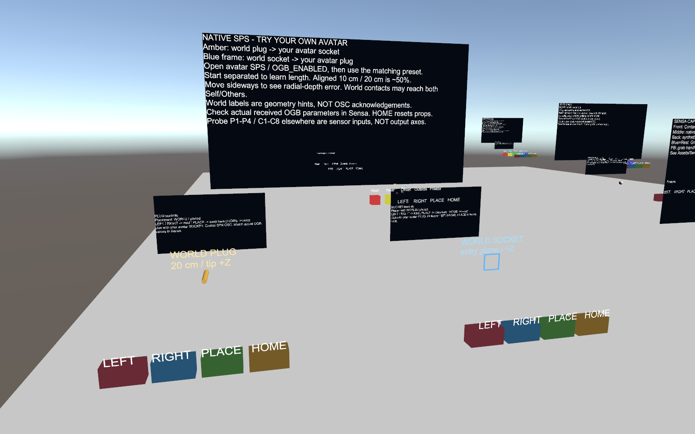
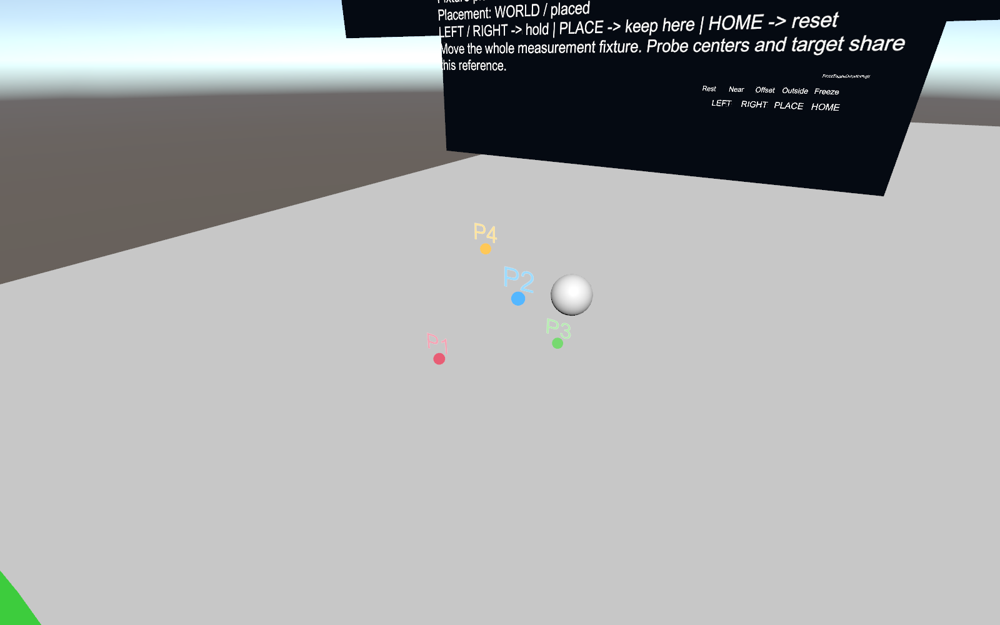

# 实验道具：拿取、放置与读数

**简体中文** | [English](lab-interaction.en.md)

本页仅用于内部 Avatar／World Lab。正式方案看[使用方案](usage-scenarios.md)。生成场景分别为 `Assets/SensaAvatarLab/Generated/FullFlow.unity` 和 `Assets/SensaLab/Functional/FunctionalLab.unity`；改动后重新构建并私有上传，没有自动上传。

## Avatar 菜单

在 **Sensa Test Props** 选择 Palm Socket、Forearm Socket、PB handle 或 Shader rig：

1. Left hand／Right hand：跟随对应手。
2. Place in world：停止跟随，留在当前位置。
3. Home / reset：回初始位置；也可重新选手拿回。

棒棒糖保留 SPS_Lollipop → LeftHand／RightHand／Fixed／Off。菜单集中提供 SPS OSC、Measure plug、Socket 的 Measure this socket，以及 Shader 合成码／CRC 故障开关。位置、测量、SPS 和设备许可互不替代。

名称、入口中心、+Z 与探针默认可见，Visible labels / probes 可隐藏辅助标记。文字为双面静态网格，不依赖上传后 TextMesh。菜单文字按构建语言生成；世界每玩家语言仍待客户端验收。[语言](languages.md)

QuickStart 绑定右手腕，仅用于内部阶梯台的合成标量，不是正式 SPS 道具，也没有内置阶梯模板。按实际路径手动配置；世界测试球可持有／放置。

## 世界按钮与原生 SPS 区

LEFT／RIGHT 跟随本地对应手，PLACE 留在原地，HOME 放下并复位。直接抓取退出按钮跟随。移动 PB 参考架本身不会产生拉伸，须抓取 PB 球。按钮只操作本地道具，不控制设备。

08 MY AVATAR SPS 提供：

- 琥珀 WORLD PLUG：长 20 cm，用于靠近自己的 Socket。
- 蓝框 WORLD SOCKET：接收自己 Avatar 的 Plug。

先开启 Avatar SPS／SPS OSC，Sensa 固定实例／来源并选择深度或振动模板。需要时显式打开 OGB 心跳；它不授予设备许可。先分开再接近，轴向对正的 20 cm Plug 插入 10 cm 仅是约 50% 的参考，偏移会暴露径向估算误差。Self／Others 不认证玩家身份；世界文字不是 OSC 回执。

## Point／Pose 布局与 SPS 四点定位

旧配对 Pose／PB 实验保留以下采样标签，它们不是设备轴或行程百分比：

| 标记 | 颜色 | 旧原始叶子 |
| --- | --- | --- |
| P1／P2／P3／P4 | 红／蓝／绿／黄 | A0／A1／A2／A3 |
| C5／C6／C7／C8 | 紫／青／橙／浅灰 | A4／A5／A6／A7 |

四面体用 P1–P4，八点用 C1–C8；C1–C4 沿用红蓝绿黄，但位置不同，不能把 P2 当 C2。Measure plug 展示 Palm 参考框／Plug 把手 P 阵列，Socket 展示 C 阵列，Root／Tip／Side 共享 C 位置但路径不同；独立 PB 参考架也用 P。

SPS 四点定位使用固定在 Avatar 根下的 **P0–P3** 加专用移动根标记，配色为蓝／青绿／紫／玫红。旧八个 C 点或 A0–A3 子集不能当作这四个锚点。参数列表保留真实路径；输出 L/R/V/A 轴仍是设备命令轴。

## 如何判断通过

菜单、放置、复位和生成控制器可以由相应构建／ClientSim 检查，但不证明上传后的 Avatar OSC、HMD 抓取或硬件。旧配对实验默认禁止空间驱动；通道数量或低残差不证明同一 Sender／同帧。

SPS 四点定位使用独立几何和 Sample，仍须实验许可、校准与停止检查。本实验室 Shader 道具为合成传输测试；原生根点编码另有生产作者，也不等于形变网格采样。[定位](positioning.md) · [实验顺序](lab-workflow.md) · [Shader 指南](../unity/top.sealoong.sensa/GPU-TRACKING.md)
