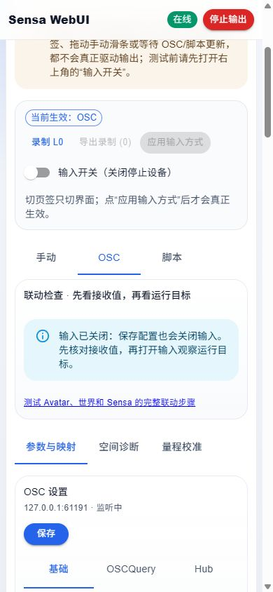

# 用测试 Avatar、世界和 Sensa 完成一次联动

**简体中文** | [English](lab-workflow.en.md)

这是一条按顺序执行的验收路线。前三项先保持 Sensa 的输出列表为空；软件仍可显示接收值和运行目标。世界看板的 Expected 是预期值，Sensa 输出卡是发送目标，两者都不是设备位置反馈。

## 准备一次，之后复用

| 在哪里 | 打开什么 | 做什么 |
| --- | --- | --- |
| Avatar Unity 项目 | `Assets/SensaAvatarLab/Generated/FullFlow.unity` | 使用已配置的完整测试 Avatar；SDK 构建并以 **Private** 上传。不要再给它重复添加 QuickStart 或自动配置组件 |
| World Unity 项目 | `Assets/SensaLab/Functional/FunctionalLab.unity` | 用 SDK Build & Test 进入客户端，或进入自己私有上传的世界；不要公开或发布到 Community Labs |
| VRChat 客户端 | 穿戴刚上传的 FullFlow | 开启 OSC、Contacts 和需要的自身交互权限。确认不是仍穿着旧版 Avatar |
| Sensa | 默认 `http://127.0.0.1:5086` | 暂不添加设备；开启 OSC 接收并保存，默认接收 UDP 9001；选择 OSC 后点击“应用输入方式” |

**Unity Play Mode / ClientSim 是世界内部验证，不会替 Avatar 发 OSC。** 要测 Avatar → Sensa，须在 VRChat 客户端穿戴 Avatar 并进入世界。FullFlow 已有全部测试组件；若测试自己的 Avatar，先按 [首次使用](quick-start.md) 添加 Quick Start World Receiver 并重新上传。

测试前关闭其他占用同一 UDP 接收端口的程序。多个 OSC 来源同时出现时，在 Sensa 参数工作台固定当前 Avatar 的来源；测试 Shader 桥时再切换到桥接来源。切回 Avatar 后不要继续锁定旧的桥接来源。

## 每次切换测试都执行这四步

1. **关闭输入**。在 Avatar 关掉上一项不用的实验开关。
2. 在 Sensa 选本项预设，点 **替换草稿**。不要使用“追加草稿”来切换测试；所有保留的 GateEnable 都会参与门控。
3. 点击 **保存并应用映射**。保存配置会关闭输入，这是正常行为。页签切换、草稿预览和已保存配置是不同状态。
4. 先核对实际 OSC，再打开输入看运行目标。OSC 页顶部的“联动检查”会指出未监听、未应用模式、未保存、门控或定位问题。

校准页的 **替换为校准映射**、姿态页的 **替换为此对象深度/六轴** 也会替换整套草稿，清除旧门控；保存前可以“恢复映射”撤销草稿更改。需要保留自定义振动、附加轴或门控时，在替换后明确加回需要的项。

## 第一项：从世界阶梯台检查完整接收链路

在出生点 **00 START HERE** 操作，不需要打开 SPS 或测量选择器。

- Sensa 预设：**入门 · 测试世界 → 我的 Avatar**。保存后应只有 QuickStart Depth 与 Active 两条映射。
- 在世界按 0%、25%、50%、75%、100%，实际 `Sensa/QuickStart/Depth` 应约为 0、.25、.5、.75、1，`Active=1`。
- 输入开启时，逻辑 L0 应约为 0%、25%、50%、75%、100%；按 STOP 后 `Active=0`、门控关闭。
- TOUCH 是自由距离试验，用右手腕接近青色球；RESET 复位并停止。离台超过 3 米或 60 秒到期也会停止。

不通过时先看实际参数：没有参数就排查客户端 Avatar、OSC、Contacts 和端口；参数正确但目标不变，就检查输入方式、输入开关、已保存映射和来源。不要用世界 Expected 代替接收确认。

## 第二项：抓取自己的 PB 并校准

Avatar 菜单 **Sensa Test Props → PB handle → Left hand / Right hand**，移动到面前后选 **Place in world**。此时固定的是参考架；抓住白球并移动才是 PB 测试。

1. 替换为 **Sensa PB 把手 · Z 位移（需校准）**，固定来源，在参数工作台找到 `Sensa/Handle/v1/LabHandle/Self/`。
2. 到 **量程校准** 选择 LabHandle。保持抓取，分别采集期望的 0% 与 100% 位置；界面应有四路采样、有效坐标和抓取状态。
3. 点 **替换为校准映射**，保存；重新打开输入。来回移动应沿校准量程变化，松手后应停止，定位会显示不可用。

LabHandle 独立于 `Sensa Lab` 选择器；不必为了它选择 Socket。PB 没有实体碰撞是设计行为，不要通过添加 Collider 来“修复”抓取。抓取失败应检查 VRChat PhysBone 自交互权限。

## 第三项：使用原生 SPS

先在 **Sensa Test Props → SPS OSC** 开启原生参数。摆放、SPS 本身、Sensa 测量、软件输入是独立开关。

| 我想测什么 | Avatar / 世界操作 | Sensa |
| --- | --- | --- |
| 自己的 Plug 接自己的 Socket | 棒棒糖选 RightHand；Palm Socket 放到面前并 Place in world | SPS Socket 新深度 · 仅自身，固定实际 OGB Socket 路径 |
| 世界 Plug 接自己的 Socket | 到 **08 MY AVATAR SPS**，移动琥珀色 WORLD PLUG 靠近 Avatar Socket | SPS Socket 对应预设，依据实际接收的 Self/Others 参数选路径 |
| 自己的 Plug 接世界 Socket | 把棒棒糖靠近蓝框 WORLD SOCKET | SPS Plug 对应预设，固定实际 OGB Plug 路径 |

替换草稿后确认 QuickStart 的 Active 已不在映射里。先让 Plug 位于 Socket 外侧，以未饱和的 NewRoot/NewTip 学习长度，再沿轴靠近。球形近接得到的是径向近似；横移、倾斜、根部球饱和、多目标混入仍可能造成偏差。

世界 Contact 可能同时影响 Self/Others；看实际路径，不要仅凭后缀猜发送者。世界上 04/05 的 Near/Offset 是**内部已知配对实验**，不能直接当作自己的 Avatar 收到了同样的数值。

## 第四项：额外定位和 Shader 分开验证

- **自己的 Plug 位置**：Avatar 菜单 Measure plug，再在 Sensa 找实际本地点/把手对象，使用量程校准。它测自己 Plug 相对参考框的位置。
- **Socket 根部诊断**：选择 Socket 的 Measure this socket。C1–C8 是八点接收阵列；Root 只能给根部位置，不能直接当准确插入比例。
- **配对姿态**：需要匹配 `LabPair` 的 Root/Tip/Side 标记；仅有普通 SPS 的其他玩家不能提供完整配对姿态。
- **Shader 合成码**：Shader rig 开启 Synthetic code，只检查图像传输、帧号、CRC 和 Valid。固定值 (.25, −.5, .75) 不是 SPS 测量；用 0–.2 m 的 Z 模板会饱和到 100%，不适合拿它检查 60% 行程。
- **真实 SPS GPU PNG**：目前通过 Unity 编辑器 GPU Probe 导出，Offset 数据约为 (.06, 0, .12)，才对应 Z 模板约 60%。按 [图像桥接步骤](../tools/unity-world-lab/CAPABILITIES.md#图像桥接操作) 启动桥接，先核对 Valid，再检查 CRC 故障、冻结及恢复。

Shader 桥不是上述 QuickStart/PB/SPS 三项的前置条件。完成后关闭 Shader、停止桥接、恢复 Avatar 来源与预设；桥接进程退出不等于设备断电。

## 最后才加设备

前三项通过后，按 [首次使用第 4 节](quick-start.md#4-再连接-osr) 创建 **OSR 首次测试 · L0 小行程** 配置、绑定输出，再重复阶梯测试。该配置发送目标约为 400、450、500、550、600；其他轴忽略。按 STOP 后再关闭输入。硬件量程、方向、速度和固件仍需单独核对。

## 记录一次测试

记录 Avatar 上传时间、世界版本、Sensa 提交/预览包、实际来源、参数路径、测试动作、预期值、实收值与失败现象。两个 Unity 项目的 `Validation/latest-suite.json` 是自动检查记录；它们没有宣称真实客户端或硬件已经通过。

开发者可使用 [统一自动验证入口](development.md#本地-unity-套件)。软件冒烟会用无设备配置重放 QuickStart 五档/STOP、映射保存关输入、姿态和 PB 松手门控；这些不能代替真实客户端抓取与硬件验收。
