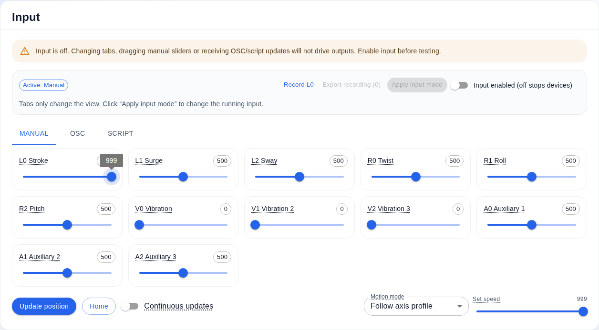
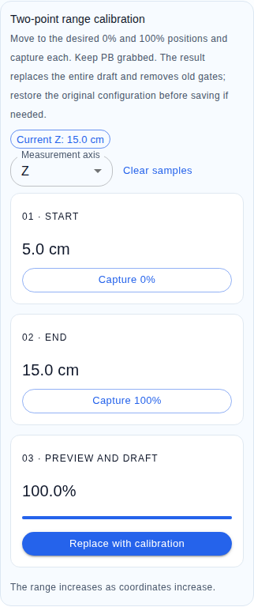

# Chinese and English support

[简体中文](languages.md) | **English**

## Use the software

Choose **English** or **简体中文** in the top bar. First visit follows the browser's first supported Chinese/English preference; unsupported languages fall back to English. The choice is stored in this browser as `sensa.locale`. Restricted storage still permits an in-memory switch.

Switching updates UI text, built-in preset descriptions, parameter explanations, calibration/pose diagnostics, help links, Material UI controls and displayed timestamps. It does not reload, discard drafts, save device configuration, change input mode or enable output. Your output/profile/preset names, file contents, enum/protocol identifiers and OSC paths remain unchanged.

Known Sensa backend diagnostics are translated at display boundaries. Unrecognized firmware, operating-system and third-party messages remain original for troubleshooting. Previously created user names are not retroactively translated.

## CI screenshots

These captures came from the passing CI candidate run 38802342060, not local browser execution.

## Unity and labs

Unity inspectors use Chinese/English labels and help together, keeping original English field terms visible. Component/menu names, serialized fields and generated protocol identifiers remain stable for searching and interoperability. QuickStart offers separate Chinese and English guide buttons.

Every main user/developer guide, Unity guide and lab guide has a linked `.en.md` counterpart. Desktop archives include both languages. Standalone Unity ZIPs include the four paired Unity guides.

Generated world/avatar signs retain their established technical English labels and P/C identifiers; the bilingual interaction/capability guides map each control to its action. Changing documentation does not rebuild an existing world/avatar or upload it. Real-client text visibility, camera behavior and hardware remain separate acceptance checks.

## Maintain translations

- Web source explicitly calls `t(sourceText, values)`; Chinese source text is the stable catalog key. English lives in `src/web/i18n.en.json`.
- Use indexed placeholders such as `{0}`; inserted user values are substituted once, never recursively translated or interpreted as HTML.
- Translate trusted application strings only. Do not walk/replace DOM text or translate arbitrary configuration values.
- Module option factories and locale-aware memo dependencies prevent stale labels after switching.
- Known dynamic backend messages use anchored templates in `i18n-diagnostics.json`; captured names/endpoints remain literal.
- Add the English entry with every new user-facing string, retaining placeholder parity. `npm test` checks source keys, all built-in presets, fallback, storage failure and subscriber behavior.
- Keep paired documentation links valid. Packaging and documentation tests catch missing language counterparts/assets.
- Run browser/E2E/screenshots only in CI. English desktop/narrow tests verify persistence, draft survival, no control requests during switching, PB calibration/mock output, release stop and help links.

[CI screenshots and baseline review](e2e.en.md) · [User guide](guide.en.md)
