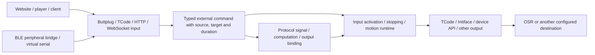

# Protocol inputs, virtual devices and device APIs

[简体中文](protocol-inputs.md) | **English**

Sensa can receive controls that another application normally sends to a device, then route them to configured outputs. A typical path is `website/player → Sensa virtual Buttplug device → TCode → OSR`. Official Buttplug clients, custom applications, virtual serial ports and Bluetooth bridges can use the same input architecture; FapTap is one example. See [signal flows](signal-pipeline.en.md) for computation/bindings and the [bridge tools](../tools/protocol-bridge/README.md) for installation and platform instructions.



## Establish a small complete flow

1. In **Settings → Protocol inputs**, add **Buttplug / Intiface**. Use host `127.0.0.1`, port `12400`, path `/` and a Position feature on `L0`.
2. Save and enable its listener.
3. Add a TCode output for OSR, choose its serial port/axis profile, save and connect.
4. In the website/player, enter `ws://127.0.0.1:12400` as the Intiface address and select the Sensa device.
5. In Sensa, apply **Protocol** and enable input. The website's controls now reach the configured output.

The existing Central application can keep using `12345`. Saving a source or changing input mode switches input off; the header controls when the prepared route starts sending.

```json
{
  "ProtocolInputs": [
    {
      "Id": "website", "Name": "Sensa OSR bridge", "Type": "Buttplug",
      "Enabled": true, "Host": "127.0.0.1", "Port": 12400, "Path": "/",
      "TimeoutMs": 10000, "RouteToMotion": true,
      "Features": [{"Channel":"L0","Name":"Stroke","Actuator":"Position","TargetAxis":"L0"}]
    }
  ]
}
```

This is a `config.json` input fragment; keep your existing outputs and profiles when merging it. You can also make the same changes in the workbench.

## Share a port across input routes

Web protocols use **Path** to share a listener. For example:

| Source | Port | Path | Client address |
| --- | --- | --- | --- |
| Buttplug | 12400 | `/buttplug` | `ws://127.0.0.1:12400/buttplug` |
| JSON HTTP | 12400 | `/json` | `http://127.0.0.1:12400/json/commands` |
| Lovense HTTP | 12400 | `/lovense` | `http://127.0.0.1:12400/lovense/command` |
| TCode WebSocket | 12400 | `/tcode` | `ws://127.0.0.1:12400/tcode` |

The listener removes the route prefix before passing a request to its protocol. Nested routes use the longest matching complete path. A source at `/` keeps its original addresses. Distinct routes have independent channels and control sessions; use different axes or explicit computation/bindings to combine them.

A TCP port can host either the shared HTTP/WebSocket listener or a raw TCode TCP listener. UDP has its own port space. Duplicate paths and incompatible listeners are shown when saving.

## Input capabilities and addresses

| Input type | Connection | Content |
| --- | --- | --- |
| `Buttplug` | WebSocket | v2/v3/v4 virtual device with configured features |
| `TCodeTcp` / `TCodeUdp` | TCP / UDP | TCode position, intensity, axes and durations |
| `TCodeWebSocket` | Shared WebSocket listener | Complete TCode text lines |
| `TCodeSerial` | Selected serial port and baud rate | Incoming TCode stream |
| `IntifaceDevice` | Central WSDM, commonly `ws://127.0.0.1:54817` | Sensa registers outward as a TCode device |
| `JsonHttp` / `JsonWebSocket` | Shared HTTP/WebSocket listener | Typed channel commands, heartbeat and stop |
| `LovenseHttp` / `HandyHttp` | Shared HTTP listener | Configurable-endpoint vendor API routes |
| `AutoblowHttp` / `VacuGlideHttp` | Shared HTTP listener | Device controls and synchronized-script routes |

One source has one controlling session at a time. Different sources can run concurrently. A multichannel batch is admitted together after validation. The workbench reports configured channels, listening addresses and receive counts.

### Types, timing and signal paths

| Feature | Meaning | Direct mapping |
| --- | --- | --- |
| `Position` | 0–1 target and optional arrival duration | Selected motion axis |
| `Scalar` | 0–1 capability value, such as vibration | V0/V1/V2 |
| `Rotation` | 0–1 speed plus `Clockwise` | Use a signal binding for speed/direction |

Direct motion routing preserves each channel's arrival duration and uses the output's axis profile. For conversion, recording or several destinations, switch direct routing off and choose Protocol input in a calculation/binding. A source path is `inputId/channelId`, for example `website/L0`; `/value` reads the current command value, `/target` its target, and rotation adds `/speed` and `/clockwise`.

Position interpolation describes the commanded trajectory. A timed first command exposes its target immediately and its current value once an initial position is established or arrival completes. Bindings use their own update schedules. For source expiry, choose an appropriate binding fallback; input disable and emergency stop perform whole-device stopping. Direct-source stops use the motion output's device-wide stop.

## Buttplug v2, v3 and v4

The input negotiates **message specification v2, v3 or v4** and advertises your configured features as one virtual device. The desktop output client uses Buttplug 5.0.1.

Clients send `Ping` within the advertised `MaxPingTime` to maintain their session.

v2 negotiates `MessageVersion:2` and replies with that version. Device lists use a `Devices` array; each command in `DeviceMessages` advertises `FeatureCount` and `StepCount`, for example `{"FeatureCount":2,"StepCount":[1000,1000]}`. The `StepCount` array has `FeatureCount` entries, matching that command metadata. Position and rotation use `LinearCmd`/`RotateCmd`; vibration uses `VibrateCmd.Speeds` with `Index` and 0–1 `Speed`. Indices are independent per command family. Configured **ScalarType=Vibrate** features receive v2 vibration indices in configuration order. Each following line is one complete WebSocket message using the default position feature:

```json
[{"RequestServerInfo":{"Id":1,"ClientName":"Legacy player","MessageVersion":2}}]
[{"RequestDeviceList":{"Id":2}}]
[{"LinearCmd":{"Id":3,"DeviceIndex":0,"Vectors":[{"Index":0,"Position":0.75,"Duration":300}]}}]
```

v2/v3 LinearCmd duration is 0–600000 ms; position and rotation speed are 0–1. Handshake, Ping, scanning, device events, per-device/all-device stop retain their negotiated formats.

v3 uses JSON arrays with case-sensitive fields. Each line below is one complete WebSocket text message.

```json
[{"RequestServerInfo":{"Id":1,"ClientName":"Example player","MessageVersion":3}}]
[{"RequestDeviceList":{"Id":2}}]
[{"LinearCmd":{"Id":3,"DeviceIndex":0,"Vectors":[{"Index":0,"Position":0.75,"Duration":300}]}}]
[{"StopDeviceCmd":{"Id":4,"DeviceIndex":0}}]
```

Supported operations are handshake, device list, start/stop scanning, Ping, `LinearCmd`, advertised `ScalarCmd` (`Vibrate`/`Oscillate`/`Constrict`), `RotateCmd`, `StopDeviceCmd` and `StopAllDevices`. v3 actuator indices are ordered within the respective command family. Invalid indices/values/types and unsupported messages return Error with the matching request ID. Unsolicited events use ID 0.

v4 handshakes use `ProtocolVersionMajor:4` and `ProtocolVersionMinor:0`; devices/features are indexed objects. Position advertises `Position` and `HwPositionWithDuration`, scalar uses its configured `ScalarType` (Vibrate/Oscillate/Constrict/Led/Temperature/Spray), and rotation advertises signed `Rotate`. Current integer ranges are 0–1000 for position/scalar and -1000–1000 for rotation. Commands use `OutputCmd`/`StopCmd`:

```json
[{"RequestServerInfo":{"Id":1,"ClientName":"Example client","ProtocolVersionMajor":4,"ProtocolVersionMinor":0}}]
[{"OutputCmd":{"Id":2,"DeviceIndex":0,"FeatureIndex":0,"Command":{"HwPositionWithDuration":{"Value":750,"Duration":300}}}}]
[{"StopCmd":{"Id":3,"DeviceIndex":0,"Outputs":true}}]
```

Scalar features configure `ScalarType`, defaulting to Vibrate. Led/Temperature/Spray are advertised only to v4 clients. v3 scalar indices use its filtered supported types, without renaming an unsupported capability. Values represent normalized protocol ranges, the declared capability range.

The endpoint supports the v3 JS and v4 C# client schemas. Its capability list describes command outputs; raw hardware and sensor/battery/RSSI APIs are outside this virtual-device profile. [Official specification](https://buttplug.io/docs/spec/) · [v3 specification](https://buttplug.io/docs/spec-v3/spec/)

## TCode, serial and Central virtual devices

Implemented syntax covers the v0.3 core and the common v0.4 core: case-insensitive `L/R/V/A` axes, channels 0–9, variable-length fractional magnitude digits, `I` milliseconds, `S` speed, space-separated axes, last command per repeated channel within a line, `D0`/`D1`/`D2` and `DSTOP`. `L277` means L2 at **0.77**, and `R09` means R0 at **0.9**.

```text
L075I300 R025I900
DSTOP
```

LF, CR and CRLF complete a line. TCP, serial and WSDM accept split reads; `TCodeWebSocket` uses complete ASCII text lines at its configured path. UDP datagrams must be complete and newline-terminated so a lost packet cannot corrupt the next command. Each line allows 4096 ASCII bytes. TCode I durations and S-derived durations are limited to 60000 ms. Unknown channels, invalid bytes, oversized lines and unsupported modifiers reject and stop rather than skip errors and execute the remainder.

An invalid stream returns `ERR` and ends its session; reconnect or reopen the serial input to continue. UDP admits the next valid complete datagram as a new session.

`S1000` traverses one normalized axis length per second, using the preceding commanded/interpolated position to calculate duration. Send an explicit initial position before using S. `D1` reports **TCode v0.3**; the implemented motion core uses L/R/V/A, I/S and the D queries above. [Official TCode specification](https://github.com/multiaxis/TCode-Spec)

An alternative Central path is `client → Central → WSDM → Sensa → OSR`. Configure a **TCode v0.3** device under Central's Manage WebSocket Devices, matching its identifier to Sensa's `Identifier`. Select `IntifaceDevice` input, use the actual device-manager address (default `ws://127.0.0.1:54817`) and TCode feature channels such as `L0`. Sensa registers with text `{identifier,address,version:0}`, then exchanges **binary WebSocket frames** containing TCode. ASCII content still needs binary hardware framing. An empty `Identifier` uses the input's name; registration address uses its stable input ID. The website continues connecting to Central's application endpoint. [Official WSDM guide](https://buttplug.io/docs/dev-guide/inflating-buttplug/devices/websocket-device-manager/)

Finite TCode moves keep their session through the latest current-channel arrival, plus `TimeoutMs` idle grace. Complete commands and D queries refresh activity; a new target replaces that channel's previous deadline. Stop clears current targets; EOF ends the session immediately. WSDM uses WebSocket Ping/Pong for liveness and can hold a static target while connected.

### Intiface output feature mappings

Existing Intiface outputs default to linear position and the configured vibration axis. To use other capabilities, add explicit `IntifaceFeatures` mappings: DeviceName matches exactly, FeatureIndex selects a feature, and OutputType must be advertised by that device. Supported types are `Vibrate`, `Oscillate`, `Rotate`, `Position`, `HwPositionWithDuration`, `Led`, `Temperature`, `Constrict` and `Spray`. Select from the device scan results.

```json
{
  "Id": "intiface-output",
  "Name": "Selected Central devices",
  "Type": "Intiface",
  "Enabled": false,
  "WebsocketAddress": "ws://127.0.0.1:12345",
  "IntifaceFeatures": [
    {"DeviceName":"Selected device","FeatureIndex":0,"OutputType":"Rotate","SourceAxis":"V0","DirectionAxis":"A0"},
    {"DeviceName":"Selected device","FeatureIndex":1,"OutputType":"HwPositionWithDuration","SourceAxis":"L0","Invert":true}
  ]
}
```

Central device names with multibyte characters and large or fragmented device lists are received as complete WebSocket text messages, with a 1 MiB limit per message. A failed connection attempt cleans up its transport so it can be retried; delivery after connecting still follows current input activation.

Replace the example device name/indices with your scan results. Values scale to each feature's advertised integer range; scalar ranges use protocol units. Rotation SourceAxis provides speed. DirectionAxis at least 0.5 means clockwise, otherwise counterclockwise; an empty direction axis uses Clockwise. Position direction uses Invert explicitly; the original position default remains `1-L0`. Timed position validates the advertised duration range; the advertised capabilities determine the available command types.

After configuration, output bindings can also target these mappings' source and rotation-direction axes, such as separate V0 speed and A0 direction bindings. Axes unused by default capabilities or explicit mappings are not accepted.

Mappings replace matching defaults; other devices retain position/vibration routing. Configuration validation detects output-to-input loops, including Central/WSDM returning Sensa's own virtual device.

## HTTP/WebSocket JSON for applications

With `JsonHttp`, send these requests to the input endpoint, not the workbench's `/api`. This example uses the default `L0` channel; add channels such as `R0` to the source configuration before sending a multiaxis batch. Keep a stable `X-Sensa-Session` for a client, and send `/heartbeat` within its timeout when holding targets. Expiry releases control and stops.

```sh
curl --request POST http://127.0.0.1:12403/commands \
  --header 'Content-Type: application/json' \
  --header 'X-Sensa-Session: player-one' \
  --data '{"commands":[{"channel":"L0","value":0.75,"durationMs":300}]}'
curl --request POST http://127.0.0.1:12403/heartbeat \
  --header 'Content-Type: application/json' --header 'X-Sensa-Session: player-one' --data '{}'
curl --request POST http://127.0.0.1:12403/stop \
  --header 'Content-Type: application/json' --header 'X-Sensa-Session: player-one' --data '{}'
```

`GET /status` lists configured channels. `POST`/`PUT /command` or `/commands` accepts one command or a `commands` array. `path`/`address` are channel aliases. `durationMs` uses milliseconds; `clockwise` carries rotation direction. Unknown/duplicate channels, nonfinite values and out-of-range fields are rejected. Requests allow at most 64 KiB and 16 channels. `/stop` may select a `channel`, otherwise stopping all channels of the source.

WebSocket JSON uses the same objects, such as `{"commands":[{"channel":"L0","value":0.5,"durationMs":250}]}`, `{"command":"heartbeat"}` and `{"command":"stop"}`. Each connection has its own session; closure stops and releases it. Check server replies. Network JSON outputs can feed the input through their path/address field; configure both endpoints explicitly and avoid a connection back to the same input.

## Vendor-compatible input and physical device output

Use the local API inputs when an application lets you configure its endpoint. For a website with an Intiface address field, the Buttplug route is the simplest choice. Physical-device outputs connect the other direction to the device's API.

| Input | Local API subset | Semantic boundary |
| --- | --- | --- |
| `LovenseHttp` | `POST /command`: GetToys, GetToyName, Function (Vibrate/Rotate/All, Stop); legacy GET Vibrate/Vibrate1/Vibrate2/RotateClockwise/RotateAntiClockwise/Stop | Toy ID is the input ID; Scalar vibration and Rotation speed remain distinct; timeSec/paired loop times supported; physical-output Pump support does not imply a matching input feature |
| `HandyHttp` | REST v2 connected/info/mode/slide/settings/servertime, HSTP time/offset, HDSP xpt/xpvp, HAMP velocity/start/stop, HSSP setup/play/loop/state/stop | Accepts `/api/handy/v2` or `/api/handy-rest/v2` prefixes; v2 Sensa virtual-device identity |
| `AutoblowHttp` | `/autoblow`: connected/info/state, goto, oscillate/start/stop and sync-script operations | Position plus percentage speed; unknown starting positions reject speed trajectories until an explicit script target establishes command state |
| `VacuGlideHttp` | `/vacuglide`: connected/info/state, target-speed/stop and sync-script operations | targetSpeed is 0–100 intensity using Scalar; scripts explicitly configured as Position bridge trajectory, otherwise trajectory change rate maps to speed intensity |

Handy xpvp/HAMP and Autoblow goto/oscillate convert percentage speed using `MaxSpeedPerSecond`, normalized full travel per second: default 1, configurable 0.01–20. This sets the virtual device's speed calibration. Establish a starting position with an explicit HDSP position or script target. Re-establish it after clearing/stopping. VacuGlide Scalar script conversion is `clamp(abs(position delta)/seconds, 0, 1)`.

After configuring the corresponding inputs, a custom client can call these endpoints (the ports belong to local Handy/Lovense inputs, not their vendor clouds):

```sh
curl --request PUT http://127.0.0.1:12406/mode \
  --header 'Content-Type: application/json' --header 'X-Sensa-Session: player-one' --data '{"mode":2}'
curl --request PUT http://127.0.0.1:12406/hdsp/xpt \
  --header 'Content-Type: application/json' --header 'X-Sensa-Session: player-one' --data '{"position":50,"duration":0}'
curl --request POST http://127.0.0.1:12405/command \
  --header 'Content-Type: application/json' --header 'X-Sensa-Session: player-one' \
  --data '{"command":"Function","action":"Vibrate:5","timeSec":0,"toy":"lovense-in","apiVer":1}'
```

Lovense `timeSec` from **greater than 1 to 600 seconds** creates a finite task that retains its session through the total duration, including loop pauses. `timeSec:0` uses the ordinary `TimeoutMs` activity lease. Stop, input disable, configuration save and emergency stop cancel the task. Script playback separately uses `MaxScriptDurationMs`.

The last example uses input ID `lovense-in` with a Scalar feature. Autoblow/VacuGlide sync-script supports multipart upload-csv/upload-funscript, URL uploads, current-input local load-token, start (startTimeMs), stop, offset (offsetTimeMs) and loop. CSV is headerless integer-millisecond/0–100 position pairs ending with a newline; funscript uses actions. Scripts allow 1 MiB, 100000 points and 16777214 ms. Handy HSSP setup accepts a URL and plays the same trajectory model.

Compatible-input script tasks use bounded URL downloads or multipart uploads. `MaxScriptDurationMs` defaults to one hour; immediate controls use `TimeoutMs`, while finite moves retain their arrival deadline. `Identifier`, when configured for Autoblow/VacuGlide input, becomes the required `x-device-token`. [Download validation and API implementation](architecture.en.md)

To control a physical device, add a **Handy, Lovense, Autoblow or VacuGlide output** and configure its actual API endpoint, connection key or device ID. These are separate directions from the similarly named compatibility inputs.

| Output | Implemented semantics | Configuration and limits |
| --- | --- | --- |
| Handy | HDSP position/duration; HSSP URL script preparation/play/seek/stop and clock synchronization | API v2 for supported fw3; v3 for fw4+ with application API key or token; actual connection key required |
| Lovense | LAN HTTPS `GetToys`, Function intensity for an explicit toy ID, and Stop | Vibrate/Rotate/Pump/Thrusting/Fingering/Suction intensity; Pump has a separate range |
| Autoblow | `goto` position with separate speed; CSV/funscript URL synchronized scripts | Configure position and a separate speed percentage |
| VacuGlide | Motor speed intensity and synchronized scripts | Use speed/intensity, normally V0; synchronized trajectories are converted to motor speed by the device |

Use these output objects as configuration examples. Handy v2 selects ApiVersion 2 without v3 application credentials; VacuGlide should use the V0 intensity axis.

```json
{
  "Outputs": [
    {
      "Id": "handy",
      "Name": "Handy API",
      "Type": "Handy",
      "Enabled": false,
      "Device": {
        "Axis": "L0",
        "ApiVersion": 3,
        "ConnectionKey": "YOUR_DEVICE_CONNECTION_KEY",
        "ApiKey": "YOUR_APPLICATION_API_KEY",
        "ScriptUrl": "https://example.com/motion.csv",
        "ScriptFormat": "Csv",
        "ScriptTimeoutMs": 90000
      }
    },
    {
      "Id": "vacuglide",
      "Name": "VacuGlide speed",
      "Type": "VacuGlide",
      "Enabled": false,
      "Device": {"Axis": "V0", "ConnectionKey": "YOUR_DEVICE_CONNECTION_KEY"}
    }
  ]
}
```

Handy v2/v3 synchronized scripts use CSV URLs. Autoblow/VacuGlide accept CSV or funscript URLs in the selected format. CSV contains headerless `milliseconds,position-percent` lines, ending in a newline. Make the URL reachable by the device/API; Handy accepts HTTP(S), while Autoblow/VacuGlide use HTTPS.

Connect, prepare the script, then enable input and choose Play. Stop can cancel preparation and playback. A prepared script remains available for another explicit Play; reconnecting starts a fresh device session. Connection keys and API tokens are saved in the selected configuration.

### Synchronized script looping

After preparing a script, choose “Loop synchronized script” while playback is stopped. Each Play applies that selection. Preparing another script or reconnecting resets looping to off.

- Handy API v2 exposes looping with **fw3.2 or later fw3** reported in connection information.
- Handy API v3 includes `loop` in the next `/hssp/play`.
- Autoblow/VacuGlide use their supported `sync-script/loop`. This output capability is separate from local compatible inputs' loop handling.

Custom tools can call the workbench API while prepared and paused. Here `handy` is the example output ID above:

```sh
curl --request POST http://127.0.0.1:5086/api/control/output/handy/script-loop \
  --header 'Content-Type: application/json' --data '{"loop":true}'
```

This request goes to the workbench address.

## Bluetooth and virtual serial wiring

Install Python and the selected transport dependencies, then choose the direction needed. Portable packages/installers include the tool files. [Installation and platform setup](../tools/protocol-bridge/README.md)

```sh
python tools/protocol-bridge/bridge.py --check
python tools/protocol-bridge/bridge.py pty-input --sensa tcp://127.0.0.1:12401
python tools/protocol-bridge/bridge.py serial-input --port COM12 --baud 115200 --sensa tcp://127.0.0.1:12401
python tools/protocol-bridge/bridge.py ble-input --protocol loob --sensa tcp://127.0.0.1:12401
python tools/protocol-bridge/bridge.py ble-input --protocol thrust-sync --sensa tcp://127.0.0.1:12401
```

Use `pty-input` on Linux/macOS or a configured COM pair on Windows. The client opens one end, and the bridge or Sensa's TCodeSerial input opens the other.

BLE input advertises a peripheral for the client to connect; BLE output connects to the device as a central. Linux/macOS input uses Bless, Windows uses WinRT, and output uses Bleak. LOOB carries position/duration in four bytes; Thrust Sync uses three. Input durations are 0–60000 ms. Choose the OS adapter and advertising name using the tool guide.

For the output direction, configure a TCode TCP output in Sensa to `127.0.0.1:12411`, enable only L0 and select Interval, then run:

```sh
python tools/protocol-bridge/bridge.py ble-output --protocol loob --device DEVICE_ID --listen tcp://127.0.0.1:12411
```

LOOB/Thrust Sync stop clears the queue and disconnects BLE; the last accepted finite move can finish on the device. The input terminal provides `disable`, `enable`, `disconnect`, `unpair` and `quit`. See the [tool guide](../tools/protocol-bridge/README.md) for adapter/name setup and device-specific stopping.

### Svakom V1 vibration bridge

`svakom-v1` implements the **Emma Neo/Phoenix Neo/Ella single-vibration profile** using writable service `FFE0`/characteristic `FFE1`. Its command is `55 04 03 00 enabled intensity`, with intensity 0–19. Select this profile explicitly; its packet layout differs from Thrust Sync despite the shared UUIDs.

Input still connects to a local TCode TCP source on `12401`. Configure that source with this **Scalar/Vibrate V0** feature instead of position L0:

```json
{"Channel":"V0","Actuator":"Scalar","ScalarType":"Vibrate","TargetAxis":"V0"}
```

```sh
python tools/protocol-bridge/bridge.py ble-input --protocol svakom-v1 --sensa tcp://127.0.0.1:12401
python tools/protocol-bridge/bridge.py ble-output --protocol svakom-v1 --device DEVICE_ID --listen tcp://127.0.0.1:12411
```

Linux/macOS input advertises `Emma NEO`. On Windows, set a matching system Bluetooth name and pass `--confirm-windows-svakom-name`.

For output, enable V0, choose `NoSlope` and set `CommandMode`/`RampType` to `None`. Send untimed V0 intensity frames at a fixed rate within the tool's idle deadline. The default is two seconds; `--idle` accepts 0.05–120 seconds. A new session starts from new commands.

Stopping sends the zero-vibration command `55 04 03 00 00 00`, then clears and disconnects. This profile exposes command writes; `FFE2` notifications and sensor/identity responses are outside its feature set.

### More vibration devices

| Profile | Device family | Direction | Intensity |
| --- | --- | --- | --- |
| `lovense-single` | Lovense single-vibration commands, including Lush, Hush, Ambi, Ferri and Diamo | BLE output | `Vibrate:0;` to `Vibrate:20;` |
| `youou-vx001` | VX001_ Wand | BLE input/output | Sequence/checksum frames, range 0–247 |

These scalar profiles use V0 with `NoSlope`, `CommandMode=None` and `RampType=None`. Use fixed-rate delivery for a held intensity. Each device connection keeps its own sequence and queue; stopping attempts zero intensity before disconnecting.

```sh
python tools/protocol-bridge/bridge.py ble-output --protocol lovense-single --device DEVICE_ID --listen tcp://127.0.0.1:12411
python tools/protocol-bridge/bridge.py ble-output --protocol youou-vx001 --device DEVICE_ID --listen tcp://127.0.0.1:12411
```

[WebSensa](websensa.en.md) uses the same profile names for direct browser Bluetooth output. The tool guide lists UUIDs, platform setup and the supported command set.

## Verification scope and references

[Verification records](e2e-status.en.md) identify the commit and environment for protocol, simulated transport and browser checks. The [development guide](development.en.md) describes the corresponding test suites.

- [Buttplug specification](https://buttplug.io/docs/spec/) and [official C# client](https://github.com/buttplugio/buttplug-csharp). The v2 [command metadata](https://github.com/buttplugio/buttplug/blob/179b0d9306f519912c10bdddd111686622b7f63a/crates/buttplug_server/src/message/v2/client_device_message_attributes.rs) and [official JSON schema](https://github.com/buttplugio/buttplug/blob/179b0d9306f519912c10bdddd111686622b7f63a/crates/buttplug_core/schema/buttplug-schema.json) are pinned to the inspected revision.
- [Handy developer documentation](https://docs.handyfeeling.com/) and [Lovense Standard API](https://developer.lovense.com/docs/standard-solutions/standard-api).
- [Autoblow HTTP API](https://developers.autoblow.com/reference/http-api-v1-autoblow/) and [VacuGlide HTTP API](https://developers.autoblow.com/reference/http-api-v1-vacuglide/).
- [FapTap](https://faptap.net/) supplies the public LOOB/Thrust Sync connector reference.
- The Svakom V1 [upstream codec](https://github.com/buttplugio/buttplug/blob/179b0d9306f519912c10bdddd111686622b7f63a/crates/buttplug_server/src/device/protocol_impl/svakom/svakom_v1.rs) and [model/range configuration](https://github.com/buttplugio/buttplug/blob/179b0d9306f519912c10bdddd111686622b7f63a/crates/buttplug_server_device_config/device-config/protocols/svakom-v1.yml) are pinned to the inspected revision.

[External command/input decision](adr/0010-external-protocol-inputs.md) · [Architecture](architecture.en.md)
