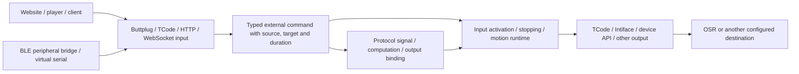

# Protocol inputs, virtual devices and device APIs

[简体中文](protocol-inputs.md) | **English**

Sensa can receive controls that another application normally sends to a device, then route them to configured outputs. A typical path is `website/player → Sensa virtual Buttplug device → TCode → OSR`. Official Buttplug clients, custom applications, virtual serial ports and Bluetooth bridges can use the same input architecture; FapTap is one example. See [signal flows](signal-pipeline.en.md) for computation/bindings and the [bridge tools](../tools/protocol-bridge/README.md) for installation and platform instructions.



## Establish a small complete flow

1. In Control's Protocol input tab, or Flow → Protocol inputs, add a **Buttplug / Intiface** source. Keep `127.0.0.1`, port `12400`, channel `L0`, Position with duration, and direct target axis `L0`. Enable this source's listener.
2. Enter the actual website's HTTP(S) origin, for example `https://faptap.net`. Use an origin without a path, query or wildcard. Native clients without Origin receive separate local-connection handling.
3. Add a **TCode serial output**, select the actual OSR port and axis profile, and initially disable unrelated axes. Check direction, travel and stopping, save, then connect the output.
4. Set the website/player's Intiface address to `ws://127.0.0.1:12400`, connect, and select the Sensa device. This is Sensa's input endpoint. A real Central application endpoint usually uses `12345`; the two can coexist.
5. Apply Protocol input mode in Sensa, then explicitly enable input when ready. Begin with small targets and inspect receive counts, outgoing targets and stopping before normal playback.

Source listening, client connection, output connection and input activation are separate states. Saving configuration, changing modes, disabling input or emergency stopping clears old targets. Clearing emergency stop does not resume movement. Connecting, scanning and preparing a script never enable motion automatically.

The following is an **input configuration fragment** for `config.json`; merge it into an existing configuration, preserving outputs and axis profiles. The workbench is the easier way to review/save it. Restart after editing the file directly. Input still starts disabled.

```json
{
  "ProtocolInputs": [
    {
      "Id": "website",
      "Name": "Sensa OSR bridge",
      "Type": "Buttplug",
      "Enabled": true,
      "Host": "127.0.0.1",
      "Port": 12400,
      "TimeoutMs": 10000,
      "RouteToMotion": true,
      "AllowedOrigins": ["https://faptap.net"],
      "Features": [
        {"Channel": "L0", "Name": "Stroke", "Actuator": "Position", "TargetAxis": "L0"}
      ]
    }
  ]
}
```

Browsers independently restrict HTTPS pages connecting to local WebSockets, local-network access, Web Serial and Web Bluetooth. If a connection is blocked, inspect the actual Origin, listener address/port and browser local-network permission. On another phone, `127.0.0.1` refers to the phone itself. These instructions do not require disabling browser security.

## Input capabilities and addresses

| Input type | Usual default address | Content |
| --- | --- | --- |
| `Buttplug` | `ws://127.0.0.1:12400` | Negotiated v3/v4; one virtual device with configured features |
| `TCodeTcp` | `tcp://127.0.0.1:12401` | Line-based TCode position/intensity/auxiliary axes and independent durations |
| `TCodeUdp` | `udp://127.0.0.1:12402` | Self-contained newline-terminated TCode datagrams |
| `TCodeSerial` | Explicit serial port and baud rate | Read TCode from a selected port; does not create a virtual port |
| `IntifaceDevice` | `ws://127.0.0.1:54817` | Connect outward to Central's WebSocket Device Manager as a TCode device |
| `JsonHttp` | `http://127.0.0.1:12403` | Channel values, durations, stopping and heartbeat described below |
| `JsonWebSocket` | `ws://127.0.0.1:12404` | The same JSON control model with a session per connection |
| `LovenseHttp` | `http://127.0.0.1:12405` | Local API compatibility subset for clients with a configurable endpoint |
| `HandyHttp` | `http://127.0.0.1:12406` | Local API compatibility subset preserving position/speed distinctions |
| `AutoblowHttp` / `VacuGlideHttp` | Local `12407` / `12408` | Local API compatibility subsets; VacuGlide retains speed/intensity semantics |

Each input has one controlling session at a time. A second client waits for disconnection or expiry. A multichannel command validates every channel before admitting the batch; a malformed trailing channel cannot move a valid prefix. There are at most 16 inputs and 16 features per input. Saving validates listener conflicts and overlapping direct target axes. Protocol HTTP/WebSocket listeners are separate from Sensa's management API, exposing only the selected protocol capabilities to a website.

### Types, timing and signal paths

| Feature | Value meaning | Direct mapping |
| --- | --- | --- |
| `Position` | Normalized 0–1 target position, optionally with arrival duration | An explicitly selected motion axis |
| `Scalar` | Normalized capability value, such as vibration, constriction, light or motor speed ratio | Only `V0`, `V1` or `V2` |
| `Rotation` | Normalized rotation speed plus `Clockwise` direction | A signal first; never automatically treated as an absolute R-axis angle |

With direct motion routing enabled, Protocol/Combined mode sends targets and per-channel arrival durations through the motion runtime and the actual output's axis profile. Different axes retain different durations. Stop, expiry and disconnection clear pending work. Existing motion transports provide a device-wide stop, so a source/feature stop conservatively stops motion outputs and can affect other active axes.

Protocol sources route only in Protocol/Combined mode, including computation/bindings. For conversion, mixing, recording or another output protocol, disable direct routing and choose Protocol input in a calculation/output binding. Enter `inputId/channelId`, for example `website/L0`. `/value` is equivalent to omitting the suffix; `/target` reads the command target; rotation also exposes `/speed` and `/clockwise`. Interpolated position describes a commanded trajectory, not physical feedback. If the first timed command has an unknown start, its current value remains invalid until arrival while its target remains readable.

Scalar computation/bindings use their own sending schedules and do not automatically carry the original hardware arrival duration. Use the direct motion path when timing must be preserved. Converting intensity to OSR displacement requires an explicit computation, range and destination; a brand name does not establish equivalent motion semantics.

## Buttplug v3 and v4

Sensa's NuGet `Buttplug 5.0.1` identifies its existing output client library, not wire protocol v5. The input server negotiates **message specification v3 or v4**, advertises configured capabilities and does not scan physical hardware.

v3 uses JSON arrays with case-sensitive fields. Each line below is one complete WebSocket text message. Real clients must keep sending protocol `Ping` within the advertised `MaxPingTime`.

```json
[{"RequestServerInfo":{"Id":1,"ClientName":"Example player","MessageVersion":3}}]
[{"RequestDeviceList":{"Id":2}}]
[{"LinearCmd":{"Id":3,"DeviceIndex":0,"Vectors":[{"Index":0,"Position":0.75,"Duration":300}]}}]
[{"StopDeviceCmd":{"Id":4,"DeviceIndex":0}}]
```

Supported operations are handshake, device list, start/stop scanning, Ping, `LinearCmd`, advertised `ScalarCmd` (`Vibrate`/`Oscillate`/`Constrict`), `RotateCmd`, `StopDeviceCmd` and `StopAllDevices`. v3 actuator indices are ordered within the respective command family; linear and vibration indices are not interchangeable. Invalid indices/values/types and unsupported messages return Error with the matching request ID. Unsolicited events use ID 0.

v4 handshakes use `ProtocolVersionMajor:4` and `ProtocolVersionMinor:0`; devices/features are indexed objects. Position advertises `Position` and `HwPositionWithDuration`, scalar uses its configured `ScalarType` (Vibrate/Oscillate/Constrict/Led/Temperature/Spray), and rotation advertises signed `Rotate`. Current integer ranges are 0–1000 for position/scalar and -1000–1000 for rotation. Commands use `OutputCmd`/`StopCmd`:

```json
[{"RequestServerInfo":{"Id":1,"ClientName":"Example client","ProtocolVersionMajor":4,"ProtocolVersionMinor":0}}]
[{"OutputCmd":{"Id":2,"DeviceIndex":0,"FeatureIndex":0,"Command":{"HwPositionWithDuration":{"Value":750,"Duration":300}}}}]
[{"StopCmd":{"Id":3,"DeviceIndex":0,"Outputs":true}}]
```

Scalar features configure `ScalarType`, defaulting to Vibrate. Led/Temperature/Spray are advertised only to v4 clients. v3 scalar indices use its filtered supported types, without renaming an unsupported capability. Values represent normalized protocol ranges, not physical units such as temperature.

There is no RawRead/RawWrite, invented sensor/battery feedback, unadvertised actuator support or v0–v2 compatibility layer. Official v3 JS and v4 C# clients can use this endpoint; applications can also filter by brand, name or capabilities, requiring acceptance with the selected version. [Official specification](https://buttplug.io/docs/spec/) · [v3 specification](https://buttplug.io/docs/spec-v3/spec/)

## TCode, serial and Central virtual devices

Implemented syntax covers the v0.3 core and the common v0.4 core: case-insensitive `L/R/V/A` axes, channels 0–9, variable-length fractional magnitude digits, `I` milliseconds, `S` speed, space-separated axes, last command per repeated channel within a line, `D0`/`D1`/`D2` and `DSTOP`. `L277` means L2 at **0.77**, and `R09` means R0 at **0.9**; magnitude is not divided by 99 or 999.

```text
L075I300 R025I900
DSTOP
```

LF, CR and CRLF complete a line. TCP/serial/WSDM accept split reads. UDP datagrams must be complete and newline-terminated so a lost packet cannot corrupt the next command. Each line allows 4096 ASCII bytes. TCode I durations and S-derived durations are limited to 60000 ms. Unknown channels, invalid bytes, oversized lines and unsupported modifiers reject and stop rather than skip errors and execute the remainder.

`S1000` traverses one normalized axis length per second. Duration is calculated from a known preceding commanded/interpolated position. An initial S command, an S command during an initial timed move with an unknown start, or the first S after clearing/stopping is rejected; establish an explicit position first. This remains command state, not encoder feedback. v0.4 `<`, `>`, `<>`, `G` curves and EEPROM writes are not implemented and are rejected. `D1` accurately returns **TCode v0.3**. [Official TCode specification](https://github.com/multiaxis/TCode-Spec)

An alternative Central path is `client → Central → WSDM → Sensa → OSR`. Configure a **TCode v0.3** device under Central's Manage WebSocket Devices, matching its identifier to Sensa's `Identifier`. Select `IntifaceDevice` input, use the actual device-manager address (default `ws://127.0.0.1:54817`) and TCode feature channels such as `L0`. Sensa registers with text `{identifier,address,version:0}`, then exchanges **binary WebSocket frames** containing TCode. ASCII content still needs binary hardware framing. An empty `Identifier` uses the input's name; registration address uses its stable input ID. The website continues connecting to Central's application endpoint. [Official WSDM guide](https://buttplug.io/docs/dev-guide/inflating-buttplug/devices/websocket-device-manager/)

TCode has no application Ping: a valid finite move over TCP/serial/UDP remains live until the latest arrival of its current channel targets, followed by `TimeoutMs` idle grace. For example, I60000 is not cut short by the default ten-second inactivity timeout. Complete valid commands or explicit D queries update activity; partial bytes and unfinished lines do not renew it. A new shorter move replaces that channel's old long deadline; Stop/global clearing revokes old trajectory deadlines. EOF still stops/releases immediately rather than waiting for a move to finish. UDP uses the same arrival-plus-grace policy and releases an expired remote owner. WSDM uses WebSocket Ping/Pong for liveness. A live WSDM connection can hold a static target without repeating identical TCode.

### Intiface output feature mappings

Existing Intiface outputs default to linear position and the configured vibration axis. To use other capabilities, add explicit `IntifaceFeatures` mappings: DeviceName matches exactly, FeatureIndex selects a feature, and OutputType must be advertised by that device. Supported types are `Vibrate`, `Oscillate`, `Rotate`, `Position`, `HwPositionWithDuration`, `Led`, `Temperature`, `Constrict` and `Spray`. Protocol support does not imply that every model implements them.

```json
{
  "Id": "intiface-output",
  "Name": "Selected Central devices",
  "Type": "Intiface",
  "Enabled": false,
  "WebsocketAddress": "ws://127.0.0.1:12345",
  "IntifaceFeatures": [
    {"DeviceName":"Selected device","FeatureIndex":0,"OutputType":"Rotate","SourceAxis":"V0","DirectionAxis":"A0"},
    {"DeviceName":"Selected device","FeatureIndex":1,"OutputType":"HwPositionWithDuration","SourceAxis":"L0","Invert":true}
  ]
}
```

This is one output object; replace its device name/indices with actual scan results. Values scale to each feature's advertised integer range; temperature-like values do not automatically mean degrees Celsius. Rotation SourceAxis provides speed. DirectionAxis at least 0.5 means clockwise, otherwise counterclockwise; an empty direction axis uses Clockwise. Position direction uses Invert explicitly; the original position default remains `1-L0`. Timed position validates the advertised duration range; an absent capability is not falsely reported as a successful command.

Mappings override matching default capabilities, not a device allowlist: uncovered devices retain the original position/vibration path. Sensa rejects simultaneously enabled WSDM input and Intiface output addressing Central on the same host, preventing its virtual device from feeding its own input. Standalone Buttplug inputs also reject an output connecting back to themselves.

## HTTP/WebSocket JSON for applications

With `JsonHttp`, send these requests to the input endpoint, not the workbench's `/api`. Keep a stable `X-Sensa-Session` for a client, and send `/heartbeat` within its timeout when holding targets. Expiry releases control and stops. HTTP identity combines Origin, remote IP and this session header.

```sh
curl --request POST http://127.0.0.1:12403/commands \
  --header 'Content-Type: application/json' \
  --header 'X-Sensa-Session: player-one' \
  --data '{"commands":[{"channel":"L0","value":0.75,"durationMs":300},{"channel":"R0","value":0.25,"durationMs":900}]}'
curl --request POST http://127.0.0.1:12403/heartbeat \
  --header 'Content-Type: application/json' --header 'X-Sensa-Session: player-one' --data '{}'
curl --request POST http://127.0.0.1:12403/stop \
  --header 'Content-Type: application/json' --header 'X-Sensa-Session: player-one' --data '{}'
```

`GET /status` lists configured channels. `POST`/`PUT /command` or `/commands` accepts one command or a `commands` array. `path`/`address` are channel aliases. `durationMs` uses milliseconds; `clockwise` carries rotation direction. Unknown/duplicate channels, nonfinite values and out-of-range fields are rejected. Requests allow at most 64 KiB and 16 channels. `/stop` may select a `channel`, otherwise stopping all channels of the source.

WebSocket JSON uses the same objects, such as `{"commands":[{"channel":"L0","value":0.5,"durationMs":250}]}`, `{"command":"heartbeat"}` and `{"command":"stop"}`. Each connection has its own session; closure stops and releases it. Check server replies. Network JSON outputs can feed the input through their path/address field; configure both endpoints explicitly and avoid a connection back to the same input.

## Vendor-compatible input and physical device output

Local compatibility inputs expose subsets for **applications that can configure their server endpoint**. They do not obtain a real vendor cloud's device identity, pairing secrets or certificates, and cannot redirect sites with fixed cloud addresses. FapTap's editable Intiface address makes that the preferred bridge; its hardcoded vendor connectors do not automatically target these local ports.

The following local API subsets are implemented. Unlisted endpoints, firmware/Wi-Fi configuration, cloud registration and sensor operations return errors rather than pretending to complete.

| Input | Local API subset | Semantic boundary |
| --- | --- | --- |
| `LovenseHttp` | `POST /command`: GetToys, GetToyName, Function (Vibrate/Rotate/All, Stop); legacy GET Vibrate/Vibrate1/Vibrate2/RotateClockwise/RotateAntiClockwise/Stop | Toy ID is the input ID; Scalar vibration and Rotation speed remain distinct; timeSec/paired loop times supported; physical-output Pump support does not imply a matching input feature |
| `HandyHttp` | REST v2 connected/info/mode/slide/settings/servertime, HSTP time/offset, HDSP xpt/xpvp, HAMP velocity/start/stop, HSSP setup/play/loop/state/stop | Accepts `/api/handy/v2` or `/api/handy-rest/v2` prefixes; not a v3 cloud proxy; identifies itself as a Sensa virtual device |
| `AutoblowHttp` | `/autoblow`: connected/info/state, goto, oscillate/start/stop and sync-script operations | Position plus percentage speed; unknown starting positions reject speed trajectories until an explicit script target establishes command state |
| `VacuGlideHttp` | `/vacuglide`: connected/info/state, target-speed/stop and sync-script operations | targetSpeed is 0–100 intensity using Scalar; scripts explicitly configured as Position bridge trajectory, otherwise trajectory change rate maps to speed intensity |

Handy xpvp/HAMP and Autoblow goto/oscillate convert percentage speed using `MaxSpeedPerSecond`, normalized full travel per second: default 1, configurable 0.01–20. **This calibrates Sensa's virtual device and is not a vendor's physical mechanical-speed model.** Establish a starting position with an explicit HDSP position or script target. Re-establish it after clearing/stopping. VacuGlide Scalar script conversion is `clamp(abs(position delta)/seconds, 0, 1)` and is likewise not the device's real motor algorithm.

After configuring the corresponding inputs, a custom client can call these endpoints (the ports belong to local Handy/Lovense inputs, not their vendor clouds):

```sh
curl --request PUT http://127.0.0.1:12406/mode \
  --header 'Content-Type: application/json' --header 'X-Sensa-Session: player-one' --data '{"mode":2}'
curl --request PUT http://127.0.0.1:12406/hdsp/xpt \
  --header 'Content-Type: application/json' --header 'X-Sensa-Session: player-one' --data '{"position":50,"duration":0}'
curl --request POST http://127.0.0.1:12405/command \
  --header 'Content-Type: application/json' --header 'X-Sensa-Session: player-one' \
  --data '{"command":"Function","action":"Vibrate:5","timeSec":0,"toy":"lovense-in","apiVer":1}'
```

The last example requires input ID `lovense-in` and a Scalar feature; it does not create that configuration. Autoblow/VacuGlide sync-script supports multipart upload-csv/upload-funscript, URL uploads, current-input local load-token, start (startTimeMs), stop, offset (offsetTimeMs) and loop. CSV is headerless integer-millisecond/0–100 position pairs ending with a newline; funscript uses actions. Scripts allow 1 MiB, 100000 points and 16777214 ms. Handy HSSP setup accepts a URL and plays the same trajectory model.

Script downloads do not inherit inbound Cookie/authentication, follow redirects or accept unbounded data. URL/address limits also apply. Before connecting, the default downloader rechecks public addresses, connects to a vetted IP and verifies the remote endpoint. If an inherited system HTTP proxy prevents verification of the final destination, URL import is rejected; DNS preflight alone does not prove the connection target. Autoblow/VacuGlide can instead use bounded multipart uploads. Local Handy-compatible HSSP URL import has the same restriction. `MaxScriptDurationMs` defaults to 3600000 (one hour), limiting each autonomous playback task. HTTP clients need not renew every frame; Stop, emergency clearing and the task deadline still apply. Immediate controls retain the `TimeoutMs` lease; finite Handy HDSP xpt/xpvp targets also retain arrival-plus-grace, whereas HAMP alternating motion still requires source activity and cannot renew itself forever. If a cloud-compatible input's `Identifier` is nonempty, `x-device-token` must match. Identity also distinguishes Origin, remote IP and `X-Sensa-Session`. This token identifies a local input, not a registered vendor cloud device.

To control a physical device, add a **Handy, Lovense, Autoblow or VacuGlide output** and configure its actual API endpoint, connection key or device ID. These are separate directions from the similarly named compatibility inputs.

| Output | Implemented semantics | Configuration and limits |
| --- | --- | --- |
| Handy | HDSP position/duration; HSSP URL script preparation/play/seek/stop and clock synchronization | API v2 for supported fw3; v3 for fw4+ with application API key or token; actual connection key required |
| Lovense | LAN HTTPS `GetToys`, Function intensity for an explicit toy ID, and Stop | Vibrate/Rotate/Pump/Thrusting/Fingering/Suction; intensity is not absolute position; Pump has a separate range |
| Autoblow | `goto` position with separate speed; CSV/funscript URL synchronized scripts | Configure speed percentage; input duration is not an arrival guarantee; cluster changes require a verified or explicitly trusted host |
| VacuGlide | Motor speed intensity and synchronized scripts | Treat its source as speed/intensity, normally V0; synchronized trajectory is converted to speed by the device rather than positional following |

This output fragment uses placeholder credentials and starts disabled. Preserve existing outputs and finish reviewing each setup in the workbench before enabling it. Handy v2 selects ApiVersion 2 without v3 application credentials; VacuGlide should use the V0 intensity axis.

```json
{
  "Outputs": [
    {
      "Id": "handy",
      "Name": "Handy API",
      "Type": "Handy",
      "Enabled": false,
      "Device": {
        "Axis": "L0",
        "ApiVersion": 3,
        "ConnectionKey": "YOUR_DEVICE_CONNECTION_KEY",
        "ApiKey": "YOUR_APPLICATION_API_KEY",
        "ScriptUrl": "https://example.com/motion.csv",
        "ScriptFormat": "Csv",
        "ScriptTimeoutMs": 90000
      }
    },
    {
      "Id": "vacuglide",
      "Name": "VacuGlide speed",
      "Type": "VacuGlide",
      "Enabled": false,
      "Device": {"Axis": "V0", "ConnectionKey": "YOUR_DEVICE_CONNECTION_KEY"}
    }
  ]
}
```

Real Handy v2/v3 synchronized scripts use CSV URLs; explicit funscript selections are rejected rather than assuming an unverified cloud format. Autoblow and VacuGlide support CSV/funscript URLs in the selected format. CSV is headerless `milliseconds,position-percent` ending with a newline. Downloads require direct public HTTPS content without redirects; explicitly local input-script URLs and real cloud-output download restrictions are separate boundaries.

Connection queries state without moving. Preparing a synchronized script closes input; enable input again before playback/seek. The device/API must be able to retrieve the script URL; preparation may take much longer than ordinary requests and can be canceled by Stop. Stop/failure clears pending work and playback state; reconnection does not resume old movement. Credentials are stored in the chosen configuration, so inspect connection keys, API keys and tokens before exporting/sharing it.

## Bluetooth and virtual serial wiring

The tools need a separate Python installation and selected dependencies. Portable/installer packages include tool files; the single EXE does not embed Python, serial drivers or a Bluetooth stack.

```sh
python tools/protocol-bridge/bridge.py --check
python tools/protocol-bridge/bridge.py pty-input --sensa tcp://127.0.0.1:12401
python tools/protocol-bridge/bridge.py serial-input --port COM12 --baud 115200 --sensa tcp://127.0.0.1:12401
python tools/protocol-bridge/bridge.py ble-input --protocol loob --sensa tcp://127.0.0.1:12401
python tools/protocol-bridge/bridge.py ble-input --protocol thrust-sync --sensa tcp://127.0.0.1:12401
```

These are alternative connections; run the one you need. A Linux/macOS PTY is not guaranteed to appear in Web Serial's picker. Windows needs an already installed/configured enumerable COM pair: the browser opens one end and the bridge opens the other. Sensa's `TCodeSerial` can instead open the bridge-side port directly; two processes must not compete for the same end.

BLE input needs the **peripheral/GATT server** role; BLE output needs the **central** role. The tool adapts LOOB's four-byte position/duration frames and Erojoy Thrust Sync's three-byte frames. Linux/macOS input uses Bless, Windows input uses independent native WinRT, and output uses Bleak. Check OS, adapter, advertising permission and browser filtering separately. Windows LOOB requires the actual system advertising name to meet its LOOB prefix before explicit confirmation; the tool does not rename the computer. An ordinary browser page cannot become a BLE peripheral. Self-connection/dual roles on one adapter may require another dongle.

For the output direction, configure a TCode TCP output in Sensa to `127.0.0.1:12411`, enable only L0 and select Interval, then run:

```sh
python tools/protocol-bridge/bridge.py ble-output --protocol loob --device DEVICE_ID --listen tcp://127.0.0.1:12411
```

Neither BLE protocol has a verified emergency-stop opcode. DSTOP, timeout and disconnect clear pending work and disconnect BLE; the device may still finish its last finite accepted move. Position zero is not used as Stop. The input bridge terminal provides `disable`/`enable`/`disconnect`/`unpair`/`quit` and does not reconnect and replay old targets. See the [tool guide](../tools/protocol-bridge/README.md) for dependencies, adapter selection and Windows limits.

## Verification scope and references

Isolated verification covers handshake/client schemas, atomic multichannel commands, independent durations, invalid data, leases, stop ordering, emergency generations, local TCP/UDP, injected serial streams and BLE codecs. Browser E2E, full-process smoke and screenshots run only in Actions. Actual FapTap/other player connections, each OS's Web Bluetooth/Web Serial permissions, Central WSDM configuration, vendor cloud and real OSR/BLE behavior need acceptance in the relevant environment. Mocks and successful builds do not establish physical-device acceptance. [Development/checks](development.en.md) · [Verification record](e2e-status.en.md)

- [Buttplug specification](https://buttplug.io/docs/spec/) and [official C# client](https://github.com/buttplugio/buttplug-csharp).
- [Handy developer documentation](https://docs.handyfeeling.com/) and [Lovense Standard API](https://developer.lovense.com/docs/standard-solutions/standard-api).
- [Autoblow HTTP API](https://developers.autoblow.com/reference/http-api-v1-autoblow/) and [VacuGlide HTTP API](https://developers.autoblow.com/reference/http-api-v1-vacuglide/).
- [FapTap](https://faptap.net/)'s public connector code supplies the LOOB/Thrust Sync encoding reference; it does not establish vendor support for every model/firmware.

[External command/input decision](adr/0010-external-protocol-inputs.md) · [Architecture](architecture.en.md)
