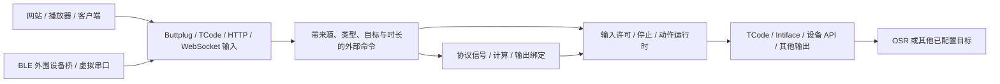

# 协议输入、虚拟设备与设备 API

**简体中文** | [English](protocol-inputs.en.md)

Sensa 可以在输入端接收其他软件原本发给设备的控制，再送到已配置的输出。典型路径是 `网站／播放器 → Sensa 虚拟 Buttplug 设备 → TCode → OSR`。同一个入口也可供官方 Buttplug 客户端、自制应用、虚拟串口与蓝牙桥使用；FapTap 是一个使用例子。[信号流程](signal-pipeline.md)解释计算和绑定，[协议桥工具](../tools/protocol-bridge/README.zh-CN.md)提供安装及平台操作。



## 先建立一条完整流程

1. 在**设置 → 协议输入**添加 **Buttplug／Intiface**，主机 `127.0.0.1`、端口 `12400`、路径 `/`，Position 特征使用 `L0`。
2. 保存并启用监听。
3. 为 OSR 添加 TCode 输出，选择串口与轴配置，保存并连接。
4. 在网站／播放器的 Intiface 地址中填写 `ws://127.0.0.1:12400`，选择 Sensa 设备。
5. 在 Sensa 应用**协议**并启用输入，网站控制即可送到输出。

原有 Central 可以继续使用 `12345`。保存来源或切换方式会关闭输入，准备好的路由由顶栏控制何时开始发送。

```json
{
  "protocolInputs": [
    {
      "id": "website", "name": "Sensa OSR bridge", "type": "Buttplug",
      "enabled": true, "host": "127.0.0.1", "port": 12400, "path": "/",
      "timeoutMs": 10000, "routeToMotion": true,
      "features": [{"channel":"L0","name":"Stroke","actuator":"Position","targetAxis":"L0"}]
    }
  ]
}
```

这是 `config.json` 的输入片段，合并时保留已有输出与轴配置，也可以在工作台完成同样设置。

## 多个输入路由共用端口

Web 协议通过 **Path** 共用监听端口。例如：

| 来源 | 端口 | 路径 | 客户端地址 |
| --- | --- | --- | --- |
| Buttplug | 12400 | `/buttplug` | `ws://127.0.0.1:12400/buttplug` |
| JSON HTTP | 12400 | `/json` | `http://127.0.0.1:12400/json/commands` |
| Lovense HTTP | 12400 | `/lovense` | `http://127.0.0.1:12400/lovense/command` |
| TCode WebSocket | 12400 | `/tcode` | `ws://127.0.0.1:12400/tcode` |

监听器移除路由前缀后，将请求交给对应协议。嵌套路径按最长完整路径匹配，路径 `/` 保留原有地址。不同路由分别管理通道与控制会话；使用不同轴，或通过计算／绑定融合它们。

同一 TCP 端口可以提供共享 HTTP／WebSocket 监听或原始 TCode TCP 监听，UDP 使用独立端口空间。重复路径与不兼容监听会在保存时显示。协议输入与 WebUI 共用地址和端口时，使用 `/input/tcode` 这样的独立路径；管理 API 和静态页面保留各自入口。实例启动后显示并保存实际绑定的端口。

## 输入能力与地址

| 输入类型 | 连接 | 内容 |
| --- | --- | --- |
| `Buttplug` | WebSocket | 具有已配置特征的 v2/v3/v4 虚拟设备 |
| `TCodeTcp`／`TCodeUdp` | TCP／UDP | TCode 位置、强度、轴与时长 |
| `TCodeWebSocket` | 共享 WebSocket 监听 | 完整 TCode 文本行 |
| `TCodeSerial` | 所选串口与波特率 | 接收 TCode 流 |
| `IntifaceDevice` | Central WSDM，常用 `ws://127.0.0.1:54817` | Sensa 向外注册为 TCode 设备 |
| `JsonHttp`／`JsonWebSocket` | 共享 HTTP／WebSocket 监听 | 有类型通道命令、心跳与停止 |
| `LovenseHttp`／`HandyHttp` | 共享 HTTP 监听 | 可配置地址的厂商 API 路由 |
| `AutoblowHttp`／`VacuGlideHttp` | 共享 HTTP 监听 | 设备控制与同步脚本路由 |

每个来源同时有一个控制会话，不同来源可以并行运行。多通道批次校验后一起接收，工作台显示通道、监听地址与接收计数。

### OSC、OSCQuery 与来源目录

Node.js 服务接收 OSC UDP 消息和 bundle，按来源分别保存参数、接收时间与内容更新时间。工作台可选择来源；OSC Hub 按事件或固定频率转发选定来源，同时保留未消费消息的 bundle 顺序与 timetag。

OSCQuery 提供地址树、数值刷新、WebSocket `LISTEN`／`IGNORE` 和断线后的重连，也可开启定频轮询。启用接收器广播后，服务通过 `_oscjson._tcp` 发布 HTTP 元数据，通过 `_osc._udp` 发布实际 OSC 端口。不同实例使用各自的服务后缀与实际端口，发现列表保留独立地址。OGB 控制向配置的固定目标每五秒发送 `OGB_ENABLED`，停止时发送最终 false。

### 类型、时长与信号路径

| 特征 | 含义 | 直接映射 |
| --- | --- | --- |
| `Position` | 0–1 目标与可选到达时长 | 指定动作轴 |
| `Scalar` | 0–1 功能值，例如振动 | V0／V1／V2 |
| `Rotation` | 0–1 速度与 `Clockwise` | 用信号绑定连接速度／方向 |

直接动作路由保留各通道到达时长，并使用输出轴配置。需要转换、录制或多个目标时，关闭直接路由，在计算／绑定中选择协议输入。来源路径为 `来源ID/通道ID`，例如 `website/L0`；`/value` 读取当前命令值，`/target` 读取目标，旋转还提供 `/speed` 与 `/clockwise`。

位置插值描述命令轨迹。首次定时命令立即提供目标值；建立初始位置或到达后即可取得当前值。绑定按自身节奏更新。来源失效时选择合适的绑定备用值；关闭输入与急停执行整机停止。直接来源的停止使用动作输出的整机停止。

## Buttplug v2、v3 与 v4

输入协商**消息规范 v2、v3 或 v4**，把已配置特征声明为一台虚拟设备。Node.js 桌面输出使用 wire v4；浏览器客户端使用 wire v3。包版本与消息规范分别说明。

客户端在声明的 `MaxPingTime` 内发送 `Ping` 以保持会话。

v2 握手使用 `MessageVersion:2`，回复同一版本。设备列表是 `Devices` 数组，每个命令的 `DeviceMessages` 属性使用 `FeatureCount` 与 `StepCount`，例如 `{"FeatureCount":2,"StepCount":[1000,1000]}`，`StepCount` 数组长度等于 `FeatureCount`。位置与旋转分别使用 `LinearCmd`／`RotateCmd`；振动使用 `VibrateCmd.Speeds` 的 `Index` 与 0～1 `Speed`。各命令族索引独立，v2 振动按已配置的 **ScalarType=Vibrate** 顺序编号。以下每行是一条完整 WebSocket 消息，使用默认位置特征：

```json
[{"RequestServerInfo":{"Id":1,"ClientName":"Legacy player","MessageVersion":2}}]
[{"RequestDeviceList":{"Id":2}}]
[{"LinearCmd":{"Id":3,"DeviceIndex":0,"Vectors":[{"Index":0,"Position":0.75,"Duration":300}]}}]
```

v2／v3 的 LinearCmd 时长为 0～600000 ms，位置与旋转速度为 0～1。握手、Ping、扫描、设备通知、停止设备与全部停止沿用各自版本格式。

v3 使用 JSON 数组，字段区分大小写。以下每行是一条完整 WebSocket 文本消息；实际客户端要在 `MaxPingTime` 内持续发送协议 `Ping`。

```json
[{"RequestServerInfo":{"Id":1,"ClientName":"Example player","MessageVersion":3}}]
[{"RequestDeviceList":{"Id":2}}]
[{"LinearCmd":{"Id":3,"DeviceIndex":0,"Vectors":[{"Index":0,"Position":0.75,"Duration":300}]}}]
[{"StopDeviceCmd":{"Id":4,"DeviceIndex":0}}]
```

支持握手、设备列表、扫描开始／结束、Ping、`LinearCmd`、已声明的 `ScalarCmd`（`Vibrate`／`Oscillate`／`Constrict`）、`RotateCmd`、`StopDeviceCmd`、`StopAllDevices`。v3 特征索引按对应命令族排列。错误索引、值、类型与不支持消息返回匹配请求 ID 的 Error。主动事件使用 ID 0。

v4 使用 `ProtocolVersionMajor:4`、`ProtocolVersionMinor:0` 握手，设备及特征是按索引标识的对象。位置声明 `Position` 与 `HwPositionWithDuration`，标量使用配置的 `ScalarType`（Vibrate／Oscillate／Constrict／Led／Temperature／Spray），旋转声明有符号 `Rotate`；当前整数范围位置／标量 0～1000、旋转 -1000～1000。使用 `OutputCmd`／`StopCmd`：

```json
[{"RequestServerInfo":{"Id":1,"ClientName":"Example client","ProtocolVersionMajor":4,"ProtocolVersionMinor":0}}]
[{"OutputCmd":{"Id":2,"DeviceIndex":0,"FeatureIndex":0,"Command":{"HwPositionWithDuration":{"Value":750,"Duration":300}}}}]
[{"StopCmd":{"Id":3,"DeviceIndex":0,"Outputs":true}}]
```

Scalar 特征可配置 `ScalarType`，默认 Vibrate；Led／Temperature／Spray 只向 v4 客户端声明，v3 的标量索引按其支持的三类过滤后排列。功能值使用归一化协议范围。

接口支持官方 v2／v3／v4 客户端消息。能力列表描述命令输出，原始硬件和传感／电量／RSSI API 不在此虚拟设备配置中。[官方规范](https://buttplug.io/docs/spec/) · [v3 规范](https://buttplug.io/docs/spec-v3/spec/)

## TCode、串口与 Central 虚拟设备

支持 v0.3 核心和 v0.4 共用核心：大小写轴 `L/R/V/A`、0～9 通道、可变位数小数幅值、`I` 毫秒、`S` 速度、空格分隔多轴、同一行重复轴最后一项生效、`D0`／`D1`／`D2` 查询及 `DSTOP`。例如 `L277` 是 L2 的 **0.77**，`R09` 是 R0 的 **0.9**。

```text
L075I300 R025I900
DSTOP
```

行以 LF、CR 或 CRLF 完成。TCP、串口和 WSDM 支持拆分接收；`TCodeWebSocket` 在配置路径接收完整 ASCII 文本行；UDP 每个数据报必须完整且以换行结束，避免丢包后拼错命令。每行最多 4096 ASCII 字节；TCode 的 I 或 S 换算时长上限 60000 ms。未知通道、非法字节、过大行或不支持修饰符会拒绝并停止，不会跳过错误继续执行该行。

非法流回复 `ERR` 并结束会话，重新连接或重新打开串口输入后可继续。UDP 的下一条完整合法数据报可建立新会话。

`S1000` 表示每秒一个归一化轴长，从之前的命令／插值位置计算时长。使用 S 前先发送明确初始位置。`D1` 返回 **TCode v0.3**，已实现动作核心使用前述 L/R/V/A、I/S 与 D 查询。[TCode 官方规范](https://github.com/multiaxis/TCode-Spec)

使用 Central 的另一条路径是 `客户端 → Central → WSDM → Sensa → OSR`。在 Central 的 Manage WebSocket Devices 配置 **TCode v0.3** 设备，将其 identifier 与 Sensa `identifier` 对应；Sensa 类型选 `IntifaceDevice`，`Address` 填实际设备管理端口，默认 `ws://127.0.0.1:54817`，通道使用 `L0` 等 TCode 轴名。Sensa 发送文本 `{identifier,address,version:0}` 注册，随后按**二进制 WebSocket 帧**收发 TCode；即使内容是 ASCII，也不能发送为文本硬件帧。`identifier` 为空时使用来源名称，注册 address 使用稳定的来源 ID。无需把网站地址改成设备管理端口。[WSDM 官方说明](https://buttplug.io/docs/dev-guide/inflating-buttplug/devices/websocket-device-manager/)

有限 TCode 动作的会话保持到当前各通道最晚到达时间，再加 `timeoutMs` 空闲宽限。完整命令和 D 查询刷新活动时间，新目标替换该通道之前的截止时间。停止清除当前目标，EOF 立即结束会话。WSDM 使用 WebSocket Ping/Pong 保持连接，连接有效时可保持静态目标。

### Intiface 输出的特征映射

已有 Intiface 输出默认使用线性位置与所选振动轴。需要其他功能时，在输出中添加 `IntifaceFeatures` 显式映射：DeviceName 精确匹配名称、FeatureIndex 选择特征，OutputType 必须由设备真实声明。支持 `Vibrate`、`Oscillate`、`Rotate`、`Position`、`HwPositionWithDuration`、`Led`、`Temperature`、`Constrict`、`Spray` 九种输出；从设备扫描结果中选择。

```json
{
  "id": "intiface-output",
  "name": "Selected Central devices",
  "type": "Intiface",
  "enabled": false,
  "websocketAddress": "ws://127.0.0.1:12345",
  "intifaceFeatures": [
    {"deviceName":"Selected device","featureIndex":0,"outputType":"Rotate","sourceAxis":"V0","directionAxis":"A0"},
    {"deviceName":"Selected device","featureIndex":1,"outputType":"HwPositionWithDuration","sourceAxis":"L0","invert":true}
  ]
}
```

连接 Central 时，设备名称含多字节字符、大型或分片的设备列表会按完整 WebSocket 文本消息接收，单条消息上限为 1 MiB。连接建立失败会清理本次传输，可以重新连接；连接后的交付仍遵守当前输入启用状态。

将示例设备名和索引替换为扫描结果。来源值按目标特征声明的整数范围缩放；标量范围使用协议单位。旋转的 SourceAxis 表示速度，DirectionAxis 值至少 0.5 为顺时针，否则逆时针；留空则使用 Clockwise。位置方向用 Invert 明确选择，旧位置默认仍是 `1-L0`。定时位置检查目标声明的时长范围，可用命令类型由设备声明决定。

配置完成后，输出绑定也可选择这些映射的来源轴和旋转方向轴，例如分别绑定 V0 速度与 A0 方向。绑定可选择默认功能或映射引用的轴。

映射替换匹配功能的默认发送，其余设备保留位置／振动路径。配置校验识别输出连回输入的回路，包括 Central／WSDM 返回 Sensa 自身虚拟设备的情况。

## 自制应用的 HTTP／WebSocket JSON

使用 `JsonHttp` 时，以下请求发往输入地址而非工作台的 `/api`。示例使用默认 `L0` 通道；发送多轴批次前，先在该来源配置中添加 `R0` 等额外通道。同一客户端使用固定的 `X-Sensa-Session`，需要持续保持目标时在超时内发送 `/heartbeat`；超时会释放控制权并停止。

```sh
curl --request POST http://127.0.0.1:12403/commands \
  --header 'Content-Type: application/json' \
  --header 'X-Sensa-Session: player-one' \
  --data '{"commands":[{"channel":"L0","value":0.75,"durationMs":300}]}'
curl --request POST http://127.0.0.1:12403/heartbeat \
  --header 'Content-Type: application/json' --header 'X-Sensa-Session: player-one' --data '{}'
curl --request POST http://127.0.0.1:12403/stop \
  --header 'Content-Type: application/json' --header 'X-Sensa-Session: player-one' --data '{}'
```

`GET /status` 提供配置通道；`POST`／`PUT /command` 或 `/commands` 接收单个对象或 `commands` 数组，也接受 `path`／`address` 作为通道字段别名。`durationMs` 以毫秒计；`clockwise` 是旋转方向。未知通道、重复通道、非有限值或越界会拒绝。单请求最多 64 KiB，批次最多 16 通道。`/stop` 可附 `channel`，省略则停止该来源全部通道。

WebSocket JSON 使用同样对象，例如 `{"commands":[{"channel":"L0","value":0.5,"durationMs":250}]}`，以及 `{"command":"heartbeat"}`、`{"command":"stop"}`。每连接有独立会话，关闭连接会停止并释放；客户端需检查服务响应。网络 JSON 输出也可以使用通道路径／地址字段接入这一输入，显式配置两端地址并避免自身回路。

## 厂商兼容输入与真实设备输出

应用可以配置服务地址时，使用本地 API 输入。网站提供 Intiface 地址栏时，Buttplug 路由最直接。真实设备输出则沿相反方向连接设备 API。

| 输入 | 已实现的本地 API 子集 | 语义边界 |
| --- | --- | --- |
| `LovenseHttp` | `POST /command` 的 GetToys、GetToyName、Function（Vibrate／Rotate／All、Stop），以及旧版 GET Vibrate／Vibrate1／Vibrate2／RotateClockwise／RotateAntiClockwise／Stop | toy ID 是来源 ID；振动映射 Scalar，旋转映射 Rotation；支持 timeSec 和成对的循环时间，不把强度当位置；Pump 等真实输出功能不因此自动成为输入能力 |
| `HandyHttp` | REST v2 connected／info／mode／slide／settings／servertime、HSTP time／offset、HDSP xpt／xpvp、HAMP velocity／start／stop、HSSP setup／play／loop／state／stop | 可接受 `/api/handy/v2` 或 `/api/handy-rest/v2` 前缀；使用 v2 Sensa 虚拟设备身份 |
| `AutoblowHttp` | `/autoblow` 下 connected／info／state，goto、oscillate／start／stop 与 sync-script 操作 | 位置及百分比速度；未知起点时拒绝速度轨迹，先通过明确的脚本目标建立命令位置 |
| `VacuGlideHttp` | `/vacuglide` 下 connected／info／state、target-speed／stop 与 sync-script 操作 | targetSpeed 为 0～100 强度，只使用 Scalar；脚本可显式配置为 Position 桥接轨迹，否则以轨迹变化率映射速度强度 |

Handy 的 xpvp／HAMP 与 Autoblow 的 goto／oscillate 使用 `MaxSpeedPerSecond` 将百分比速度换算为每秒归一化全行程，默认 1，可配置 0.01～20。这设置虚拟设备的速度标定。先用 HDSP 的已知位置，或脚本中的明确位置建立起点；停止／急停清理后重新建立。VacuGlide 脚本的 Scalar 路径是 `clamp(abs(位置差)/秒, 0, 1)`。

配置好 Handy 与 Lovense 输入后，自制客户端可以这样调用：

```sh
curl --request PUT http://127.0.0.1:12406/mode \
  --header 'Content-Type: application/json' --header 'X-Sensa-Session: player-one' --data '{"mode":2}'
curl --request PUT http://127.0.0.1:12406/hdsp/xpt \
  --header 'Content-Type: application/json' --header 'X-Sensa-Session: player-one' --data '{"position":50,"duration":0}'
curl --request POST http://127.0.0.1:12405/command \
  --header 'Content-Type: application/json' --header 'X-Sensa-Session: player-one' \
  --data '{"command":"Function","action":"Vibrate:5","timeSec":0,"toy":"lovense-in","apiVer":1}'
```

Lovense `timeSec` **大于 1 且不超过 600 秒**时创建有限任务，会话保持到总时长结束，包括循环暂停。`timeSec:0` 使用普通 `timeoutMs` 活动租约。停止、关闭输入、保存配置和急停取消任务，脚本播放另使用 `maxScriptDurationMs`。

最后一例使用来源 ID `lovense-in` 与 Scalar 特征。Autoblow／VacuGlide 的 `sync-script` 支持 multipart `upload-csv`／`upload-funscript`，URL 上传、当前来源本地 `load-token`、`start`（startTimeMs）、`stop`、`offset`（offsetTimeMs）和 `loop`。CSV 是无表头、末尾有换行的整数毫秒／0～100 位置对；funscript 使用 actions。脚本上限 1 MiB、100000 点、16777214 ms。Handy 的 HSSP setup 接受 URL，按相同轨迹模型播放。

兼容输入的脚本任务使用有界 URL 下载或 multipart 上传。`maxScriptDurationMs` 默认为一小时；即时控制使用 `timeoutMs`，有限运动保留到达期限。Autoblow／VacuGlide 配置 `identifier` 后，对应值用于 `x-device-token`。[下载校验与 API 实现](architecture.md)

真实设备输出在“添加输出”中选择 **Handy、Lovense、Autoblow、VacuGlide**，填写实际 API 地址、连接密钥或设备 ID。它们与同名的兼容输入是两个方向。

| 输出 | 已实现语义 | 配置和限制 |
| --- | --- | --- |
| Handy | HDSP 位置＋到达时长；HSSP URL 脚本准备／播放／定位／停止与时间同步 | API v2 对应受支持的 fw3；v3 对应 fw4+，需应用 API key 或 token；填实际连接 key |
| Lovense | LAN HTTPS `GetToys`、指定 toy ID 的 Function 强度及 Stop | Vibrate／Rotate／Pump／Thrusting／Fingering／Suction 强度，Pump 使用独立量程 |
| Autoblow | `goto` 位置与独立 speed；CSV／funscript URL 同步脚本 | 分别配置目标位置与速度百分比 |
| VacuGlide | 电机速度强度与同步脚本 | 使用速度／强度，通常选择 V0；同步轨迹由设备转换为电机速度 |

以下对象用作输出配置示例。Handy v2 可选择 ApiVersion 2 并省去 v3 应用凭据；VacuGlide 的默认来源轴应选 V0 强度。

```json
{
  "outputs": [
    {
      "id": "handy",
      "name": "Handy API",
      "type": "Handy",
      "enabled": false,
      "device": {
        "axis": "L0",
        "apiVersion": 3,
        "connectionKey": "YOUR_DEVICE_CONNECTION_KEY",
        "apiKey": "YOUR_APPLICATION_API_KEY",
        "scriptUrl": "https://example.com/motion.csv",
        "scriptFormat": "Csv",
        "scriptTimeoutMs": 90000
      }
    },
    {
      "id": "vacuglide",
      "name": "VacuGlide speed",
      "type": "VacuGlide",
      "enabled": false,
      "device": {"axis": "V0", "connectionKey": "YOUR_DEVICE_CONNECTION_KEY"}
    }
  ]
}
```

Handy v2/v3 同步脚本使用 CSV URL。Autoblow／VacuGlide 按所选格式接受 CSV 或 funscript URL。CSV 为无表头的 `时间毫秒,位置百分比`，末尾保留换行。使用设备／API 能访问的 URL；Handy 接受 HTTP(S)，Autoblow／VacuGlide 使用 HTTPS。

连接并准备脚本后，启用输入再点击播放。停止可取消准备与播放。已准备脚本可再次明确播放；重新连接开启新的设备会话。连接 key 和 API token 保存在所选配置中。

### 同步脚本循环

准备脚本后，在停止播放时选择“循环播放同步脚本”。每次播放会应用当前选择；更换脚本或重新连接会关闭循环。

- Handy API v2 在连接信息报告 **fw3.2 或更高 fw3** 时提供循环。
- Handy API v3 在下一次 `/hssp/play` 请求中携带 `loop`。
- Autoblow／VacuGlide 使用其已支持的 `sync-script/loop`。它们与本地兼容输入的 loop 是两个方向的能力。

自制工具可在已准备且暂停时调用工作台 API；下面的 `handy` 是上述示例输出 ID：

```sh
curl --request POST http://127.0.0.1:5086/api/control/output/handy/script-loop \
  --header 'Content-Type: application/json' --data '{"loop":true}'
```

此请求发送到工作台地址。

## 蓝牙与虚拟串口的实际接线

安装 Python 和所选传输依赖，再选择需要的方向。便携包／安装版附带工具文件。[安装与平台设置](../tools/protocol-bridge/README.zh-CN.md)

```sh
python tools/protocol-bridge/bridge.py --check
python tools/protocol-bridge/bridge.py pty-input --sensa tcp://127.0.0.1:12401
python tools/protocol-bridge/bridge.py serial-input --port COM12 --baud 115200 --sensa tcp://127.0.0.1:12401
python tools/protocol-bridge/bridge.py ble-input --protocol loob --sensa tcp://127.0.0.1:12401
python tools/protocol-bridge/bridge.py ble-input --protocol thrust-sync --sensa tcp://127.0.0.1:12401
```

Linux／macOS 可以使用 `pty-input`，Windows 使用已配置的 COM 端口对。客户端打开一端，桥工具或 Sensa 的 TCodeSerial 输入打开另一端。

BLE 输入以外设身份广播，供客户端连接；BLE 输出以 central 身份连接设备。Linux／macOS 输入使用 Bless，Windows 使用 WinRT，输出使用 Bleak。LOOB 用四字节传递位置／时长，Thrust Sync 使用三字节；输入时长范围为 0–60000 ms。适配器和广播名称按工具指南选择。

反向输出时，在 Sensa 配置仅 L0 的 TCode TCP 输出到 `127.0.0.1:12411`，Interval 方式，再启动：

```sh
python tools/protocol-bridge/bridge.py ble-output --protocol loob --device DEVICE_ID --listen tcp://127.0.0.1:12411
```

LOOB／Thrust Sync 停止时清空队列并断开 BLE，设备仍可完成最后接收的有限动作。输入终端提供 `disable`、`enable`、`disconnect`、`unpair` 和 `quit`。适配器、名称与设备停止方式见[工具指南](../tools/protocol-bridge/README.zh-CN.md)。

### Svakom V1 振动桥

`svakom-v1` 实现 **Emma Neo／Phoenix Neo／Ella 单振动配置**，使用可写服务 `FFE0`／特征 `FFE1`。命令为 `55 04 03 00 开关 强度`，强度范围 0–19。请明确选择此配置；它的包布局与共用 UUID 的 Thrust Sync 不同。

输入仍连接本机 TCode TCP 来源 `12401`；将该来源的特征设为下面的 **Scalar／Vibrate V0**，不要使用位置 L0：

```json
{"channel":"V0","actuator":"Scalar","scalarType":"Vibrate","targetAxis":"V0"}
```

```sh
python tools/protocol-bridge/bridge.py ble-input --protocol svakom-v1 --sensa tcp://127.0.0.1:12401
python tools/protocol-bridge/bridge.py ble-output --protocol svakom-v1 --device DEVICE_ID --listen tcp://127.0.0.1:12411
```

Linux／macOS 输入广播 `Emma NEO`；Windows 设置匹配的系统蓝牙名称后，传入 `--confirm-windows-svakom-name`。

输出启用 V0、选择 `NoSlope`，将 `commandMode`／`rampType` 设为 `None`。通过固定频率发送无时长 V0 强度帧，间隔保持在工具的空闲期限内。默认期限为两秒，`--idle` 可选 0.05–120 秒。新会话从新命令开始。

停止时发送零振动命令 `55 04 03 00 00 00`，随后清空并断开。此配置提供命令写入，`FFE2` 通知和传感／身份响应不在其功能范围内。

### 更多振动设备

| 配置 | 设备系列 | 方向 | 强度 |
| --- | --- | --- | --- |
| `lovense-single` | Lovense 单振动指令，包括 Lush、Hush、Ambi、Ferri、Diamo | BLE 输出 | `Vibrate:0;` 至 `Vibrate:20;` |
| `youou-vx001` | VX001_ Wand | BLE 输入／输出 | 序号与校验帧，范围 0–247 |

这些标量配置使用 V0、`NoSlope`、`CommandMode=None` 和 `RampType=None`，保持强度时使用固定频率交付。各设备连接分别保留序号与队列，停止时先尝试发送零强度再断开。

```sh
python tools/protocol-bridge/bridge.py ble-output --protocol lovense-single --device DEVICE_ID --listen tcp://127.0.0.1:12411
python tools/protocol-bridge/bridge.py ble-output --protocol youou-vx001 --device DEVICE_ID --listen tcp://127.0.0.1:12411
```

[WebSensa](websensa.md)使用同名配置直接从浏览器进行蓝牙输出。工具指南列出 UUID、平台设置与支持指令。

## 验证范围与参考

### TypeScript 实现与迁移契约

| 能力 | 维护中的实现 |
| --- | --- |
| 输入配置、租约与命令轨迹 | [input-types.ts](https://github.com/SeaLoong/Sensa/blob/main/src/core/protocols/input-types.ts)、[external-control.ts](https://github.com/SeaLoong/Sensa/blob/main/src/core/protocols/external-control.ts) |
| OSC 编解码与来源目录 | [osc.ts](https://github.com/SeaLoong/Sensa/blob/main/src/core/protocols/osc.ts) |
| TCode／Buttplug 虚拟设备 | [tcode-input.ts](https://github.com/SeaLoong/Sensa/blob/main/src/core/protocols/tcode-input.ts)、[buttplug-input.ts](https://github.com/SeaLoong/Sensa/blob/main/src/core/protocols/buttplug-input.ts) |
| 共享监听、串口与 WSDM | [Node 输入协调器](https://github.com/SeaLoong/Sensa/blob/main/src/node/inputs/coordinator.ts) |
| HTTP 厂商 API 与有限脚本任务 | [http-session.ts](https://github.com/SeaLoong/Sensa/blob/main/src/node/inputs/http-session.ts)、[vendor-session.ts](https://github.com/SeaLoong/Sensa/blob/main/src/node/inputs/vendor-session.ts) |
| OSCQuery、mDNS、OSC Hub 与 OGB | [osc-services.ts](https://github.com/SeaLoong/Sensa/blob/main/src/node/inputs/osc-services.ts) |

[编解码与租约契约](https://github.com/SeaLoong/Sensa/blob/main/tests/node/input-codecs.test.ts)、[隔离网络与服务契约](https://github.com/SeaLoong/Sensa/blob/main/tests/node/input-transports.test.ts)和[分片停机代次契约](https://github.com/SeaLoong/Sensa/blob/main/tests/node/input-websocket-epoch.test.ts)随实现维护。传输测试使用真实 loopback TCP／UDP／HTTP／WebSocket 对端，串口与 mDNS 使用注入平台接口；浏览器、完整进程和原生包检查由 Actions 执行。设备实机结果单独记录。

[验证记录](e2e-status.md)列出协议、模拟传输与浏览器检查的提交和执行环境。[开发指南](development.md)说明对应测试套件。

- [Buttplug 消息规范](https://buttplug.io/docs/spec/)与[官方 C# 客户端](https://github.com/buttplugio/buttplug-csharp)。 v2 的[命令元数据定义](https://github.com/buttplugio/buttplug/blob/179b0d9306f519912c10bdddd111686622b7f63a/crates/buttplug_server/src/message/v2/client_device_message_attributes.rs)与[官方 JSON schema](https://github.com/buttplugio/buttplug/blob/179b0d9306f519912c10bdddd111686622b7f63a/crates/buttplug_core/schema/buttplug-schema.json)固定到已核验提交。
- [Handy 开发文档](https://docs.handyfeeling.com/)、[Lovense Standard API](https://developer.lovense.com/docs/standard-solutions/standard-api)。
- [Autoblow HTTP API](https://developers.autoblow.com/reference/http-api-v1-autoblow/)、[VacuGlide HTTP API](https://developers.autoblow.com/reference/http-api-v1-vacuglide/)。
- [FapTap](https://faptap.net/)提供公开 LOOB／Thrust Sync 连接器参考。
- Svakom V1 的[官方上游编解码](https://github.com/buttplugio/buttplug/blob/179b0d9306f519912c10bdddd111686622b7f63a/crates/buttplug_server/src/device/protocol_impl/svakom/svakom_v1.rs)与[型号／范围配置](https://github.com/buttplugio/buttplug/blob/179b0d9306f519912c10bdddd111686622b7f63a/crates/buttplug_server_device_config/device-config/protocols/svakom-v1.yml)固定到已核验提交。

[外部命令与输入边界决策](adr/0010-external-protocol-inputs.md) · [架构](architecture.md)
