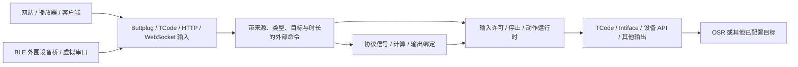

# 协议输入、虚拟设备与设备 API

**简体中文** | [English](protocol-inputs.en.md)

Sensa 可以在输入端接收其他软件原本发给设备的控制，再送到已配置的输出。典型路径是 `网站／播放器 → Sensa 虚拟 Buttplug 设备 → TCode → OSR`。同一个入口也可供官方 Buttplug 客户端、自制应用、虚拟串口与蓝牙桥使用；FapTap 是一个使用例子。[信号流程](signal-pipeline.md)解释计算和绑定，[协议桥工具](../tools/protocol-bridge/README.zh-CN.md)提供安装及平台操作。



## 先建立一个可检查的闭环

1. 在“控制”的协议输入页，或“流程 → 协议输入”，添加 **Buttplug / Intiface** 来源。保留本机地址 `127.0.0.1`、端口 `12400`，通道 `L0`、类型“位置与到达时长”、直接轴 `L0`。启用此来源的监听。
2. 网站来源填实际网页的 HTTP(S) origin，例如 `https://faptap.net`。只填来源，不含路径、查询或通配符。本机原生客户端无 Origin 时按本机连接单独处理。
3. 添加一个 **TCode 串口输出**，选实际 OSR 串口和轴配置；先关闭无关轴，核对方向、行程与停止。保存后，连接输出。
4. 在网站或客户端的 Intiface 地址填 `ws://127.0.0.1:12400`，连接并选择 Sensa 设备。这是 Sensa 输入端；真正的 Central 应用端口通常是 `12345`，二者可以并存。
5. 在 Sensa 应用“协议”输入方式，准备好后单独启用输入。先发送小范围目标并检查接收计数、输出目标与停止行为，再开始正常播放。

输入来源监听、客户端连接、输出连接和输入启用是分别管理的状态。保存配置、切换输入方式、关闭输入或急停会清理旧目标；解除急停不会恢复动作。只建立连接、扫描设备或准备脚本都不会自动启用运动。

下面是 `config.json` 中的**输入配置片段**，合并进已有配置，其他输出和轴配置照常保留。工作台保存更便于检查；直接修改文件后重启以载入。程序启动时仍保持输入关闭。

```json
{
  "ProtocolInputs": [
    {
      "Id": "website",
      "Name": "Sensa OSR bridge",
      "Type": "Buttplug",
      "Enabled": true,
      "Host": "127.0.0.1",
      "Port": 12400,
      "TimeoutMs": 10000,
      "RouteToMotion": true,
      "AllowedOrigins": ["https://faptap.net"],
      "Features": [
        {"Channel": "L0", "Name": "Stroke", "Actuator": "Position", "TargetAxis": "L0"}
      ]
    }
  ]
}
```

浏览器对 HTTPS 页面连接本机 WebSocket、局域网访问、Web Serial 和 Web Bluetooth 有独立限制与权限。若浏览器阻止连接，先检查实际 Origin、监听地址、端口和本机网络权限；另一台手机里的 `127.0.0.1` 指向手机本身。这里没有要求关闭浏览器安全机制。

## 输入能力与地址

| 输入类型 | 常用默认地址 | 提供的内容 |
| --- | --- | --- |
| `Buttplug` | `ws://127.0.0.1:12400` | 协商 v3/v4，声明一个具有已配置特征的虚拟设备 |
| `TCodeTcp` | `tcp://127.0.0.1:12401` | 按行的 TCode 位置／强度／辅助轴命令及独立时长 |
| `TCodeUdp` | `udp://127.0.0.1:12402` | 自包含、有换行结尾的 TCode 数据报 |
| `TCodeSerial` | 显式串口及波特率 | 从已选择的串口读取 TCode；不创建虚拟串口 |
| `IntifaceDevice` | `ws://127.0.0.1:54817` | Sensa 主动连接 Central 的 WebSocket Device Manager，作为 TCode 设备 |
| `JsonHttp` | `http://127.0.0.1:12403` | 本文的通道值、到达时长、停止和心跳接口 |
| `JsonWebSocket` | `ws://127.0.0.1:12404` | 相同 JSON 控制模型和每连接控制会话 |
| `LovenseHttp` | `http://127.0.0.1:12405` | 本地兼容 API 子集，供可配置 endpoint 的客户端 |
| `HandyHttp` | `http://127.0.0.1:12406` | 本地兼容 API 子集，保留位置与速度的区别 |
| `AutoblowHttp` / `VacuGlideHttp` | 本机 `12407` / `12408` | 本地兼容 API 子集；VacuGlide 使用速度强度语义 |

一个来源同时只有一个控制会话；第二个客户端需等待原会话断开或超时。同一批次先校验所有通道，再原子接收，非法后半段不会使合法前半段先动。最多 16 个来源、每来源 16 个特征。监听地址／端口冲突和重复直接轴会在保存时检查。HTTP／WebSocket 输入与 Sensa 工作台管理 API 使用不同监听入口；网站只能调用选定的协议能力。

### 类型、时长与信号路径

| 特征 | 值的含义 | 直接映射 |
| --- | --- | --- |
| `Position` | 0～1 的目标位置，可附带到达时长 | 已明确选择的动作轴 |
| `Scalar` | 0～1 的功能值，例如振动、约束、灯光或电机速度比例 | 只直接映射到 `V0`／`V1`／`V2` |
| `Rotation` | 0～1 的旋转速度及 `Clockwise` 方向 | 先作为信号使用，不自动变成 R 轴绝对角度 |

勾选“直接映射到动作输出”时，“协议”或“组合”方式把目标与每个通道的时长送入动作运行时，再使用实际输出的轴配置。多轴时长彼此独立。来源停止、失效或断线会清理待发命令；现有动作输出的强停是全设备停止，因此来源／特征停止会保守地停止动作输出，可能影响同时运行的其他轴。

协议来源只有在“协议”／“组合”方式中才能路由，计算和绑定也遵守这一条件。需要换算、融合、记录或送往其他协议时，关闭该来源的直接映射，在计算或输出绑定中选“协议输入”，填 `来源ID/通道ID`，例如 `website/L0`。`/value` 与省略后缀等效；`/target` 读取目标；旋转通道还可读 `/speed`、`/clockwise`。位置插值仅代表命令轨迹，不能当作硬件回读。首次定时运动没有已知起点时，当前值在到达前无效，目标值仍可读取。

通过标量计算／绑定会采用绑定自身的发送节奏，不会自动保留原命令的硬件到达时长。需要原有定时轨迹时使用直接动作路径。强度转往 OSR 位移等跨含义操作，必须由使用者显式选择计算、量程与目标，不能靠品牌名称猜测。

## Buttplug v3 与 v4

Sensa 的 NuGet `Buttplug 5.0.1` 是现有输出客户端库版本，不是 wire protocol v5。输入服务自己协商 **消息规范 v3 或 v4**，只声明已配置能力；它不扫描真实硬件。

v3 使用 JSON 数组，字段区分大小写。以下每行是一条完整 WebSocket 文本消息；实际客户端要在 `MaxPingTime` 内持续发送协议 `Ping`。

```json
[{"RequestServerInfo":{"Id":1,"ClientName":"Example player","MessageVersion":3}}]
[{"RequestDeviceList":{"Id":2}}]
[{"LinearCmd":{"Id":3,"DeviceIndex":0,"Vectors":[{"Index":0,"Position":0.75,"Duration":300}]}}]
[{"StopDeviceCmd":{"Id":4,"DeviceIndex":0}}]
```

支持握手、设备列表、扫描开始／结束、Ping、`LinearCmd`、已声明的 `ScalarCmd`（`Vibrate`／`Oscillate`／`Constrict`）、`RotateCmd`、`StopDeviceCmd`、`StopAllDevices`。v3 的特征索引按对应命令族排列；不要把线性索引与振动索引混用。错误索引、值、类型与不支持消息返回匹配请求 ID 的 Error。主动事件使用 ID 0。

v4 使用 `ProtocolVersionMajor:4`、`ProtocolVersionMinor:0` 握手，设备及特征是按索引标识的对象。位置声明 `Position` 与 `HwPositionWithDuration`，标量使用配置的 `ScalarType`（Vibrate／Oscillate／Constrict／Led／Temperature／Spray），旋转声明有符号 `Rotate`；当前整数范围位置／标量 0～1000、旋转 -1000～1000。使用 `OutputCmd`／`StopCmd`，不是 v3 的 LinearCmd 格式：

```json
[{"RequestServerInfo":{"Id":1,"ClientName":"Example client","ProtocolVersionMajor":4,"ProtocolVersionMinor":0}}]
[{"OutputCmd":{"Id":2,"DeviceIndex":0,"FeatureIndex":0,"Command":{"HwPositionWithDuration":{"Value":750,"Duration":300}}}}]
[{"StopCmd":{"Id":3,"DeviceIndex":0,"Outputs":true}}]
```

Scalar 特征可配置 `ScalarType`，默认 Vibrate；Led／Temperature／Spray 只向 v4 客户端声明，v3 的标量索引按其支持的三类过滤后排列，避免借其他类型冒名。功能值是归一化协议范围，不能直接解释为物理温度等单位。

不提供 RawRead／RawWrite、传感器／电池虚构读数、其他未声明执行器或 v0～v2 兼容层。可使用官方 v3 JS 客户端和 v4 C# 客户端；具体应用还可能按品牌、设备名或特征筛选，须对所选版本验收。[官方规范](https://buttplug.io/docs/spec/) · [v3 规范](https://buttplug.io/docs/spec-v3/spec/)

## TCode、串口与 Central 虚拟设备

支持 v0.3 核心和 v0.4 共用核心：大小写轴 `L/R/V/A`、0～9 通道、可变位数小数幅值、`I` 毫秒、`S` 速度、空格分隔多轴、同一行重复轴最后一项生效、`D0`／`D1`／`D2` 查询及 `DSTOP`。例如 `L277` 是 L2 的 **0.77**，`R09` 是 R0 的 **0.9**；不是除以 99 或 999。

```text
L075I300 R025I900
DSTOP
```

行以 LF、CR 或 CRLF 完成。TCP／串口／WSDM 支持拆分接收；UDP 每个数据报必须完整且以换行结束，避免丢包后拼错命令。每行最多 4096 ASCII 字节；TCode 的 I 或 S 换算时长上限 60000 ms。未知通道、非法字节、过大行或不支持修饰符会拒绝并停止，不会跳过错误继续执行该行。

TCP／串口在非法行后回复 `ERR`，随后关闭并释放本次会话；不能继续向原连接发送动作。TCP 客户端需重新建立连接，串口来源需重新启用／保存监听以重新打开端口，再发送新的合法命令。UDP 的非法数据报释放当前远端会话；后续完整合法数据报可建立新会话。整行中合法的前半段不会先运动。

`S1000` 表示每秒一个归一化轴长，从已知的上一个命令位置／插值位置计算到达时长。首次 S、首次定时命令尚未到达且起点未知时的 S，以及清理／停止后的首个 S 均拒绝；先发送一个明确位置。该位置仍是命令值，不是编码器反馈。v0.4 的 `<`、`>`、`<>`、`G` 曲线及 EEPROM 保存命令尚未实现，明确拒绝；`D1` 如实返回 **TCode v0.3**。[TCode 官方规范](https://github.com/multiaxis/TCode-Spec)

使用 Central 的另一条路径是 `客户端 → Central → WSDM → Sensa → OSR`。在 Central 的 Manage WebSocket Devices 配置 **TCode v0.3** 设备，将其 identifier 与 Sensa `Identifier` 对应；Sensa 类型选 `IntifaceDevice`，`Address` 填实际设备管理端口，默认 `ws://127.0.0.1:54817`，通道使用 `L0` 等 TCode 轴名。Sensa 发送文本 `{identifier,address,version:0}` 注册，随后按**二进制 WebSocket 帧**收发 TCode；即使内容是 ASCII，也不能发送为文本硬件帧。`Identifier` 为空时使用来源名称，注册 address 使用稳定的来源 ID。无需把网站地址改成设备管理端口。[WSDM 官方说明](https://buttplug.io/docs/dev-guide/inflating-buttplug/devices/websocket-device-manager/)

TCode 没有应用层 Ping：TCP／串口／UDP 的合法有限动作保持到各通道当前目标中最晚到达时间，再加 `TimeoutMs` 空闲宽限；例如 I60000 不会被默认 10 秒空闲期截断。完整合法命令或明确 D 查询可以更新活动时间，零散字节和未完成的行不能续期。新短动作替换该通道旧长截止时间，停止／全局清理会撤销旧轨迹期限；EOF 仍立即停止和释放，不能借剩余动作时间忽略断线。UDP 使用相同到达后宽限并释放过期的远端持有者。WSDM 使用 WebSocket Ping/Pong 判断连接存活；连接有效时静止目标可以保持，无需反复发送相同 TCode。

### Intiface 输出的特征映射

已有 Intiface 输出默认使用线性位置与所选振动轴。需要其他功能时，在输出中添加 `IntifaceFeatures` 显式映射：DeviceName 精确匹配名称、FeatureIndex 选择特征，OutputType 必须由设备真实声明。支持 `Vibrate`、`Oscillate`、`Rotate`、`Position`、`HwPositionWithDuration`、`Led`、`Temperature`、`Constrict`、`Spray` 九种输出；支持协议类型不代表所有型号都实现。

```json
{
  "Id": "intiface-output",
  "Name": "Selected Central devices",
  "Type": "Intiface",
  "Enabled": false,
  "WebsocketAddress": "ws://127.0.0.1:12345",
  "IntifaceFeatures": [
    {"DeviceName":"Selected device","FeatureIndex":0,"OutputType":"Rotate","SourceAxis":"V0","DirectionAxis":"A0"},
    {"DeviceName":"Selected device","FeatureIndex":1,"OutputType":"HwPositionWithDuration","SourceAxis":"L0","Invert":true}
  ]
}
```

这是单个输出的示例对象，设备名和索引需换成扫描结果。来源值按目标特征声明的整数范围缩放；温度等功能值不是默认摄氏度。旋转的 SourceAxis 表示速度，DirectionAxis 值至少 0.5 为顺时针，否则逆时针；留空则使用 Clockwise。位置方向用 Invert 明确选择，旧位置默认仍是 `1-L0`。定时位置检查目标声明的时长范围，未声明能力不会伪造发送成功。

映射覆盖匹配功能的默认发送，不是设备白名单：其他未覆盖设备仍使用原有位置／振动路径。Sensa 会拒绝同时启用指向同主机 Central 的 WSDM 输入和 Intiface 输出，避免把自身虚拟设备再次作为输出形成回路；独立 Buttplug 输入也不能被本程序输出连回自身。

## 自制应用的 HTTP／WebSocket JSON

使用 `JsonHttp` 时，以下请求发往输入地址而非工作台的 `/api`。同一客户端使用固定的 `X-Sensa-Session`，需要持续保持目标时在超时内发送 `/heartbeat`；超时会释放控制权并停止。HTTP 身份由 Origin、远端 IP 与此会话头共同区分。

```sh
curl --request POST http://127.0.0.1:12403/commands \
  --header 'Content-Type: application/json' \
  --header 'X-Sensa-Session: player-one' \
  --data '{"commands":[{"channel":"L0","value":0.75,"durationMs":300},{"channel":"R0","value":0.25,"durationMs":900}]}'
curl --request POST http://127.0.0.1:12403/heartbeat \
  --header 'Content-Type: application/json' --header 'X-Sensa-Session: player-one' --data '{}'
curl --request POST http://127.0.0.1:12403/stop \
  --header 'Content-Type: application/json' --header 'X-Sensa-Session: player-one' --data '{}'
```

`GET /status` 提供配置通道；`POST`／`PUT /command` 或 `/commands` 接收单个对象或 `commands` 数组，也接受 `path`／`address` 作为通道字段别名。`durationMs` 以毫秒计；`clockwise` 是旋转方向。未知通道、重复通道、非有限值或越界会拒绝。单请求最多 64 KiB，批次最多 16 通道。`/stop` 可附 `channel`，省略则停止该来源全部通道。

WebSocket JSON 使用同样对象，例如 `{"commands":[{"channel":"L0","value":0.5,"durationMs":250}]}`，以及 `{"command":"heartbeat"}`、`{"command":"stop"}`。每连接有独立会话，关闭连接会停止并释放；客户端需检查服务响应。网络 JSON 输出也可以使用通道路径／地址字段接入这一输入，显式配置两端地址并避免自身回路。

## 厂商兼容输入与真实设备输出

本地兼容输入是给**能够配置服务器地址的应用**使用的接口子集。它不会取得真实厂商云的设备身份、配对密钥或证书，也不会接管写死云地址的网站。FapTap 的 Intiface 地址可编辑，因而优先使用上述路径；其写死厂商云的连接器不会自动转向本地端口。

本地兼容输入当前提供以下操作；未列出的 endpoint、固件升级、Wi-Fi 配置、云注册和设备感测返回错误，不会假装完成。

| 输入 | 已实现的本地 API 子集 | 语义边界 |
| --- | --- | --- |
| `LovenseHttp` | `POST /command` 的 GetToys、GetToyName、Function（Vibrate／Rotate／All、Stop），以及旧版 GET Vibrate／Vibrate1／Vibrate2／RotateClockwise／RotateAntiClockwise／Stop | toy ID 是来源 ID；振动映射 Scalar，旋转映射 Rotation；支持 timeSec 和成对的循环时间，不把强度当位置；Pump 等真实输出功能不因此自动成为输入能力 |
| `HandyHttp` | REST v2 connected／info／mode／slide／settings／servertime、HSTP time／offset、HDSP xpt／xpvp、HAMP velocity／start／stop、HSSP setup／play／loop／state／stop | 可接受 `/api/handy/v2` 或 `/api/handy-rest/v2` 前缀；不是 v3 云代理；返回明确的 Sensa 虚拟设备身份 |
| `AutoblowHttp` | `/autoblow` 下 connected／info／state，goto、oscillate／start／stop 与 sync-script 操作 | 位置及百分比速度；未知起点时拒绝速度轨迹，先通过明确的脚本目标建立命令位置 |
| `VacuGlideHttp` | `/vacuglide` 下 connected／info／state、target-speed／stop 与 sync-script 操作 | targetSpeed 为 0～100 强度，只使用 Scalar；脚本可显式配置为 Position 桥接轨迹，否则以轨迹变化率映射速度强度 |

Handy 的 xpvp／HAMP 与 Autoblow 的 goto／oscillate 使用 `MaxSpeedPerSecond` 将百分比速度换算为每秒归一化全行程，默认 1，可配置 0.01～20。**这是 Sensa 虚拟设备的明确标定，不是真实厂商的机械速度模型**。先用 HDSP 的已知位置，或脚本中的明确位置建立起点；停止／急停清理后重新建立。VacuGlide 脚本的 Scalar 路径是 `clamp(abs(位置差)/秒, 0, 1)`，同样不是设备的真实电机算法。

配置好相应输入后，自制客户端可以这样调用（端口分别是 Handy 与 Lovense 输入，不是正式厂商云）：

```sh
curl --request PUT http://127.0.0.1:12406/mode \
  --header 'Content-Type: application/json' --header 'X-Sensa-Session: player-one' --data '{"mode":2}'
curl --request PUT http://127.0.0.1:12406/hdsp/xpt \
  --header 'Content-Type: application/json' --header 'X-Sensa-Session: player-one' --data '{"position":50,"duration":0}'
curl --request POST http://127.0.0.1:12405/command \
  --header 'Content-Type: application/json' --header 'X-Sensa-Session: player-one' \
  --data '{"command":"Function","action":"Vibrate:5","timeSec":0,"toy":"lovense-in","apiVer":1}'
```

最后一例需要来源 ID `lovense-in` 和 Scalar 特征；它不会自动创建该来源。Autoblow／VacuGlide 的 `sync-script` 支持 multipart `upload-csv`／`upload-funscript`，URL 上传、当前来源本地 `load-token`、`start`（startTimeMs）、`stop`、`offset`（offsetTimeMs）和 `loop`。CSV 是无表头、末尾有换行的整数毫秒／0～100 位置对；funscript 使用 actions。脚本上限 1 MiB、100000 点、16777214 ms。Handy 的 HSSP setup 接受 URL，按相同轨迹模型播放。

脚本 URL 不继承入站 Cookie／认证，下载不跟随重定向，并限制 URL／地址和大小。默认下载器在连接前重新核验公网地址，直接连接已核验 IP 并核对实际远端；若继承的系统 HTTP 代理使最终目标无法核验，则拒绝 URL 导入，不能把 DNS 预检当作实际连接证明。Autoblow／VacuGlide 可改用有界 multipart 文件上传；Handy 本地兼容 HSSP 的 URL 导入同受这一限制。`MaxScriptDurationMs` 默认 3600000（1 小时），限制一个自主播放任务的最长运行时间；HTTP 客户端不必逐帧续约，任务仍受急停、停止和截止时间约束。普通即时控制继续使用 `TimeoutMs` 租约；Handy HDSP 的有限 xpt／xpvp 目标同样延续到到达后再加该宽限，HAMP 自动往复仍需来源活动，不能靠内部循环无限续租。兼容云输入的 `Identifier` 非空时，`x-device-token` 须匹配；实际来源身份还区分 Origin、远端 IP 与 `X-Sensa-Session`。token 表示本地输入身份，不是厂商云注册凭据。

真实设备输出在“添加输出”中选择 **Handy、Lovense、Autoblow、VacuGlide**，填写实际 API 地址、连接密钥或设备 ID。它们与同名的兼容输入是两个方向。

| 输出 | 已实现语义 | 配置和限制 |
| --- | --- | --- |
| Handy | HDSP 位置＋到达时长；HSSP URL 脚本准备／播放／定位／停止与时间同步 | API v2 对应受支持的 fw3；v3 对应 fw4+，需应用 API key 或 token；填实际连接 key |
| Lovense | LAN HTTPS `GetToys`、指定 toy ID 的 Function 强度及 Stop | Vibrate／Rotate／Pump／Thrusting／Fingering／Suction；强度不是绝对位置，Pump 与其他功能量程分别处理 |
| Autoblow | `goto` 位置与独立 speed；CSV／funscript URL 同步脚本 | 配置速度百分比；不能保证按输入 duration 到达；集群切换只接受已核验或明确配置的主机 |
| VacuGlide | 电机速度强度与同步脚本 | 把来源当作速度／强度，通常选择 V0；同步轨迹由设备转换成速度，不是位置跟随 |

以下输出片段使用占位凭据，默认关闭；保留已有输出并在工作台逐项配置后再启用。Handy v2 可选择 ApiVersion 2 并省去 v3 应用凭据；VacuGlide 的默认来源轴应选 V0 强度。

```json
{
  "Outputs": [
    {
      "Id": "handy",
      "Name": "Handy API",
      "Type": "Handy",
      "Enabled": false,
      "Device": {
        "Axis": "L0",
        "ApiVersion": 3,
        "ConnectionKey": "YOUR_DEVICE_CONNECTION_KEY",
        "ApiKey": "YOUR_APPLICATION_API_KEY",
        "ScriptUrl": "https://example.com/motion.csv",
        "ScriptFormat": "Csv",
        "ScriptTimeoutMs": 90000
      }
    },
    {
      "Id": "vacuglide",
      "Name": "VacuGlide speed",
      "Type": "VacuGlide",
      "Enabled": false,
      "Device": {"Axis": "V0", "ConnectionKey": "YOUR_DEVICE_CONNECTION_KEY"}
    }
  ]
}
```

真实 Handy 的 v2/v3 同步脚本使用 CSV URL；明确的 funscript 选择会拒绝，不假设云端支持未证实的格式。Autoblow 与 VacuGlide 可按所选格式使用 CSV／funscript URL 脚本。CSV 为无表头、末尾换行的 `时间毫秒,位置百分比`，URL 下载使用公网 HTTPS、直出内容并拒绝重定向；输入端明确的本机脚本 URL 与真实云输出的下载约束分别适用。

连接阶段只查询状态，不运动。准备同步脚本会关闭输入；准备后重新启用输入才能播放或定位。同步脚本 URL 必须能被设备／API 获取，上传准备可比普通请求耗时更长；停止可取消等待。停止或故障清理待发目标和脚本状态；重新连接不恢复旧运动。凭据保存在所选配置中，导出／共享前检查其中的连接 key、API key 和 token。

## 蓝牙与虚拟串口的实际接线

桥工具需要单独安装 Python 与所选依赖；便携包／安装器附带工具文件，单文件 EXE 不内嵌 Python、虚拟串口驱动或蓝牙栈。

```sh
python tools/protocol-bridge/bridge.py --check
python tools/protocol-bridge/bridge.py pty-input --sensa tcp://127.0.0.1:12401
python tools/protocol-bridge/bridge.py serial-input --port COM12 --baud 115200 --sensa tcp://127.0.0.1:12401
python tools/protocol-bridge/bridge.py ble-input --protocol loob --sensa tcp://127.0.0.1:12401
python tools/protocol-bridge/bridge.py ble-input --protocol thrust-sync --sensa tcp://127.0.0.1:12401
```

这些是备选接法，按需运行其中一条。Linux/macOS 的 PTY 不保证出现在 Web Serial 选择器；Windows 需要事先安装并配置可枚举的 COM 端口对，浏览器打开一端，桥工具打开另一端。Sensa 也可用 `TCodeSerial` 直接打开桥端，但不能让两个进程争用同一端口。

BLE 输入需要 **peripheral/GATT server** 角色；BLE 输出需要 **central** 角色。工具提供 LOOB 的 4 字节位置＋时长和 Erojoy Thrust Sync 的 3 字节位置＋时长适配。Linux/macOS 输入使用 Bless，Windows 输入使用独立原生 WinRT；输出用 Bleak。操作系统、适配器、广播权限与浏览器筛选分别检查。Windows LOOB 需系统实际广播名满足 LOOB 前缀后显式确认；工具不修改系统名称。浏览器普通网页不能自行变成 BLE 外围设备，同一适配器自连接／双角色可能需要额外 dongle。

反向输出时，在 Sensa 配置仅 L0 的 TCode TCP 输出到 `127.0.0.1:12411`，Interval 方式，再启动：

```sh
python tools/protocol-bridge/bridge.py ble-output --protocol loob --device DEVICE_ID --listen tcp://127.0.0.1:12411
```

这两个 BLE 协议没有已核实的硬件急停 opcode。DSTOP、超时或断线会清空并断开 BLE，设备仍可能完成最后已接收的有限动作；位置 0 不作为停止指令。输入桥终端提供 `disable`／`enable`／`disconnect`／`unpair`／`quit`，不会自动重连后续动。完整依赖、适配器选择与 Windows 限制见[桥工具说明](../tools/protocol-bridge/README.zh-CN.md)。

## 验证范围与外部资料

隔离验证覆盖协议握手、真实客户端 schema、原子批次、独立时长、非法输入、租约、停止顺序、急停代次、回环 TCP／UDP、模拟串口和 BLE 编解码。浏览器 E2E、完整进程冒烟及截图仅在 Actions 执行。实际 FapTap／其他播放器连接、不同 OS 的 Web Bluetooth／Web Serial 权限、Central WSDM 配置、厂商云及真实 OSR／BLE 设备效果仍须在对应环境验收，不能把 mock 或编译成功当作硬件验收。[开发与检查](development.md) · [验证记录](e2e-status.md)

- [Buttplug 消息规范](https://buttplug.io/docs/spec/)与[官方 C# 客户端](https://github.com/buttplugio/buttplug-csharp)。
- [Handy 开发文档](https://docs.handyfeeling.com/)、[Lovense Standard API](https://developer.lovense.com/docs/standard-solutions/standard-api)。
- [Autoblow HTTP API](https://developers.autoblow.com/reference/http-api-v1-autoblow/)、[VacuGlide HTTP API](https://developers.autoblow.com/reference/http-api-v1-vacuglide/)。
- [FapTap](https://faptap.net/)当前连接器的公开脚本是 LOOB／Thrust Sync 适配依据；它不是厂商对所有设备型号与固件的兼容承诺。

[外部命令与输入边界决策](adr/0010-external-protocol-inputs.md) · [架构](architecture.md)
