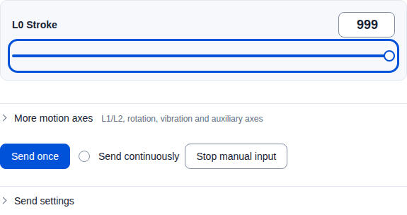

# First run

[简体中文](quick-start.md) | **English**

Connect one device first: use L0 for an OSR/TCode stroke, or V0 for an Intiface vibrator. Then choose VRChat/SPS, a funscript or manual control.

## 1. Start

For manual control or scripts, [open WebSensa](https://sealoong.github.io/Sensa/websensa/). Use desktop Chrome or Edge for serial or Bluetooth connections.

For **VRChat/OSC**, [download Sensa](https://github.com/SeaLoong/Sensa/releases/latest), extract a **Desktop** package and run it. The **CLI** package opens the same workbench in your browser and reports its address, usually **http://127.0.0.1:5086**. Use the address it actually reports.

Current Desktop/CLI builds are also available in [development previews](https://github.com/SeaLoong/Sensa/releases); Download opens the latest stable release. Choose **x64** for Intel/AMD or **ARM64** for Apple Silicon/Windows ARM. [All download formats and Linux setup](features.en.md#configuration-and-development)



[Narrow layout](screenshots/mobile/english-manual.png) · [More running examples](screenshots.en.md)

## 2. Add an output

1. Open **Control → Outputs**, choose an **Output type** and click **Add output**.
2. Enter your device's connection in **Output settings**:
   - **OSR / SR6 / TCode:** select serial and the port, or enter its network endpoint. Choose the device's axis profile.
   - **Intiface:** start Intiface Central and scan for your device. Enter its WebSocket address in Sensa. Use **Matching device name** under **Devices and features** to limit control to your device.
3. Click **Save output**, then **Enable** on the output card. Confirm that it connects.

For TCode, check direction and travel in **Settings → Axis profiles** before the first movement. For another device type, follow [output setup](signal-pipeline.en.md#add-outputs-and-bindings).

## 3. Enable input and inspect results

1. In **Control**, choose **Manual** and click **Apply input mode** if shown.
2. Turn on **Input enabled** in the header.
3. For OSR/TCode, move **L0** a small amount. For an Intiface vibrator, open **More motion axes** and adjust **V0** instead. In WebSensa, also enable **V0** under **Motion axes**. Click **Send once** and watch the device respond. **Send continuously** follows later slider changes.

The output card shows connection status and recent values. If nothing happens, check the selected device/port, output **Enable**, applied input mode and **Input enabled**.

Turn off **Input enabled** when finished. **Emergency stop** stops all outputs and stays active until cleared. Saving settings, changing input mode or replacing a script turns input off; enable it again when ready. Clearing emergency stop also leaves input off.

## 4. Choose sources and add computation

- **VRChat / SPS / OGB:** use the desktop edition and follow [the OGB/SPS steps](usage-scenarios.en.md#existing-ogb--sps). Select a preset, check received values and calibrate before enabling input.
- **Funscript:** choose **Script**, **Choose script**, then **Apply input mode** if shown. For a vibration-only Intiface device, set its **Vibration source** to **L0 · Depth to vibration**. Turn on **Input enabled** and press **Play**. [Player controls](websensa.en.md#manual-controls-and-scripts)
- **Manual:** keep using L0. Expand the additional axes when your device needs them.

Once this works, [computed signals](computed-signals.en.md) can mix inputs or smooth a response. [Protocol inputs](protocol-inputs.en.md) receive controls from websites and other players.

## 5. Save recordings and complete plans

[Recording and replay](signal-pipeline.en.md#record-and-inspect) can save your interaction as funscript. [Complete plans](signal-pipeline.en.md#save-and-reuse-a-complete-plan) save mappings, calculations, axis profiles and outputs together.

Browser settings are saved locally; download completed browser recordings before reloading or closing the page. [WebSensa connection details](websensa.en.md) · [Workbench map](guide.en.md)

## Run several instances

Opening the same desktop configuration again reuses its running service. For an independent setup, use a named instance:

```sh
Sensa --instance studio
Sensa --new-instance
```

Named configurations live in `instances/<name>/config.json` beside the original configuration. Read the current listening addresses in the console/workbench. `--config <path>` selects a configuration; `--open-browser false` runs the CLI in the background. [Configuration locations and runtime details](architecture.en.md)
