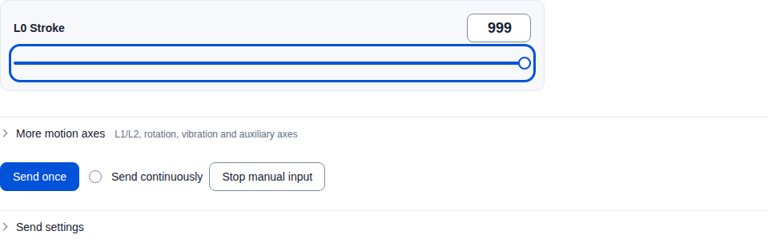

# First run

[简体中文](quick-start.md) | **English**

Follow the setup guide to choose a scene, connect one device and prepare an input. Use L0 for an OSR/TCode stroke, or V0 for an Intiface vibrator using its default source. [Which connection does my device use?](devices.en.md)

## 1. Start

For manual control or scripts, [open WebSensa](https://sealoong.github.io/Sensa/websensa/). Use desktop Chrome or Edge for serial or Bluetooth connections.

For **VRChat/OSC**, [download Sensa](https://github.com/SeaLoong/Sensa/releases/latest), extract a **Desktop** package and run it. The **CLI** package opens the same workbench in your browser and reports its address, usually **http://127.0.0.1:5086**. Use the address it actually reports.

Current Desktop/CLI builds are also available in [development previews](https://github.com/SeaLoong/Sensa/releases); Download opens the latest stable release. Choose **x64** for Intel/AMD or **ARM64** for Apple Silicon/Windows ARM. [All download formats and Linux setup](features.en.md#configuration-and-development)

Open **Guided tour** in the Input header. The desktop guide starts with OSC and an L0 example. You can choose another supported input. WebSensa defaults to manual.

**Save and exit** records your place. **Resume setup** returns to that step. To browse controls directly, use the input tabs.



[Narrow layout](screenshots/mobile/english-manual.png) · [More running examples](screenshots.en.md)

## 2. Prepare input in the highlighted controls

The guide follows **Choose a scene → Prepare input → Axis mappings → Axis profiles → Connect device → View logs → Review setup**. Each step gives an ordered checklist and highlights both the current sidebar tab (top navigation on narrow screens) and the live controls. Use **Tab / Shift+Tab** between the guide, navigation and controls; arrow-key navigation from the highlighted tab also changes the guide step. Mapping, transform and device-motion templates are on their own pages. Expand **Jump to step** for direct navigation. Longer instructions scroll separately while **Back / Next** and emergency stop remain available. Editors suspend the guide and closing them resumes it. **Escape** saves progress and leaves. **Diagnostics** opens with logs expanded on every visit; you can collapse them manually.

At step three, choose **Edit axis mappings** to work directly in the editor. Select a source type and parameter path or computed signal, choose the target axis, check the ranges and direction, and select **Save changes**. Continue to **Axis profiles** to set device travel and assign that profile in the output. Manual, script and protocol inputs can skip mapping when they already supply the required axes.

Prepare your source in **Input**. Opening a tab does not apply its input mode:

- **Manual:** check L0. For an Intiface vibrator using its default source, use V0 under **More motion axes**; WebSensa also requires V0 under **Motion axes**.
- **Script:** choose a `.funscript` file. For an Intiface vibrator, its output can use **L0 · depth to vibration** as the vibration source.
- **VRChat / SPS:** inspect received parameters and sources in **Input → OSC**. [OGB/SPS steps](usage-scenarios.en.md#existing-ogb--sps)
- **Website or software:** configure a source under **Input → Protocol**, then connect the upstream application. [Protocol inputs](protocol-inputs.en.md)

## 3. Choose mappings, transforms and axis profiles

Under **Mapping & transforms → Parameter to axis**, select a received OSC parameter, keep **Pass through** and **L0**, then select **Add to draft → Save changes**. Use 250 ms smoothing for jitter, or a 5% dead zone followed by smoothing for noise around zero. Expand **Customize processing steps** to append or remove operations. Select a calculation in the draft to edit its inputs and values. Other routes can reuse the same result.

- **VRChat / OSC mappings:** SPS depth, vibration, combined depth/vibration and other templates. Append or replace drafts, then check actual paths and ranges.
- **Transforms:** manual smoothing, manual/script mixing, a threshold switch or a slow wave. After loading a calculation, select its result in an axis mapping or output binding.
- **Device axis profiles:** TCode first-run short travel, OSR2/SR6, L0-only or V0-only. Review direction, travel and speed in the editor before saving.

**Save changes** saves axis mappings and calculations together; **Restore changes** restores both. Manual and script inputs can drive motion axes directly, so skip transforms when unnecessary. TCode profiles live on the separate **Axis profiles** page; select a saved profile on the output to use it. [Preset reference](presets.en.md)

## 4. Connect outputs, review and enable

1. At the guide's device step, click **Connect or configure a device**, or open **Outputs** directly. Choose **Output type → Add output**.
2. Configure the connection. **OSR/SR6/TCode:** select serial or network settings and a saved axis profile. **Intiface:** enter Central's WebSocket address and select the target with **Device and features → Matching device name**.
3. **Save output**, then **Enable** its card and confirm the connection. [Other output types](devices.en.md)
4. Return to **Input** and click **Apply input mode** when needed. The final guide step shows actual readiness; use **Prepare input** or **Connect device** beside an unfinished item to return to that step. Use **Edit axis mappings** for missing OSC mappings or **Continue later** to keep your place. When ready, **Finish tour** only records progress and does not enable input.
5. Turn on **Input enabled** separately when ready. For a first manual movement, make a small adjustment and **Send once**; for a script, press **Play**. Inspect connection state and recent values in **Outputs**.

Turn off **Input enabled** when finished. **Emergency stop** stops all outputs and stays latched until released. Saving configuration, changing mode or replacing a script turns input off; releasing emergency stop also requires explicit input activation. Calculations, mappings and output connections can be edited separately, and navigation preserves unfinished drafts.

## 5. Save recordings and complete plans

[Recording and replay](signal-pipeline.en.md#record-and-inspect) can save your interaction as funscript. [Complete plans](signal-pipeline.en.md#save-and-reuse-a-complete-plan) export saved mappings, calculations, axis profiles and outputs together. Save your edits first to include them.

Browser settings and guide progress are saved locally; download completed browser recordings before reloading or closing the page. [WebSensa connection details](websensa.en.md) · [Workbench map](guide.en.md) · [All guides](start.en.md)

## Run several instances

Opening the same desktop configuration again reuses its running service. For an independent setup, use a named instance:

```sh
Sensa --instance studio
Sensa --new-instance
```

Named configurations live in `instances/<name>/config.json` beside the original configuration. Read the current listening addresses in the console/workbench. `--config <path>` selects a configuration; `--open-browser false` runs the CLI in the background. [Configuration locations and runtime details](architecture.en.md)
