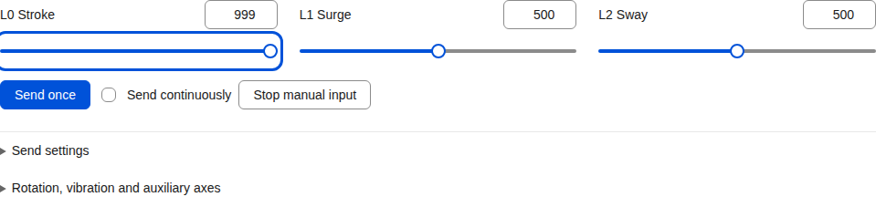

# First run

[简体中文](quick-start.md) | **English**

For controls and script playback straight from your browser, [open WebSensa](https://sealoong.github.io/Sensa/websensa/). For OSC, application routing, recording and the full device connections, start the desktop workbench below. WebSensa, the Node CLI and Electron share one workbench organized around sources, connections and results.

## 1. Start

[Download](https://github.com/SeaLoong/Sensa/releases/latest) the latest stable release. Node.js/Electron migration builds first reach [development previews](https://github.com/SeaLoong/Sensa/releases) after CI passes. The formats below include their runtime; no separate Node.js installation is needed.

| System and format | Architecture | Example filename | Start |
| --- | --- | --- | --- |
| Windows Electron desktop | x64/ARM64 | `Sensa-version-win-x64-Desktop.zip` | Extract the complete archive, then run `Sensa.exe` |
| Linux Electron desktop | x64/ARM64 | `Sensa-version-linux-x64-Desktop.tar.gz` | Extract the complete archive, then run `./Sensa` |
| macOS Electron desktop | x64/ARM64 | `Sensa-version-osx-arm64-Desktop.zip` | Extract the complete archive, then open `Sensa.app` |
| Windows CLI installer | x64/ARM64 | `Sensa-version-win-x64-Setup.exe` | Install, then launch from the Start menu |
| Windows CLI single file | x64/ARM64 | `Sensa-version-win-x64-SingleFile.exe` | Put the EXE in a writable folder and run it |
| Windows CLI portable | x64/ARM64 | `Sensa-version-win-x64.zip` | Extract the complete ZIP, then run `Sensa.exe` |
| Linux CLI portable | x64/ARM64 | `Sensa-version-linux-x64.tar.gz` | Extract, then run `./Sensa` |
| macOS CLI portable | x64/ARM64 | `Sensa-version-osx-arm64.tar.gz` | Extract, then run `./Sensa` |

Intel/AMD computers generally use **x64**; Apple Silicon and Windows ARM use **ARM64**. Development filenames also include a build number and commit.

On Ubuntu 24.04 with restricted user namespaces, run `python3 ./sensa-linux-sandbox.py install` from the Electron extraction directory before opening `./Sensa`. The helper uses sudo to register an AppArmor permission for that exact executable path; Chromium's sandbox stays enabled and Sensa runs as your ordinary user. Run `python3 ./sensa-linux-sandbox.py remove` before moving or deleting the directory, then register the new location. Other Linux configurations and the CLI do not need this step.

Electron opens the workbench in its own window and coordinates the same bundled Node CLI service. The CLI opens it in your browser. The usual CLI address is **http://127.0.0.1:5086**; use the actual address reported at startup when ports change. Input starts off so you can prepare the first connection.

The Windows CLI installer uses `%LOCALAPPDATA%\Programs\Sensa`; updates and uninstall retain user configuration and recordings. CLI portable archives, installers and Electron packages include documentation and Python bridge tools. The single EXE embeds the workbench, [parameter explorer](http://127.0.0.1:5086/docs/parameter-geometry.html) and serial/MIDI dependencies. Prepare a Python environment separately when using the bridges. [Serial and Bluetooth bridges](../tools/protocol-bridge/README.md)



English interface · [Narrow layout](screenshots/mobile/english-manual.png) · [More running examples](screenshots.en.md)

## 2. Add an output

Recording a slider is a useful first flow:

1. In **Flow**, choose **Add output → Recording** and keep **Funscript**.
2. Open **Input-to-output bindings**, choose **Manual → L0**, name the track `L0` and use input/output ranges **0–1**.
3. Save and enable the recording output.

Or choose a connected destination:

| Destination | Connection |
| --- | --- |
| TCode / OSR | Serial at 115200/8N1, or a UDP/TCP endpoint; select an axis profile |
| Intiface | Start Central, enter its address, scan and select a device |
| OSC / VRChat | Receiver IP/port, parameter path and Float/Int/Bool type |
| DG-LAB | DG-LAB 4 APP pairing, device and channel |
| MIDI / network service | MIDI port, HTTP/WebSocket URL or MQTT broker/topic |

A binding connects a source to a destination. Its input range describes the source reading; its output range describes the destination response. [Complete output setup](signal-pipeline.en.md#add-outputs-and-bindings)

## 3. Enable input and inspect results

In **Control**, choose **Manual**, apply the mode and enable input. Adjust L0 and choose **Send once**, or enable **Live updates** to follow edits. Each binding displays its raw reading, converted value and recent target.

Disable input to finish the recording. Download the funscript or load it into the player, choose **Script**, enable input and press **Play**. Natural completion retains the final value and input activation. Stop, input disable and emergency stop perform their respective stop operations; other sources in Combined mode continue according to their own state.

For a motion device, set direction and travel in its axis profile and try a small movement first. The header's **Emergency stop** stops every output and remains active until cleared. Saving configuration or changing mode/scripts switches input off; enable it after preparing the new setup.

## 4. Choose sources and add computation

| Source | Next step |
| --- | --- |
| OSC parameter | Choose OSC or Combined; inspect the sender/source and save a mapping |
| Funscript | Load the file, choose Script, then set speed, loop and position |
| Website/player | Add a [protocol input](protocol-inputs.en.md), connect the client and choose Protocol or Combined |
| Several sources | Add calculations and bindings, then choose Combined |
| Avatar position | Follow [tracking setup](usage-scenarios.en.md), inspect the readings and calibrate the range |

VRChat commonly sends OSC to Sensa on **9001** and receives write-back/heartbeat on **9000**. [Parameter meanings](osc-parameters.en.md) and [presets](presets.en.md) help select the right readings.

In **Flow**, choose **Add computed signal** for weighting, smoothing, thresholds or spatial calculations. Save the result once and select it in several outputs. [Examples](computed-signals.en.md)

## 5. Save recordings and complete plans

Completed recordings can be downloaded, played or used as calculation inputs. Funscript stores trajectories; JSON Lines/CSV store diagnostic samples. [Recording and replay](signal-pipeline.en.md#record-and-inspect)

In **Flow → Save and load a complete plan**, export calculations, mappings, axis profiles and outputs together. The import preview shows what will be replaced before applying it.

The CLI defaults to `config.json` beside its executable, or the current working directory during source development. Electron defaults to `Sensa/config.json` under the user application-data directory. `SENSA_CONFIG_PATH` or `--config <path>` selects a shared file for either host. Existing PascalCase and camelCase properties are accepted; saves use canonical camelCase. Recording outputs default to `recordings` beside the selected configuration. [Workbench guide](guide.en.md) · [Language preferences](languages.en.md)

## Run several instances

Opening the same configuration again from the CLI or Electron reuses its running service. If a workbench page is already connected, Sensa keeps that page; otherwise it opens the workbench.

Use named instances for independent setups:

```sh
Sensa --instance studio
Sensa --instance portable
Sensa --new-instance
```

Named configurations live under `instances/<name>/config.json` beside the original configuration. A new instance starts with a fresh setup. `--new-instance` chooses a unique name. Management HTTP, OSC reception and startup protocol listeners use available ports when the preferred ports are occupied; read the console/workbench for their current addresses. Manually saving an occupied listener still reports the conflict so you can choose its intended endpoint.

For a background CLI service, pass `--open-browser false`. Use `--config <path>` to share a configuration and running instance between CLI and Electron.
