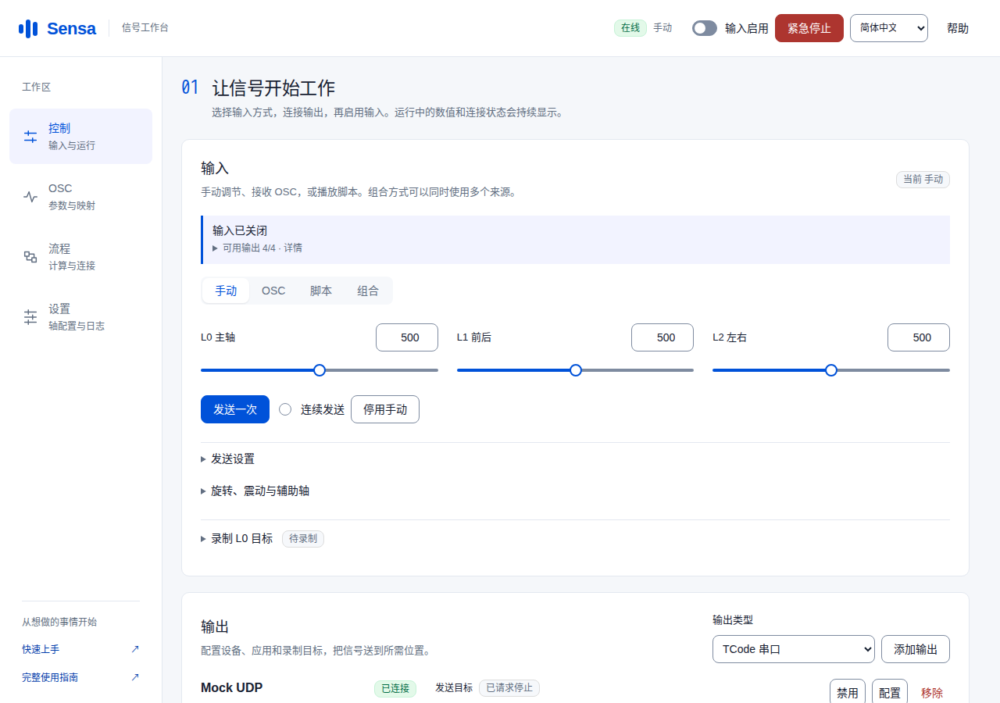

# 首次使用

**简体中文** | [English](quick-start.en.md)

先连接一个设备：OSR／TCode 用 L0 测试主轴动作，Intiface 振动设备用 V0。成功后，再选择 VRChat／SPS、funscript 或手动控制。

## 1. 启动

手动控制或播放脚本时，[打开 WebSensa](https://sealoong.github.io/Sensa/websensa/)。连接串口或蓝牙设备时，建议使用桌面 Chrome 或 Edge。

使用 **VRChat／OSC** 时，[下载 Sensa](https://github.com/SeaLoong/Sensa/releases/latest)，解压 **Desktop** 包并运行。**CLI** 包会在浏览器打开同一工作台并显示地址，通常是 **http://127.0.0.1:5086**；以启动时显示的实际地址为准。

[开发预览](https://github.com/SeaLoong/Sensa/releases)也提供当前 Desktop／CLI 构建，下载入口打开最新正式版。Intel／AMD 电脑选择 **x64**，Apple Silicon／Windows ARM 选择 **ARM64**。[全部下载格式与 Linux 设置](features.md#配置与开发)



[窄屏界面](screenshots/mobile/control-page.png) · [更多运行画面](screenshots.md)

## 2. 配置输出

1. 打开**控制 → 输出**，选择**输出类型**，点击**添加输出**。
2. 在**输出设置**中填写设备连接：
   - **OSR／SR6／TCode：**选择串口和端口，或填写网络地址，再选择设备的轴配置。
   - **Intiface：**启动 Intiface Central 并扫描设备，在 Sensa 填写它的 WebSocket 地址。在**设备与功能 → 匹配设备名称**中填写设备名，将控制限定到所需设备。
3. 点击**保存输出**，再点击输出卡片上的**启用**，确认连接成功。

使用 TCode 时，先在**设置 → 轴配置**检查方向与行程。其他设备请参阅[输出配置](signal-pipeline.md#添加输出与绑定)。

## 3. 启用输入并检查结果

1. 在**控制**中选择**手动**；如果显示**应用输入方式**，点击它。
2. 打开顶栏的**输入启用**。
3. OSR／TCode 小幅调整 **L0**；Intiface 振动设备则展开**更多动作轴**，调整 **V0**。WebSensa 中还需在**输出动作轴**中勾选 **V0**。点击**发送一次**，观察设备响应。**连续发送**会跟随之后的滑条调整。

输出卡片显示连接状态与最近数值。如果没有动作，检查设备／端口、输出**启用**、当前应用的输入方式和**输入启用**。

结束时关闭**输入启用**。**紧急停止**会停止所有输出，并保持到手动解除。保存设置、切换输入方式或更换脚本后，输入会关闭，准备好再重新启用；解除急停后也需要单独启用输入。

## 4. 选择来源并添加计算

- **VRChat／SPS／OGB：**使用桌面版，跟随 [OGB／SPS 步骤](usage-scenarios.md#已有-ogb--sps)。选择预设，检查收到的数值并校准，再启用输入。
- **Funscript：**选择**脚本**和**选择脚本**；如果显示**应用输入方式**，点击它。Intiface 纯振动设备先将输出的**振动来源**设为 **L0 · 深度转振动**，再打开**输入启用**并点击**播放**。[播放器操作](websensa.md#手动控制与脚本)
- **手动：**继续使用 L0，设备需要时再展开其他轴。

连接成功后，可以使用[计算信号](computed-signals.md)混合输入或平滑响应。[协议输入](protocol-inputs.md)可接收网站与其他播放器的控制。

## 5. 保存录制与整套方案

[录制与回放](signal-pipeline.md#录制与观察)可以将交互保存为 funscript。[整套方案](signal-pipeline.md#保存与复用整套方案)一起保存映射、计算、轴配置和输出。

浏览器设置保存在本地；关闭或刷新网页前，请下载已完成的浏览器录制。[WebSensa 连接说明](websensa.md) · [工作台地图](guide.md)

## 运行多个实例

再次打开同一桌面配置会复用已经运行的服务。需要独立设置时，使用命名实例：

```sh
Sensa --instance studio
Sensa --new-instance
```

命名配置保存在原配置旁的 `instances/<name>/config.json`。当前监听地址可在控制台／工作台查看。`--config <path>` 指定配置文件，`--open-browser false` 让 CLI 在后台运行。[配置位置与运行说明](architecture.md)
