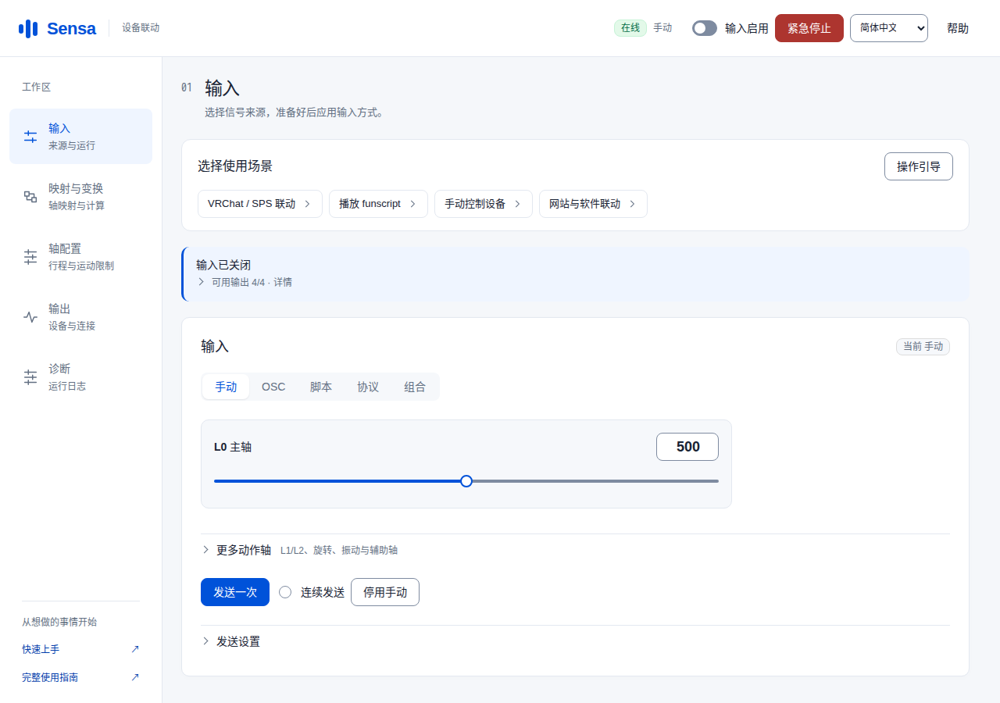

# 首次使用

**简体中文** | [English](quick-start.en.md)

跟随设置向导选择场景、连接一个设备并准备输入。OSR／TCode 往复动作使用 L0，使用默认振动来源的 Intiface 设备使用 V0。[我的设备使用哪种连接？](devices.md)

## 1. 启动

手动控制或播放脚本时，[打开 WebSensa](https://sealoong.github.io/Sensa/websensa/)。连接串口或蓝牙设备时，建议使用桌面 Chrome 或 Edge。

使用 **VRChat／OSC** 时，[下载 Sensa](https://github.com/SeaLoong/Sensa/releases/latest)，解压 **Desktop** 包并运行。**CLI** 包会在浏览器打开同一工作台并显示地址，通常是 **http://127.0.0.1:5086**；以启动时显示的实际地址为准。

[开发预览](https://github.com/SeaLoong/Sensa/releases)也提供当前 Desktop／CLI 构建，下载入口打开最新正式版。Intel／AMD 电脑选择 **x64**，Apple Silicon／Windows ARM 选择 **ARM64**。[全部下载格式与 Linux 设置](features.md#配置与开发)

点击**开始设置向导**，选择**VRChat / SPS 联动**、**播放 funscript**或**手动控制设备**等需要的场景，再继续。WebSensa 会显示浏览器运行方式支持的场景。

之后可以通过**操作引导**打开向导。**保存并退出**会保留当前位置，**继续设置**会返回向导。场景快捷入口可以直接打开对应控制。



[窄屏界面](screenshots/mobile/control-page.png) · [更多运行画面](screenshots.md)

## 2. 跟随高亮区域准备输入

向导按照**选择场景 → 准备输入 → 映射与变换 → 轴配置 → 连接设备 → 检查并完成**前进。每步自动打开对应页面，高亮真实控件并变暗其余区域；可以直接操作高亮控件，用 **Tab／Shift+Tab** 在引导和高亮控件之间前后移动。映射步骤按场景定位：OSC 高亮映射预设，手动、脚本和协议场景高亮第一个常用变换示例，可点**场景预设**查看全部变换。需要跳步时展开**跳转步骤**。说明较长时只滚动说明区，**上一步／下一步**和急停始终保留。打开编辑器会暂停引导，关闭后继续；按 **Escape** 可以保存进度退出。

在**输入**准备所选场景；打开页签本身不会应用输入方式：

- **手动**：检查 L0。Intiface 振动设备使用默认来源时，在**更多动作轴**中使用 V0；WebSensa 还需在**输出动作轴**中勾选 V0。
- **脚本**：点击**选择脚本**，载入 `.funscript`。Intiface 纯振动设备可将输出的**振动来源**设为 **L0 · 深度转振动**。
- **VRChat／SPS**：在**输入 → OSC**检查参数接收与来源。[OGB／SPS 步骤](usage-scenarios.md#已有-ogb--sps)
- **网站或软件**：在**输入 → 协议**配置来源，让上游应用连接。[协议输入步骤](protocol-inputs.md)

## 3. 选择映射、变换与轴配置

**映射与变换**分为**轴映射**和**计算信号**两个页签。打开**场景预设**，按用途选择卡片：

- **VRChat / OSC 映射**：选择 SPS 深度、振动或深度＋振动等模板，追加／替换草稿，检查实际路径与量程。
- **常用变换**：手动平滑、手动与脚本混合、阈值开关或缓慢往复节奏。载入后仍需选择计算结果的目标映射或输出绑定。
- **设备轴配置**：为 TCode 选择首次测试小行程、OSR2／SR6、仅 L0 或仅 V0 等配置，在编辑器检查方向、行程与速度后保存。

**保存更改**一起保存轴映射与计算信号草稿，**恢复更改**一起恢复两者。手动与脚本可以直接使用动作轴；无需变换时可跳过。TCode 轴配置在独立的**轴配置**页管理，保存后还需在输出上选择使用。[预设参考](presets.md)

## 4. 连接输出、检查并启用

1. 在向导的连接设备步骤点击**连接或配置设备**，或直接打开**输出**。选择**输出类型 → 添加输出**。
2. 在**输出设置**填写连接。**OSR／SR6／TCode**：选择串口或网络地址和保存的轴配置；**Intiface**：填写 Central 的 WebSocket 地址，在**设备与功能 → 匹配设备名称**限定目标设备。
3. 点击**保存输出**，再**启用**输出卡片，确认连接成功。[其他输出类型](devices.md)
4. 回到**输入**，需要时点击**应用输入方式**。向导最后一步显示实际准备状态；**完成引导**只记录进度，不启用输入。
5. 准备好后单独打开顶栏的**输入启用**。首次手动动作小幅调整滑条并**发送一次**；脚本则点击**播放**。到**输出**查看设备状态与最近数值。

结束时关闭**输入启用**。**紧急停止**会停止所有输出，并保持到手动解除。保存配置、切换输入方式或更换脚本后，输入会关闭；解除急停后也需单独启用输入。计算、映射和输出连接可以分别编辑，跨页切换保留未保存草稿。

## 5. 保存录制与整套方案

[录制与回放](signal-pipeline.md#录制与观察)可以将交互保存为 funscript。[整套方案](signal-pipeline.md#保存与复用整套方案)一起导出已保存的映射、计算、轴配置和输出，需要包含最新编辑时先保存更改。

浏览器设置与向导进度保存在本地；关闭或刷新网页前，请下载已完成的浏览器录制。[WebSensa 连接说明](websensa.md) · [工作台地图](guide.md) · [全部指南](start.md)

## 运行多个实例

再次打开同一桌面配置会复用已经运行的服务。需要独立设置时，使用命名实例：

```sh
Sensa --instance studio
Sensa --new-instance
```

命名配置保存在原配置旁的 `instances/<name>/config.json`。当前监听地址可在控制台／工作台查看。`--config <path>` 指定配置文件，`--open-browser false` 让 CLI 在后台运行。[配置位置与运行说明](architecture.md)
