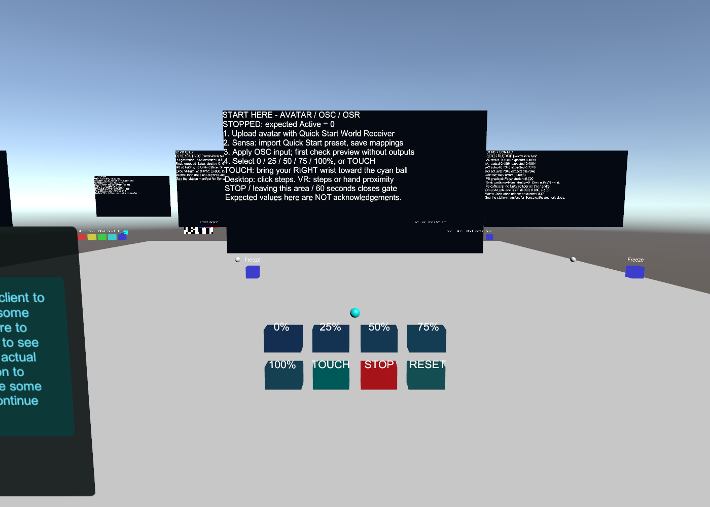

# 第一次用 OSR 和 Sensa

**简体中文** | [English](quick-start.en.md)

你需要支持 TCode 的设备、对应的连接线或网络配置、运行 PC VRChat 的电脑，以及能重新上传的 Avatar。Sensa 不负责刷写或校准设备固件。串口目前固定为 **115200、8N1**；请先核对设备说明。不能保证任意标为 OSR 的固件都直接兼容。

## 先选你要做的事

已有 FullFlow 测试 Avatar 和测试世界时，直接按 [三端联动路线](lab-workflow.md) 依次验证 QuickStart、PB、原生 SPS，再考虑定位和 Shader。

| 我想做什么 | Avatar 上需要什么 | Sensa 选什么 |
| --- | --- | --- |
| 第一次确认整个链路可用 | 新增 **Quick Start World Receiver** | **入门 · 测试世界 → 我的 Avatar** |
| 日常使用已安装的 SPS | 原生 SPS 的 OSC/Haptics 参数；通常不需要 Sensa 组件 | 对应 Socket/Plug、自身/他人的 SPS 预设 |
| 本地骨骼或可抓取 PB 定位 | Local Bone or PB Probe，或自动配置能力 | 本地点/PB 预设，并校准量程 |
| 调查位置、配对姿态、Shader | 参见 Unity 进阶文档 | 对应诊断，不是首次使用必需项 |

**Automatic SPS Setup 的默认 Root 只做位置诊断，不会自动给出准确行程。** 首次测试组件只验证链路，不会把任意 Avatar 自动改造成 SPS Avatar。

## 1. 下载并打开软件

到 [Releases](https://github.com/SeaLoong/Sensa/releases) 下载对应平台的 Sensa 包。多数 Windows 电脑选择 `win-x64.zip`。完整解压，运行 `Sensa.exe`，浏览器打开 `http://127.0.0.1:5086`。不要在压缩包内直接运行。暂时不添加设备输出。

同时下载 `top.sealoong.sensa-*.zip`，它是 Unity 包，不是应用程序。

## 2. 给 Avatar 添加入门组件

1. 在 Creator Companion 的 **Avatars** 项目中打开自己的 Avatar，确认它是 Humanoid，右手骨骼映射正确。
2. 安装 Modular Avatar（附带 NDMF）。下载的 Sensa 包解压到项目 `Packages/top.sealoong.sensa`，确认该目录直接包含 `package.json`。不要多套一层同名目录。此入门测试不需要 VRCFury、SPS、摄像机或其他玩家安装组件。
3. 选中含 Avatar Descriptor 的 Avatar 根物件，**Add Component → Sensa → Quick Start World Receiver**。只加一个，没有要手调的位置或参数。
4. 使用 VRChat SDK Build & Publish，设为 **Private**。进入 VRChat 后切换到刚上传的版本。

上传时会在右手骨骼原点自动生成两个本地 Contact：深度 Float、激活 Bool，并自动合并对应 FX 参数控制器。参数不联网、默认 0、不保存；不增加网络参数位。半径随 Avatar 视点高度计算，世界侧跟随当前身高。这个右手原点通常在手腕，触球时不要只用指尖。

测试 Avatar 项目已经提供 `Assets/SensaAvatarLab/Capabilities/QuickStart.unity`：它就是底模加上述组件。要用同一个 Avatar 验证后续 PB、SPS、定位和可选 Shader，请优先打开 **`Assets/SensaAvatarLab/Generated/FullFlow.unity`**，入门接收器也已经装好；操作顺序见 [FullFlow 指南](../tools/unity-avatar-lab/FULL-FLOW.md)。不要把模型资源复制到 Sensa 发布包。

## 3. 先验证 Avatar → Sensa

1. VRChat 快捷菜单打开 **OSC → Enabled**。允许 Avatar Dynamics/Contacts。
2. Sensa 开启 OSC 接收并保存。常规本机 VRChat 输出到 UDP **9001**；不要同时让别的软件抢占该端口。使用自定义端口时两端一致。
3. 选择 OSC 输入，点击 **应用输入方式**。只切到 OSC 页签不会切换运行模式。
4. 在预设中导入 **入门 · 测试世界 → 我的 Avatar**。首次测试只保留它的两条映射，移除或停用其他运动/门控映射，再点击 **保存并应用映射**。导入草稿不等于生效。
5. 测试世界打开 `Assets/SensaLab/Functional/FunctionalLab.unity`，使用 SDK 本地 Build & Test 或进入自己私有上传的版本。出生点旁的 **00 START HERE** 就是新手操作台。当前没有公共测试世界链接。
6. 点击 0%、25%、50%、75%、100%。在 Sensa 参数工作台搜索 `Sensa/QuickStart`，核对下表。先保持输出列表为空；查看运行目标时可打开输入开关，空输出不会驱动设备。

| 操作 | 实际 OSC 应看到 | 逻辑 L0 预览 |
| --- | --- | --- |
| 进入世界，尚未按按钮 | Active=0；Depth 可能尚未发送 | 门控关闭 |
| 0 / 25 / 50 / 75 / 100% | Active=1；Depth≈0 / .25 / .5 / .75 / 1 | 约 0 / 25 / 50 / 75 / 100% |
| TOUCH | Active=1；右手腕接近青色球时 Depth 上升 | 跟随距离变化 |
| STOP、离台超过 3 米、60 秒到期、换 Avatar | Active 回到 0（客户端发包后） | 门控关闭、停止发送 |

阶梯按钮通过移动世界 Contact Sender 产生受控输入；TOUCH 才是自由移动距离试验。球可抓取，RESET 放回原位并停止。桌面用户用鼠标点按钮即可，不需要 VR 手柄。测试选择只在本地生效，不广播给其他玩家。

世界显示 **Expected**（预期），不能证明 Avatar 已安装组件、OSC 已到达或 OSR 已到位。必须与 Sensa 实际接收值对照。动画更新顺序可能导致过渡一帧波动；正常静止点应在约 1% 内。特殊骨骼缩放、视点配置或客户端差异仍需实测；不要用错误预期值校准硬件。

## 4. 再连接 OSR

1. 关闭输入，创建轴配置，选择 **OSR 首次测试 · L0 小行程**。它只发送 L0，其他轴忽略；逻辑 0–100% 映射到 TCode **400–600**，速度上限 100。按设备已校准的中位、行程和固件速度解释检查这些值；这是模板，不是适用于所有机械装置的保证。
2. 添加 **TCode 串口** 输出，选择实际设备的 COM 端口，把输出绑定到刚创建的轴配置。网络固件则用对应 TCode UDP/TCP 输出和设备地址、端口，不要猜测。
3. 保存、连接后，确认选择正确输入和映射，再打开输入开关。连接本身不会主动开始动作，但输入若已经开启且门控有效，连接后就可能开始输出。
4. 在世界选择 0→25→50→75→100%。该模板的输出目标应约为 **400、450、500、550、600**，允许取整差 1；不会把 100% 当成完整硬件行程。输出卡显示发送目标，并不测量机械当前位置。
5. 点击世界 STOP，确认 Sensa 门控关闭；再关闭输入。停止不会自动回中或切断硬件电源。忽略的轴也不会自动回中；需要其他轴时先按设备要求设置姿态。

默认不启用输入超时，因为 VRChat 使用变化时发送的 OSC，静止阶梯可能没有新包。世界自动停止依赖 VRChat 正常发出 Active=0，不能替代设备固件的超时保护、Sensa 停止按钮或物理断电。异常退出客户端可能丢失最后一包，试用结束应主动关闭输入。

## 5. 换成日常 SPS

入门台通过后，停止输入，换成 [SPS 对应预设](presets.md)，去掉 Quick Start 的门控映射。确认原生 SPS haptics/OSC 已启用；已有 Avatar 的实现可能需要将 **OGB_ENABLED** 设为 true。测试 Avatar 的 SPS 场景提供 **Enable SPS OSC (local)** 菜单，普通 Avatar 不一定有这个菜单，要检查它实际生成的参数。

在参数工作台定位实际 Socket/Plug 的路径，优先固定一个实例和来源。新式 NewRoot/NewTip 的测量和旧 PenOthers 都不是任意姿态下完整的三维行程真值；偏离轴线时仍有局限。只有需要额外定位、PB 或配对姿态时，再安装相应 Sensa 组件。Quick Start 组件可删除后重新上传，不影响原生 SPS。

## 遇到问题

| 现象 | 检查 |
| --- | --- |
| 世界数值在变，Sensa 没有 QuickStart 参数 | 是否上传并穿戴新 Avatar；OSC 是否启用；接收端口是否被占用；Avatar Contacts 是否启用 |
| 有 Depth 没有 Active | 两个接收器是否均生成；是否测试会话已到期；是否仍保留其他预设的门控 |
| OSC 有值、运行目标不变 | 是否应用 OSC 输入方式、保存映射、打开输入；是否固定了错误来源 |
| 运行目标变，输出卡为空 | 是否绑定正确轴配置、启用并连接输出；查看日志 |
| 串口打不开 | 端口是否正确、其他程序是否占用、驱动/系统权限、固件是否支持 115200 TCode |
| 输出卡有值，硬件不动 | 卡片只证明本机传输；核对固件协议、供电和硬件校准 |
| 静止时意外停止 | 是否启用了输入超时；是否超过操作台 60 秒期限 |
| 切到 SPS 后一直门控关闭 | 删除首次测试的 Active 门控；确认 SPS 实际参数和启用状态 |

Contact 的世界与 Avatar 交互、Proximity/Constant 的含义见 [VRChat 官方 Contacts 文档](https://creators.vrchat.com/common-components/contacts/)。日常 SPS 设置见 [VRCFury 官方说明](https://vrcfury.com/sps/)。
