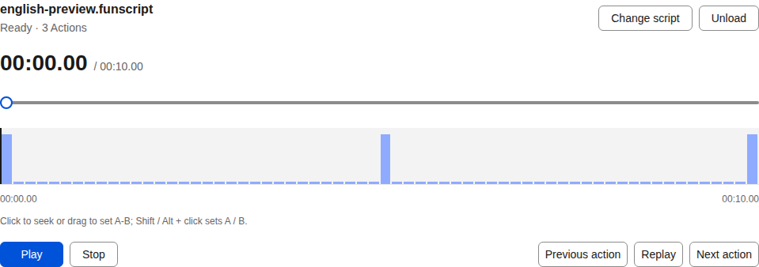
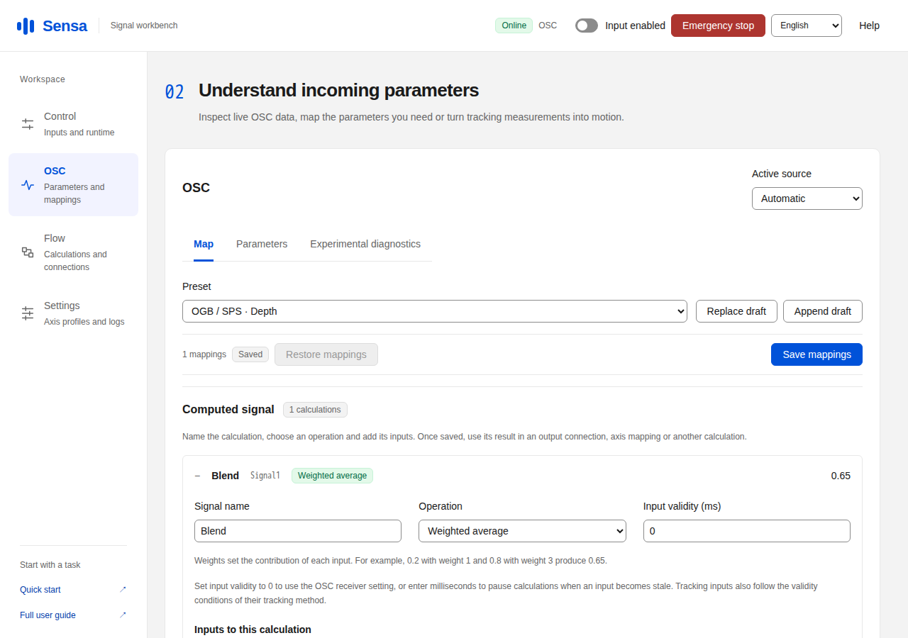
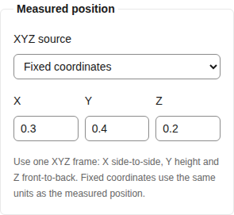
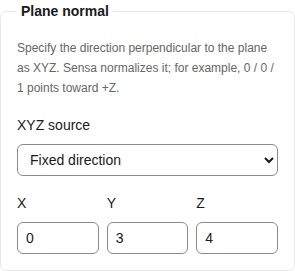

# Sensa in use

[简体中文](screenshots.md) | **English**

These images were captured from Sensa running in Chromium in [GitHub Actions](https://github.com/SeaLoong/Sensa/actions/runs/40035585736/attempts/1). Desktop uses a 1280 × 900 viewport; narrow uses 390 × 844. Device connections use isolated simulated transports. Each image retains its original capture bytes. Some captures show a single panel.

[The homepage gallery](https://sealoong.github.io/Sensa/#screenshots) switches between scenarios and screen widths. [Capture manifest](screenshots/catalog.json) records source commit, run, attempt and image SHA-256.

## Manual control

The Control page brings together input mode, runtime state and sliders.

English interface · [Open narrow layout](screenshots/mobile/english-manual.png)

## OSC parameters

Inspect received parameters, current values and sources, then use them in a calculation or mapping. The narrow table scrolls horizontally.

Chinese interface · [Open narrow layout](screenshots/mobile/osc-parameters.png)

## Funscript playback

After importing a funscript, seek, play, pause or loop it. The capture shows a loaded script.

[Open narrow layout](screenshots/mobile/english-script-loaded.png)

## Weighted calculation

Name the calculation, choose weighted average, and set each input’s path and weight. Values 0.2 and 0.8 with weights 1:3 produce 0.65.

[Open narrow layout](screenshots/mobile/computed-signal-settings-en-US.png)

## Spatial calculations

Set XYZ together, choosing the measured position, plane reference point and direction to calculate depth, lateral offset or angles. These captures show the position and plane-normal input groups. [Configuration examples](computed-signals.en.md#combine-root-coordinates)

[Narrow position controls](screenshots/mobile/computed-plane-point-en-US.png)

[Narrow direction controls](screenshots/mobile/computed-plane-direction-en-US.png)

## Combined inputs

Use manual controls, OSC and scripts together, choosing their sources in calculations or output connections.

[Open narrow layout](screenshots/mobile/combined-input-en-US.png)

## Position measurements

Sensa offers SPS four-anchor tracking, Contact direct tracking and Shader capture. The following captures show received measurements in the WebUI. [Choose a tracking method](positioning.en.md).

### SPS four-anchor tracking

Chinese interface · [Open narrow layout](screenshots/mobile/fixed-root-position.png)

### Contact direct tracking

Chinese interface · [Open narrow layout](screenshots/mobile/contact-root-position.png)

### Shader capture

Chinese interface · [Open narrow layout](screenshots/mobile/shader-root-position.png)

These are WebUI captures of received test measurements. Unity Editor and VRChat client images will be added after those environments can execute the matching scenes.
