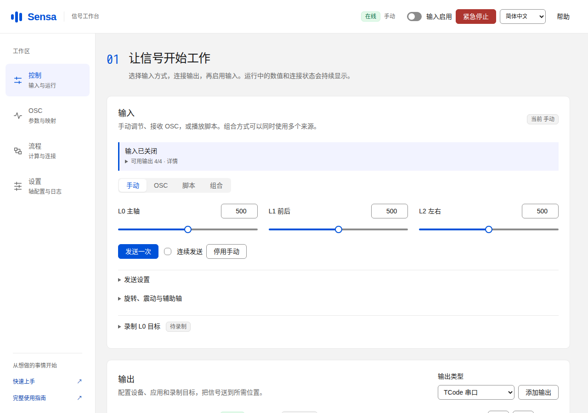
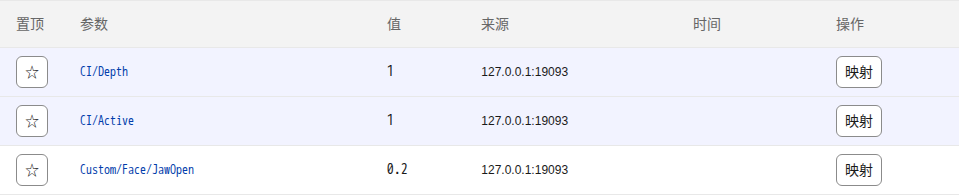
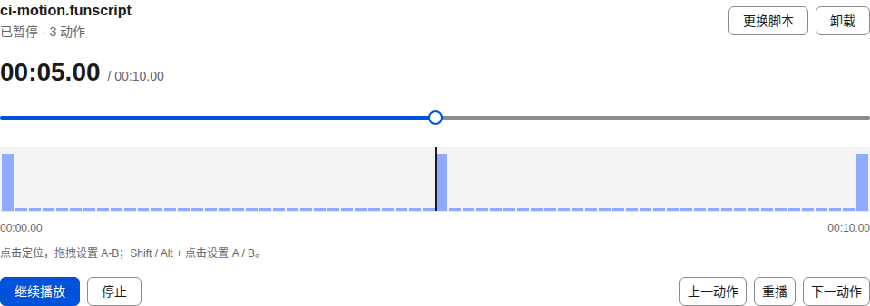
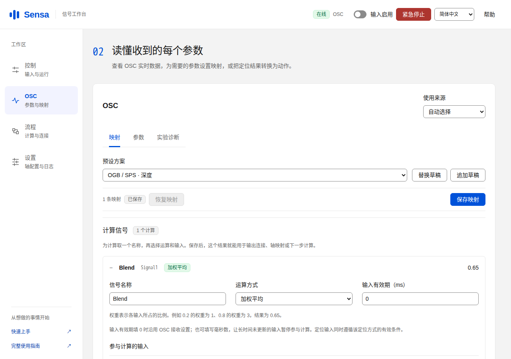
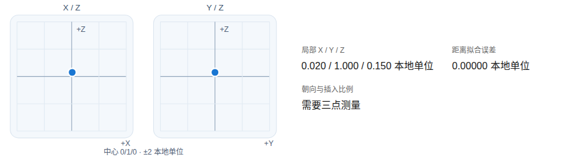
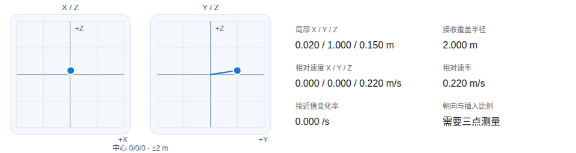
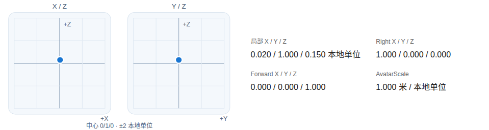

# 运行界面

**简体中文** | [English](screenshots.en.md)

这些图片来自 [GitHub Actions](https://github.com/SeaLoong/Sensa/actions/runs/40015184919/attempts/1) 中实际运行的 Sensa 与 Chromium。桌面视口为1280 × 900，窄屏为390 × 844；设备连接使用隔离的模拟传输。图片保留采集时的原始内容，部分展示单个功能面板。

[首页图库](https://sealoong.github.io/Sensa/#screenshots)可切换场景和屏幕宽度。[采集清单](screenshots/catalog.json)记录源码提交、运行编号、attempt与每张图片的SHA-256。

## 手动调节

控制页集中显示输入方式、实时状态和滑条。

[查看窄屏界面](screenshots/mobile/control-page.png)

## OSC 参数

查看收到的参数、当前值和来源，再把需要的参数用于计算或映射。窄屏可横向滚动表格。

[查看窄屏界面](screenshots/mobile/osc-parameters.png)

## 脚本播放

导入 funscript 后，可定位、播放、暂停和循环。图中是实际加载后的播放器。

[查看窄屏界面](screenshots/mobile/script-paused-keyframe.png)

## 加权计算

给计算命名，选择加权平均，并为每项输入填写路径和权重。例子中0.2与0.8按1∶3得到0.65。

[查看窄屏界面](screenshots/mobile/computed-signal-settings-zh-CN.png)

## 组合输入

同时使用手动、OSC和脚本，在计算或输出连接中选择各自来源。

[查看窄屏界面](screenshots/mobile/combined-input-zh-CN.png)

## 定位读数

Sensa 提供 SPS 四点定位、Contact 直接定位和 Shader 捕获。下面展示 WebUI 接收测量后的读数面板。[选择定位方案](positioning.md)。

### SPS 四点定位

[查看窄屏界面](screenshots/mobile/fixed-root-position.png)

### Contact 直接定位

[查看窄屏界面](screenshots/mobile/contact-root-position.png)

### Shader 捕获

[查看窄屏界面](screenshots/mobile/shader-root-position.png)

这些图片展示测试测量数据在 WebUI 中的呈现。Unity Editor 与 VRChat 客户端的运行画面将在对应场景实际执行后补充。
