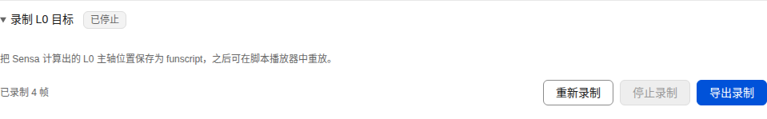

# Inputs, computation and outputs

[简体中文](signal-pipeline.md) | **English**

In Flow, choose sources, add calculations when needed and connect outputs. A simple flow uses a source directly; a complex flow saves named results for reuse. An output binding connects a source to a destination, with its own range and sending mode.

| Task | Start here |
| --- | --- |
| Try a complete flow | [Record a manual track](#record-a-manual-track-first) |
| Choose sources or calculations | [Sources and computation](#choose-sources-and-computation) |
| Connect a device or application | [Output setup](#add-outputs-and-bindings) |
| Drive several destinations | [Multiple-output example](#one-result-several-outputs) |
| Download and reuse a trajectory | [Recording and replay](#record-and-inspect) |
| Save the setup | [Complete plans](#save-and-reuse-a-complete-plan) |

```text
Input: OSC/tracking, manual, script, feedback or replay
                         ↓
Computation: blend, smooth, trigger or convert as needed
                         ↓
Output: device, OSC parameter, application or recording
```

For example, combine two touch regions into “contact intensity,” then use it for vibration, a DG-LAB channel and Avatar glow. Each output interprets the result in its own range. [Computed signals](computed-signals.en.md) · [Workbench guide](guide.en.md)


[Narrow layout](screenshots/mobile/combined-input-en-US.png) · [More running examples](screenshots.en.md)

## Record a manual track first

1. Open Flow, add a Recording output and keep its default Funscript format.
2. Choose Manual → L0 for the binding, set track name `L0` and both input/output ranges to 0–1, then Save output.
3. Enable the output and confirm its connection. In Control, apply Manual, enable input, adjust L0 and send once. Repeated adjustments create a changing trajectory.
4. Disable input to complete the segment, then download it or load it into the script player. Loading leaves playback paused; apply Script and enable input before playing.

This flow demonstrates source, conversion, output and replay. Next, choose an OSC value or calculation as its source, or add other outputs for the same result.

## Choose sources and computation

Manual, OSC and Script retain their quick input modes; Combined lets several kinds of source contribute to output bindings. Prepare and save the setup, apply the required input mode, then enable input.

| Source | Available reading | Example use |
| --- | --- | --- |
| OSC parameter | A value with an explicit path and source | Touch intensity, switch or mode |
| Tracking measurement | Valid position, distance, pose, velocity or Shader axes/scale | Root separation or local movement speed |
| Manual | Current manual-axis setting | An adjustable overall intensity |
| Script | Current script trajectory and playback metrics | Base rhythm or movement trajectory |
| Device feedback | State and readings provided by connected outputs | DG-LAB APP action, device intensity or pressure |
| Recording replay | A loaded funscript track or diagnostic signal | Reproduce an interaction and refine its processing |
| Constant/computed signal | A fixed value or saved named result | Scale factor or an intermediate result shared by outputs |

Shader direction and scale can participate as tracking metrics: choose Tracking measurement (SensaPoint) in a calculation or output binding, then select RightX/Y/Z, ForwardX/Y/Z or AvatarScale. These metrics update with complete measurement packets and retain spatial-input permission and validity checks. Use the OSC parameter page to inspect raw reports.

Give a calculation a recognizable name, such as Contact intensity, then select it in any output binding. Position, velocity and intensity use ranges matching their meaning; each binding converts the result into the destination's required range. [Calculation examples](computed-signals.en.md) · [Tracking units](positioning.en.md)

## Add outputs and bindings

1. Choose Add output, select its type and configure the address/device.
2. Open Input-to-output bindings and select a direct source or saved calculation.
3. Enter the target parameter and input/output ranges, then Save output.
4. Enable the output and confirm its connection. Apply the input mode in Control, then enable input.

| Output type | Connection and destination | Suitable content |
| --- | --- | --- |
| TCode serial/UDP/TCP | Port or network endpoint and axis profile | Position, rotation, vibration and auxiliary axes |
| Intiface | Central address and device features | Supported position or vibration features |
| OSC parameter | IP, port, address and Float/Int/Bool type | Avatar parameters or other OSC applications |
| DG-LAB | WebSocket relay, paired APP, device and channel | Temporary intensity, waveform tasks and feedback |
| HTTP JSON/WebSocket JSON | Service URL accepting JSON | External panels, plugins or custom services |
| MQTT | Broker, port and topic | Automation service or subscribing application |
| MIDI CC | A system MIDI output port, channel and controller | Application volume, panning or another MIDI control |
| Recording | Name, format and selected signals | Script playback, trajectory editing and signal diagnostics |

TCode bindings target one of twelve axes using values from 0 to 1; the output's axis profile sets actual travel and motion behavior. Intiface bindings can target L0 and the vibration axis configured for that output, translating values into position or vibration commands supported by the device.

The input range explains the source reading; the output range sets the destination's response. For example, converting input 0–1 to MIDI 0–127 makes an input of 0.5 roughly half the controller range. OSC, network, MIDI and motion-axis bindings can set a stop value to end that binding's effect when its source becomes invalid. Choose it to match the target, such as false for a switch, zero for intensity or a state parameter's default value. Disabling input, disabling an output and emergency stopping use the motion device's stop command.

OSC, network, MIDI, Recording and motion-axis bindings offer three sending modes. Send-on-change suits state or slowly changing readings and supports a minimum change. Fixed-rate sending suits destinations needing periodic updates. Positive-trigger sending delivers a single action when the mapped signal becomes positive. These bindings accept a send rate of 1–100 Hz, allowing outputs sharing a source to use different schedules. Events are delivered in order; state delivery retains the latest value. Use a state-sending mode for a switch that must receive both on and off values. DG-LAB automatically schedules delivery and renewal from task duration, as described below.

## One result, several outputs

For example, create a Product calculation with the actual OSC touch value and Manual → L0 as an overall intensity, both using 0–1. Save it, then select that calculation as the source in each output:

| Output | Target and range | Result use |
| --- | --- | --- |
| OSC parameter | `/avatar/parameters/SensaFeedbackIntensity`, Float, 0–1 | Drive glow or another effect configured on the Avatar |
| DG-LAB | `Intensity`, 0–1, with a channel limit | Follow the current interaction intensity |
| Recording | Track `L0`, 0–1 | Save the same effect as a funscript trajectory |

After saving the outputs, apply Control → Combined, enable the outputs you intend to use and confirm their connections, then enable input. Each binding shows its raw reading, converted result and validity, with its own destination range and sending behavior.

## Write back to VRChat OSC

Add an OSC parameter output and select “Write back to VRChat OSC.” Use VRChat's receiving endpoint, commonly `127.0.0.1:9000`, then specify an address and type configured as writable for the current Avatar. For example:

| Example destination | Type | Source use |
| --- | --- | --- |
| `/avatar/parameters/SensaFeedbackIntensity` | Float | A 0–1 effect intensity used by Avatar glow, color or deformation animations |
| `/avatar/parameters/SensaFeedbackActive` | Bool | Whether an effect is currently active |
| `/avatar/parameters/SensaFeedbackMode` | Int | Select an effect mode configured on the Avatar |

The Avatar's OSC configuration defines incoming addresses and expected types; expression parameters and animations present the effect. Give measurements and feedback separate names to make dependencies and loops easier to inspect. Check the current Avatar's destination, range and sending schedule. [Official VRChat Avatar parameter interface](https://github.com/vrchat-community/osc/blob/main/docs/Avatar-Parameters.md)

The existing OSC Hub forwards received messages; OSC parameter outputs generate messages from binding results. The OGB heartbeat continues to maintain Avatar parameter publication. [Reception, forwarding and heartbeat](guide.en.md#reception-discovery-and-forwarding)

## Connect DG-LAB

DG-LAB outputs use the DG-LAB 4 APP's WebSocket V4 interface. Choose the official relay or your own V4 relay, connect, then pair the APP using the locally generated QR code or pairing link. After the APP reports devices, choose the actual device and A/B channel. Selection records both APP and device identifiers so devices from several APP connections remain distinct.

Keep the channel intensity limit at 0 while pairing and selecting a device, then set the limit you need. `Intensity` clamps the binding result to 0–1 and multiplies it by the channel's user limit; `Pulse` sends configured waveform frames. Temporary intensity and waveforms are configured separately. Tasks last 100–1000 ms, with short tasks renewed for continuous effects.

`Intensity` offers “Follow input,” with the backend renewing short tasks at the current intensity, or “Trigger once,” sending one temporary-intensity task when the mapped result becomes positive. `Pulse` offers “Play continuously,” continuing from the current position in the sequence of 100 ms waveform frames while the mapped value is 0.5 or higher, or “Trigger once,” sending one waveform task at 0.5 and allowing another trigger after the result falls below it. COYOTE_030 offers Sensa-generated steady, fade and alternating basic effects; advanced settings accept custom frames, one per line.

Pairing, device selection and output activation are separate steps. The relay and APP remain paired while waiting for device selection. Saving bindings or channel settings for the same relay preserves the connection. After a disconnection, use the connection button to reconnect; inspect the device, channel and task state before enabling input. Coyote 3.0 temporary-intensity and waveform bindings stop independently; custom frames follow their device protocol. Global stopping clears pending tasks and sends the stop operation to connected targets. Device-reported feedback can become new input according to the available capabilities.

DG-LAB 4 APP, the V4 network protocol and Coyote hardware models identify the application, communication and device versions respectively. Available devices and feedback follow the APP's actual reports. [Official DGLAB KIT](https://github.com/dungeonlab-open/dglab-kit/blob/main/README_CN.md) · [Official WebSocket relay](https://github.com/dungeonlab-open/dglab-websocket-server/blob/main/README_CN.md)

## Other applications and MIDI

HTTP JSON and WebSocket JSON send messages with `address`, `value`, `type`, `signalId`, `unit`, `coordinateFrame` and `timestampMs`. MQTT publishes this JSON to its selected topic. The receiving application interprets the configured address and value.

MIDI uses the operating system's available output ports. Refresh the port list and choose a destination. Set the address as `CC/channel/controller`: channels are 1–16, controllers are 0–127, and sent values are 0–127. For example, `CC/1/1` sends controller 1 on channel 1. Windows and macOS use their system MIDI services; Linux requires ALSA with an available sequencer, including `/dev/snd/seq`.

## Record and inspect

The Control page also provides a quick L0 recording panel (Chinese interface shown).



[Narrow layout](screenshots/mobile/recording-controls.png)

Choose the source to keep, then add a Recording output. Start with Funscript for a trajectory you can play and edit.

1. Add a binding, select the source and track name, use an output range of 0–1, then save and enable the recording output.
2. Apply the input mode, enable input and perform the interaction.
3. Disable input or the recording output to complete the segment, then download it from the file list.

| What to do next | Operation |
| --- | --- |
| Play the trajectory as a script | Load into the script player; when ready, apply Script, enable input and play |
| Use the trajectory in calculations | Load it in Recording replay and select it as a source |
| Analyse raw signals and invalid intervals | Choose JSON Lines/CSV as the recording format |

### Funscript format and compatibility

A Recording output defaults to funscript for use in script players and editors. Each binding selects its source, track name and conversion range. Converted values are clamped to 0–1, then rounded to integer `pos` values from 0 to 100. `at` uses milliseconds, with each continuous valid segment starting at zero. For example:

```json
{"version":"1.0","inverted":false,"range":100,"actions":[{"at":0,"pos":20},{"at":1000,"pos":80}]}
```

This trajectory moves from 20% to 80% over one second. Funscript is a widely supported time-position script convention. Sensa exports `version: "1.0"`, `inverted: false` and `range: 100`. Loading applies position inversion when `inverted` is true; output axis profiles continue to set physical device travel. [Original format description](https://github.com/funjack/launchcontrol/blob/master/protocol/funscript/doc.go) · [JSON Schema](https://github.com/funjack/launchcontrol/blob/master/schemas/funscript.schema.json)

An explicit axis name in “Track name” uses MultiFunPlayer's recommended filename suffix. Tracks in one recording share a filename prefix: for example, L0 becomes `session.funscript` and R0 becomes `session.twist.funscript`. A custom name produces a separate named-track file that can be assigned to an axis in the player.

| Track axis | Filename suffix |
| --- | --- |
| L0 | `.funscript` |
| L1/L2 | `.surge.funscript`/`.sway.funscript` |
| R0/R1/R2 | `.twist.funscript`/`.roll.funscript`/`.pitch.funscript` |
| V0 | `.vib.funscript` |
| A0/A1/A2 | `.valve.funscript`/`.suck.funscript`/`.lube.funscript` |

These suffixes follow MultiFunPlayer's common-axis and TCode v0.3 recommended names. The player also supports loading a file manually for each axis. [MultiFunPlayer primary reference](https://github.com/Yoooi0/MultiFunPlayer#how-to)

Invalid input ends the current segment; recovery creates the next one, such as `session-part02.twist.funscript`. The file list shows track, segment number and start offset in the original recording. Each file starts at 0 ms for independent playback; its offset can align it with the original timeline. Active segments show “Recording”; completed segments can be downloaded or loaded into the script player. The loaded single track is available through Script → L0; an output binding selects its destination axis. Enable input and play when ready. Quick L0 recording also continues to export funscript. [L0 recording](guide.en.md#l0-recording)

A funscript recording supports up to 64 tracks and 1024 segments, with a combined limit of 64 MiB and 250000 actions across all tracks and segments. Reaching a limit ends recording and saves the complete segments already captured; status reports the reason.

Advanced JSON Lines/CSV diagnostics record several signals in one file, retaining relative time, raw and converted values, validity, reason, source and coordinate frame. The recording field becomes `signalId`; an empty field uses the binding ID. These files hold up to 64 MiB and 250000 samples; replay accepts up to 64 signals. Recording files are written under `recordings/` beside the program; `SENSA_RECORDINGS_PATH` selects another directory.

Expand “Recording replay,” refresh the list, choose a completed file and load it, or enter the filename directly. Loading leaves playback paused. A funscript source uses `recording-output-id/value`, providing 0–1 positions with linear interpolation. JSON Lines/CSV sources use `recording-output-id/signal-id`, reading recorded raw values and retaining invalid intervals. Save the destination binding, apply Combined and enable input before starting replay. Playback supports pause and millisecond seeking; paused or finished playback appears as invalid input. The new binding can apply its own range and curve.

Inspect the source, raw value, computed result and destination along the same binding. Device-reported state is shown separately so commands and feedback can be compared. For complex setups, check conversion through recording or observable application parameters, then connect the physical device.

## Save and reuse a complete plan

Expand “Save and load a complete plan” to export axis mappings, axis profiles, the computed-signal graph and output settings as JSON. Axis profiles preserve each axis's range and processing settings. Choose a name to recognize the setup later. Importing first opens a review dialog showing the numbers of computations, mappings and outputs; applying it replaces those parts of the current configuration.

Imported outputs and input activation start disabled. Inspect target addresses, referenced axis profiles, device selections and source paths, then enable the outputs you intend to use. Script files, current manual values and external application setup remain part of the local environment.

## Pages and shared connections

The workbench multiplexes state pushes and control requests through one realtime connection. Same-origin tabs first share it through SharedWorker. If that worker cannot start, browsers supporting BroadcastChannel and Web Locks let one tab maintain the connection for the others. Each tab keeps its own drafts and request responses.

When one tab closes, the remaining tabs continue using the shared connection or a new owner takes over. Entering the page cache releases that page's subscription; restoration attaches it again. Reconnection restores the session and state reading, while control requests end with their own timeout or result.

When neither cross-tab method is available, each tab uses its own singleton connection. The number of usable tabs also depends on the server's session budget. HTTP connection pools, WebSocket and server session limits are managed separately; the sharing scope follows the current browser's capabilities.

## Configuration and activation

Browsing and draft editing preserve the applied runtime state. Saving configuration, changing input mode or replacing a script first disables input and stops. Inspect the new setup before enabling it. Emergency stop covers all outputs; clearing it is followed by separately enabling input.

Each binding checks its required inputs. Invalid readings invoke that binding's stop behavior. When sources and computations recover, the backend uses the current input-activation state to decide whether to continue. Device connection and input activation remain separate.

See [architecture](architecture.en.md) and the [input/computation/output decision](adr/0008-signal-pipeline-and-shared-session.md) for implementation boundaries. Actual automated results are recorded in [browser verification](e2e-status.en.md).
